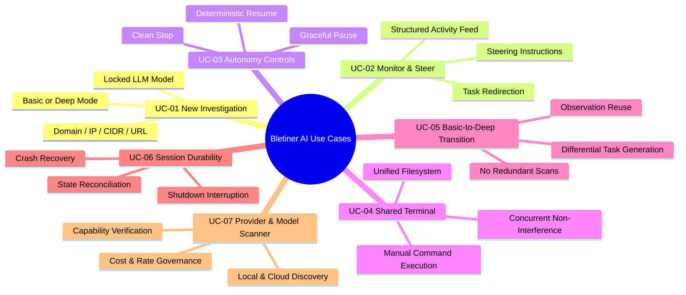
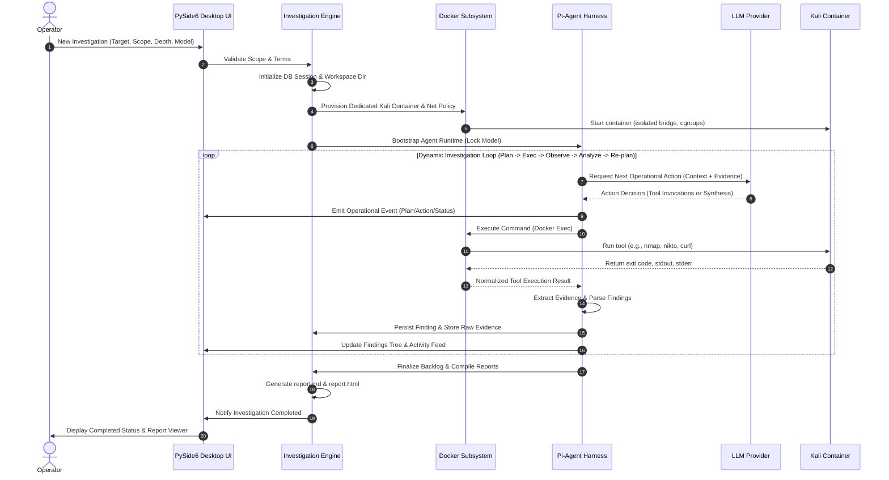
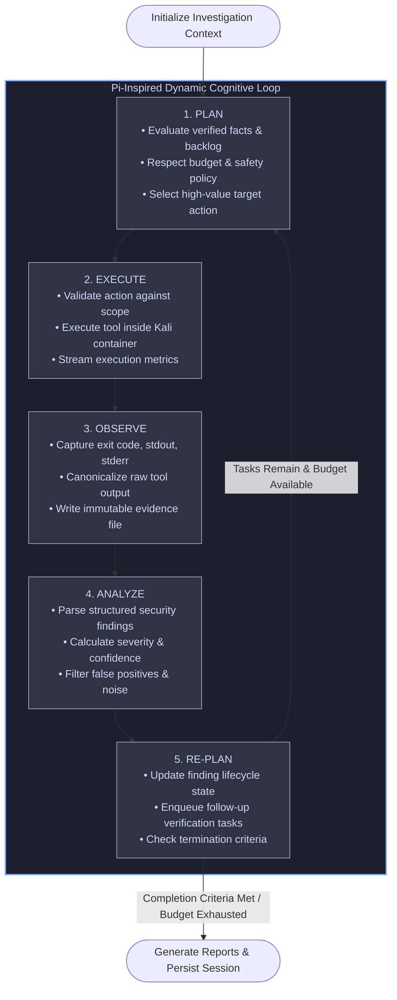
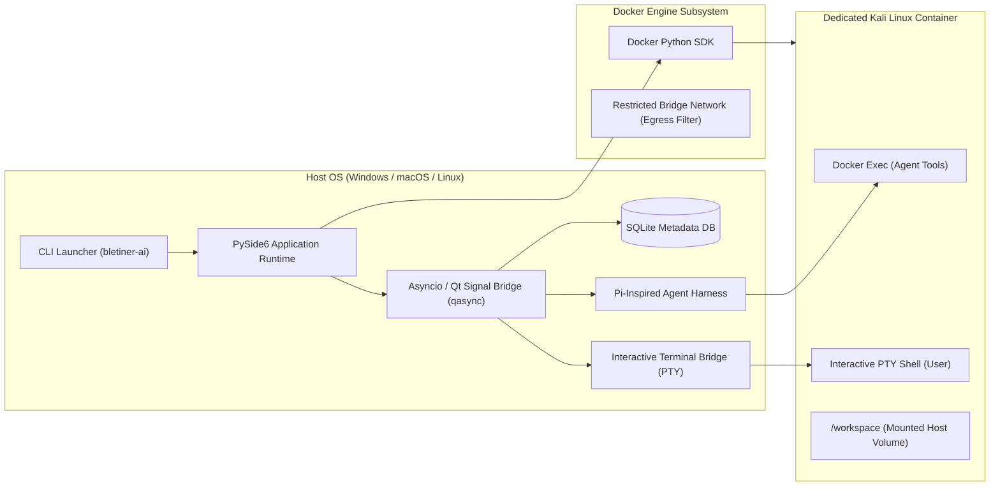
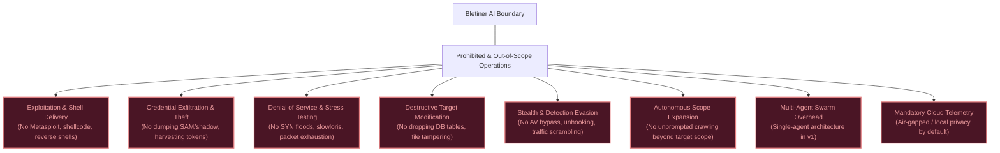

# 00 — Product Overview: Bletiner AI

> **Document ID:** DOC-00  
> **Version:** 1.0  
> **Status:** Confirmed Baseline Specification  
> **Last Updated:** 2026-11-11  
> **Target Audience:** Principal Architects, Systems Engineers, Security Engineers, Claude Code Implementation Agents

---

## Table of Contents

1. [Product Vision & Mission](#1-product-vision--mission)
2. [Target Users, Personas & Core Use Cases](#2-target-users-personas--core-use-cases)
3. [Core Investigation & Operational Workflows](#3-core-investigation--operational-workflows)
4. [Confirmed Product & Architectural Decisions](#4-confirmed-product--architectural-decisions)
5. [Explicit Out-of-Scope Capabilities](#5-explicit-out-of-scope-capabilities)
6. [Foundational Product Principles](#6-foundational-product-principles)
7. [Comprehensive Glossary of Terms](#7-comprehensive-glossary-of-terms)

---

## 1. Product Vision & Mission

### 1.1 Executive Summary

**Product Name:** Bletiner AI  
**Product Type:** Native desktop application for autonomous, authorized security investigation  
**Primary User Interface:** PySide6 (Qt for Python 6.6+) desktop application  
**Execution Environment:** Dedicated, per-investigation Kali Linux Docker container  
**Agent Architecture:** Single autonomous agent powered by a Pi-inspired modular harness  
**Primary Deliverables:** Structured, evidence-backed Markdown (`.md`) and standalone HTML (`.html`) investigation reports, accompanied by an organized repository of raw evidence artifacts.

Bletiner AI bridges the gap between manual penetration testing and traditional automated vulnerability scanners. Traditional vulnerability scanners execute rigid, predefined scan sequences that produce overwhelming noise, high false-positive ratios, and zero contextual correlation. Conversely, manual security assessments require immense cognitive overhead and meticulous record-keeping. 

Bletiner AI functions as an **autonomous security investigator** operating inside a strictly controlled, isolated sandbox. When a security professional configures an authorized target and explicit scope boundary, the agent autonomously formulates an investigation plan, conducts network and service reconnaissance, analyzes observations, validates suspected security flaws using non-destructive checks, collects cryptographically verified evidence, and synthesizes executive- and technical-level reports.

### 1.2 The Investigation Workspace Paradigm

Bletiner AI is emphatically **not a conversational chatbot**. It is an **interactive security investigation workspace** engineered for professional security operators:

- **Autonomous, Quiet Operation:** The agent does not narrate internal thoughts in conversational prose. It emits concise, structured operational events (e.g., *Service Discovered*, *Tool Executed*, *Finding Confirmed*).
- **Dual Execution Visibility:** Operators monitor agent progress through a real-time structured activity stream while retaining access to an interactive, shared Kali Linux terminal operating inside the same container.
- **Bi-Directional Human-in-the-Loop Control:** The operator maintains supreme control over the agent through non-destructive pause, resume, stop, and mid-flight steering capabilities.
- **Cryptographic Evidence Ledger:** Every confirmed vulnerability is tied directly to raw command outputs, network responses, and environmental artifacts stored on disk.
- **State Durability & Session Continuity:** Investigations survive application crashes, host restarts, and manual interruptions, allowing seamless state restoration without redundant scans.

---

## 2. Target Users, Personas & Core Use Cases

### 2.1 Target User Personas

| User Persona | Background & Technical Profile | Primary Objectives in Bletiner AI | Operational Constraints |
|---|---|---|---|
| **Authorized Penetration Tester** | Senior offensive security consultant, OSCP/CREST certified, deep command of Kali Linux tooling (Nmap, Nikto, ffuf, SQLMap, Nuclei). | Offload routine discovery and initial vulnerability verification; obtain structured, auditable evidence and pre-formatted report drafts. | Bound by strict contractual Rules of Engagement (RoE), client-defined scope limits, and strict testing time windows. Zero tolerance for out-of-scope traffic. |
| **Corporate Security Engineer (SecOps / AppSec)** | Internal defender evaluating corporate perimeter, internal lab environments, or microservice deployments. | Rapidly assess newly deployed infrastructure, validate external attack surfaces, identify misconfigurations before adversaries do. | Absolute requirement for non-destructive operations. Must not cause production service degradation or database corruption. |
| **Independent Security Researcher / Bug Hunter** | Security researcher operating under bug bounty policies (e.g., HackerOne, Bugcrowd). | Uncover deep multi-step configuration weaknesses, perform comprehensive sub-surface reconnaissance, generate high-signal reports. | Must prove explicit authorization; strictly bound by program scope policies (e.g., wildcard domain vs. single IP). |

### 2.2 Core Operational Use Cases



#### Detailed Use Case Specifications

- **UC-01: Launching a Scoped Autonomous Investigation**
  - *Trigger:* Operator initializes a new assessment via UI.
  - *Inputs:* Target identifier (FQDN, IPv4/IPv6, CIDR range, or URL), investigation depth (Basic vs. Deep), LLM provider and model selection.
  - *System Action:* Validates target format, verifies acceptance of Terms & Conditions, creates dedicated SQLite session record, scaffolds directory workspace, provisions dedicated Kali Docker container, locks model configuration, and initiates the autonomous investigation loop.
  - *Outcome:* Agent enters autonomous reconnaissance phase while UI displays container health and live activity.

- **UC-02: Live Operational Monitoring & Mid-Flight Steering**
  - *Trigger:* Operator observes an interesting service or path in the activity feed and wishes to refocus the agent.
  - *Inputs:* Plaintext steering instruction (e.g., *"Focus on verifying the TLS cipher suites and exposed administrative endpoints on port 8443; deprioritize port 80"*).
  - *System Action:* Harness intercepts instruction at the next agent iteration boundary, validates that the instruction does not expand scope or violate safety policy, injects steering payload into agent working context, logs steering event, and adjusts dynamic task backlog.
  - *Outcome:* Agent adjusts investigative plan without discarding previously collected observations or restarting reconnaissance.

- **UC-03: Investigation State Management (Pause, Resume, Stop)**
  - *Trigger:* Operator needs to pause testing during client freeze window, or stop after finding key objective.
  - *Actions:*
    - *Pause:* Agent finishes or cleanly signals current in-flight atomic tool, persists context to SQLite and JSON checkpoint, marks session `PAUSED`. User container terminal remains accessible.
    - *Resume:* Agent verifies container readiness, revalidates network scope, loads durable checkpoint, checks idempotency of queued tasks, and resumes agent loop.
    - *Stop:* Agent terminates active processes, finalizes finding backlog, generates partial report, marks session `STOPPED`.

- **UC-04: Shared Container Terminal Collaboration**
  - *Trigger:* Operator wishes to run a specialized manual verification command (e.g., `curl -v -k https://target/api`) alongside the agent.
  - *System Action:* PySide6 terminal widget attaches via secure local bridge to a dedicated PTY shell inside the investigation's Kali container.
  - *Outcome:* Operator inspects container filesystem (`/workspace`), reviews agent output files, and executes manual commands without conflicting with the agent's background Docker Exec executions.

- **UC-05: Progressive Investigation (Basic → Deep Continuation)**
  - *Trigger:* Basic investigation completes, revealing potential vulnerabilities that warrant deeper verification.
  - *System Action:* System presents option to "Upgrade to Deep Investigation". Upon selection, the existing session is preserved; previously verified findings, open ports, and service fingerprints are marked as validated baseline facts; new verification tasks are generated; redundant port scanning is skipped.
  - *Outcome:* A consolidated Deep Investigation report is generated, superseding the preliminary report.

- **UC-06: Crash & Shutdown Resiliency**
  - *Trigger:* Application process is terminated (OS shutdown, user quit, power failure).
  - *System Action:* On next launch, SQLite audit identifies sessions left in `RUNNING` or `PAUSING` state, reconciles container existence with Docker daemon, marks session as `INTERRUPTED_BY_SHUTDOWN`, and presents "Resume Session" control.
  - *Outcome:* Zero data loss for completed tool executions and recorded findings.

---

## 3. Core Investigation & Operational Workflows

### 3.1 End-to-End Investigation Workflow

The end-to-end investigation lifecycle proceeds through 15 rigorous stages:



### 3.2 The Dynamic Agent Loop: Plan → Execute → Observe → Analyze → Re-plan

Unlike naive sequential automation scripts, Bletiner AI employs a cognitive cybernetic feedback loop. The agent evaluates environmental feedback at every step before selecting subsequent actions:



### 3.3 Investigation Depth Characteristics: Basic vs. Deep

The system provides two distinct, carefully calibrated investigation profiles:

| Operational Dimension | Basic Investigation Mode | Deep Investigation Mode |
|---|---|---|
| **Primary Objective** | Rapid perimeter mapping, service identification, and preliminary non-intrusive hygiene checks. | Comprehensive attack-surface enumeration, cross-service correlation, and rigorous non-destructive verification. |
| **Reconnaissance Depth** | Top 1000 common TCP ports, DNS record enumeration, HTTP banner grab, TLS certificate extraction. | Full TCP port spectrum (or user-defined custom ports), targeted UDP scanning, sub-resource discovery, directory indexing. |
| **Finding Validation** | Single-pass heuristic validation; marks unconfirmed anomalies as `NEEDS_TRIAGE` or `INCONCLUSIVE`. | Multi-pass cross-verification (e.g., verifying web vulnerability via multiple distinct tool signatures); eliminates false positives. |
| **Target Budget (Default)** | 50 iterations / 30 minutes / Max $2.00 LLM token budget. | 250 iterations / 180 minutes / Max $10.00 LLM token budget. |
| **Report Deliverable** | Preliminary Security Assessment Report (Focus on immediate surface exposure). | Comprehensive In-Depth Security Assessment Report (Full vulnerability narratives, remediation guidance, reproduction steps). |
| **Continuation Path** | Seamlessly upgradable to Deep mode with 100% preservation of verified assets and evidence. | Terminal depth mode; may be steered manually for specific follow-ups. |

---

## 4. Confirmed Product & Architectural Decisions

The following architectural decisions are confirmed requirements derived from the master product mandate. They establish the invariant technical foundation of Bletiner AI:

### 4.1 Technology Stack & Desktop Foundations



- **Python Core:** Built entirely in modern Python (Python 3.11+). Leverages strict typing (`typing.Protocol`, Pydantic v2 schemas) for all data boundaries.
- **PySide6 Desktop UI:** Native desktop UI implemented in PySide6 (Qt 6.6+). Long-running operations, network I/O, and LLM polling are strictly decoupled from the Qt GUI thread via `qasync` / worker threads and Qt signals/slots.
- **Pi-Inspired Harness Architecture:** The agent execution framework adopts proven architectural patterns from modern autonomous harnesses: strict separation of loop state, immutable message histories, tool lifecycle contracts, dynamic steering injection, and durable checkpoint serialization. No third-party agent code is copied; all concepts are implemented independently.
- **Per-Investigation Kali Container:** Every investigation session provisions an isolated, dedicated Kali Linux Docker container. No target testing is ever executed directly on the host operating system.
- **Durable Local Storage:** SQLite (configured with Write-Ahead Logging `WAL` mode) acts as the central relational store for session history, task logs, findings, and provider configurations. Raw evidence artifacts and reports are persisted on the local filesystem.

### 4.2 Security, Isolation & Sandboxing Architecture

- **Dedicated Sandbox Isolation:** One investigation = One independent Kali Linux container = One distinct disk workspace. Containers share neither filesystem namespaces nor IPC.
- **Zero Host-Docker Socket Mounts:** The host Docker socket (`/var/run/docker.sock` or `//./pipe/docker_engine`) is strictly forbidden from being mounted into any Kali container. Containers possess zero container-orchestration capabilities.
- **Non-Privileged Execution:** Kali containers run without `--privileged` flags. Linux capabilities are explicitly dropped, retaining only minimal essential networking capabilities (`CAP_NET_RAW` for SYN scanning).
- **Infrastructure-Enforced Network Egress:** Network scope boundaries are enforced by host-level Docker network drivers and iptables/nftables egress firewalls, not merely by LLM system prompts. Out-of-scope RFC 1918 private subnets, cloud metadata endpoints (169.254.169.254), and loopback interfaces are blocked by default.
- **Model Locking:** When an investigation session begins, the selected LLM provider, model ID, temperature, and capability profile are permanently locked to that session to guarantee investigative consistency. Changing models on a resumed session requires explicit operator authorization and creates a permanent audit record.
- **Zero-Plaintext Credential Storage:** API keys, access tokens, and sensitive target credentials are never stored in plaintext within SQLite, report files, session logs, or event streams. The application utilizes the OS-native credential vault (Windows Credential Manager, macOS Keychain, Linux Secret Service via `keyring`).

### 4.3 Data and Artifact Storage Layout

Every investigation session is allocated an isolated directory structure within the local Bletiner application directory:

```text
~/.bletiner/ (or C:\Users\<User>\.bletiner\)
├── config/
│   ├── app_settings.json
│   └── providers.json (non-sensitive configuration)
├── database/
│   └── bletiner_master.db (SQLite WAL mode)
└── investigations/
    └── <investigation_uuid>/
        ├── metadata.json           <- Canonical session definition & scope lock
        ├── workspace/              <- Container volume mount (/workspace)
        │   ├── scans/              <- Raw tool output files (nmap XML, etc.)
        │   └── scripts/            <- Execution scripts generated by agent
        ├── evidence/               <- Immutable evidence artifacts & hashes
        │   ├── EV-001_port80_http.txt
        │   └── EV-002_ssl_cert.pem
        ├── findings/               <- Finding JSON records (synced with DB)
        │   ├── FND-001.json
        │   └── FND-002.json
        ├── checkpoints/            <- Durable agent state snapshots
        │   ├── step_00012.json
        │   └── latest.json
        ├── logs/                   <- Auditable execution & terminal logs
        │   ├── agent_events.jsonl
        │   ├── container_exec.log
        │   └── user_terminal.log
        └── reports/                <- Final and interim generated deliverables
            ├── report.md
            └── report.html
```

---

## 5. Explicit Out-of-Scope Capabilities

To ensure absolute legal safety, operational reliability, and architectural clarity, the following capabilities are explicitly classified as **OUT OF SCOPE** for Bletiner AI:



1. **Active Exploitation & Weaponized Payload Delivery:** Bletiner AI is an investigative vulnerability discovery tool, not an exploit framework. It does not generate reverse shells, deploy post-exploitation agents, inject binary shellcode, or compromise host control.
2. **Denial-of-Service (DoS) & Service Exhaustion:** The agent is strictly forbidden from executing packet flooding, connection exhaustion, memory exhaustion, or high-concurrency fuzzing that risks target service unavailability.
3. **Target Data Tampering & Destruction:** The agent will never modify database records, inject destructive SQL payloads (`DROP`, `DELETE`, `UPDATE`), alter remote files, or overwrite application configurations.
4. **Credential Harvesting & Account Takeover:** Automated brute-force password spraying, dictionary attacks against production authentication endpoints, and session hijacking are prohibited in the autonomous loop.
5. **Detection Evasion & Anti-Forensic Techniques:** The system makes no attempt to disguise user agents to spoof legitimate browsers maliciously, alter packet headers for evasion, disable remote logging, or clear remote audit trails.
6. **Unprompted Scope Expansion:** The agent cannot autonomously decide to scan related third-party domains, CDN edge infrastructure, cloud tenant neighbors, or resolved external IP addresses without explicit human verification and scope amendment.
7. **Multi-Agent Swarm Complexity in v1:** A single deterministic agent with modular internal sub-components is utilized. Multi-agent negotiation protocols, peer swarms, and decentralized debate mechanisms are excluded from v1 to ensure absolute auditability and deterministic debugging.
8. **Cloud Telemetry & External Data Exfiltration:** No telemetry, scan data, target identifiers, or findings are ever transmitted to Bletiner servers or third parties (excluding direct LLM API queries directed to user-configured providers).

---

## 6. Foundational Product Principles

Every architectural choice, pull request, and prompt design must adhere to these ten non-negotiable principles:

- **P1 — Authorized Testing as a Hard Prerequisite:** The application enforces explicit Terms & Conditions acceptance and target authorization confirmation before permitting any investigative action.
- **P2 — Non-Destructive by Default:** All scanning and validation logic adheres to benign, safe verification standards. If a vulnerability cannot be validated safely without risk of data loss or service downtime, the agent flags it as `NEEDS_MANUAL_TRIAGE` rather than risking operational damage.
- **P3 — Operational Transparency Over Chatty Prose:** The user interface reflects reality: raw tool executions, exact command strings, parsed outputs, and structured findings. Internal LLM chain-of-thought is never exposed as conversational chatter; structured events provide total auditability.
- **P4 — Rigid Sandboxing & Isolation:** The host machine is sacred. Target execution happens solely within isolated Docker containers. A compromise or error within the container cannot escape to the operator's host machine.
- **P5 — Infrastructure-Enforced Policy:** Security guardrails are never delegated solely to LLM prompt adherence. Scope validation, IP filtering, and resource limits are hard-coded into the container and Python service architecture.
- **P6 — Verifiable, Evidence-Backed Findings:** A finding does not exist without corroborating raw evidence. Every finding links to an immutable artifact file and records the exact command, execution timestamp, and reproduction steps.
- **P7 — Resilient State & Idempotency:** The agent assumes interruptions will occur. Sessions can be paused, resumed, and recovered from crashes. Tool executions must be idempotent, preventing redundant re-execution of completed work.
- **P8 — Model Agnostic & Session Locked:** The architecture treats LLMs as interchangeable inference engines via a uniform adapter interface. Once an investigation starts, its model parameters are locked to maintain assessment reproducibility.
- **P9 — Lean, Auditable Dependencies:** Avoid unnecessary frameworks, heavyweight ORMs, or experimental libraries. Use the standard library, PySide6, Docker SDK, Pydantic, and SQLite for maximum stability and security auditing ease.
- **P10 — Zero-Trust Toward Untrusted Data:** Web banners, HTTP response bodies, DNS records, and tool outputs are hostile data sources. The agent treats all external inputs as untrusted data to prevent prompt injection and cross-site scripting (XSS) in generated reports.

---

## 7. Comprehensive Glossary of Terms

| Term | Category | Authoritative Definition in Bletiner AI |
|---|---|---|
| **Agent Harness** | Architecture | The runtime infrastructure that manages the cognitive agent loop, message history, tool lifecycle, context window limits, event streaming, and checkpointing. |
| **Basic Investigation** | Workflow | An investigation mode focused on perimeter reconnaissance, service discovery, and non-intrusive hygiene checks, bound by tight iteration and time budgets. |
| **Checkpoint** | Data Model | A serialized JSON and SQLite snapshot representing the exact state of the agent's task queue, context window, and findings at a specific iteration. |
| **Deep Investigation** | Workflow | An exhaustive investigation mode that conducts deep surface enumeration, cross-service correlation, and thorough non-destructive vulnerability verification. |
| **Docker Exec Session** | Infrastructure | A non-interactive background process spawned inside the Kali container via the Docker API to execute specific agent tools with captured I/O streams. |
| **Evidence Artifact** | Security / Data | An immutable raw file (command output, packet capture, response body, TLS certificate) stored on disk and linked cryptographically to a Finding. |
| **Finding** | Security Model | A detected security weakness, misconfiguration, or vulnerability, characterized by structured metadata, severity, confidence, and evidence links. |
| **Finding Confidence** | Security Model | A graduated metric (CERTAIN, FIRM, TENTATIVE) representing the empirical certainty that a finding is a genuine vulnerability and not a false positive. |
| **Finding Severity** | Security Model | An impact rating (CRITICAL, HIGH, MEDIUM, LOW, INFORMATIONAL) based on industry-standard CVSS v3.1 scoring guidelines. |
| **Interactive Terminal Bridge** | Desktop UI | The secure WebSocket / IPC PTY bridge connecting the PySide6 UI terminal widget to an interactive Bash shell inside the dedicated Kali container. |
| **Investigation** | Domain | A complete, bounded security assessment against a specific authorized target, possessing its own container, workspace, database record, and reports. |
| **Model Discovery Scanner**| LLM Subsystem | An asynchronous engine that queries local (Ollama, LM Studio) and remote (OpenAI, Anthropic) endpoints to inventory available models and test capabilities. |
| **Model Locking** | LLM Subsystem | The architectural constraint pinning an investigation session to a specific LLM provider, model ID, and parameter profile for its entire lifecycle. |
| **Network Scope** | Security Policy | The formal definition of authorized network destinations (FQDNs, IP addresses, CIDR ranges, URL paths) permitted for network interaction. |
| **Non-Destructive Policy**| Security Policy | The mandatory rule restricting tool execution to passive observation, non-payload probing, and benign verification techniques. |
| **Pi-Inspired Harness** | Architecture | An agent loop architecture inspired by the modular concepts of the Pi agent system: event streaming, interruptibility, steering, and durable sessions. |
| **Prompt Injection Defense**| Security Policy | Architectural controls (structured delimiters, input isolation, system prompt priority) designed to prevent target data from hijacking agent behavior. |
| **PySide6** | Technology | The official Qt 6 Python binding utilized to render the native, multi-panel desktop user interface. |
| **qasync** | Technology | The integration library synchronizing Python's asynchronous `asyncio` event loop with Qt's native C++ event loop on the main GUI thread. |
| **Report (Markdown / HTML)**| Deliverable | Self-contained executive and technical documentation compiled from the structured SQLite finding database and raw evidence files. |
| **Scope Expansion** | Security Policy | Any modification or addition to the approved target boundaries. Requires explicit human confirmation; cannot be triggered autonomously. |
| **Session State** | Data Model | The lifecycle status of an investigation (`DRAFT`, `RUNNING`, `PAUSING`, `PAUSED`, `RESUMING`, `STOPPED`, `COMPLETED`, `FAILED`). |
| **Steering Instruction** | User Control | A dynamic prompt injected by the human operator into the agent loop to alter investigative priorities without invalidating established context. |
| **Tool Registry** | Architecture | The declarative catalog defining all available Kali Linux tools, including their CLI invocation schemas, risk ratings, and output parsers. |
| **Untrusted Data Boundary**| Security Policy | The demarcation line between internal application state and data retrieved from the target network or third-party APIs. |
| **Workspace** | Storage | The dedicated filesystem directory allocated to a single investigation, containing its logs, scans, evidence, checkpoints, and reports. |

---

*End of Document 00 — Product Overview.*