# 02 — System Architecture

> **Status:** Proposed — architectural specification for implementation.  
> **Version:** 3.1.0 (Revision 3.1: Technical Routing & ECH Stripping Corrections Applied)  
> **Target Audience:** Claude Code / Engineering Team  
> **Last Updated:** 2026-11-11  

---

## Table of Contents

1. [Executive Summary & Architectural Principles](#1-executive-summary--architectural-principles)
2. [System Context](#2-system-context)
3. [Container & Deployment Architecture](#3-container--deployment-architecture)
   - [3.1 Host & Container Topology](#31-host--container-topology)
   - [3.2 Host-Side Route Injection for Zero-CAP_NET_ADMIN Kali](#32-host-side-route-injection-for-zero-cap_net_admin-kali)
   - [3.3 Dual-Homed Gateway & Network Isolation Topology](#33-dual-homed-gateway--network-isolation-topology)
   - [3.4 DNS HTTPS/SVCB Record Stripping to Counter TLS ECH](#34-dns-httpssvcb-record-stripping-to-counter-tls-ech)
   - [3.5 Cross-Platform Network Reality: Windows Docker Desktop (WSL2), Linux, and macOS](#35-cross-platform-network-reality-windows-docker-desktop-wsl2-linux-and-macos)
4. [Component Architecture & Decomposition](#4-component-architecture--decomposition)
5. [Runtime Architecture & Concurrency Model](#5-runtime-architecture--concurrency-model)
   - [5.1 The PySide6 UI Thread & asyncio Integration (qasync)](#51-the-pyside6-ui-thread--asyncio-integration-qasync)
   - [5.2 Concurrency Model: Agent, Docker & Interactive Terminal](#52-concurrency-model-agent-docker--interactive-terminal)
   - [5.3 Signal / Slot and Reactive Event Architecture](#53-signal--slot-and-reactive-event-architecture)
6. [Trust Boundaries & Threat Surface Mapping](#6-trust-boundaries--threat-surface-mapping)
   - [6.1 Trust Boundary Definitions](#61-trust-boundary-definitions)
   - [6.2 Zero-Trust Kali Capabilities & Ambient Capabilities Inheritance](#62-zero-trust-kali-capabilities--ambient-capabilities-inheritance)
   - [6.3 Two-Tier TLS Redirect Enforcement Architecture](#63-two-tier-tls-redirect-enforcement-architecture)
7. [End-to-End Data Flows](#7-end-to-end-data-flows)
   - [7.1 Investigation Lifecycle & Autonomous Loop Flow](#71-investigation-lifecycle--autonomous-loop-flow)
   - [7.2 Human-in-the-Loop Steering Flow](#72-human-in-the-loop-steering-flow)
   - [7.3 Graceful Exit, Checkpointing & Recovery Flow](#73-graceful-exit-checkpointing--recovery-flow)
8. [Subsystem Boundaries & Protocol Contracts (Sections 4.1–4.10)](#8-subsystem-boundaries--protocol-contracts-sections-41410)
   - [8.1 Presentation Layer Protocol Contracts (§4.1)](#81-presentation-layer-protocol-contracts-41)
   - [8.2 Application & Service Layer Contracts (§4.2)](#82-application--service-layer-contracts-42)
   - [8.3 Agent Harness Contracts (§4.3 — Pi-Inspired)](#83-agent-harness-contracts-43--pi-inspired)
   - [8.4 Tool System Contracts (§4.4 — 4-Tier Risk Classification)](#84-tool-system-contracts-44--4-tier-risk-classification)
   - [8.5 Docker & Container Subsystem Contracts (§4.5)](#85-docker--container-subsystem-contracts-45)
   - [8.6 Scope & Network Enforcement Contracts (§4.6)](#86-scope--network-enforcement-contracts-46)
   - [8.7 Session Persistence & Checkpointing Contracts (§4.7)](#87-session-persistence--checkpointing-contracts-47)
   - [8.8 Provider & Model Management Contracts (§4.8 — pi-ai)](#88-provider--model-management-contracts-48--pi-ai)
   - [8.9 Findings & Prioritization Contracts (§4.9)](#89-findings--prioritization-contracts-49)
   - [8.10 Reporting Subsystem Contracts (§4.10)](#810-reporting-subsystem-contracts-410)
9. [Key Design Decisions & Technical Trade-offs](#9-key-design-decisions--technical-trade-offs)
10. [Architecture Decision Records (ADRs)](#10-architecture-decision-records-adrs)
    - [ADR-001: Use qasync for Qt + asyncio Integration](#adr-001-use-qasync-for-qt--asyncio-integration)
    - [ADR-002: Dedicated Kali Linux Container per Investigation Session](#adr-002-dedicated-kali-linux-container-per-investigation-session)
    - [ADR-003: Terminal Emulation via Qt WebEngineView and xterm.js](#adr-003-terminal-emulation-via-qt-webengineview-and-xtermjs)
    - [ADR-004: Single-Agent Pi-Inspired Harness Architecture](#adr-004-single-agent-pi-inspired-harness-architecture)
    - [ADR-005: SQLite WAL Mode + Atomic Filesystem Checkpoints](#adr-005-sqlite-wal-mode--atomic-filesystem-checkpoints)
    - [ADR-006: OS Keyring for Secret Storage](#adr-006-os-keyring-for-secret-storage)
    - [ADR-007: Cooperative Shutdown with Grace Period & Escalation](#adr-007-cooperative-shutdown-with-grace-period--escalation)
    - [ADR-008: Basic-to-Deep Investigation Continuation](#adr-008-basic-to-deep-investigation-continuation)
    - [ADR-009: Dual-Homed Gateway Container vs Container-Namespace Sharing](#adr-009-dual-homed-gateway-container-vs-container-namespace-sharing)
    - [ADR-010: Zero-Trust Kali Capabilities & Gateway-Enforced Firewalling](#adr-010-zero-trust-kali-capabilities--gateway-enforced-firewalling)
    - [ADR-011: Deferring Host-Level MCP Execution in v1](#adr-011-deferring-host-level-mcp-execution-in-v1)
    - [ADR-012: SNI & Host Header Egress Validation for Multi-Tenant CDNs](#adr-012-sni--host-header-egress-validation-for-multi-tenant-cdns)
    - [ADR-013: Ambient Capabilities vs File Capabilities under no_new_privs](#adr-013-ambient-capabilities-vs-file-capabilities-under-no_new_privs)
    - [ADR-014: Two-Tier Redirect Validation (Client Hook + Gateway SNI) vs TLS MITM](#adr-014-two-tier-redirect-validation-client-hook--gateway-sni-vs-tls-mitm)
    - [ADR-015: 4-Tier Tool Risk Classification & Autonomous Scheduling Boundaries](#adr-015-4-tier-tool-risk-classification--autonomous-scheduling-boundaries)
    - [ADR-016: Host-Side Route Injection for Zero-CAP_NET_ADMIN Kali Sandbox](#adr-016-host-side-route-injection-for-zero-cap_net_admin-kali-sandbox)
    - [ADR-017: DNS HTTPS/SVCB Record Stripping to Counter TLS ECH SNI Encryption](#adr-017-dns-httpssvcb-record-stripping-to-counter-tls-ech-sni-encryption)
    - [ADR-018: Separation of Domain SNI Gateway Proxying from Dedicated IP Raw Forwarding](#adr-018-separation-of-domain-sni-gateway-proxying-from-dedicated-ip-raw-forwarding)
    - [ADR-019: Finding Prioritization Composite Scoring Engine](#adr-019-finding-prioritization-composite-scoring-engine)
    - [ADR-020: Model-Locking per Investigation Session](#adr-020-model-locking-per-investigation-session)

---

## 1. Executive Summary & Architectural Principles

**Bletiner AI** is an autonomous security-investigation desktop workbench designed for authorized, non-destructive security reconnaissance, service discovery, and vulnerability validation. The application operates quietly, executing dynamic investigation loops without conversational verbosity, while providing complete transparency, deterministic human steering, and absolute containment.

### Core Architectural Principles

1. **Non-Destructive by Construction:** The agent loop, tool schemas, and safety filters disallow intrusive exploits, destructive denial-of-service tests, credential theft, persistence, or data exfiltration.
2. **Infrastructure-Enforced Fail-Closed Boundaries:** Security boundaries (such as network scope and container containment) are enforced at the Linux network layer via dual-homed bridge networks and transparent gateways rather than relying solely on voluntary proxy environment variables or LLM prompting.
3. **Single Intelligent Agent with Modular Subsystems:** To maximize determinism, avoid multi-agent consensus deadlocks, and control token budgets, v1 implements a single agent runtime coordinating decoupled service protocols (extracting and adapting the **Earendil Works Pi harness** architecture).
4. **Cooperative Asynchronous UI:** The PySide6 desktop interface remains at a consistent 60 FPS. All network I/O, LLM streaming, Docker interactions, and database transactions execute asynchronously on a unified event loop via `qasync`.
5. **Durable State Across Sudden Restarts:** The ephemeral nature of container execution is paired with transactional SQLite metadata and atomic filesystem checkpoints. Any investigation can be resumed seamlessly after power failure or application termination.
6. **Zero-Trust Input Sanitization:** Data ingested from target banners, web servers, tool outputs, and LLM text completions are classified as untrusted data. They are sanitized before rendering in Qt views or compiling into HTML reports.

---

## 2. System Context

The System Context diagram defines the boundaries of Bletiner AI relative to human analysts, operating system services, Docker virtualization, remote LLM inference engines, and external target networks.

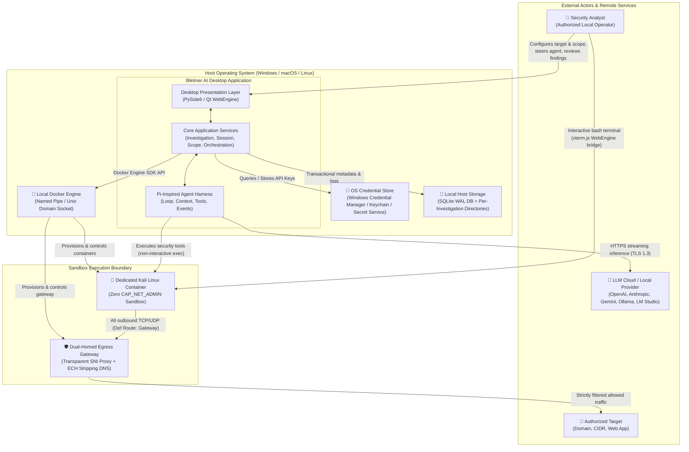

---

## 3. Container & Deployment Architecture

### 3.1 Host & Container Topology

Bletiner AI runs as a single unprivileged desktop client process on the host operating system that dynamically controls the Docker Engine to provision isolated container sandboxes.

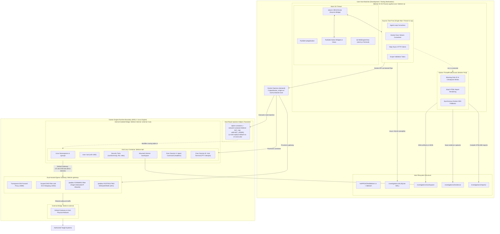

### 3.2 Host-Side Route Injection for Zero-CAP_NET_ADMIN Kali

To prevent compromise, the Kali container is configured with `cap_drop=['ALL']` and has **zero `CAP_NET_ADMIN`**. It cannot modify its own network routing.

To establish `172.30.0.254` (the gateway container) as Kali's default gateway without granting Kali network administration privileges:
1. The host Docker orchestration daemon provisions `bletiner-kali-<id>` on `bletiner-internal-<id>`.
2. Immediately before starting any tool or interactive session, the host launches a transient helper container attached directly to Kali's network namespace:
   ```bash
   docker run --rm \
     --network=container:bletiner-kali-<id> \
     --cap-add=NET_ADMIN \
     alpine ip route replace default via 172.30.0.254
   ```
3. The helper container replaces the kernel routing table inside Kali's network namespace from the outside and exits in <50ms.
4. Kali itself is launched with `user: kali` and `no_new_privs: true`, completely devoid of `CAP_NET_ADMIN` throughout its entire operational lifecycle.

### 3.3 Dual-Homed Gateway & Network Isolation Topology

Because proxy environment variables (`HTTP_PROXY`, `ALL_PROXY`) are voluntary conventions that raw sockets, Nmap, and low-level tools easily bypass, Bletiner AI enforces network containment at the **Linux kernel network layer**:

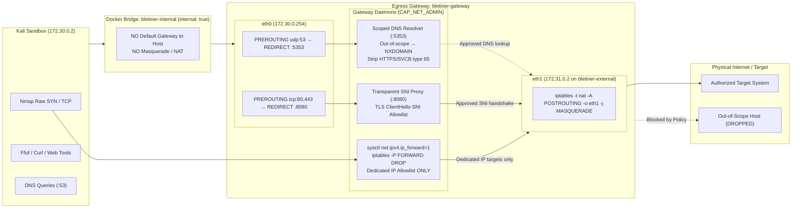

#### Gateway Invariants:
1. **`internal: true` Bridge:** The `bletiner-internal` network is created with Docker's `internal: true` flag. Docker disables default NAT/masquerade; no container on this bridge can reach the internet directly.
2. **Explicit Default Route:** Kali's default gateway is set to `172.30.0.254` via the host route injection helper.
3. **Transparent Interception:**
   - TCP port 80 and 443 packets are redirected by iptables `PREROUTING` into the transparent SNI proxy on port 8080.
   - UDP port 53 DNS queries are redirected into the scoped DNS resolver on port 5353. Direct DNS queries to external resolvers (e.g. `8.8.8.8`) are intercepted.
   - **Separation of Domain Targets vs Dedicated IP Targets:**
     - For domain targets (e.g. `example.com`), raw IP forwarding in the gateway iptables is **strictly disabled** (`FORWARD DROP`). Traffic flows exclusively through the transparent SNI proxy to prevent collateral access to unrelated co-hosted tenants on multi-tenant CDNs.
     - For explicitly authorized IP/CIDR targets (e.g. `192.0.2.10`), explicit `FORWARD` rules are provisioned for those specific destination IPs and authorized ports.
4. **IPv6 Disabled:** Outbound IPv6 is disabled in the gateway (`net.ipv6.conf.all.disable_ipv6=1`) to eliminate IPv6 bypass channels.
5. **Fail-Closed:** If `bletiner-gateway` terminates, all outbound traffic from Kali immediately ceases.

### 3.4 DNS HTTPS/SVCB Record Stripping to Counter TLS ECH

TLS Encrypted Client Hello (ECH) encrypts the SNI extension using public keys distributed in DNS **HTTPS (Resource Record Type 65)** or **SVCB** records. If ECH is active, the transparent gateway proxy cannot inspect the plaintext domain name in the TLS `ClientHello`, creating a scope escape vulnerability.

**Mitigation:** The gateway's scoped DNS resolver (listening on port 5353) actively filters and **strips all DNS HTTPS (type 65) and SVCB records** from DNS query responses. This transparently forces modern TLS clients (curl, browsers, Python httpx) to fall back to standard TLS 1.3 with a plaintext SNI extension, ensuring 100% deterministic domain validation without breaking target connectivity.

### 3.5 Cross-Platform Network Reality: Windows Docker Desktop (WSL2), Linux, and macOS

A critical architectural consideration for desktop deployment is that Windows Docker Desktop operates inside a Linux virtual machine (WSL2 backend). Therefore:
- **No Host Windows iptables:** Host Windows packet filters (`Windows Filtering Platform` / `netsh advfirewall`) cannot inspect or filter Docker bridge container traffic inside the WSL2 Linux VM.
- **Portable Containerized Solution:** By implementing egress filtering entirely within containerized Docker networks (`bletiner-internal` + `bletiner-gateway`), Bletiner AI functions identically and portably across **Windows 10/11 (WSL2)**, **macOS (Docker Desktop Linux VM)**, and **native Linux** without requiring elevated host firewall permissions.

---

## 4. Component Architecture & Decomposition

The system is decomposed into 11 decoupled subsystems mapping directly to the product requirements and the Earendil Works Pi harness architecture.

```mermaid
flowchart TD
    subgraph Layer1_Presentation["1. Presentation Layer (§4.1)"]
        UI_MainWindow["MainWindow (QMainWindow)"]
        UI_LeftPanel["Activity & Findings Panel"]
        UI_CenterPanel["Terminal & Steering Panel (xterm.js)"]
        UI_RightPanel["Sessions & Documents Panel"]
        UI_Settings["Settings & Provider Discovery Dialog"]
        UI_Terms["First-Run Terms & Scope Approval Dialog"]
        UI_ViewModels["ViewModels / Presenters (Observable Models)"]
    end

    subgraph Layer2_AppServices["2. Application & Orchestration Layer (§4.2)"]
        Svc_Invest["InvestigationService"]
        Svc_Session["SessionService"]
        Svc_Container["ContainerLifecycleService"]
        Svc_AgentOrch["AgentOrchestrationService"]
        Svc_Provider["ProviderManagementService"]
        Svc_Findings["FindingsService"]
        Svc_Report["ReportService"]
        Svc_Settings["SettingsService (Keyring Bridge)"]
        Svc_Scope["ScopeService"]
    end

    subgraph Layer3_AgentCore["3. Agent Harness Layer (§4.3 — Pi-Inspired)"]
        Agent_Loop["AgentLoop (Plan → Execute → Observe → Analyze)"]
        Agent_Context["ContextManager (Token Window & History)"]
        Agent_EventStream["EventStream (Structured Operational Telemetry)"]
        Agent_Steering["SteeringController (Safe Instruction Injection)"]
        Agent_Budget["BudgetEnforcer (Max Tokens / Time / Invocations)"]
    end

    subgraph Layer4_ToolSubsystem["4. Tool System Layer (§4.4 — 4-Tier Risk)"]
        Tool_Registry["ToolRegistry (4-Tier Risk Classification)"]
        Tool_Executor["ToolExecutor (Timeout & Execution Nonces)"]
        Tool_Parser["ToolResultParser (Observation Normalization)"]
    end

    subgraph Layer5_DockerSubsystem["5. Docker Subsystem Layer (§4.5)"]
        Docker_Manager["DockerManager (aiodocker SDK Wrapper)"]
        Docker_ExecBridge["ExecSessionManager (Agent Headless Exec)"]
        Docker_TermBridge["TerminalBridge (WebSocket / PTY Multiplexer)"]
        Docker_Health["HealthMonitor (Memory / CPU limits)"]
    end

    subgraph Layer6_ScopeEnforcement["6. Scope & Network Enforcement Layer (§4.6)"]
        Scope_Parser["ScopeParser (Domain, IP, CIDR, URL)"]
        Scope_Validator["ScopeValidator (Private IP / Metadata Filter)"]
        Scope_DNS["DNSResolver (Rebinding Protection, Pinning)"]
    end

    subgraph Layer7_InfraGateway["7. Infrastructure Gateway Subsystem"]
        Gateway_Mgr["GatewayManager (Dual-Homed Network Provisioner)"]
        Gateway_RouteInject["RouteInjector (Host-Side Netns Route Helper)"]
        Gateway_SNI["SNIProxy (Transparent TLS SNI & Host Header Filter)"]
        Gateway_DNS["DNSFilter (Scoped DNS with ECH Stripping)"]
        Gateway_IPTables["IPTablesManager (Forwarding & Redirect Chains)"]
    end

    subgraph Layer8_ProviderSubsystem["8. Provider & Model Subsystem Layer (§4.8 — pi-ai)"]
        Prov_Registry["ProviderRegistry"]
        Prov_Adapters["ProviderAdapters (OpenAI, Anthropic, Gemini, Ollama, etc.)"]
        Prov_Scanner["ModelDiscoveryScanner"]
        Prov_Prober["CapabilityProber (Tool Calling, Streaming, JSON)"]
    end

    subgraph Layer9_FindingsReport["9. Findings & Reporting Layer (§4.9 & §4.10)"]
        Find_Store["FindingStore & Deduplicator"]
        Find_Prioritizer["PrioritizationEngine (Composite Scoring)"]
        Rep_Markdown["MarkdownReportGenerator"]
        Rep_HTML["HTMLReportGenerator (Safe Jinja2 Sanitizer)"]
    end

    subgraph Layer10_Persistence["10. Persistence & Storage Layer (§4.7)"]
        DB_Repo["DatabaseRepository (SQLite WAL with aiosqlite)"]
        Store_Artifact["ArtifactStore (Filesystem Trees & Checksums)"]
        Store_Checkpoint["CheckpointManager (Atomic JSON Dumps)"]
    end

    %% Dependencies
    Layer1_Presentation --> Layer2_AppServices
    UI_ViewModels <--> Svc_Invest
    UI_ViewModels <--> Svc_Findings
    UI_ViewModels <--> Svc_Session
    UI_ViewModels <--> Svc_AgentOrch
    UI_CenterPanel <--> Docker_TermBridge

    Svc_Invest --> Svc_Scope
    Svc_Invest --> Svc_Container
    Svc_Invest --> Svc_AgentOrch
    Svc_Invest --> Svc_Session
    Svc_AgentOrch --> Agent_Loop
    
    Agent_Loop --> Agent_Context
    Agent_Loop --> Agent_EventStream
    Agent_Loop --> Agent_Steering
    Agent_Loop --> Agent_Budget
    Agent_Loop --> Tool_Registry
    Agent_Loop --> Prov_Registry

    Tool_Registry --> Tool_Executor
    Tool_Executor --> Docker_ExecBridge
    Docker_ExecBridge --> Docker_Manager
    Docker_TermBridge --> Docker_Manager
    
    Svc_Container --> Docker_Manager
    Svc_Container --> Gateway_Mgr
    Gateway_Mgr --> Gateway_RouteInject
    Gateway_Mgr --> Gateway_SNI
    Gateway_Mgr --> Gateway_DNS
    Gateway_Mgr --> Gateway_IPTables
    Svc_Scope --> Scope_Parser
    Svc_Scope --> Scope_Validator
    Svc_Scope --> Scope_DNS

    Prov_Registry --> Prov_Adapters
    Svc_Provider --> Prov_Scanner
    Prov_Scanner --> Prov_Prober

    Svc_Findings --> Find_Store
    Find_Store --> Find_Prioritizer
    Svc_Report --> Rep_Markdown
    Svc_Report --> Rep_HTML

    Svc_Session --> DB_Repo
    Svc_Session --> Store_Artifact
    Svc_Session --> Store_Checkpoint
    Svc_Settings --> DB_Repo
    Find_Store --> DB_Repo
```


## 5. Runtime Architecture & Concurrency Model

### 5.1 The PySide6 UI Thread & asyncio Integration (qasync)

Desktop applications in Python that combine rich UI rendering with heavy network I/O face an architectural dilemma: PySide6 owns the main OS thread via its C++ event loop (`QApplication.exec()`), while asynchronous Python libraries (`httpx`, `aiodocker`, `aiosqlite`) require an active `asyncio` event loop.

#### The Integration Architecture
Bletiner AI adopts **`qasync`** (the actively maintained successor to `quamash`). Under `qasync`, an implementation of `asyncio.AbstractEventLoop` is embedded inside Qt's `QEventLoop`. Qt timers drive the asyncio task queue on the main OS thread during idle cycles.

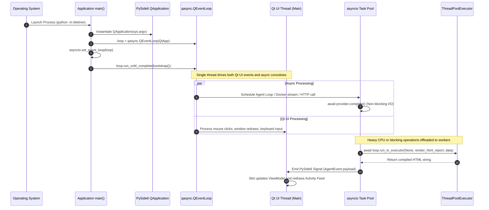

#### Concurrency Invariants
1. **Zero Main-Thread Blocking:** No synchronous network calls (`requests`), synchronous sleeps (`time.sleep()`), or heavy filesystem scans are permitted on the main thread.
2. **Main-Thread UI Mutations:** Only the main OS thread may construct, mutate, or destroy Qt widgets. Coroutines crossing into UI representations must do so via Qt Signals and Slots or `QMetaObject.invokeMethod(..., Qt.QueuedConnection)`.
3. **Asynchronous Core Services:** All service layer methods return coroutines (`async def`) and run within the `qasync` event loop.
4. **Executor Isolation for CPU/Disk:** CPU-intensive Jinja2 HTML rendering, image conversions, and synchronous disk synchronization run in a shared `concurrent.futures.ThreadPoolExecutor`.

### 5.2 Concurrency Model: Agent, Docker & Interactive Terminal

The user and the autonomous agent share the same Kali Linux container. To prevent command collisions, corrupted outputs, or race conditions on the shell session, execution is partitioned into disjoint Docker Exec sessions.

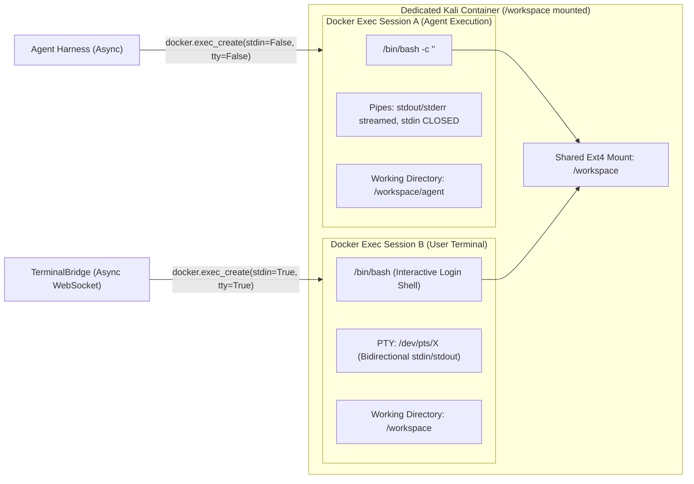

#### Concurrency & Coexistence Rules
1. **Isolated Exec Sessions:** The agent never injects text into the user's terminal PTY. It issues headless, non-interactive `docker exec` commands with distinct Linux PID trees.
2. **Workspace Directory Segregation:** To prevent write collisions:
   - Tool outputs generated by the agent default to `/workspace/agent/`.
   - The user operates in `/workspace/` or `/workspace/user/`.
   - Both parties share read access across the entire `/workspace` tree.
3. **Decoupled Pause Semantics:** Pausing an investigation halts the agent's scheduling loop and gracefully terminates in-flight agent tools. It **does not close or interrupt** the user's interactive bash terminal.
4. **Process Accounting Table:** The application maintains an in-memory process registry tracking active exec session IDs, command strings, initiator (`AGENT` vs `USER`), start times, and exit statuses.

### 5.3 Signal / Slot and Reactive Event Architecture

The desktop presentation layer operates reactively: it never polls the agent for status updates. Instead, the agent harness publishes structured events to an internal async queue, which are forwarded to the UI via a Qt Signal bridge.

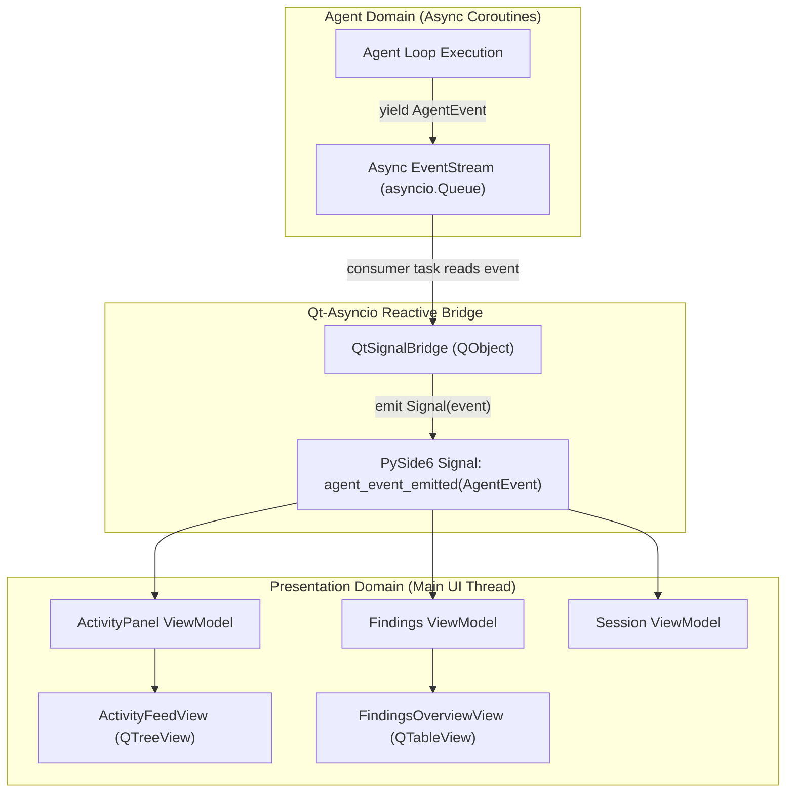

---

## 6. Trust Boundaries & Threat Surface Mapping

### 6.1 Trust Boundary Definitions

Bletiner AI implements defense-in-depth across five explicit trust boundaries.

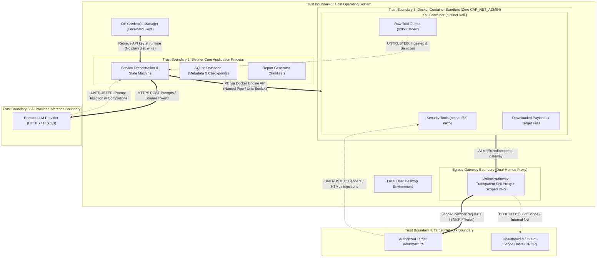

### 6.2 Zero-Trust Kali Capabilities & Ambient Capabilities Inheritance

1. **Strict Capability Profile:**
   - Container configuration enforces:
     ```python
     cap_drop=["ALL"]
     cap_add=["NET_RAW", "NET_BIND_SERVICE"]
     ```
   - **Zero `CAP_NET_ADMIN`:** The Kali container possesses **no** network administration capability and has no `iptables` binary installed or permitted. The container is **never trusted to firewall itself**.
2. **Ambient Capabilities for Non-Root Nmap vs `no_new_privs`:**
   - When non-root execution (`user: kali`, UID 1000) is combined with security hardening flag `no_new_privs: true`, traditional Linux file capabilities (`setcap cap_net_raw+ep /usr/bin/nmap`) are suppressed by the kernel.
   - **Solution:** In the container execution wrapper, raise `CAP_NET_RAW` and `CAP_NET_BIND_SERVICE` into the Linux **Ambient Capability Set**:
     ```bash
     capsh --inh=cap_net_raw,cap_net_bind_service \
           --ambient=cap_net_raw,cap_net_bind_service \
           --user=kali -- <command>
     ```
   - This permits non-root `kali` to execute raw socket SYN scans without elevating to root and while strictly honoring `no_new_privs: true`.
   - If ambient capabilities are unsupported on a legacy host, the tool executor falls back gracefully to `nmap -sT` (unprivileged TCP Connect scan).

### 6.3 Two-Tier TLS Redirect Enforcement Architecture

Standard HTTPS forward proxies (`CONNECT` method) establish an encrypted tunnel between the client and destination, making HTTP 301/302 `Location` headers unreadable without deploying TLS Man-in-the-Middle (MITM) root certificates.

Bletiner AI solves this cleanly through a **Two-Tier Architecture**:

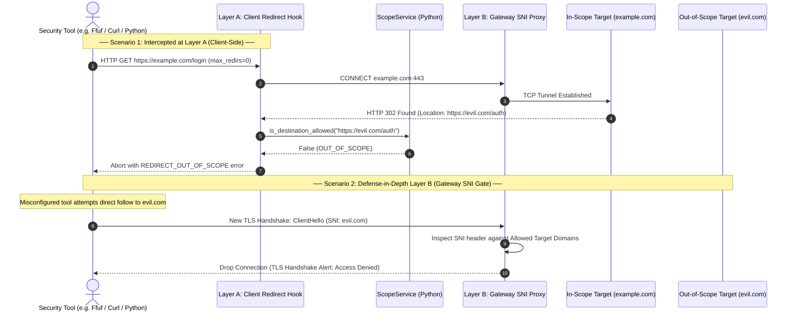

1. **Layer A (Client-Side Hook):** All HTTP scanners and clients run with automatic redirects disabled (`follow_redirects=False` or `--max-redirs 0`). The tool parser inspects the `Location` header, validates it against `ScopeService`, and aborts if it leaves authorized scope.
2. **Layer B (Gateway SNI Enforcement):** If a tool initiates a follow-up connection, a new TLS ClientHello handshake is initiated. The transparent gateway inspects the SNI extension in plaintext and drops the handshake if the host is unauthorized.

---

## 7. End-to-End Data Flows

### 7.1 Investigation Lifecycle & Autonomous Loop Flow

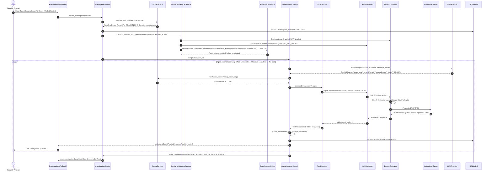

### 7.2 Human-in-the-Loop Steering Flow

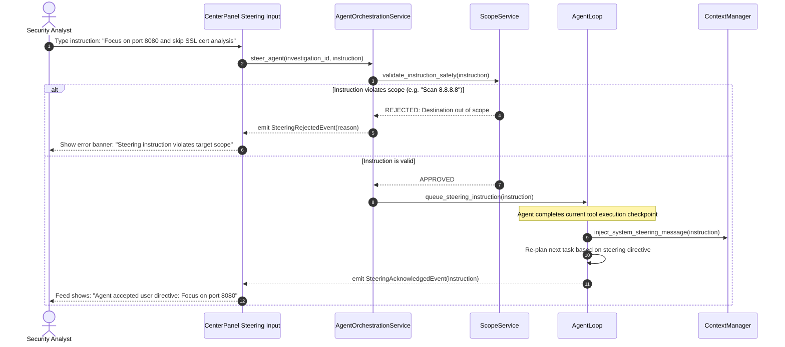

### 7.3 Graceful Exit, Checkpointing & Recovery Flow

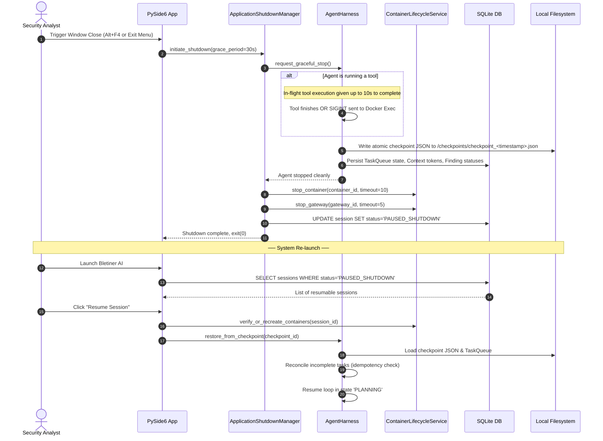


## 8. Subsystem Boundaries & Protocol Contracts (Sections 4.1–4.10)

The system enforces modularity using Python `typing.Protocol` classes. All subsystem boundaries are defined below.

### 8.1 Presentation Layer Protocol Contracts (§4.1)

```python
from typing import Protocol, Any, Optional
from PySide6.QtCore import Signal, QObject

class AgentEventDTO:
    timestamp: str
    event_type: str
    phase: str
    tool_name: Optional[str]
    description: str
    metadata: dict[str, Any]

class FindingsSummaryDTO:
    total_count: int
    critical_count: int
    high_count: int
    medium_count: int
    low_count: int
    info_count: int

class InvestigationViewModelProtocol(Protocol):
    """Protocol for the main presentation view model."""
    investigation_changed: Signal
    events_updated: Signal
    findings_updated: Signal
    status_changed: Signal

    def set_active_investigation(self, investigation_id: str) -> None: ...
    def send_steering_instruction(self, text: str) -> None: ...
    def request_pause(self) -> None: ...
    def request_resume(self) -> None: ...
    def request_stop(self) -> None: ...
    def get_activity_events(self, limit: int = 100) -> list[AgentEventDTO]: ...
    def get_findings_summary(self) -> FindingsSummaryDTO: ...
```

### 8.2 Application & Service Layer Contracts (§4.2)

```python
from typing import Protocol, Optional, AsyncIterator
from dataclasses import dataclass
from enum import Enum

class InvestigationDepth(Enum):
    BASIC = "basic"
    DEEP = "deep"

class InvestigationStatus(Enum):
    DRAFT = "draft"
    INITIALIZING = "initializing"
    RUNNING = "running"
    PAUSING = "pausing"
    PAUSED = "paused"
    RESUMING = "resuming"
    COMPLETED = "completed"
    STOPPING = "stopping"
    STOPPED = "stopped"
    FAILED = "failed"

@dataclass(frozen=True)
class InvestigationCreateRequest:
    target: str
    scope_raw: str
    depth: InvestigationDepth
    provider_id: str
    model_id: str

class InvestigationServiceProtocol(Protocol):
    async def create_investigation(self, request: InvestigationCreateRequest) -> str: ...
    async def start_investigation(self, investigation_id: str) -> None: ...
    async def pause_investigation(self, investigation_id: str) -> None: ...
    async def resume_investigation(self, investigation_id: str) -> None: ...
    async def stop_investigation(self, investigation_id: str) -> None: ...
    async def upgrade_to_deep(self, investigation_id: str) -> None: ...
    async def delete_investigation(self, investigation_id: str, confirm: bool) -> None: ...

class SessionServiceProtocol(Protocol):
    async def get_session_state(self, session_id: str) -> InvestigationStatus: ...
    async def transition_state(self, session_id: str, new_state: InvestigationStatus) -> None: ...
    async def list_resumable_sessions(self) -> list[dict]: ...
```

### 8.3 Agent Harness Contracts (§4.3 — Pi-Inspired)

```python
from typing import Protocol, AsyncIterator, Optional, Any
from dataclasses import dataclass
from enum import Enum

class AgentLoopState(Enum):
    IDLE = "idle"
    PLANNING = "planning"
    EXECUTING = "executing"
    OBSERVING = "observing"
    ANALYZING = "analyzing"
    REPLANNING = "replanning"
    PAUSED = "paused"
    STOPPED = "stopped"
    COMPLETED = "completed"
    ERROR = "error"

@dataclass(frozen=True)
class AgentEvent:
    event_id: str
    investigation_id: str
    timestamp: float
    state: AgentLoopState
    event_type: str
    payload: dict[str, Any]

class AgentHarnessProtocol(Protocol):
    @property
    def current_state(self) -> AgentLoopState: ...
    async def run(self, investigation_id: str, checkpoint_id: Optional[str] = None) -> None: ...
    async def pause(self) -> None: ...
    async def resume(self) -> None: ...
    async def stop(self) -> None: ...
    async def inject_steering(self, instruction: str) -> bool: ...
    def event_stream(self) -> AsyncIterator[AgentEvent]: ...

class ContextManagerProtocol(Protocol):
    """Unified internal message representation (Pi-inspired AgentMessage/AppMessage)."""
    def add_message(self, role: str, content: str, metadata: Optional[dict] = None) -> None: ...
    def get_compiled_messages(self) -> list[dict[str, Any]]: ...
    def calculate_token_usage(self) -> int: ...
    def prune_context(self, max_tokens: int) -> int: ...
    def serialize_state(self) -> bytes: ...
    def deserialize_state(self, data: bytes) -> None: ...

class StateTreeProtocol(Protocol):
    """Branching conversation state tree supporting checkpoints, rewinds, and forks."""
    def add_node(self, parent_id: Optional[str], state_snapshot: dict[str, Any]) -> str: ...
    def get_node(self, node_id: str) -> Optional[dict[str, Any]]: ...
    def fork_branch(self, base_node_id: str) -> str: ...
```

### 8.4 Tool System Contracts (§4.4 — 4-Tier Risk Classification)

```python
from typing import Protocol, Any, Optional
from dataclasses import dataclass
from enum import Enum

class ToolRiskTier(Enum):
    TIER1_SAFE_PASSIVE = "tier1_safe_passive"        # whois, dig, curl GET, nmap -sV -F (Always allowed)
    TIER2_ACTIVE_RECON = "tier2_active_recon"        # nmap full ports, gobuster max 50 req/s, nikto (Basic & Deep)
    TIER3_INTRUSIVE_VALIDATION = "tier3_intrusive"   # nuclei non-destructive CVE, ffuf max 20 req/s (Deep ONLY)
    TIER4_HIGH_RISK_BLOCKED = "tier4_high_risk"      # masscan >1000pps, sqlmap --os-shell, Metasploit (BLOCKED)

@dataclass(frozen=True)
class ToolResult:
    tool_name: str
    execution_id: str
    command_executed: list[str]  # Structured argument list, never shell string
    stdout: str
    stderr: str
    exit_code: int
    duration_seconds: float
    timed_out: bool

class ToolDefinitionProtocol(Protocol):
    @property
    def name(self) -> str: ...
    @property
    def version(self) -> str: ...
    @property
    def description(self) -> str: ...
    @property
    def risk_tier(self) -> ToolRiskTier: ...
    @property
    def input_schema(self) -> dict[str, Any]: ...  # JSON Schema
    @property
    def timeout_seconds(self) -> int: ...
    def build_command_line(self, parameters: dict[str, Any]) -> list[str]: ...

class ToolExecutorProtocol(Protocol):
    async def execute_tool(
        self, tool: ToolDefinitionProtocol, parameters: dict[str, Any], container_id: str,
        investigation_depth: InvestigationDepth
    ) -> ToolResult: ...
    async def cancel_execution(self, execution_id: str) -> None: ...
```

### 8.5 Docker & Container Subsystem Contracts (§4.5)

```python
from typing import Protocol, AsyncIterator, Optional
from dataclasses import dataclass

@dataclass(frozen=True)
class ContainerSpec:
    image: str
    container_name: str
    internal_network_name: str
    workspace_host_path: str
    cpu_limit: float = 2.0
    memory_limit: str = "4g"
    cap_drop: tuple[str, ...] = ("ALL",)
    cap_add: tuple[str, ...] = ("NET_RAW", "NET_BIND_SERVICE")

@dataclass(frozen=True)
class GatewaySpec:
    image: str
    gateway_name: str
    internal_network_name: str
    external_network_name: str
    allowed_domains: tuple[str, ...]
    allowed_ips: tuple[str, ...]

class DockerManagerProtocol(Protocol):
    async def create_internal_network(self, network_name: str) -> str: ...
    async def create_and_start_gateway(self, spec: GatewaySpec) -> str: ...
    async def create_and_start_sandbox(self, spec: ContainerSpec) -> str: ...
    async def stop_sandbox(self, container_id: str, timeout: int = 15) -> None: ...
    async def stop_gateway(self, gateway_id: str, timeout: int = 5) -> None: ...
    async def destroy_sandbox(self, container_id: str) -> None: ...
    async def execute_command(
        self, container_id: str, cmd: list[str], timeout: int, workdir: str = "/workspace"
    ) -> tuple[int, str, str]: ...
    async def open_pty_terminal_session(
        self, container_id: str, cols: int, rows: int
    ) -> "TerminalBridgeSessionProtocol": ...

class TerminalBridgeSessionProtocol(Protocol):
    async def write_input(self, data: bytes) -> None: ...
    async def read_output(self) -> AsyncIterator[bytes]: ...
    async def resize_pty(self, cols: int, rows: int) -> None: ...
    async def close(self) -> None: ...

class RouteInjectorProtocol(Protocol):
    """Executes transient helper container attached to Kali netns to set default gateway."""
    async def inject_default_route(self, kali_container_id: str, gateway_ip: str = "172.30.0.254") -> None: ...
```

### 8.6 Scope & Network Enforcement Contracts (§4.6)

```python
from typing import Protocol, Union
from dataclasses import dataclass
from ipaddress import IPv4Address, IPv4Network, IPv6Address, IPv6Network

@dataclass(frozen=True)
class TargetScopeDefinition:
    raw_target: str
    domains: set[str]
    allowed_ips: set[Union[IPv4Address, IPv6Address]]
    allowed_cidrs: set[Union[IPv4Network, IPv6Network]]
    ports: set[int]
    allow_subdomains: bool

class ScopeServiceProtocol(Protocol):
    def parse_and_validate(self, raw_input: str) -> TargetScopeDefinition: ...
    async def resolve_target_destinations(self, scope: TargetScopeDefinition) -> set[str]: ...
    def is_destination_allowed(self, dest_ip_or_domain: str, port: int, scope: TargetScopeDefinition) -> bool: ...
    def validate_redirect(self, location_url: str, scope: TargetScopeDefinition) -> bool: ...
    async def configure_gateway_rules(self, gateway_id: str, scope: TargetScopeDefinition) -> None: ...
```

### 8.7 Session Persistence & Checkpointing Contracts (§4.7)

```python
from typing import Protocol, Optional, Any
from datetime import datetime

class DatabaseRepositoryProtocol(Protocol):
    async def initialize_schema(self) -> None: ...
    async def execute_transaction(self, query: str, params: tuple = ()) -> None: ...
    async def fetch_one(self, query: str, params: tuple = ()) -> Optional[dict[str, Any]]: ...
    async def fetch_all(self, query: str, params: tuple = ()) -> list[dict[str, Any]]: ...

class CheckpointManagerProtocol(Protocol):
    async def write_atomic_checkpoint(
        self, investigation_id: str, state_snapshot: dict[str, Any]
    ) -> str: ...
    async def read_latest_checkpoint(self, investigation_id: str) -> Optional[dict[str, Any]]: ...
```

### 8.8 Provider & Model Management Contracts (§4.8 — pi-ai)

```python
from typing import Protocol, AsyncIterator, Optional
from dataclasses import dataclass

@dataclass(frozen=True)
class ModelCapabilities:
    supports_tool_calling: bool
    supports_streaming: bool
    supports_structured_json: bool
    max_context_window: int

class ProviderAdapterProtocol(Protocol):
    @property
    def provider_id(self) -> str: ...
    async def list_models(self) -> list[str]: ...
    async def probe_capabilities(self, model_id: str) -> ModelCapabilities: ...
    async def generate_completion(
        self, model_id: str, messages: list[dict], tools: list[dict]
    ) -> dict[str, Any]: ...
    async def stream_completion(
        self, model_id: str, messages: list[dict], tools: list[dict]
    ) -> AsyncIterator[dict[str, Any]]: ...
```

### 8.9 Findings & Prioritization Contracts (§4.9)

```python
from typing import Protocol, Optional
from dataclasses import dataclass
from enum import Enum

class Severity(Enum):
    CRITICAL = "CRITICAL"
    HIGH = "HIGH"
    MEDIUM = "MEDIUM"
    LOW = "LOW"
    INFO = "INFO"

class Confidence(Enum):
    CONFIRMED = "CONFIRMED"
    HIGH = "HIGH"
    MEDIUM = "MEDIUM"
    LOW = "LOW"
    TENTATIVE = "TENTATIVE"

@dataclass
class FindingRecord:
    finding_id: str
    investigation_id: str
    title: str
    description: str
    affected_asset: str
    severity: Severity
    confidence: Confidence
    verification_status: str
    evidence_paths: list[str]
    remediation: str

class PrioritizationEngineProtocol(Protocol):
    def calculate_priority_score(self, finding: FindingRecord) -> float: ...
    def rank_findings(self, findings: list[FindingRecord]) -> list[FindingRecord]: ...
```

### 8.10 Reporting Subsystem Contracts (§4.10)

```python
from typing import Protocol
from pathlib import Path

class ReportServiceProtocol(Protocol):
    async def generate_markdown_report(self, investigation_id: str) -> Path: ...
    async def generate_html_report(self, investigation_id: str) -> Path: ...
```


## 9. Key Design Decisions & Technical Trade-offs

| Decision ID | Summary of Decision | Architectural Rationale & Trade-offs |
|---|---|---|
| **KAD-01** | **Single Host Python Process with `qasync` Event Loop** | Eliminates inter-process communication (IPC) serialization overhead between UI and agent services while maintaining 60 FPS UI responsiveness via non-blocking cooperative async. |
| **KAD-02** | **One Container per Investigation** | Strict process, network, and disk sandboxing. Prevents cross-investigation contamination and enables total cleanup upon session deletion. |
| **KAD-03** | **Dual-Homed Fail-Closed Egress Gateway** | Kali sits on an internal network (`internal: true`) with no default gateway. All egress passes through a dual-homed gateway container enforcing transparent SNI, HTTP Host, and IP allowlisting. If the gateway stops, all traffic drops to zero. |
| **KAD-04** | **Zero `CAP_NET_ADMIN` in Kali Sandbox** | Kali has zero capability to alter routing or firewall rules. All network enforcement is externalized to the gateway container. |
| **KAD-05** | **Host-Side Route Injection via Netns Helper** | A transient helper container attached to Kali's network namespace sets the default route without giving Kali administration rights. |
| **KAD-06** | **DNS HTTPS/SVCB Record Stripping** | The gateway DNS resolver suppresses type 65 resource records, preventing TLS Encrypted Client Hello (ECH) from blinding SNI domain inspection. |
| **KAD-07** | **Domain SNI vs Dedicated IP Forwarding** | Raw packet forwarding is strictly prohibited for domain targets (which may resolve to multi-tenant CDNs) and permitted only for explicitly authorized dedicated IP/CIDR targets. |
| **KAD-08** | **Ambient Capabilities under `no_new_privs`** | Linux ambient capabilities allow non-root `kali` (UID 1000) to execute raw socket SYN scans without elevating to root or disabling `no_new_privs`. |
| **KAD-09** | **Two-Tier Redirect Validation** | Layer A (client hook) intercepts HTTP 301/302 headers client-side; Layer B (gateway SNI) blocks new TLS handshakes to out-of-scope targets, avoiding complex TLS MITM root certificates. |
| **KAD-10** | **4-Tier Tool Risk Classification** | Tier 1 (Safe) and Tier 2 (Active Recon) automated; Tier 3 (Intrusive) restricted to Deep mode; Tier 4 (High-Risk/Exploitative) strictly blocked by harness policy. |
| **KAD-11** | **SQLite WAL + Atomic Filesystem Checkpoints** | Combines the transactional indexing power of SQLite with the crash resilience of atomic file dumps (`tempfile` + `os.replace`). |
| **KAD-12** | **Zero Secret Persistence on Disk** | API keys reside strictly inside the OS Keyring (Windows Credential Manager / macOS Keychain / Linux Secret Service) and are passed in memory to HTTPS clients. |
| **KAD-13** | **Strict Separation of User Terminal & Agent Exec** | User and agent share the filesystem but have separate TTY/PTY channels. Avoids race conditions on stdin and allows the user to explore freely while the agent is paused. |
| **KAD-14** | **Pi-Inspired Single Agent with Step-by-Step State Tree** | Adopts the Earendil Works Pi harness architecture for step-by-step state machine loops, branching conversation state trees, compact instructions, and typed JSON event streams. |

---

## 10. Architecture Decision Records (ADRs)

### ADR-001: Use qasync for Qt + asyncio Integration

* **Status:** Accepted  
* **Context:** The application requires PySide6 for desktop rendering, while modern Python network libraries (`httpx`, `aiodocker`, `aiosqlite`) require `asyncio`. Running two separate loops in separate threads causes race conditions, deadlocks, and excessive synchronization code when updating UI elements.  
* **Decision:** Adopt `qasync` to bridge the Qt Event Loop and Python's asyncio into a single cooperative loop on the main thread.  
* **Consequences:**  
  * *Positive:* Native `async/await` syntax throughout view models; no complex cross-thread signal marshaling for basic coroutines; single-threaded determinism.  
  * *Negative:* Any synchronous CPU-bound function will block the GUI. Strict rule: all blocking operations must use `loop.run_in_executor()`.  

---

### ADR-002: Dedicated Kali Linux Container per Investigation Session

* **Status:** Accepted  
* **Context:** Security tools (nmap, masscan, nikto, dirb) leave dirty filesystem artifacts, open raw sockets, and can destabilize the host. Reusing a single container across sessions risks data leakage between investigations.  
* **Decision:** Every investigation spins up a dedicated container using an official, pinned Kali Linux base image (`bletiner-kali:1.0`). The container is stopped upon pause/exit and destroyed upon session deletion.  
* **Consequences:**  
  * *Positive:* Absolute isolation between investigations; clean reproduction environment; zero host contamination.  
  * *Negative:* Startup latency of ~2–4 seconds per investigation; disk storage of ~2–3 GB for the Kali image.  

---

### ADR-003: Terminal Emulation via Qt WebEngineView and xterm.js

* **Status:** Accepted  
* **Context:** Analysts require an interactive terminal to inspect container state. Native Qt widgets (`QTextEdit`, `QPlainTextEdit`) lack full ANSI/VT100 escape code support, cursor positioning, and standard PTY resizing.  
* **Decision:** Embed `QWebEngineView` rendering a local, self-contained `xterm.js` bundle. Connect `xterm.js` to an internal asyncio WebSocket bridge that pipes raw bytes to a Docker Exec PTY session.  
* **Consequences:**  
  * *Positive:* Flawless terminal rendering (colors, ncurses tools like `top` and `htop`, vim, tab completion); native developer experience.  
  * *Negative:* Qt WebEngine adds ~100MB to binary distribution size.  
* **Security Mitigation:** WebEngine sandbox enabled; local file access disabled; WebSocket listens strictly on `127.0.0.1` with a cryptographic session nonce.  

---

### ADR-004: Single-Agent Pi-Inspired Harness Architecture

* **Status:** Accepted  
* **Context:** The product vision explicitly mandates a single-agent architecture for v1. Multi-agent systems introduce race conditions, state coordination complexity, unpredictability, and excessive token consumption.  
* **Decision:** Extract and adapt the core architecture of the **Earendil Works Pi harness (`@earendil-works/pi-coding-agent`)**:
  1. `pi-ai` provider abstraction strictly separating internal unified `AgentMessage`/`AppMessage` types from external provider schemas.
  2. `pi-agent` step-by-step state machine (`Prompt → Plan → Tool Selection → Container Exec → Observation → Analysis → Replanning`).
  3. Branching conversation state tree supporting checkpoints, rewinds, and forks instead of flat chat logs.
  4. Compact system instructions (under 1000 tokens) focusing on tool calling and operational discipline.
  5. Dynamic mid-turn steering and interruption support without losing context or prior evidence.  
* **Consequences:**  
  * *Positive:* Predictable token usage, single context window, straightforward state machine, deterministic debugging.  
  * *Negative:* Throughput limited to sequential tool execution per investigation run.  

---

### ADR-005: SQLite WAL Mode + Atomic Filesystem Checkpoints

* **Status:** Accepted  
* **Context:** Desktop software can be terminated unexpectedly (power failure, SIGKILL, user closing laptop). Incomplete writes to database or files can corrupt session history.  
* **Decision:** Implement a dual-tier persistence pattern:
  1. SQLite configured in WAL mode (`PRAGMA journal_mode=WAL; PRAGMA synchronous=NORMAL;`).
  2. Checkpoint blobs written via POSIX atomic rename: serialize JSON to temporary file `checkpoint.tmp`, call `os.replace("checkpoint.tmp", "checkpoint_<seq>.json")`.  
* **Consequences:**  
  * *Positive:* Corrupted partial writes are impossible. The engine can always roll back to the last valid atomic checkpoint.  
  * *Negative:* Disk space management required to purge historical checkpoints older than the last 3 snapshots.  

---

### ADR-006: OS Keyring for Secret Storage

* **Status:** Accepted  
* **Context:** API keys for LLM providers must be stored securely. Storing them in plaintext in SQLite, config files, or environment variables is unacceptable for a security product.  
* **Decision:** Use the Python `keyring` library to store secrets in the OS credential store (Windows Credential Manager, macOS Keychain, Linux Secret Service). Keys are stored under a service name like `bletiner-ai/<provider_id>`. The application retrieves keys at runtime and passes them directly to provider adapters in memory.  
* **Consequences:**  
  * *Positive:* Platform-native encryption; user-controlled access; no custom crypto code.  
  * *Negative:* Headless or CI testing environments require a mock keyring fallback.  

---

### ADR-007: Cooperative Shutdown with Grace Period & Escalation

* **Status:** Accepted  
* **Context:** Application exit must not leave orphaned Docker containers running autonomous scans. But abrupt termination can lose in-flight work.  
* **Decision:** Implement a three-phase shutdown: (1) Graceful (0–10s): Signal agent to checkpoint; stop scheduling new tasks; wait for current tool to complete or reach a safe point. (2) Forceful (10–30s): Cancel in-flight async tasks via `asyncio.CancelledError`; Docker Exec sessions terminated. (3) Emergency (>30s): `SIGKILL` the container if `docker stop` hasn't completed. Session marked as `PAUSED_SHUTDOWN` in all cases. On resume, the container is reconciled (recreated if needed) and the agent restores from the last checkpoint.  
* **Consequences:**  
  * *Positive:* Predictable shutdown time; no orphaned processes; durable state.  
  * *Negative:* Some in-flight tool results may be lost between the last checkpoint and shutdown; the agent must handle idempotency on resume.  

---

### ADR-008: Basic-to-Deep Investigation Continuation

* **Status:** Accepted  
* **Context:** After a Basic investigation, the user may request a Deep investigation. The Deep investigation must reuse findings and evidence from the Basic run without repeating completed work.  
* **Decision:** The Deep investigation is a new session within the same investigation record. It inherits: (1) all findings (with their current statuses); (2) all evidence artifacts; (3) the resolved scope; (4) the same container (restarted if stopped). The agent checkpoint is extended with a "continuation context" that marks completed tasks as `done` and adds new deep-investigation tasks.  
* **Consequences:**  
  * *Positive:* Efficient continuation; no wasted API tokens repeating work.  
  * *Negative:* Revalidation logic must be robust — stale items must be marked based on timestamps.  

---

### ADR-009: Dual-Homed Gateway Container vs Container-Namespace Sharing

* **Status:** Accepted  
* **Context:** Initially, sharing container network namespaces via `--network container:<proxy_id>` was considered for egress proxying. However, container-namespace sharing introduces subtle failure modes: if the proxy container crashes, the dependent container may inherit broken routing or, in misconfigurations, fall back to default bridge networking. Furthermore, Windows Docker Desktop operates inside WSL2, where host-level packet filters cannot intercept container bridge traffic.  
* **Decision:** Deploy a dual-homed bridge network architecture:
  1. The Kali container sits strictly on `bletiner-internal-<id>` created with `internal: true` (no default route to host or internet).
  2. A dedicated proxy container `bletiner-gateway-<id>` connects to both `bletiner-internal-<id>` and the external bridge `bletiner-external`.
  3. All outbound HTTP/HTTPS/TCP traffic must route through the gateway proxy (`HTTP_PROXY`, `HTTPS_PROXY`, `ALL_PROXY`).  
* **Consequences:**  
  * *Positive:* Strict **Fail-Closed** security guarantee: if the gateway container terminates, the internal network has zero route to the internet. Works portably across Windows (WSL2), Linux, and macOS without touching host OS packet filters.  
  * *Negative:* Minor network overhead from forwarding proxy; tools must support standard proxy environment variables or SOCKS routing.  

---

### ADR-010: Zero-Trust Kali Capabilities & Gateway-Enforced Firewalling

* **Status:** Accepted  
* **Context:** Allowing the Kali container to manage its own iptables rules requires granting `CAP_NET_ADMIN`. In a security tool container where untrusted code, scripts, or downloaded exploits may run, granting `CAP_NET_ADMIN` allows a compromised tool to modify its own routing table, flush iptables rules, and bypass scope restrictions entirely.  
* **Decision:** Enforce a strict zero-trust capability model on the Kali container:
  ```python
  cap_drop = ["ALL"]
  cap_add = ["NET_RAW", "NET_BIND_SERVICE"]
  ```
  Explicitly remove `CAP_NET_ADMIN`. Kali is **never trusted to firewall itself**. All firewalling, destination allowlisting, and proxying are enforced externally by the `bletiner-gateway` container.  
* **Consequences:**  
  * *Positive:* Even if an attacker achieves root inside Kali via local privilege escalation, they cannot alter container routing or bypass egress filtering.  
  * *Negative:* Kali cannot execute local packet filtering tools; raw packet crafting tools (e.g. nmap SYN scans) require `NET_RAW` but cannot alter kernel networking tables.  

---

### ADR-011: Deferring Host-Level MCP Execution in v1

* **Status:** Accepted  
* **Context:** Model Context Protocol (MCP) servers allow LLMs to invoke external tools. However, executing MCP servers on the host OS allows tools to run with the analyst's host user privileges, bypassing Docker container isolation, filesystem sandboxing, and network egress controls.  
* **Decision:** In v1, defer host-level MCP execution. All security tools, scanners, file inspections, and command executions must run strictly inside the Kali container sandbox. Extensible tool plugins are containerized. Host-level MCP support will only be evaluated in future versions with dedicated virtualization boundaries.  
* **Consequences:**  
  * *Positive:* Preserves absolute container isolation; host filesystem and host network remain completely inaccessible to tool execution.  
  * *Negative:* Cannot easily plug in existing desktop-native MCP servers without containerizing them.  

---

### ADR-012: SNI & Host Header Egress Validation for Multi-Tenant CDNs

* **Status:** Accepted  
* **Context:** Modern web applications frequently reside behind multi-tenant Content Delivery Networks (CDNs) or shared cloud load balancers (e.g. Cloudflare, Fastly, AWS CloudFront). Resolving `example.com` returns a CDN IP address shared by thousands of unrelated organizations. If egress enforcement only checks destination IP addresses, an agent or tool could access unauthorized domains on the same CDN IP, causing catastrophic scope escape.  
* **Decision:** The egress gateway enforces application-layer validation:
  1. For TLS connections (port 443), inspect the Server Name Indication (SNI) extension in the TLS ClientHello packet. Drop connections whose SNI does not match an authorized domain.
  2. For plain HTTP connections (port 80), inspect the `Host:` request header.
  3. Block outbound QUIC / UDP 443 traffic by default, forcing HTTP/3 traffic to downgrade to TCP-based TLS where SNI inspection is possible.
  4. Automatically detect and drop HTTP 301/302 redirects to out-of-scope domains (`REDIRECT_OUT_OF_SCOPE`).
  5. Allow raw IP/CIDR port scanning only when the user explicitly configures an IP/CIDR target; for domain targets, restrict scans to standard web ports (80/443).  
* **Consequences:**  
  * *Positive:* Prevents scope escape to other tenants on shared CDN infrastructure; provides cryptographic domain enforcement.  
  * *Negative:* Encrypted ClientHello (ECH) would blind SNI inspection without DNS mitigation (addressed in ADR-017).  

---

### ADR-013: Ambient Capabilities vs File Capabilities under no_new_privs

* **Status:** Accepted  
* **Context:** Non-root container execution (`user: kali`, UID 1000) combined with `no_new_privs: true` causes the Linux kernel to ignore file capabilities (`setcap cap_net_raw+ep`). This breaks Nmap raw SYN scans (`-sS`) for unprivileged users. Running the container as root to fix this destroys defense-in-depth, while granting `sudo` without password allows full container compromise.  
* **Decision:** Utilize Linux **Ambient Capabilities** via `capsh`:
  ```bash
  capsh --inh=cap_net_raw,cap_net_bind_service \
        --ambient=cap_net_raw,cap_net_bind_service \
        --user=kali -- nmap -sS -p 80,443 <target>
  ```
  Ambient capabilities are inherited across `execve()` calls by non-root processes even when `no_new_privs: true` is set. If the host kernel does not support ambient capabilities, the tool executor automatically falls back to unprivileged TCP Connect scans (`nmap -sT`).  
* **Consequences:**  
  * *Positive:* Preserves non-root execution and `no_new_privs: true` while enabling fast raw SYN scans.  
  * *Negative:* Requires `libcap2-bin` (`capsh`) in the Kali image.  

---

### ADR-014: Two-Tier Redirect Validation (Client Hook + Gateway SNI) vs TLS MITM

* **Status:** Accepted  
* **Context:** An HTTP 301/302 redirect can bounce an authorized domain (`https://target.com/login`) to an unauthorized third-party (`https://auth.google.com` or `https://malicious.com`). Standard HTTPS forward proxies (`CONNECT`) tunnel TLS traffic blindly and cannot inspect HTTP redirect headers without performing full TLS Man-in-the-Middle (MITM) decryption (generating and trusting dynamic root CAs inside the container). TLS MITM creates certificate pinning errors, breaks security scanners, and risks secret exposure.  
* **Decision:** Adopt a Two-Tier Redirect Validation architecture without TLS MITM:
  1. **Layer A (Client-Side Hook):** All HTTP tools and clients run with automated redirects disabled (`follow_redirects=False` or `--max-redirs 0`). The tool executor inspects the HTTP 301/302 `Location` header in the response, validates the destination against `ScopeService`, and raises `REDIRECT_OUT_OF_SCOPE` if it leaves approved scope.
  2. **Layer B (Gateway SNI Gate):** If an uninstrumented tool attempts to follow a redirect, the subsequent TLS connection initiates a new TLS handshake. The gateway SNI proxy reads the unencrypted `ClientHello` SNI hostname and drops the connection before any TLS session is established.  
* **Consequences:**  
  * *Positive:* Complete protection against redirect scope escapes without fragile root CA installation or TLS MITM overhead.  
  * *Negative:* Plain HTTP redirect targets require client-side enforcement (Layer A), as Layer B relies on TLS SNI.  

---

### ADR-015: 4-Tier Tool Risk Classification & Autonomous Scheduling Boundaries

* **Status:** Accepted  
* **Context:** An autonomous agent with access to aggressive or destructive security tools can destabilize production targets, cause denial of service, trigger intrusion prevention bans, or run destructive exploits.  
* **Decision:** Implement a formal 4-Tier Tool Risk Classification enforced in the tool registry and agent harness:
  - **Tier 1 (Safe / Passive):** Passive queries and non-intrusive scans (whois, dig, curl GET, `nmap -sV -F`). Permitted in all modes.
  - **Tier 2 (Active Recon):** Active port scans, rate-limited directory fuzzing (nmap full ports, gobuster max 50 req/s, nikto safe tuning). Permitted in Basic & Deep modes.
  - **Tier 3 (Intrusive Validation):** Targeted vulnerability probes and fuzzing (nuclei non-destructive CVE checks, ffuf max 20 req/s). Permitted **ONLY in Deep mode** with explicit scope confirmation.
  - **Tier 4 (High-Risk / Destructive):** Exploitation, stress testing, and destructive payloads (masscan >1000pps, sqlmap `--os-shell`, Metasploit, password spraying). **Strictly blocked by policy** in all autonomous modes. The agent harness cannot schedule Tier 4 tools.  
* **Consequences:**  
  * *Positive:* Guarantees non-destructive operation by design; satisfies strict authorization and compliance boundaries.  
  * *Negative:* Highly intrusive vulnerability verification cannot be fully automated and requires user manual intervention via the shared terminal.  

---

### ADR-016: Host-Side Route Injection for Zero-CAP_NET_ADMIN Kali Sandbox

* **Status:** Accepted (Revision 3.1)  
* **Context:** To ensure fail-closed egress, the Kali sandbox container on `bletiner-internal` must route all traffic through the gateway container (`172.30.0.254`). However, replacing the kernel default route (`ip route replace default via ...`) requires `CAP_NET_ADMIN`. Granting `CAP_NET_ADMIN` to the Kali container violates zero-trust principles and introduces container breakout and firewall tampering risks.  
* **Decision:** The host Docker lifecycle manager executes a transient helper container attached directly to Kali's network namespace:
  ```bash
  docker run --rm \
    --network=container:bletiner-kali-<id> \
    --cap-add=NET_ADMIN \
    alpine ip route replace default via 172.30.0.254
  ```
  This alters the network routing table from the host side before tool execution begins. Kali is created with `cap_drop=['ALL']`, `cap_add=['NET_RAW', 'NET_BIND_SERVICE']` and **never receives `CAP_NET_ADMIN`**.  
* **Consequences:**  
  * *Positive:* Completely eliminates `CAP_NET_ADMIN` from the long-running Kali sandbox while cleanly directing all kernel routing to the gateway.  
  * *Negative:* Adds ~100ms container startup overhead during initial investigation provisioning.  

---

### ADR-017: DNS HTTPS/SVCB Record Stripping to Counter TLS ECH SNI Encryption

* **Status:** Accepted (Revision 3.1)  
* **Context:** Modern web targets and CDNs (Cloudflare, Fastly) deploy Encrypted Client Hello (ECH). ECH encrypts the SNI extension using public keys distributed via DNS HTTPS (Resource Record Type 65) or SVCB records. If a security tool receives an ECH public key in DNS responses, it encrypts the SNI, blinding the gateway transparent SNI proxy and creating a scope bypass risk.  
* **Decision:** Configure the gateway scoped DNS resolver daemon (port 5353) to actively intercept all DNS queries and **strip/filter all HTTPS (type 65) and SVCB resource records** before returning responses to Kali.  
* **Consequences:**  
  * *Positive:* Forces client TLS handshakes to fall back cleanly to standard TLS 1.3 with plaintext SNI, ensuring deterministic gateway domain validation.  
  * *Negative:* Prevents testing of ECH-specific server configurations.  

---

### ADR-018: Separation of Domain SNI Gateway Proxying from Dedicated IP Raw Forwarding

* **Status:** Accepted (Revision 3.1)  
* **Context:** Multi-tenant CDNs share IP addresses across hundreds of thousands of domains. If the gateway provisions iptables `FORWARD` rules allowing raw IP packets to a resolved domain IP, an attacker or compromised agent could send raw requests to unauthorized co-hosted domains on that same IP, bypassing domain allowlisting.  
* **Decision:** Strictly separate target types at the gateway layer:
  1. **Domain Targets (e.g. `example.com`):** Gateway iptables policy maintains `FORWARD DROP`. Direct raw IP forwarding to the target IP is prohibited. Outbound traffic is restricted to ports 80/443 and routed strictly through the transparent SNI/Host proxy on port 8080.
  2. **Dedicated IP/CIDR Targets (e.g. `192.0.2.10`, `10.0.0.0/24`):** The gateway provisions explicit iptables `FORWARD` rules allowing raw TCP/UDP port scans and packets to those exact IPs on authorized ports.  
* **Consequences:**  
  * *Positive:* Completely eliminates collateral tenant access on shared CDN infrastructures while preserving full port scanning capabilities on dedicated IP targets.  
  * *Negative:* Nmap port scanning is restricted to ports 80 and 443 for domain-only targets unless the user explicitly authorizes target IPs.  

---

### ADR-019: Finding Prioritization Composite Scoring Engine

* **Status:** Accepted  
* **Context:** The agent must decide which findings to investigate further and in what order. A purely severity-based model ignores confidence and investigation value.  
* **Decision:** Use a weighted composite score:
  $$\text{Priority} = (w_s \times S) + (w_c \times C) + (w_v \times V) - (w_e \times E)$$
  Default weights: Severity ($w_s = 0.35$), Confidence ($w_c = 0.25$), Investigation Value ($w_v = 0.25$), Estimated Cost ($w_e = 0.15$). Weights are configurable in settings but never modified by the LLM. Safety policy and scope can veto any priority. Lower-priority findings remain tracked in the queue and are never discarded.  
* **Consequences:**  
  * *Positive:* Transparent, tunable, auditable.  
  * *Negative:* Numeric scores can convey false precision — the UI displays the component factors alongside the composite score.  

---

### ADR-020: Model-Locking per Investigation Session

* **Status:** Accepted  
* **Context:** LLMs differ in reasoning, tool calling, and output formats. Changing models mid-investigation can cause context confusion, corrupted plans, or invalid tool syntax.  
* **Decision:** When an investigation is created, the selected LLM provider and model ID are permanently locked into the session metadata. Resuming a session enforces using the locked model.  
* **Consequences:**  
  * *Positive:* Deterministic investigation trajectories and reproducible reasoning history.  
  * *Negative:* If an external provider deprecates a model, the session cannot resume without an explicit user override migration flow.  

---

*End of Document 02 — System Architecture.*
