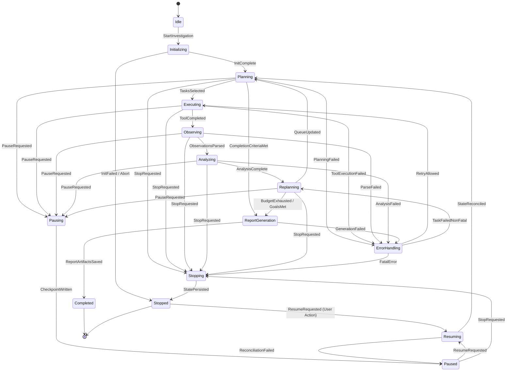
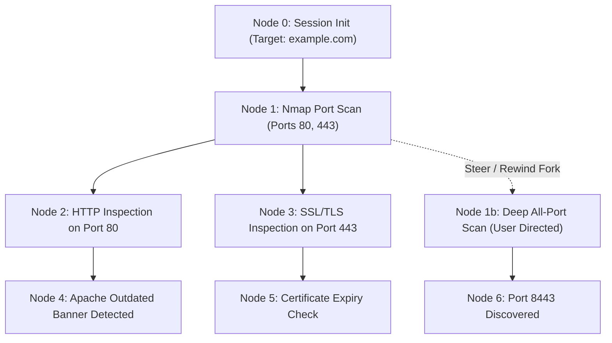

# 03 — Agent Harness Architecture & Specification

> **Bletiner AI** — Autonomous Security Investigation Desktop Application  
> Document: `docs/03_AGENT_HARNESS.md`  
> Author: AI Agent Systems Engineer (`@agent-eng`)  
> Reference: Earendil Works Pi Architecture (`pi-ai` & `pi-agent`)  
> Revision: 3.0 (Egress Enforcement & Runtime Security Validation)  
> Target Audience: Claude Code implementation agent, Principal Architect, QA Auditor  

---

## 1. Overview and Design Philosophy

Bletiner AI implements a **single autonomous agent** runtime with modular internal responsibilities, directly adapting the proven agentic capabilities and architectural concepts of the **Earendil Works Pi harness** (`@earendil-works/pi-coding-agent`, `pi-ai`, and `pi-agent`).

The harness is engineered from the ground up in Python 3.11+, providing clean-room, robust implementations of Pi's core strengths:
1. **`pi-ai` Provider Abstraction**: Decoupled multi-vendor model interface with strict translation boundaries separating internal representations from external vendor wire schemas.
2. **`pi-agent` Core Loop & State Tree**: Branching session tree with parent-linked checkpoints, dynamic steering, and compact system instructions.
3. **Hardened Minimalist Tool Surface**: Core file and execution primitives inside Kali Docker, supplemented by security tools. In v1, all tool execution is strictly confined within the container.
4. **4-Tier Tool Risk Classification**: Hard policy boundaries restricting autonomous tool execution to safe and validated tiers, strictly blocking Tier 4 destructive actions.
5. **Two-Tier Redirect Inspection**: Client-side redirect inspection hook (Layer A) coupled with gateway-level SNI filtering (Layer B) preventing out-of-scope escapes.
6. **Headless RPC & Event Streaming**: Typed JSON streaming protocol linking the background asyncio runtime to PySide6.

### 1.1 Evolution Context & Origin

Bletiner AI evolved from early prototypes (`lm_terminal_agent.py` — an OpenAI client interacting with local LLM endpoints) into a production-grade, pure Python + PySide6 autonomous security operations workspace. Where the early prototype relied on synchronous terminal loops and simple command execution, Bletiner AI introduces:
- A headless agent execution loop communicating strictly via the Docker Exec API using structured argument arrays (`argv: list[str]`).
- A dual-mode execution environment separating the autonomous agent's exec channel from the user's interactive PTY session.
- An event-driven architecture streaming structured JSON telemetry rather than unstructured conversational narration.
- Hardened container execution with RFC1918 and cloud metadata blocking, non-root users, isolated workspaces, and a dual-homed fail-closed network gateway.

### 1.2 Earendil Works Pi Capabilities Adapted in Bletiner AI

| Pi Harness Concept (`earendil-works/pi`) | Bletiner AI Implementation |
|---|---|
| **`pi-ai` Model Abstraction** | Complete decoupling of internal `AgentMessage` / `AppMessage` structures from vendor-specific LLM schemas. Bidirectional conversion occurs strictly at the provider boundary. |
| **Branching State Tree** | Session history structured as an acyclic graph (Tree) of checkpointed turns with `parent_id` pointers, enabling rewind, branch-off, and fork semantics rather than a brittle flat log. |
| **Compact System Instructions** | System prompt budgeted under **1,000 tokens** for token economy and operational clarity. Safety is enforced by infrastructure and code, never by prompt alone. |
| **Dynamic Mid-Turn Steering** | Human instructions injected asynchronously during active turns, evaluated for scope/safety in Python code, and incorporated into subsequent task planning without destroying valid context. |
| **Minimalist Tool Interface** | Foundational primitives (`docker_exec`, `docker_read_file`, `docker_write_file`, `docker_edit_file`) executing inside Kali Linux via structured `argv` arrays (no shell interpolation). |
| **Headless RPC Event Protocol** | Asyncio-based typed JSON event stream acting as an RPC bridge to the PySide6 UI thread and session database. |
| **Zero CoT Exposure** | Complete elimination of raw Chain-of-Thought or conversational narration; only structured events and verified artifacts are emitted. |

---

## 2. Agent Loop State Machine (`pi-agent` Engine)

The core loop adapts the `pi-agent` iterative cycle into an asynchronous, deterministic Finite State Machine (FSM).

### 2.1 Mermaid State Diagram



### 2.2 State Definitions and Responsibilities

| State | Purpose & Active Operations | Can Pause Here? | Can Stop Here? |
|---|---|---|---|
| **`IDLE`** | Dormant runtime. Waiting for investigation initiation. | No (N/A) | No (N/A) |
| **`INITIALIZING`** | Allocates session directory, starts Docker container, configures network isolation, locks LLM model profile, verifies scope. | Yes (Immediate abort) | Yes (Immediate abort) |
| **`PLANNING`** | Generates initial or macro investigation task hierarchy using LLM inference over target scope, depth, and prior findings. | Yes (At next task boundary) | Yes (Immediate) |
| **`EXECUTING`** | Dispatches tool command to Docker Exec engine. Monitors timeouts, output streaming, and cancellation signals. | Yes (Awaits tool grace period) | Yes (Forces SIGTERM/SIGKILL) |
| **`OBSERVING`** | Ingests raw stdout/stderr, normalizes output, extracts artifacts, and runs deterministic parsers. | Yes (Finishes parse first) | Yes (Immediate) |
| **`ANALYZING`** | Uses LLM to evaluate parsed observations, correlate attack surfaces, and detect candidate findings. | Yes (At inference end) | Yes (Immediate) |
| **`REPLANNING`** | Evaluates completion criteria, applies loop detection heuristics, updates task priority queue, checks token/time budgets. | Yes (At replan boundary) | Yes (Immediate) |
| **`ERROR_HANDLING`** | Assesses failures against retry policy, computes backoff, logs security warnings or blocks. | Yes | Yes |
| **`PAUSING`** | Transition state. Resolves active tools, gathers state snapshot, flushes persistence. | N/A (In transit) | Yes (Escalate to Stop) |
| **`PAUSED`** | Stable resting state. SQLite checkpoint written. Container remains running or suspended. | N/A | Yes |
| **`RESUMING`** | Validates environment integrity, reconciles container state, verifies model lock availability, rehydrates context. | Yes | Yes |
| **`REPORT_GENERATION`** | Synthesizes final Markdown and standalone HTML reports from verified findings and evidence files. | No (Must finish or abort) | Yes |
| **`STOPPING`** | Terminating state. Issues container termination, finalizes audit logs, saves partial reports. | N/A (In transit) | N/A |
| **`STOPPED`** | Terminal inactive state. Full state persisted in SQLite; eligible for later resume. | N/A | N/A |
| **`COMPLETED`** | Terminal successful state. All goals or budgets reached; reports delivered. | N/A | N/A |

---

## 3. System Prompt & Safety Enforcement Architecture

### 3.1 Purpose of the Compact System Prompt (<1,000 Tokens)

The system instruction is intentionally kept compact (**<1,000 tokens**) adhering to the `pi-agent` operational philosophy. Its exclusive purposes are:
1. **Operational Focus**: Define the expected JSON format for tool selection and parameters.
2. **Context Economy**: Maximize the token budget available for actual reconnaissance evidence and findings.
3. **Execution Instructions**: Instruct the model to operate concisely without narrative conversational filler.

### 3.2 Strict Separation: Prompt Guidance vs. Code/Infra Enforcement

> [!CAUTION]
> **CRITICAL SECURITY PRINCIPLE: THE SYSTEM PROMPT IS NOT A SECURITY CONTROL.**  
> Under no circumstances does Bletiner AI rely on LLM system instructions to enforce security boundaries. LLMs are susceptible to prompt injection, jailbreaks, and hallucinations.

All safety, scope, and non-destructive policies are enforced strictly in **deterministic Python code** and **network infrastructure**:

```
┌────────────────────────────────────────────────────────────────────────┐
│                        DEFENSE-IN-DEPTH BOUNDARIES                     │
│                                                                        │
│   1. Network Layer (bletiner-gateway)                                  │
│      └── Kernel iptables/nftables + Forward Proxy                      │
│      └── SNI / Host Header Inspection (Blocks CDN scope escapes)       │
│      └── Layer B Redirect Gate: Blocks out-of-scope TLS handshakes     │
│      └── RFC1918 / 169.254.169.254 Hard Drop (Fail-closed)             │
│                                                                        │
│   2. Container Layer (Docker Engine)                                   │
│      └── cap_drop=['ALL'], cap_add=['NET_RAW', 'NET_BIND_SERVICE']     │
│      └── Ambient capabilities (capsh) under no_new_privs: true         │
│      └── read_only root filesystem, no docker.sock mount               │
│      └── Non-root 'bletiner' user execution                            │
│                                                                        │
│   3. Application Service Layer (Python)                                │
│      └── ScopeGuard: Validates target IPs/domains against approved CIDR │
│      └── PolicyEngine: 4-Tier Tool Risk Classification Enforcement     │
│      └── Layer A Redirect Hook: Disables client-side redirect auto-hop │
│      └── Structured argv execution: Prevents shell command injection   │
│                                                                        │
│   4. LLM System Prompt (Guidance Only)                                 │
│      └── Compact operational guidelines (<1,000 tokens)                │
└────────────────────────────────────────────────────────────────────────┘
```

---

## 4. 4-Tier Tool Risk Classification & Autonomous Scheduling

To prevent accidental denial of service, unauthorized intrusion, or destructive operations, Bletiner AI classifies all tools into **4 explicit risk tiers**. The agent runtime policy engine enforces strict authorization boundaries on what tools may be autonomously scheduled.

### 4.1 The 4-Tier Classification Matrix

| Tier | Classification | Permitted Tools / Actions | Scheduling Authority | Autonomous Availability |
|---|---|---|---|---|
| **Tier 1** | **Safe / Passive** | `whois`, `dig`, `dnsrecon`, `curl` (GET/HEAD), `whatweb`, `nmap -sV -F` | Agent autonomous loop | **Basic & Deep Modes** |
| **Tier 2** | **Active Recon** | Full-port TCP SYN scan (`nmap -p- -sS`), service versioning, `gobuster` (max 50 req/s), `nikto` (safe plugins) | Agent autonomous loop | **Basic & Deep Modes** |
| **Tier 3** | **Intrusive Validation** | `nuclei` (community templates with `info`/`low` non-destructive CVE tags), `ffuf` (max 20 req/s), SSL renegotiation tests | Agent autonomous loop | **Deep Mode ONLY** (Requires explicit scope) |
| **Tier 4** | **High-Risk / Exploitative** | `masscan` (>1,000 pps), `sqlmap --os-shell`, `metasploit`, `hydra` / brute-force, payload execution, DoS modules | **BLOCKED BY DEFAULT** | **NEVER AUTONOMOUS** (Agent cannot schedule) |

### 4.2 Autonomous Policy Engine Enforcement

Before any tool invocation is dispatched to the container, the `PolicyEngine` evaluates the candidate against the current investigation depth:

```python
class ToolRiskTier(int, Enum):
    TIER_1_SAFE_PASSIVE = 1
    TIER_2_ACTIVE_RECON = 2
    TIER_3_INTRUSIVE_VALIDATION = 3
    TIER_4_HIGH_RISK_EXPLOITATIVE = 4

class PolicyEngine(Protocol):
    """Enforces execution boundaries across the 4-Tier risk matrix."""

    def validate_tool_invocation(
        self,
        invocation: "ToolInvocation",
        tool_def: "ToolDefinition",
        depth: str,
        scope: "InvestigationScope"
    ) -> Tuple[bool, Optional[str]]:
        """
        Evaluates risk tier against investigation mode.
        - Tier 4: ALWAYS BLOCKED (Never schedulable by autonomous agent).
        - Tier 3: BLOCKED in Basic mode; allowed ONLY in Deep mode.
        - Tier 1 & 2: Allowed in both Basic and Deep modes within scope.
        """
        ...
```

### 4.3 Rate and Request Budget Guardrails

Every tool definition includes mandatory operational throttling constraints enforced at runtime:
- **Max Requests Per Second (RPS)**: Hard ceiling (e.g., `gobuster` capped at 50 rps, `ffuf` capped at 20 rps).
- **Max Total Requests**: Fixed ceiling per tool invocation (e.g., maximum 5,000 directory checks).
- **Execution Timeout**: Hard timeout per execution (e.g., 300s default, maximum 900s).

---

## 5. Two-Tier Redirect Validation Architecture

When investigating web targets, HTTP 301/302/307/308 redirects pose an escape vulnerability: an authorized target (`https://example.com/login`) might redirect to an unauthorized third-party authentication server (`https://auth.thirdparty.com`) or cloud asset (`https://s3.amazonaws.com`).

Bletiner AI implements a **Two-Tier Redirect Validation Architecture** that intercepts redirects at both the client application level and the network gateway level without requiring intrusive TLS interception.

```mermaid
flowchart TD
    subgraph Container [Kali Docker Container]
        Tool[Security Tool: httpx / curl]
    end

    subgraph ClientLayer [Layer A: Client-Side Redirect Hook]
        Hook[HTTP Client Hook: follow_redirects=False]
        RespHeader{Status 301/302?}
        Extract[Extract Location Header]
        ValidateScope{Location in Scope?}
    end

    subgraph GatewayLayer [Layer B: Gateway SNI Proxy]
        SNIProxy[Transparent SNI Proxy: mitmproxy / nginx]
        TLSCheck{ClientHello SNI in Allowlist?}
        Drop[Drop TLS Handshake / TCP RST]
        Forward[Forward to Target IP]
    end

    Tool --> Hook
    Hook --> RespHeader
    RespHeader -->|No (200/404)| ToolDone[Process Tool Output]
    RespHeader -->|Yes (Redirect)| Extract
    Extract --> ValidateScope
    ValidateScope -->|Out of Scope| BlockA[Harness Aborts: REDIRECT_OUT_OF_SCOPE]
    ValidateScope -->|In Scope| SchedNew[Harness Schedules Next Step to New URL]
    
    %% If any rogue tool bypasses Layer A
    Tool -.->|Raw Redirect Follow| SNIProxy
    SNIProxy --> TLSCheck
    TLSCheck -->|Out of Scope| Drop
    TLSCheck -->|In Scope| Forward
```

### 5.1 Layer A: Client-Side Redirect Inspection Hook

All HTTP operations executed by the agent harness or containerized helper scripts must enforce `follow_redirects=False` (in `httpx` or `requests`) or `--max-redirs 0` (in `curl`):

```python
async def execute_http_request_with_redirect_check(
    url: str,
    scope_service: "ScopeService"
) -> HttpResponse:
    """Executes single HTTP hop and validates Location header on 3xx."""
    async with httpx.AsyncClient(follow_redirects=False, verify=True) as client:
        response = await client.get(url)
        
        if response.status_code in (301, 302, 303, 307, 308):
            location = response.headers.get("Location")
            if not location:
                return response
                
            # Parse redirect destination
            redirect_url = urllib.parse.urljoin(url, location)
            is_valid, reason = scope_service.is_url_in_scope(redirect_url)
            
            if not is_valid:
                # Halt execution; emit structured event
                raise ScopeViolationError(
                    f"REDIRECT_OUT_OF_SCOPE: Target attempted redirect to {redirect_url} ({reason})"
                )
                
            # If in-scope, agent decides whether to schedule next hop
            return response
            
        return response
```

### 5.2 Layer B: Gateway-Level SNI Filter (Fail-Closed)

If an un-instrumented tool (such as `nikto` or a custom script) attempts to follow a redirect autonomously:
1. The tool initiates a *new* TCP connection and TLS handshake to the redirect target.
2. The packet traverses `bletiner-gateway` via transparent proxy routing.
3. The gateway extracts the target domain from the TLS `ClientHello` SNI extension.
4. If the SNI is not in the active session's domain allowlist, the gateway **immediately drops the TLS handshake** with TCP RST, preventing egress escape.

---

## 6. Tool System & Structured Execution (No Shell Interpolation)

### 6.1 Structured Argument Arrays (`argv: list[str]`)

To completely eliminate command injection vulnerabilities (such as argument splitting, subshell execution, pipes, and semicolon chaining), Bletiner AI mandates that tools execute strictly via **structured parameter arrays** (`list[str]`) passed directly to Docker Engine's `exec_create(cmd=argv)`.

**Forbidden Pattern**:
```python
# FORBIDDEN: NEVER USE SHELL STRING INTERPOLATION
cmd_str = f"/bin/sh -c 'nmap -sV {target}'"  # VULNERABLE TO INJECTION
```

**Mandated Pattern**:
```python
# MANDATED: STRUCTURED ARGUMENT ARRAYS
argv: list[str] = ["nmap", "-sV", "-p", str(port), str(target_ip)]
exec_id = await docker_client.api.exec_create(
    container=container_id,
    cmd=argv,
    user="bletiner",
    environment={"LC_ALL": "C.UTF-8"}
)
```

### 6.2 Tool Schema Specification

```python
from enum import Enum
from typing import Dict, Any, List, Optional
from dataclasses import dataclass

@dataclass(frozen=True)
class ToolDefinition:
    """Immutable tool specification adhering to structured argv invocation."""
    name: str                                    # e.g., "nmap_syn_scan"
    version: str                                 # e.g., "7.94-kali1"
    display_name: str
    description: str
    input_schema: Dict[str, Any]                 # JSON Schema for parameters
    output_schema: Dict[str, Any]                # JSON Schema for parsed result
    risk_tier: ToolRiskTier                      # Tier 1, 2, 3, or 4
    idempotency: Idempotency
    cancellation: CancellationProtocol
    default_timeout_seconds: float
    max_output_bytes: int
    max_requests_per_second: Optional[int]       # Rate limit ceiling
    max_total_requests: Optional[int]            # Budget ceiling
    base_binary: str                             # e.g., "/usr/bin/nmap"
    command_builder: str                         # Python helper mapping input_schema -> list[str]
    required_capabilities: List[str]             # e.g., ["CAP_NET_RAW"]
    evidence_collectors: List[str]
    tags: List[str]
```

---

## 7. Tool Surface & MCP Execution Trust Boundary

### 7.1 Architecture Decision: Deferral of Host-Level MCP in v1

> [!IMPORTANT]
> **FINDING 5 RESOLUTION — MCP TRUST BOUNDARY**:  
> In Bletiner AI v1, external/host-level Model Context Protocol (MCP) servers are **explicitly deferred**.  
> Allowing host-level MCP servers to execute target-scanning commands would introduce a catastrophic trust boundary violation, granting the LLM an execution path that bypasses the Kali Docker container and its network egress gateway.

### 7.2 Containerized Tool Surface Invariants

1. **All security tools execute inside Kali**: Every reconnaissance binary (`nmap`, `gobuster`, `nikto`, `nuclei`, `curl`, `dig`) executes strictly inside the per-investigation Kali Linux container via Docker Exec API.
2. **Core Container Primitives**:
   - `docker_exec`: Runs a non-interactive binary using structured `argv: list[str]`.
   - `docker_read_file`: Reads files from `/workspace` using Docker tar-archive streaming.
   - `docker_write_file`: Writes files to `/workspace` using Docker tar-archive streaming.
   - `docker_edit_file`: Atomic in-place file editing inside `/workspace`.
3. **Future MCP Roadmap (v2+)**: Any future MCP integration must run **containerized within the sandbox** (either inside the Kali container or as an isolated sidecar container on `bletiner-internal-<id>`), never directly on the host operating system.

---

## 8. Lifecycle Semantics: Pause vs. Stop vs. Application Exit

To eliminate operational ambiguity, Bletiner AI establishes precise, formal distinctions between **Pause**, **Stop**, and **Application Exit**:

| Dimension | `PAUSE` | `STOP` | `APPLICATION EXIT` |
|---|---|---|---|
| **Trigger** | User clicks "Pause" button | User clicks "Stop" button | User closes desktop app / OS shutdown |
| **Agent State Machine** | Transitions to `PAUSING` → `PAUSED` | Transitions to `STOPPING` → `STOPPED` | Transitions to `PAUSING` → `STOPPED` |
| **In-Flight Exec Commands** | Drains gracefully (up to 10s grace); then SIGTERM | Terminated immediately with SIGKILL | Grace period 5s (SIGTERM), then SIGKILL |
| **Task Queue** | Unfinished tasks held in queue as `PENDING` | Active tasks cancelled, marked `STOPPED` | Unfinished tasks held in queue for resume |
| **Docker Container State** | **Kept Running & Alive** | **Stopped Cleanly** (`docker stop`) | **Stopped Cleanly** (`docker stop`) |
| **User Interactive Terminal**| **Remains Connected & Usable** | Disconnected | Disconnected |
| **Session SQLite Status** | `status = "paused"` | `status = "stopped"` | `status = "interrupted_by_shutdown"` |
| **Report Generation** | No report generated | Generates interim report from current findings | No report generated |
| **Resume Mechanism** | Single-click "Resume" in UI | Resumable only via explicit "Resume Session" | Automatically listed in "Resumable Sessions" |

---

## 9. `pi-ai` Message Translation & Session State Tree

### 9.1 Strict Message Translation Boundary

Internal components operate exclusively on `AgentMessage` objects. Conversion to vendor wire formats occurs strictly at the LLM adapter boundary.

```
┌────────────────────────────────────────────────────────────────────────┐
│                        AGENT INTERNAL DOMAIN                           │
│                                                                        │
│   AgentMessage / AppMessage                                            │
│   ├── message_id: UUID                                                 │
│   ├── parent_id: Optional[UUID] (Session Tree node)                    │
│   ├── role: System | Assistant | UserSteering | ToolResult | Summary   │
│   ├── parts: Sequence[TextPart | ToolCallPart | ToolResultPart]        │
│   └── metadata: Dict[str, Any]                                         │
└───────────────────────────────────┬────────────────────────────────────┘
                                    │
                  LLM Provider Boundary Translation Layer
                                    │
                                    ▼
┌────────────────────────────────────────────────────────────────────────┐
│                        EXTERNAL VENDOR DOMAIN                          │
│                                                                        │
│   OpenAI Format:    {"role": "assistant", "tool_calls": [...]}         │
│   Anthropic Format: {"role": "assistant", "content": [{"type": ...}]}  │
│   Gemini Format:    {"role": "model", "parts": [{"functionCall": ...}]} │
│   Ollama / Local:   {"role": "assistant", "images": [...]}             │
└────────────────────────────────────────────────────────────────────────┘
```

### 9.2 Session Tree Structure (Branching State Graph)

Session history is structured as a directed acyclic graph (Tree) where each checkpoint turn points to its `parent_id`.



---

## 10. Complete Catalog of Structured Event Types

The agent harness communicates with the PySide6 UI exclusively through **strongly typed JSON events**. No conversational chat narration or raw Chain-of-Thought (CoT) tokens are transmitted.

| Event Type Name | Discriminator String (`event_type`) | Key Payload Fields | Description |
|---|---|---|---|
| **InvestigationInitialized** | `investigation.initialized` | `target`, `scope_summary`, `depth`, `model_id`, `provider_id` | Emitted when session is successfully established and scope locked. |
| **ContainerCreated** | `container.created` | `container_id`, `image_tag`, `ip_address`, `limits` | Emitted when dedicated Kali Docker container enters running state. |
| **ContainerStopped** | `container.stopped` | `container_id`, `exit_code`, `reason` | Emitted when container halts cleanly or is stopped by user. |
| **ContainerRecreated** | `container.recreated` | `new_container_id`, `prior_container_id`, `reason` | Emitted on session resume when prior container is unrecoverable. |
| **PlanGenerated** | `agent.plan_generated` | `plan_id`, `task_count`, `summary_bullets`, `estimated_time` | Emitted when initial or macro plan is constructed (no CoT). |
| **PlanRevised** | `agent.plan_revised` | `plan_id`, `added_tasks`, `removed_tasks`, `rationales` | Emitted when replanning modifies active queue. |
| **TaskStarted** | `task.started` | `task_id`, `title`, `task_type`, `target_asset` | Emitted when agent begins working on an FSM task item. |
| **TaskCompleted** | `task.completed` | `task_id`, `duration_seconds`, `findings_discovered` | Emitted upon task completion. |
| **TaskSkipped** | `task.skipped` | `task_id`, `reason` (`duplicate`, `budget`, `stale`) | Emitted when duplicate or unneeded task is bypassed. |
| **ToolStarted** | `tool.started` | `execution_id`, `tool_name`, `target`, `parameters` | Emitted immediately prior to Docker exec dispatch. |
| **ToolCompleted** | `tool.completed` | `execution_id`, `tool_name`, `exit_code`, `duration_seconds` | Emitted when Docker exec completes successfully. |
| **ToolFailed** | `tool.failed` | `execution_id`, `tool_name`, `error_message`, `exit_code` | Emitted when tool process terminates with failure. |
| **ToolTimedOut** | `tool.timed_out` | `execution_id`, `tool_name`, `timeout_seconds` | Emitted when hard execution limit is reached and process terminated. |
| **ToolCancelled** | `tool.cancelled` | `execution_id`, `tool_name`, `reason` | Emitted when in-flight tool is cleanly interrupted by user. |
| **ToolBlocked** | `tool.blocked` | `tool_name`, `violation_type`, `target` | Emitted when invocation is rejected by Scope, Tier, or Safety Guard. |
| **ServiceDiscovered** | `recon.service_discovered` | `host`, `port`, `protocol`, `banner`, `confidence` | Emitted when parser extracts newly discovered endpoint. |
| **FindingDetected** | `finding.detected` | `finding_id`, `title`, `severity`, `confidence`, `asset` | Emitted when candidate vulnerability is inferred. |
| **FindingVerificationStarted** | `finding.verification_started` | `finding_id`, `verification_tool`, `test_strategy` | Emitted when non-destructive secondary check begins. |
| **FindingVerified** | `finding.verified` | `finding_id`, `status` (`confirmed`, `false_positive`) | Emitted when verification succeeds in confirming finding. |
| **FindingStatusChanged** | `finding.status_changed` | `finding_id`, `prior_status`, `new_status`, `rationale` | Emitted on finding lifecycle state transition. |
| **EvidenceCollected** | `evidence.collected` | `evidence_id`, `finding_id`, `relative_path`, `sha256` | Emitted when raw evidence artifact is written to disk. |
| **SteeringReceived** | `steering.received` | `instruction_id`, `instruction_text`, `submitted_at` | Emitted when user inputs mid-run instruction. |
| **SteeringApplied** | `steering.applied` | `instruction_id`, `plan_impact_summary` | Emitted when instruction is safely woven into active plan. |
| **SteeringRejected** | `steering.rejected` | `instruction_id`, `rejection_reason` | Emitted when steering violates scope or safety policy. |
| **InvestigationPaused** | `investigation.paused` | `checkpoint_id`, `in_flight_tasks_held` | Emitted when safe checkpoint is achieved and loop is suspended. |
| **InvestigationResumed** | `investigation.resumed` | `checkpoint_id`, `reconciled_state_summary` | Emitted when loop resumes execution from checkpoint. |
| **InvestigationStopped** | `investigation.stopped` | `reason`, `total_findings`, `report_ready` | Emitted when investigation is halted by human operator. |
| **InvestigationCompleted** | `investigation.completed` | `total_duration`, `findings_count`, `artifacts_path` | Emitted upon clean finish of all authorized work. |
| **ReportGenerating** | `report.generating` | `target_formats` (`markdown`, `html`), `findings_count` | Emitted when report synthesis begins. |
| **ReportGenerated** | `report.generated` | `format`, `file_path`, `byte_size` | Emitted when report file is written and validated. |
| **BudgetWarning** | `budget.warning` | `budget_metric` (`tokens`, `time`, `tasks`), `pct_used` | Emitted when consumption exceeds 80% of defined budget. |
| **BudgetExhausted** | `budget.exhausted` | `budget_metric`, `trigger_action` | Emitted when hard cap reached, initiating graceful wind-down. |
| **LoopDetected** | `agent.loop_detected` | `pattern_type`, `repeated_invocations`, `mitigation` | Emitted when heuristic detects circular or stalled behaviour. |
| **ModelUnavailable** | `model.unavailable` | `locked_model_id`, `provider_id`, `error_detail` | Emitted on resume if locked model endpoint cannot be reached. |
| **DepthTransition** | `investigation.depth_transition`| `source_depth`, `target_depth`, `reused_findings` | Emitted when user upgrades Basic session to Deep mode. |
| **ErrorOccurred** | `agent.error` | `error_code`, `message`, `recoverable_flag` | Emitted on unhandled subsystem exception. |

---

## 11. Python Protocols for Claude Code Implementation

```python
from __future__ import annotations
from typing import Protocol, Sequence, Optional, List, Dict, Any, AsyncIterator, Tuple
from dataclasses import dataclass
from datetime import datetime
from enum import Enum


class AgentState(str, Enum):
    IDLE = "idle"
    INITIALIZING = "initializing"
    PLANNING = "planning"
    EXECUTING = "executing"
    OBSERVING = "observing"
    ANALYZING = "analyzing"
    REPLANNING = "replanning"
    ERROR_HANDLING = "error_handling"
    PAUSING = "pausing"
    PAUSED = "paused"
    RESUMING = "resuming"
    REPORT_GENERATION = "report_generation"
    STOPPING = "stopping"
    STOPPED = "stopped"
    COMPLETED = "completed"


@dataclass(frozen=True)
class CheckpointSnapshot:
    """Immutable state snapshot for zero-loss recovery."""
    checkpoint_id: str
    investigation_id: str
    run_id: str
    parent_checkpoint_id: Optional[str]  # Session State Tree pointer
    created_at: datetime
    agent_state: AgentState
    active_task_id: Optional[str]
    queued_task_ids: List[str]
    completed_task_ids: List[str]
    findings_count: int
    latest_context_summary_id: Optional[str]
    last_persisted_event_seq: int
    locked_provider_id: str
    locked_model_id: str
    budget_snapshot: "BudgetSnapshot"
    container_id: str
    container_status: str
    integrity_checksum: str


class PlannerModule(Protocol):
    """Plans and decomposes investigation objectives into structured tasks."""
    async def generate_initial_plan(
        self, context: "AgentContext", scope: "InvestigationScope", depth: str, budget: "BudgetSnapshot"
    ) -> "TaskPlan": ...

    async def replan(
        self, context: "AgentContext", completed_tasks: Sequence["TaskResult"], active_findings: Sequence["Finding"], budget: "BudgetSnapshot"
    ) -> "TaskPlan": ...


class ToolSelectorModule(Protocol):
    """Matches investigation tasks with authorized tools satisfying scope and 4-tier risk constraints."""
    async def select_tools_for_task(
        self, task: "Task", available_tools: Sequence[ToolDefinition], scope: "InvestigationScope", policy: "SafetyPolicy", budget: "BudgetSnapshot"
    ) -> Sequence["ToolInvocation"]: ...


class ToolExecutorModule(Protocol):
    """Executes tool commands within the dedicated Docker Kali container using structured argv."""
    async def execute_tool(
        self, invocation: "ToolInvocation", container_id: str, timeout_seconds: float, cancel_token: "CancellationToken"
    ) -> "ToolResult": ...

    async def terminate_in_flight(self, execution_id: str, grace_seconds: float) -> "ToolResult": ...


class ObservationParserModule(Protocol):
    """Transforms raw tool stdout/stderr into structured, strongly typed observations."""
    async def parse_output(self, result: "ToolResult", tool_definition: ToolDefinition) -> Sequence["Observation"]: ...


class FindingAnalyzerModule(Protocol):
    """Evaluates observations to synthesize, update, or refute security findings."""
    async def analyze_observations(
        self, observations: Sequence["Observation"], existing_findings: Sequence["Finding"], context: "AgentContext"
    ) -> Sequence["Finding"]: ...


class VerificationEngineModule(Protocol):
    """Performs non-destructive, evidence-backed verification of candidate findings."""
    async def verify_finding(
        self, finding: "Finding", available_tools: Sequence[ToolDefinition], scope: "InvestigationScope", policy: "SafetyPolicy"
    ) -> "VerificationResult": ...


class ContextManagerModule(Protocol):
    """Enforces token boundaries, context sliding windows, and semantic compaction."""
    def compile_model_context(
        self, system_prompt: str, message_history: Sequence["Message"], budget: "TokenBudget"
    ) -> Sequence["Message"]: ...

    async def compact_history(
        self, messages: Sequence["Message"], target_token_reduction: int
    ) -> Tuple["Message", Sequence[str]]: ...

    def count_tokens(self, text: str, model_id: str) -> int: ...


class AgentRuntimeService(Protocol):
    """Public contract exposed by the agent harness to the desktop application layer."""
    async def initialize_investigation(
        self, investigation_id: str, target: str, scope: "InvestigationScope", depth: str, locked_model: "ModelLock", policy: "SafetyPolicy", budget: "BudgetSnapshot"
    ) -> None: ...

    async def pause(self, investigation_id: str) -> bool: ...
    async def resume(self, investigation_id: str, replacement_model: Optional["ModelLock"] = None) -> bool: ...
    async def stop(self, investigation_id: str, reason: str = "User stop") -> bool: ...
    async def inject_steering(self, investigation_id: str, instruction_text: str) -> Tuple[bool, str]: ...
    def subscribe_events(self, investigation_id: str, callback: Any) -> str: ...
    def unsubscribe_events(self, subscription_id: str) -> None: ...
```

---

## 12. Cross-References

- **`docs/01_REQUIREMENTS.md`**: FR-010 through FR-045 mapped to agent loop states.
- **`docs/02_SYSTEM_ARCHITECTURE.md`**: Qt-asyncio concurrency architecture, ADR-009 through ADR-015.
- **`docs/04_DOCKER_AND_NETWORK_SECURITY.md`**: Dual-homed gateway topology, ambient capabilities, SNI filtering.
- **`docs/06_LLM_PROVIDERS_AND_MODEL_DISCOVERY.md`**: LLM provider protocol, empirical capability verification, model lock.
- **`docs/07_DATA_MODEL_AND_SESSION_LIFECYCLE.md`**: SQLite schema for `agent_runs`, `checkpoints`, and `agent_events`.
- **`docs/08_FINDINGS_AND_REPORTING.md`**: Finding schema and Markdown/HTML report rendering specifications.
- **`docs/09_SECURITY_THREAT_MODEL.md`**: Threat model analysis of prompt injection and sandbox escape mitigations.
- **`docs/10_TESTING_AND_ACCEPTANCE.md`**: Dual-homed fail-closed and redirect validation test specifications.
