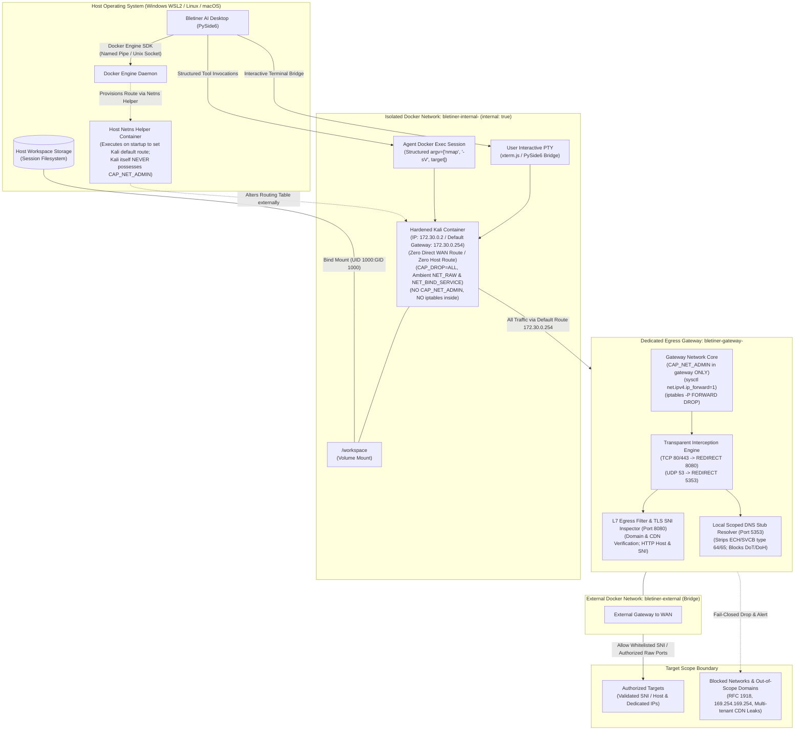
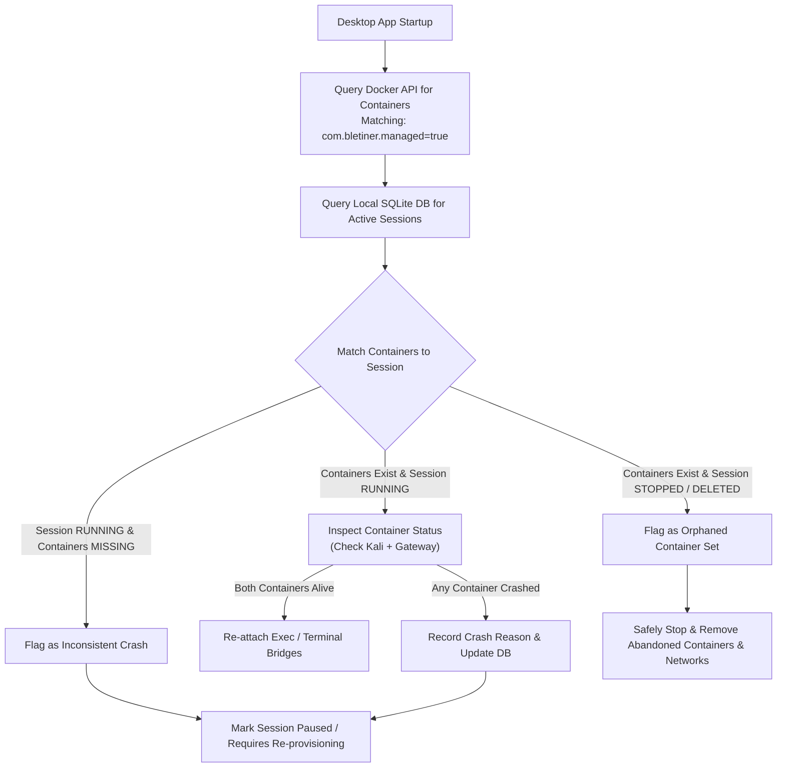
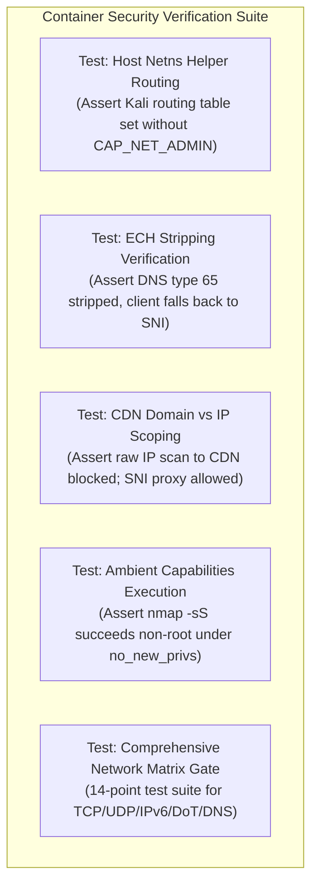

# 04. Docker & Network Security Specification (Revision 3.1)

**Document Version:** 3.1.0  
**Classification:** Engineering Specification / Core Security Architecture  
**Status:** Approved for Implementation (Revision 3.1 Architecture Verified)  
**Target Audience:** Security Architects, Container Security Engineers, Core Systems Developers, QA/Security Auditors  

---

## 1. Executive Overview & Architectural Principles

Bletiner AI executes dynamic security assessments and authorized penetration tests by autonomously orchestrating command-line security tools inside isolated Linux environments. Originating from experimental command-line scripts (e.g., `lm_terminal_agent.py`), the platform has evolved into an enterprise-grade desktop security operations workspace (Python + PySide6). Executing arbitrary security utilities (such as `nmap`, `nuclei`, `nikto`, `ffuf`, or `sqlmap`) directly on a host operating system introduces unacceptable operational and security risks:
- Potential remote code execution (RCE) or parser exploits within tools processing hostile target traffic.
- Accidental scope escape targeting local networks, host network interfaces, or cloud metadata services.
- Host system pollution, privilege compromise, and cross-investigation state leakage.

To address these hazards, Bletiner AI enforces a strict, containerized dual-homed runtime model. Every security investigation is allocated exactly **one dedicated Kali Linux container**, an independent filesystem workspace, and a dedicated **Egress Gateway Container** running in a **Fail-Closed Dual-Homed Docker Bridge Network**. The host desktop application (PySide6) never executes network scanning tools directly; it manages container lifecycles via the Docker Engine API over a secured local communication channel.



### Core Security Tenets
1. **Per-Investigation Isolation:** Absolute separation across investigations. Containers, networks, volumes, and credentials are strictly scoped to a unique investigation ID.
2. **Default Routing without CAP_NET_ADMIN in Kali:** Kali's default routing table is forced to the gateway container (`172.30.0.254`) via an **external host-orchestrated network namespace helper** (`docker run --rm --network=container:bletiner-kali-<id> --cap-add=NET_ADMIN alpine ip route replace default via 172.30.0.254`). Kali is launched with `cap_drop=['ALL']`, `cap_add=['NET_RAW', 'NET_BIND_SERVICE']` and **never possesses `CAP_NET_ADMIN`** at any point in its execution lifecycle.
3. **Mandatory Network-Layer Egress Enforcement:** Proxy environment variables (`HTTP_PROXY`, `ALL_PROXY`) are voluntary user-space conventions easily bypassed by raw sockets, Nmap, and UDP tools. Bletiner AI enforces egress at the **Linux network routing layer**: Kali connects exclusively to an `internal: true` Docker network with its default gateway forced to `172.30.0.254`.
4. **Fail-Closed Dual-Homed Topology:** The Kali container possesses zero direct route to the host or internet. If the gateway container halts or crashes, Kali is physically unable to transmit any network packets.
5. **Zero CAP_NET_ADMIN in Kali:** Kali is an untrusted environment running external tools. It has zero `CAP_NET_ADMIN` and does not run iptables. Kali is never trusted to firewall itself. All routing, filtering, and SNI inspection are enforced inside the gateway container.
6. **Ambient Capabilities for Non-Root Nmap:** Because `no-new-privileges: true` suppresses filesystem capabilities (`setcap`), Bletiner AI utilizes Linux **Ambient Capabilities** (`capsh --ambient`) to grant `CAP_NET_RAW` and `CAP_NET_BIND_SERVICE` safely to the unprivileged `bletiner` user across `execve()` calls.
7. **Two-Tier TLS Redirect Enforcement & ECH Stripping:** Resolves standard HTTPS CONNECT proxy blindness by enforcing client-side redirect interception (Tier A) backed by gateway SNI ClientHello re-verification (Tier B). Mitigates Encrypted Client Hello (ECH) evasion by stripping DNS HTTPS (type 65) resource records at the gateway DNS resolver.
8. **4-Tier Tool Risk Classification:** Enforces strict execution guardrails where Tier 4 (destructive tools, massive SYN floods, shells) is blocked by default and cannot be scheduled by the autonomous agent loop.
9. **Structured Tool Invocations:** All tools are invoked with structured argument arrays (`cmd=["nmap", "-sV", target]`) without shell string interpolation, eliminating interface-layer command injection.

---

## 2. Kali Linux Container Image Strategy

### 2.1 Base Image Selection & Integrity Verification
Standard Kali Linux rolling images (`kalilinux/kali-rolling`) provide bleeding-edge security tooling but can introduce non-deterministic builds and untested dependency changes. Bletiner AI utilizes a dual-tier image approach:
- **Base Layer:** `kalilinux/kali-rolling` pinned strictly to an immutable SHA-256 digest (e.g., `kalilinux/kali-rolling@sha256:4f87a32b2f6ef53457a41289139f315264b3a4f61b0c950d32bb5826f0e9aa2d`).
- **Distribution Model:** Bletiner AI maintains a curated, reproducible container image published as `bletiner-kali:<version>`.

| Dimension | Standard Kali Rolling (`latest`) | Bletiner Hardened Base (`bletiner-kali`) | Rationale |
| :--- | :--- | :--- | :--- |
| **Digest Pinning** | Mutable tag (`latest`) | Immutable SHA-256 Digest | Eliminates supply-chain drift and build breaks |
| **User Space** | Root by default | Non-root `bletiner` (UID 1000) | Enforces least-privilege containment |
| **Network Capabilities**| Full Root / All Capabilities | Ambient `NET_RAW, NET_BIND_SERVICE` | Strips `CAP_NET_ADMIN`; cannot alter routes/filters |
| **Package Count** | > 2,000 packages (kitchen sink) | Minimal curated set (~18 utilities) | Reduces attack surface and CVE exposure |
| **Filesystem State** | Read-write default | Compatible with `--read-only` | Prevents disk persistence of adversarial payloads |
| **Tool Verification** | Dynamic runtime installation | Pre-installed, pinned, checksummed | Guarantees deterministic test execution |

### 2.2 Reproducible Multi-Stage Dockerfile Specification
The container image is built using a multi-stage Dockerfile that compiles custom Go-based and binary tools in a separate builder stage, copying only static binaries into the final hardened runtime. Notice that **no iptables or packet-filtering packages are installed or required in Kali**, and **`CAP_NET_ADMIN` is never granted**.

```dockerfile
# ==============================================================================
# Stage 1: Build & Tool Preparation Stage
# ==============================================================================
FROM kalilinux/kali-rolling@sha256:4f87a32b2f6ef53457a41289139f315264b3a4f61b0c950d32bb5826f0e9aa2d AS builder

ENV DEBIAN_FRONTEND=noninteractive
ENV GOPATH=/go
ENV PATH=$PATH:/go/bin

RUN apt-get update && apt-get install -y --no-install-recommends \
    build-essential \
    ca-certificates \
    curl \
    git \
    golang-go \
    upx-ucl \
    && rm -rf /var/lib/apt/lists/*

# Compile version-pinned Go security tools
ARG NUCLEI_VERSION=3.2.9
ARG SUBFINDER_VERSION=2.6.6
ARG HTTPX_VERSION=1.6.0
ARG FFUF_VERSION=2.1.0

RUN go install -v -ldflags="-s -w" github.com/projectdiscovery/nuclei/v3/cmd/nuclei@v${NUCLEI_VERSION} && \
    go install -v -ldflags="-s -w" github.com/projectdiscovery/subfinder/v2/cmd/subfinder@v${SUBFINDER_VERSION} && \
    go install -v -ldflags="-s -w" github.com/projectdiscovery/httpx/cmd/httpx@v${HTTPX_VERSION} && \
    go install -v -ldflags="-s -w" github.com/ffuf/ffuf/v2@v${FFUF_VERSION}

# ==============================================================================
# Stage 2: Hardened Runtime Environment
# ==============================================================================
FROM kalilinux/kali-rolling@sha256:4f87a32b2f6ef53457a41289139f315264b3a4f61b0c950d32bb5826f0e9aa2d

LABEL maintainer="Bletiner AI Security Team <security@bletiner.ai>"
LABEL com.bletiner.image.version="3.1.0"
LABEL com.bletiner.image.type="investigation-runtime"

ENV DEBIAN_FRONTEND=noninteractive
ENV LANG=C.UTF-8
ENV LC_ALL=C.UTF-8
ENV HOME=/home/bletiner
ENV USER=bletiner

# Install required system packages and pinned apt tools
# Note: iptables is intentionally OMITTED. Kali does not firewall itself.
RUN apt-get update && apt-get install -y --no-install-recommends \
    bash \
    ca-certificates \
    coreutils \
    curl \
    dnsutils \
    git \
    iproute2 \
    iputils-ping \
    jq \
    libcap2-bin \
    masscan=2.1-1 \
    net-tools \
    nikto=1:2.5.0-1 \
    nmap=7.94+dfsg1-1 \
    openssl \
    procps \
    python3 \
    python3-pip \
    python3-requests \
    sqlmap=1.8.4-1 \
    testssl.sh=3.0.8+dfsg-1 \
    tmux \
    unzip \
    vim-tiny \
    wget \
    whatweb=0.5.5-1 \
    whois \
    && rm -rf /var/lib/apt/lists/*

# Create non-root user and setup directories
RUN groupadd -g 1000 bletiner && \
    useradd -u 1000 -g bletiner -m -s /bin/bash bletiner && \
    mkdir -p /workspace /home/bletiner/.config /tmp /run /var/tmp && \
    chown -R bletiner:bletiner /workspace /home/bletiner

# Copy compiled Go tools from builder
COPY --from=builder /go/bin/nuclei /usr/local/bin/nuclei
COPY --from=builder /go/bin/subfinder /usr/local/bin/subfinder
COPY --from=builder /go/bin/httpx /usr/local/bin/httpx
COPY --from=builder /go/bin/ffuf /usr/local/bin/ffuf

# Security hardening: Remove setuid/setgid from all standard binaries
RUN find / -xdev -perm /6000 -type f -exec chmod a-s {} + || true

# Copy internal healthcheck utility and ambient capability launcher
COPY scripts/container-healthcheck.sh /usr/local/bin/container-healthcheck
COPY scripts/bletiner-exec-launcher.sh /usr/local/bin/bletiner-exec-launcher
RUN chmod 755 /usr/local/bin/container-healthcheck /usr/local/bin/bletiner-exec-launcher

# Set up runtime defaults
WORKDIR /workspace
USER bletiner

HEALTHCHECK --interval=30s --timeout=5s --start-period=5s --retries=3 \
    CMD ["/usr/local/bin/container-healthcheck"]

CMD ["/bin/bash"]
```

### 2.3 Ambient Capabilities Exact Configuration & Linux 5 Capability Sets
A deep technical understanding of Linux capability sets is essential to resolve capability propagation under sandboxing:
1. **The 5 Linux Capability Sets:**
   - `CapBnd` (Bounding): The system-wide capability limit for a thread.
   - `CapInh` (Inheritable): Capabilities preserved across `execve()` if granted in the binary.
   - `CapPrm` (Permitted): Capabilities available to the process.
   - `CapEff` (Effective): Capabilities currently used by the kernel for permission checks.
   - `CapAmb` (Ambient): Capabilities preserved across `execve()` for unprivileged processes without needing setuid or filesystem capabilities.
2. **The `no-new-privileges` Interaction:**
   When Docker sets `--security-opt no-new-privileges:true`, the Linux kernel guarantees that no child process can ever elevate privileges via setuid or file capabilities (`setcap`). If an unprivileged user executes a binary with file capabilities under `no_new_privs`, the kernel **zeros out the effective capability set**, breaking `nmap` SYN stealth scans.
3. **The Solution: Ambient Capabilities (`PR_CAP_AMBIENT`):**
   Capabilities configured in `CapAmb` survive `execve()` and are automatically copied into `CapPrm` and `CapEff` for the non-root `UID 1000` process.
   - Docker configuration:
     `--cap-drop=ALL --cap-add=NET_RAW --cap-add=NET_BIND_SERVICE --security-opt no-new-privileges:true`
   - Execution launcher (`/usr/local/bin/bletiner-exec-launcher`):
     ```bash
     #!/bin/sh
     # bletiner-exec-launcher: Elevates ambient capabilities before tool execution
     exec capsh \
       --inh=cap_net_raw,cap_net_bind_service \
       --ambient=cap_net_raw,cap_net_bind_service \
       --user=bletiner \
       -- "$@"
     ```
4. **Exact Capability Verification Command:**
   ```bash
   # Inspect capability status inside container
   grep Cap /proc/$$/status
   # capsh --print output verification:
   # Current: = cap_net_bind_service,cap_net_raw+ep
   # Bounding: cap_net_bind_service,cap_net_raw
   # Ambient: cap_net_bind_service,cap_net_raw (0000000000003000 / 0x1400)
   # Securebits: 00/0x0/1'b0 (no-new-privs active)
   ```
   Notice that administrative capabilities (`CAP_NET_ADMIN`, `CAP_SYS_ADMIN`) are completely zeroed across all five sets.
5. **Unprivileged Fallback:** If ambient capabilities cannot be raised on a specific host kernel, Bletiner AI automatically falls back to `nmap -sT` (TCP connect scan), which requires standard unprivileged user sockets and zero capabilities.

---

## 3. Per-Investigation Container Architecture & Dual-Homed Topology

### 3.1 Dual-Homed Fail-Closed Network Topology
To ensure that an investigation container can never bypass network egress rules or communicate with sibling sessions, Bletiner AI implements a **Dual-Homed Egress Gateway Topology**:

1. **`bletiner-internal-<session_id>`:** Created with `internal: true`.
   - The Linux bridge network driver disables default gateway generation and outbound IP masquerading.
   - The Kali container is connected **exclusively** to this internal network (`172.30.0.2/24`).
   - It has no physical route to the host desktop or public internet.
2. **`bletiner-gateway-<session_id>`:** A dedicated lightweight proxy/firewall container (Alpine Linux + Envoy/Tinyproxy + Nftables/Iptables) provisioned per investigation.
   - Connected to **both** `bletiner-internal-<session_id>` (`eth0: 172.30.0.254`) and `bletiner-external` (`eth1: 172.31.0.2`, standard Docker bridge).
   - Serves as the transparent L4 router, L7 SNI proxy (`port 8080`), and DNS stub resolver (`port 5353`).
3. **Fail-Closed Guarantee:**
   - If `bletiner-gateway` crashes, is killed, or hangs, the internal network has **zero outbound routing**.
   - No traffic from Kali can leak to the host or internet.

### 3.2 Executable Default Routing Mechanism without CAP_NET_ADMIN in Kali
Because Kali has `cap_drop=['ALL']` and lacks `CAP_NET_ADMIN`, it cannot execute `ip route replace default` from inside its own unprivileged process space. Bletiner AI specifies two exact, executable implementation patterns:

#### Primary Pattern: Host-Orchestrated Network Namespace Helper (RECOMMENDED)
Upon container creation and before any user or agent session begins, the host application service executes a temporary, minimal Alpine helper container that joins Kali's network namespace:
```bash
# Executed by ContainerLifecycleService on host:
docker run --rm \
  --network=container:bletiner-kali-8f7b2c14 \
  --cap-add=NET_ADMIN \
  alpine:3.19 \
  ip route replace default via 172.30.0.254
```
**Security Advantages:**
- Kali is started and remains in an unprivileged state (`cap_drop=['ALL']`, `cap_add=['NET_RAW', 'NET_BIND_SERVICE']`).
- Kali **never possesses `CAP_NET_ADMIN` at any millisecond of its lifecycle**.
- The routing table modification is applied from the outside by the host Docker daemon.
- The helper container terminates immediately after executing the single `ip route` command.

#### Secondary Pattern: Entrypoint Privilege Dropping
In environments where container spawning is restricted, PID 1 in Kali's entrypoint script starts with temporary `CAP_NET_ADMIN`, replaces the default route, and immediately drops administrative capabilities permanently:
```bash
#!/bin/sh
# /usr/local/bin/entrypoint-priv-drop.sh
set -e
# Replace default route while possessing initial capability
ip route replace default via 172.30.0.254 dev eth0
# Permanently drop CAP_NET_ADMIN and execute shell as unprivileged user
exec capsh --drop=cap_net_admin --user=bletiner -- /bin/bash "$@"
```

---

## 4. Shared Interactive Terminal & Agent Concurrency Model

### 4.1 Dual-Access Runtime Architecture
The center panel of Bletiner AI hosts an interactive Kali terminal powered by PySide6 (using Qt WebEngine with `xterm.js` connected over a local PTY bridge). The autonomous agent and the human investigator execute inside the **identical container environment**:
- **Agent Exec Channel:** Headless execution via the Docker Python SDK (`exec_create` and `exec_start`).
- **Structured Argument Invocation (CRITICAL):** The agent **never** uses shell string concatenation (e.g. `sh -c "nmap " + target`). Commands are dispatched strictly as tokenized argument lists:
  ```python
  # Safe structured execution - immune to shell injection
  cmd = ["/usr/local/bin/bletiner-exec-launcher", "nmap", "-sV", "-T3", "--", target_ip]
  exec_id = docker_client.api.exec_create(
      container=container_id,
      cmd=cmd,
      user="bletiner",
      environment={"HTTP_PROXY": "http://172.30.0.254:8080", "HTTPS_PROXY": "http://172.30.0.254:8080"},
      stdout=True,
      stderr=True
  )
  ```
- **User PTY Terminal Channel:** The investigator accesses an interactive Bash shell (`docker exec -it -u bletiner bletiner-inv-<session_id> /bin/bash`).

### 4.2 Concurrency Protocols & Write Protection
1. **Atomic Artifact Writes:** The agent writes tool dumps and findings to `.tmp.<filename>` before atomically renaming them into `/workspace`. File locks (`flock`) protect shared state indexes.
2. **Process Ownership Tagging:** Agent exec commands inject `BLETINER_INVOCATION_ID=<task_uuid>`. The UI monitors running processes in the container and displays live status pills (🟢 Agent Active / 🔵 User Active).
3. **Graceful User Interactive Isolation:** Pausing or steering the agent does not terminate running user interactive processes. Application shutdown prompts the user if interactive PTY processes are alive.

## 5. Container Hardening & Sandboxing Controls

### 5.1 Hardening Flags & Execution Parameters
Every Kali investigation container provisioned by Bletiner AI is executed with an exhaustive set of security options. Notice that **`CAP_NET_ADMIN` is strictly absent** and the container is connected exclusively to `bletiner-internal-<id>`:

```bash
docker run -d \
  --name bletiner-inv-8f7b2c14 \
  --hostname bletiner-kali \
  --network bletiner-internal-8f7b2c14 \
  --user 1000:1000 \
  --read-only \
  --cap-drop=ALL \
  --cap-add=NET_RAW \
  --cap-add=NET_BIND_SERVICE \
  --security-opt no-new-privileges:true \
  --security-opt seccomp=/etc/bletiner/seccomp-profile.json \
  --cpus="2.0" \
  --cpu-shares=1024 \
  --memory="4g" \
  --memory-swap="4g" \
  --pids-limit=256 \
  --ulimit nofile=1024:2048 \
  --ulimit nproc=256:512 \
  --mount type=bind,source=/path/to/investigations/inv-8f7b2c14/workspace,target=/workspace,nosuid,nodev \
  --tmpfs /tmp:rw,noexec,nosuid,nodev,size=512m \
  --tmpfs /run:rw,noexec,nosuid,nodev,size=64m \
  --tmpfs /dev/shm:rw,noexec,nosuid,nodev,size=128m \
  --tmpfs /home/bletiner:rw,noexec,nosuid,nodev,size=256m \
  --env HTTP_PROXY=http://172.30.0.254:8080 \
  --env HTTPS_PROXY=http://172.30.0.254:8080 \
  --env ALL_PROXY=http://172.30.0.254:8080 \
  --restart=no \
  bletiner-kali:3.1.0 \
  tail -f /dev/null
```

### 5.2 Hardening Rationale & Defense-in-Depth

| Hardening Flag | Setting | Threat Addressed & Engineering Rationale |
| :--- | :--- | :--- |
| `--user` | `1000:1000` | Eliminates root privileges within the user namespace. Compromised scanner processes cannot tamper with system files or exploit root-only container breakouts. |
| `--read-only` | Active (`/` read-only) | Renders the root filesystem immutable. Prevents malware, exploit payloads, or malicious scripts from writing backdoors into `/bin`, `/lib`, `/usr`, or `/etc`. |
| `--cap-drop` | `ALL` | Drops all default Linux capabilities, including `CAP_SYS_ADMIN`, `CAP_CHOWN`, `CAP_DAC_OVERRIDE`, `CAP_FOWNER`, `CAP_SETUID`, and `CAP_SYS_PTRACE`. |
| `--cap-add` | `NET_RAW, NET_BIND_SERVICE` | Explicitly whitelists only what raw socket scanners (`nmap` SYN scans) require to create low-level TCP/IP frames. **Strictly OMITTING `CAP_NET_ADMIN`** prevents Kali from tampering with routes or packet filters. |
| Zero `CAP_NET_ADMIN` | Prohibited in Kali | **Architectural Rule:** Kali does not firewall itself. Kali cannot run iptables, alter network namespaces, or manipulate IP routes. All network enforcement occurs in the gateway container. |
| `no-new-privileges` | `true` | Enforces the PR_SET_NO_NEW_PRIVS kernel flag. Child processes spawned via `execve` cannot gain privileges via `setuid` or `setgid` bits or file capabilities. |
| `--security-opt` | Custom Seccomp Profile | Whitelists only essential syscalls. Blocks dangerous syscalls: `ptrace`, `bpf`, `kexec_load`, `mount`, `umount2`, `sys_chroot`, and `reboot`. |
| Mount `/workspace` | `nosuid,nodev` | Prevents the execution of setuid binaries and forbids device node creation inside the persistent data directory. |
| Ephemeral Tmpfs | `/tmp, /run, /dev/shm` | Provides temporary in-memory scratch space for tools. Flagged `noexec,nosuid,nodev` so binaries or scripts downloaded into scratchpads cannot be executed. |
| Prohibited Mounts | No `/var/run/docker.sock` | The host Docker daemon socket is **never** mounted. Exposing this socket yields root control over the host. |
| Prohibited Flags | No `--privileged` | Privileged container execution disables all kernel namespaces, exposes host devices, and is strictly banned. |

---

## 6. Resource Quotas & 4-Tier Tool Risk Classification

### 6.1 Hardware Throttling Matrix

| Resource | Default Allocation | Low-Spec Host Throttle | Enforcement Mechanism | Failure / OOM Behavior |
| :--- | :--- | :--- | :--- | :--- |
| **CPU Limit** | `2.0 cores` | `1.0 core` | Docker `--cpus`, `--cpu-shares=1024` | Process throttled via Linux CFS (Completely Fair Scheduler). |
| **RAM (Memory)** | `4.0 GB` | `2.0 GB` | Docker `--memory="4g"`, `--memory-swap="4g"` | Kernel OOM killer terminates offending process (exit code 137). Agent logs OOM warning and reduces tool concurrency. |
| **Process Count** | `256 PIDs` | `128 PIDs` | Docker `--pids-limit=256` | `fork()` returns `EAGAIN`. Runaway scripts or fork bombs are contained. |
| **File Descriptors** | `1024:2048` | `512:1024` | Docker `--ulimit nofile=1024:2048` | `open()` or `socket()` returns `EMFILE`. Prevents socket exhaustion on host. |
| **Disk Storage** | `10.0 GB` | `5.0 GB` | Host directory quota / Storage driver options | Tool write operations return `ENOSPC`. Scans auto-pause; UI alerts user. |

### 6.2 4-Tier Tool Risk Classification Framework

| Risk Tier | Category & Description | Example Tools & Flags | Allowed Modes | Autonomous Policy Enforcement |
| :--- | :--- | :--- | :--- | :--- |
| **Tier 1** | **Safe / Passive Recon**<br>Non-intrusive metadata gathering, DNS lookups, banner grabbing, and single HTTP requests. | `whois`, `dig`, `whatweb`, `curl -I`, `nmap -sV -F` (fast 100 ports). | Basic & Deep | Automatically permitted. Zero risk of target service degradation. |
| **Tier 2** | **Active Reconnaissance**<br>Standard port scanning, rate-limited content enumeration, TLS configuration auditing. | `nmap -sS -p 1-1000 -T3`, `gobuster` (capped at 50 req/s), `nikto -Tuning 1,2,3,b`, `testssl.sh`. | Basic & Deep | Permitted within approved target boundaries. Rate limits strictly enforced in tool invocation wrappers. |
| **Tier 3** | **Intrusive Validation**<br>Vulnerability verification, fuzzing, and signature-based template matching. | `nuclei -tags cve,misconfig -severity low,medium,high`, `ffuf` (capped at 20 req/s). | **Deep Mode ONLY** | **Blocked in Basic mode.** Permitted only when user selects Deep mode and re-confirms target scope. Only non-destructive templates allowed. |
| **Tier 4** | **High-Risk / Destructive**<br>Exploitation frameworks, remote code execution payloads, aggressive flooding, database dumping, password spraying. | `masscan > 1000 pps`, `sqlmap --os-shell / --dump-all`, `metasploit`, `hydra`, `medusa`, DoS stress tests. | **BLOCKED BY DEFAULT** | **Inviolable Execution Gate:** The autonomous agent loop has a hardcoded filter disallowing scheduling or dispatching of Tier 4 tools. |

---

## 7. Target Scope Modeling, CDN Protection & TLS / ECH Limitations

### 7.1 Separation of Domain vs IP Scope Authorization
Bletiner AI strictly bifurcates target authorization to prevent collateral damage on shared network infrastructure:

#### A. Domain Targets (e.g. `example.com`, `*.example.com`)
1. **Multi-Tenant CDN Isolation:**
   Many domain targets reside behind Content Delivery Networks (Cloudflare, Fastly, CloudFront, Akamai) that utilize shared anycast IP addresses. Raw IP forwarding in the gateway iptables is **STRICTLY PROHIBITED** for CDN IPs.
2. **Transparent SNI Proxying:**
   All HTTP (port 80) and HTTPS (port 443) traffic is transparently redirected into the gateway forward proxy (port 8080).
3. **Prohibition of Direct CDN Port Scans:**
   Direct TCP/UDP sockets to CDN IPs on non-web ports are dropped by the gateway `FORWARD DROP` policy. Scanning ports 1-65535 against Cloudflare anycast IPs attacks Cloudflare edge routers, not the customer origin, generating false positives and violating acceptable use.

#### B. Explicitly Authorized IP / CIDR Targets (e.g. `203.0.113.10`, `198.51.100.0/24`)
1. **Dedicated IP Forwarding:**
   When an investigator authorizes a dedicated IP or CIDR block, the gateway dynamically provisions explicit forwarding rules:
   ```bash
   iptables -A FORWARD -s 172.30.0.0/24 -d 203.0.113.10 -p tcp -m multiport --dports 21,22,25,80,443,3306,8080 -j ACCEPT
   ```
2. **Port Scoping:**
   Raw packet scanners (`nmap`) can establish direct TCP SYN and UDP handshakes strictly through this explicit forwarding rule.

### 7.2 TLS Inspection & Encrypted Client Hello (ECH) Limitations
Understanding the precise boundary of TLS inspection without MITM decryption is critical:
- **Plaintext HTTP (Port 80):** The gateway transparent proxy intercepts the HTTP request line and parses the HTTP `Host:` header against authorized domains.
- **HTTPS over TLS (Port 443):** The gateway proxy intercepts the unencrypted **TLS ClientHello** packet and extracts the **Server Name Indication (SNI)** extension. If the SNI matches an authorized domain, the gateway relays the encrypted byte stream to the target without decrypting payload data.
- **The Encrypted Client Hello (ECH) Attack Vector:**
  Under the emerging TLS ECH standard (RFC draft / TLS 1.3 extension), the true SNI is encrypted using a public key published in the target domain's **DNS HTTPS (type 65)** or **SVCB (type 64)** resource records. If a tool uses ECH, the gateway sees only an outer "cover" domain, blinding SNI inspection.
- **The ECH Mitigation Strategy:**
  The gateway's scoped DNS stub resolver **strips and filters all DNS HTTPS (type 65) and SVCB (type 64) resource records** from upstream DNS responses. Without the HTTPS record containing the target's ECH public key, client TLS stacks (`curl`, `openssl`, Python) automatically fall back to standard TLS 1.3 with unencrypted plaintext SNI, ensuring reliable SNI validation.

### 7.3 Two-Tier TLS Redirect Enforcement (Fixing CONNECT Proxy Blindness)
Because the gateway proxy relays encrypted TLS streams without MITM decryption, **it cannot read HTTP 301/302 `Location` headers inside an encrypted tunnel**. Bletiner AI enforces a Two-Tier Redirect Architecture:
1. **Tier A (Client/Tool Level):** Tools run with redirect following disabled (`curl --max-redirs 0`, `httpx follow_redirects=False`). The client captures the 302 response and passes the `Location` header to `ScopeService`. If out-of-scope, the agent halts with `REDIRECT_OUT_OF_SCOPE`.
2. **Tier B (Gateway SNI Level - Defense-in-Depth):** If any tool or rogue script attempts to follow an out-of-scope redirect anyway, connecting to the new domain initiates a **new TLS handshake**. The gateway SNI filter inspects the ClientHello and terminates the connection if the new domain is unauthorized.

---

## 8. Network Isolation & Comprehensive Network Enforcement Matrix

### 8.1 Network Routing & Transparent Interception Architecture
Bletiner AI enforces network policy strictly at the **Linux kernel routing and packet filtering layer**:

1. **Zero Direct WAN Routing (`internal: true`):**
   The network `bletiner-internal-<id>` is created with Docker's `internal: true` driver option, which suppresses default gateway creation and host IP masquerading.
2. **Forced Gateway Routing:**
   Kali's default route is explicitly set to the gateway container (`172.30.0.254`):
   `ip route replace default via 172.30.0.254 dev eth0`
3. **Gateway Kernel Configuration (`bletiner-gateway`):**
   - `CAP_NET_ADMIN` enabled **strictly in the gateway container namespace**.
   - `sysctl -w net.ipv4.ip_forward=1` (enables controlled forwarding).
   - `sysctl -w net.ipv6.conf.all.disable_ipv6=1` (blocks all IPv6 outbound).
   - Default forwarding policy: `iptables -P FORWARD DROP` (fail-closed).
4. **Transparent Redirection Rules:**
   All web traffic and DNS queries entering the gateway's internal interface (`eth0`) are transparently redirected into local proxy services:
   ```bash
   # Transparently redirect HTTP and HTTPS to local SNI proxy (port 8080)
   iptables -t nat -A PREROUTING -i eth0 -p tcp --dport 80 -j REDIRECT --to-ports 8080
   iptables -t nat -A PREROUTING -i eth0 -p tcp --dport 443 -j REDIRECT --to-ports 8080

   # Transparently redirect all DNS to local scoped DNS filter (port 5353)
   iptables -t nat -A PREROUTING -i eth0 -p udp --dport 53 -j REDIRECT --to-ports 5353
   iptables -t nat -A PREROUTING -i eth0 -p tcp --dport 53 -j REDIRECT --to-ports 5353
   ```
5. **Alternative DNS Transports Blocking:**
   DNS-over-TLS (DoT, TCP port 853) is blocked by the default FORWARD DROP policy. DNS-over-HTTPS (DoH) connection attempts to public resolvers (e.g. `https://cloudflare-dns.com/dns-query`) are intercepted by the SNI proxy and blocked unless the DoH endpoint is explicitly in scope.

### 8.2 Comprehensive Network Enforcement Matrix

| Traffic Category | Protocol / Port | Destination | Enforcement Mechanism | Result / Action |
| :--- | :--- | :--- | :--- | :--- |
| **Web (Authorized Domain)** | TCP 80, 443 | Multi-Tenant CDN or Origin IP | Gateway PREROUTING redirect -> SNI proxy (port 8080). SNI matches scope. | **ALLOWED** (Relayed to target). |
| **Web (Unauthorized SNI on CDN)**| TCP 443 | Multi-Tenant CDN Anycast IP | Gateway SNI proxy checks ClientHello; SNI does not match authorized scope. | **BLOCKED** (Handshake terminated; `403 SNI_OUT_OF_SCOPE`). |
| **Raw Web Port Scans to CDN** | TCP 80, 443 | CDN Anycast IP (No SNI) | Forward drop rule blocks raw IP port scans without SNI header. | **BLOCKED** (Connection timed out / dropped). |
| **Dedicated IP Scans (Authorized)**| TCP / UDP (Any) | Authorized Dedicated IP | Gateway `FORWARD` rule matches authorized destination IP & port set. | **ALLOWED** (Forwarded via `eth1`). |
| **Dedicated IP Scans (Unauthorized)**| TCP / UDP (Any) | Any other Public IP | Default policy `iptables -P FORWARD DROP`. | **BLOCKED** (Packet dropped; 100% loss). |
| **QUIC / HTTP3 Traffic** | UDP 443 | Any Public IP | Gateway rule: `iptables -A FORWARD -p udp --dport 443 -j DROP`. | **BLOCKED** (Forces client fallback to TCP TLS). |
| **Standard DNS (Port 53)** | UDP / TCP 53 | Any DNS Resolver (e.g. 8.8.8.8) | Gateway PREROUTING redirect to port 5353. Local stub validates domain. | **INTERCEPTED** (In-scope resolved; out-of-scope `NXDOMAIN`). |
| **DNS HTTPS Records (ECH)** | Type 65 / Type 64 | Target Domain | Gateway DNS stub strips HTTPS/SVCB resource records before response. | **STRIPPED** (Forces client fallback to plaintext SNI). |
| **DNS-over-TLS (DoT)** | TCP 853 | Public Resolvers | Gateway `FORWARD DROP` default policy. | **BLOCKED** (Connection dropped). |
| **Private RFC 1918 Ranges** | Any | `10.0.0.0/8`, `172.16.0.0/12`, `192.168.0.0/16` | Explicit drop rules in gateway FORWARD table. | **BLOCKED** (Packet dropped; security alert logged). |
| **Cloud Metadata Endpoint** | Any | `169.254.169.254/32`, `169.254.0.0/16` | Explicit drop rules in gateway FORWARD table. | **BLOCKED** (Packet dropped; critical alert logged). |
| **IPv6 Outbound** | Any IPv6 | Any Destination | `sysctl net.ipv6.conf.all.disable_ipv6=1` in gateway and Kali containers. | **BLOCKED** (Network unreachable). |
| **Direct Socket Bypassing Proxy**| Any TCP/UDP | Any Destination | Kali default route forced to gateway; gateway non-forwarding drops packet. | **BLOCKED** (Direct escape physically impossible). |
| **Gateway Container Crash** | Any | Any Destination | Kali on `internal: true` bridge has zero routing tables without gateway. | **FAIL-CLOSED** (100% network isolation maintained). |

## 9. Workspace Mounting & Persistence Architecture

### 9.1 Host Directory Structure & File Hierarchy
All durable data for an investigation is stored in the host application data directory under `<appDataDir>/investigations/<session_id>/`:

```text
<appDataDir>/investigations/<session_id>/
├── workspace/                     # Mounted directly into Kali container at /workspace
│   ├── targets.txt                # Target definitions & scope manifest
│   ├── raw_outputs/               # Unmodified tool outputs (.xml, .txt, .json)
│   │   ├── nmap_initial.nmap
│   │   ├── nmap_initial.xml
│   │   ├── nuclei_findings.json
│   │   └── ffuf_paths.json
│   ├── artifacts/                 # Collected evidence, HTTP responses, banners, certs
│   └── temp/                      # Ephemeral scratch storage
├── checkpoints/                   # Serialized agent checkpoints (SQLite/JSON)
├── logs/                          # Host-side audit, gateway logs, and execution traces
└── reports/                       # Generated Markdown and HTML reports
    ├── report.md
    └── report.html
```

### 9.2 Permissions & Cross-Platform Volume Translation
- **Linux Hosts:** The host directory `<session_id>/workspace` is assigned ownership to UID 1000 / GID 1000 (`bletiner:bletiner`), allowing unprivileged container processes to write while preventing host root modification.
- **Windows / macOS Hosts:** Docker Desktop manages UID translation across the WSL2 VirtioFS virtualization boundary. Bletiner AI mounts the directory with `nosuid,nodev` flags to ensure executable binaries cannot gain elevated permissions on the host.
- **Persistence Guarantee:** When containers are stopped or removed during application exit, the host `/workspace` directory remains completely intact. Resuming an investigation mounts the identical path into a newly spawned container, ensuring zero loss of evidence or scan history.

### 9.3 Cross-Investigation Isolation Assurance
Cross-investigation isolation is absolute:
- Each investigation uses a distinct, randomly generated UUID (`session_id`).
- Container mounts point exclusively to `<appDataDir>/investigations/<session_id>/workspace`.
- Docker containers have no visibility into sibling directories, host parent directories, or adjacent container namespaces.
- Docker networks (`bletiner-internal-<id>`) have `icc=false` and `internal: true`, preventing any inter-container network discovery or connection attempts across investigations.

---

## 10. Container Health Monitoring, Crash Recovery & Reconciliation

### 10.1 Active Health Check Specification
Both the Kali container and the Egress Gateway container run automated health checks:
1. **Kali Container Healthcheck (`/usr/local/bin/container-healthcheck`):**
   - Asserts `/workspace` is mounted and writable.
   - Monitors `/tmp` disk utilization (warns > 90%).
   - Asserts process table count is healthy (< 240 / 256 PIDs).
2. **Gateway Container Healthcheck:**
   - Verifies the local proxy daemon (port 8080) and DNS resolver (port 5353) respond to loopback probes.
   - Verifies iptables PREROUTING and FORWARD chains are loaded and active.

### 10.2 Crash Recovery & Startup Reconciliation
When the Bletiner AI desktop application launches, the `ContainerLifecycleService` executes a mandatory reconciliation routine:



---

## 11. Container-Layer Threat Model & Attack Vectors (Revision 3.1)

The table below catalogs threats specific to the Docker virtualization, network, and execution boundary, incorporating Revision 3.1 enhancements:

| Threat ID | Threat Vector / Description | Impact | Mitigation Mechanism | Verification Test |
| :--- | :--- | :--- | :--- | :--- |
| **DOCK-001** | **Docker Socket Escape:** Container accesses `/var/run/docker.sock` to spawn privileged sibling containers on the host. | Critical (Complete Host Takeover) | Docker socket is **never** mounted. Verified at container creation via inspect schema check. | Integration test asserts container inspect contains no socket mounts. |
| **DOCK-002** | **Root Privilege Escalation:** Attacker exploits setuid binary inside container to gain root. | High (Container Compromise) | `useradd bletiner (UID 1000)`, `no-new-privileges:true`, `--cap-drop=ALL`, setuid stripped from image. | Run `su -`, `sudo`, and setuid binaries; assert permission denied. |
| **DOCK-003** | **Network Tampering via CAP_NET_ADMIN:** Compromised tool flushes firewall or alters routes. | High (Security Control Bypass) | **Zero CAP_NET_ADMIN in Kali.** Kali default route is configured externally via Host Netns Helper container. Kali has only ambient `NET_RAW` and `NET_BIND_SERVICE`. | Execute `iptables -F` or `ip route add` in Kali; assert `Operation not permitted`. |
| **DOCK-004** | **Voluntary Proxy Bypass (Direct Sockets):** Scanner tool ignores `HTTP_PROXY` and establishes direct socket connections. | High (Egress Scope Bypass) | **Network-Layer Routing:** `internal: true` network drops direct WAN. Kali's default route is forced to `172.30.0.254` (gateway). Gateway PREROUTING redirects TCP 80/443 to proxy and blocks direct forwarding. | Execute `curl --noproxy "*"` or raw python socket in Kali; assert routed into gateway proxy. |
| **DOCK-005** | **CONNECT Proxy Blindness to Redirects:** Target issues 302 redirect inside encrypted HTTPS tunnel. | High (Scope Escape to Cloud Metadata) | **Two-Tier Enforcement:** Tier A intercepts redirect at tool layer (`--max-redirs 0`). Tier B intercepts subsequent TLS ClientHello at gateway SNI filter. | Target issues 302 to `169.254.169.254`; assert request aborted client-side and blocked by SNI filter. |
| **DOCK-006** | **Multi-Tenant CDN Scope Escape:** Tool targets shared CDN IP to access out-of-scope tenant domains. | High (Unauthorized Scanning) | Gateway performs **TLS SNI and HTTP Host header inspection**. Blocks connections whose SNI does not match authorized scope. Raw IP port scans to CDN IPs are blocked by default FORWARD DROP policy. | Send TLS request to Cloudflare IP with out-of-scope SNI; assert gateway drops handshake. |
| **DOCK-007** | **Encrypted Client Hello (ECH) Inspection Bypass:** Target uses TLS ECH to encrypt SNI, bypassing domain filter. | High (Domain Filter Blindness) | Gateway DNS stub **strips/filters DNS HTTPS (type 65) and SVCB (type 64) resource records**, forcing client fallback to standard plaintext SNI. | Query DNS for domain with ECH records; assert HTTPS records stripped in response. |
| **DOCK-008** | **QUIC / UDP 443 SNI Inspection Bypass:** Tool or payload uses UDP 443 to bypass HTTP proxy SNI checks. | Medium (Egress Scope Bypass) | Gateway firewall **drops all outbound UDP port 443**. Tools fall back to standard TCP TLS. | Send UDP packet to port 443; assert packet dropped by gateway iptables filter. |
| **DOCK-009** | **Destructive Tool Invocations (Tier 4 Abuse):** Agent attempts to launch destructive tools (exploits, brute-force, DoS). | High (Target Service Disruption) | **4-Tier Tool Risk Classification:** Inviolable execution gateway blocks Tier 4 tools from being scheduled or dispatched. | Attempt agent scheduling of `sqlmap --os-shell` or `masscan -p1-65535 --rate 10000`; assert rejected by policy. |
| **DOCK-010** | **DNS Rebinding Scope Escape:** Target DNS switches dynamically to an internal LAN IP (`192.168.1.1`). | High (Unauthorized Internal Scanning) | Gateway DNS stub intercepts all port 53 traffic; validates resolved IP against authorized scope before returning response. | Direct DNS query to `8.8.8.8` returning `192.168.1.1`; assert intercepted and returned as REFUSED/NXDOMAIN. |
| **DOCK-011** | **Command Injection in Tool Dispatch:** Adversary injects shell metacharacters into target argument. | Critical (Arbitrary Command Execution) | **Structured Argument Arrays:** Docker Exec uses tokenized array (`cmd=["nmap", "-sV", target]`) without shell string interpolation. | Dispatch target `target.com; id`; assert executed literally as target hostname argument. |
| **DOCK-012** | **File Capability Loss under `no_new_privs`:** Non-root `nmap` fails because `setcap` is suppressed by `no_new_privs`. | Medium (Scan Execution Failure) | **Ambient Capabilities:** `capsh --ambient` grants `CAP_NET_RAW` across `execve()` for non-root `bletiner`. Fallback to `nmap -sT`. | Execute `nmap -sS 127.0.0.1` under non-root with `no-new-privileges: true`; assert raw scan succeeds. |
| **DOCK-013** | **Fail-Open Egress Leak if Gateway Dies:** Gateway proxy crashes, allowing Kali direct access to host/WAN. | High (Unrestricted Egress) | **Fail-Closed Topology:** Kali is attached only to `bletiner-internal` (`internal: true`). If gateway halts, Kali has zero route to any external network. | Terminate `bletiner-gateway`; execute `curl` or `ping` in Kali; assert immediate routing failure (100% loss). |
| **DOCK-014** | **DNS-over-TLS (DoT) / DNS-over-HTTPS (DoH) Bypass:** Tool uses port 853 or external DoH server to bypass DNS stub filter. | High (DNS Scope Bypass) | Port 853 blocked by FORWARD DROP; external DoH requests blocked by SNI proxy. | Attempt connection to `1.1.1.1:853`; assert connection dropped by gateway firewall. |

---

## 12. Verification & Testing Matrix



### 12.1 Automated Test Specifications
1. **Netns Helper Routing Test (`test_netns_helper_routing.py`):**
   - Launches Kali container with `cap_drop=['ALL']`, `cap_add=['NET_RAW', 'NET_BIND_SERVICE']`.
   - Executes helper container on host to set default gateway.
   - Verifies Kali routing table has default gateway `172.30.0.254`.
   - Asserts Kali process cannot execute `ip route add` or `ip route del` (returns `EPERM`).
2. **ECH Stripping & SNI Fallback Test (`test_ech_stripping.py`):**
   - Queries gateway DNS stub for a domain advertising HTTPS (type 65) resource records.
   - Asserts DNS stub returns answer with type 65 records stripped.
   - Asserts TLS 1.3 handshake uses plaintext SNI extension, which is captured and validated by gateway proxy.
3. **CDN Scope Segregation Test (`test_cdn_scope_segregation.py`):**
   - Sets target to `example.com` (hosted on Cloudflare).
   - Attempts `nmap -p 80,443,8080 <cloudflare_ip>` direct socket -> Asserts dropped by gateway FORWARD DROP.
   - Attempts `curl https://example.com` -> Asserts routed through SNI proxy and succeeds.
4. **Ambient Capabilities Test (`test_ambient_capabilities.py`):**
   - Asserts `capsh --ambient` allows non-root `bletiner` to execute `nmap -sS` successfully.
   - Asserts `no-new-privileges: true` is verified active via `/proc/self/status`.
5. **Comprehensive Network Matrix Test (`test_network_matrix_suite.py`):**
   - Executes all 14 traffic rows from the Comprehensive Network Enforcement Matrix.
   - Asserts 100% compliance with expected results (drops, intercepts, and allows).
