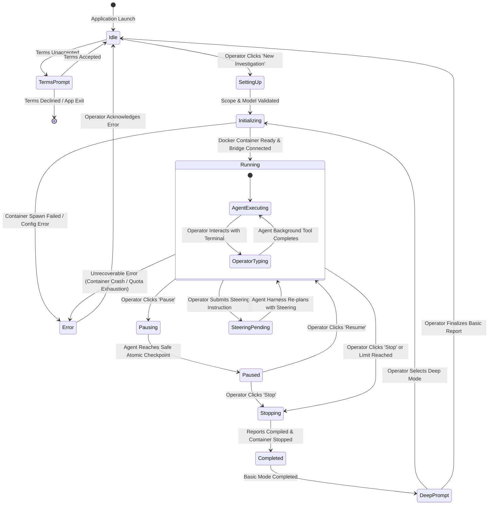
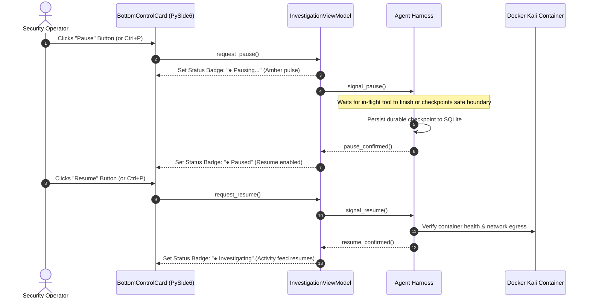

# Bletiner AI --- Desktop UI/UX Architecture & Specification

## Document Metadata
- **Document ID:** DOC-05-UIUX
- **Component:** Presentation Layer (PySide6 Desktop Application)
- **Status:** Approved & Implementation-Ready (Updated with User Reference Layout & Herdr-Inspired Aesthetic)
- **Target Framework:** Python 3.11+ / PySide6 (Qt 6.6+)
- **Author:** Desktop UI/UX Architect
- **Cross-References:** `docs/00_PRODUCT_OVERVIEW.md`, `docs/01_REQUIREMENTS.md`, `docs/02_SYSTEM_ARCHITECTURE.md`, `docs/03_AGENT_HARNESS.md`, `docs/04_DOCKER_AND_NETWORK_SECURITY.md`, `docs/07_DATA_MODEL_AND_SESSION_LIFECYCLE.md`, `docs/08_FINDINGS_AND_REPORTING.md`

---

## 1. Executive Summary & Design Philosophy

Bletiner AI is an autonomous, authorized security-investigation workstation. Its desktop interface is engineered not as a conversational chatbot, but as an **operational Security Operations Center (SOC) investigation deck**. The user experience borrows structural elegance and high visual density from modern developer workspaces (such as the Herdr desktop terminal environment), combining:
- A unified **Top Bar** with system brand, operational state badge, and sleek window controls.
- A **Three-Card Workspace** (Investigation Activity Card, Kali Linux Terminal Card, and Sessions & Files Drawer Card).
- A dedicated **Bottom Control & Steering Card** providing human-in-the-loop steering and pause/stop execution controls.
- A deep charcoal and obsidian dark palette (`#12141a`, `#1a1d24`, `#222630`) with crisp typography and semantic status accents.

### 1.1 Core UX Principles
1. **Silent Autonomy, High Observability:** The agent acts without narrating conversational filler. Instead, it streams structured operational telemetry: phase changes, tool dispatches, raw observations, and validated findings.
2. **Shared Sandbox Transparency:** The center pane displays a live, interactive terminal connected directly to the container PTY, enabling the operator to observe running tools in real time or run ad-hoc manual investigative commands within the exact same sandbox environment (*"Agent and user share the sandbox workspace"*).
3. **Deterministic Operator Sovereignty:** The human operator is always in command. The bottom steering deck allows mid-investigation instruction injection, bounded-latency pausing, and graceful termination.
4. **Strict Thread Segregation (60 FPS Guarantee):** The PySide6 UI thread is completely decoupled from Docker socket streaming, LLM network requests, and report generation via `qasync` and dedicated worker thread pools.
5. **Card-Based Visual Ergonomics:** Modular, rounded cards (`8px-12px` border radius) with subtle borders (`#2a2e39`) provide clear physical boundaries between investigative streams, live terminal execution, and session artifacts.

---

## 2. Desktop Presentation Architecture & PySide6 Bootstrap

### 2.1 Concurrency Model: Qt Event Loop + Python `asyncio`
PySide6 executes a native C++ event loop (`QEventLoop`). The Bletiner AI agent harness, Docker Engine API client, and LLM provider streaming clients are implemented using Python's asynchronous event loop (`asyncio`). 

To bridge these two event loops without thread deadlocks or polling loops, Bletiner AI utilizes **`qasync`** (a Qt-compliant `asyncio` event loop). `qasync` integrates Python coroutines directly into Qt's event pump on the main thread, allowing native Qt signals to trigger coroutines and background tasks to emit thread-safe Qt signals.

```
+---------------------------------------------------------------------------------------+
|                                  BLETINER DESKTOP PROCESS                             |
|                                                                                       |
|  +---------------------------------------------------------------------------------+  |
|  |                MAIN THREAD: qasync (Qt Event Pump + asyncio Loop)               |  |
|  |                                                                                 |  |
|  |  +-----------------------------------+   Qt Signals    +---------------------+  |  |
|  |  |        PySide6 Views (UI)         | <=============> |  ViewPort/ViewModels|  |  |
|  |  |  (TopBar, 3-Card Deck, BottomBar) |                 |  (State, Commands)  |  |  |
|  |  +-----------------------------------+                 +---------------------+  |  |
|  |                   ^                                               ^             |  |
|  +-------------------|-----------------------------------------------|-------------+  |
|                      | Qt Signals                                    | Thread-safe    |
|                      | (Direct / Queued)                             | Signals/Events |
|  +-------------------|-----------------------------------------------|-------------+  |
|  |                   v                                               v             |  |
|  |  +-----------------------------------+                 +---------------------+  |  |
|  |  |  Terminal WebSocket Bridge        |                 | Agent Harness Loop  |  |  |
|  |  |  (127.0.0.1 Auth Bridge)          |                 | (Async Coroutines)  |  |  |
|  |  +-----------------------------------+                 +---------------------+  |  |
|  |                                                                                 |  |
|  |  +---------------------------------------------------------------------------+  |  |
|  |  |         QThreadPool / Background Tasks (Docker API, Scanners, IO)         |  |  |
|  |  +---------------------------------------------------------------------------+  |  |
|  +---------------------------------------------------------------------------------+  |
+---------------------------------------------------------------------------------------+
```

### 2.2 Bootstrap Implementation (`app/main.py`)
```python
"""
Application entry point configuring High-DPI scaling, dark theme,
qasync event loop, and primary window initialization.
"""
import sys
import asyncio
from PySide6.QtWidgets import QApplication
from PySide6.QtCore import Qt
from qasync import QEventLoop

from app.ui.views.main_window import MainWindow
from app.ui.theme import apply_dark_theme
from app.services.session_service import SessionService
from app.services.settings_service import SettingsService
from app.services.provider_service import ProviderService

def main() -> int:
    # High-DPI scaling configuration for Qt6 across 2K/4K/Retina displays
    QApplication.setHighDpiScaleFactorRoundingPolicy(
        Qt.HighDpiScaleFactorRoundingPolicy.PassThrough
    )
    
    app = QApplication(sys.argv)
    app.setApplicationName("Bletiner AI")
    app.setApplicationDisplayName("Bletiner AI --- Autonomous Security Workstation")
    app.setOrganizationName("Bletiner Security")
    
    # Apply global Dark Theme & Font assets
    apply_dark_theme(app)
    
    # Establish unified asyncio event loop driven by Qt's event pump
    loop = QEventLoop(app)
    asyncio.set_event_loop(loop)
    
    # Initialize core background services
    settings_service = SettingsService()
    provider_service = ProviderService(settings_service)
    session_service = SessionService(settings_service)
    
    # Instantiate Main Window & ViewModels
    main_window = MainWindow(session_service, settings_service, provider_service)
    main_window.show()
    
    # Check First-Run Terms and Conditions
    if not settings_service.has_accepted_current_terms():
        main_window.prompt_terms_dialog(mandatory=True)
        
    with loop:
        return loop.run_forever()

if __name__ == "__main__":
    sys.exit(main())
```

### 2.3 Model-View-ViewModel (MVVM) Implementation Pattern
The presentation layer strictly enforces MVVM separation:
- **Models / Domain Entities:** Pure, immutable Pydantic models or dataclasses (`InvestigationSession`, `Finding`, `OperationalEvent`, `EvidenceArtifact`).
- **ViewModels (`QObject`):** Expose observable Qt `Signal`s, `Property` definitions, and asynchronous command `Slot`s. ViewModels subscribe to backend service events, maintain UI view state (filtering, selection, pagination), and emit signals when properties update.
- **Views (`QWidget`):** Declarative PySide6 widgets composed via layouts. Views listen to ViewModel signals to update widgets and forward user interactions (clicks, keypresses, drag-and-drops) directly to ViewModel slots. Views contain zero domain logic.
---

## 3. Main Workspace: Layout & Visual Wireframe

The application window is organized into four distinct structural elements inspired by modern developer terminals (Herdr aesthetic):
1. **Top Bar:** Branding, live operational status badge, and window controls.
2. **Three-Card Central Workspace:**
   - **Left Card (`INVESTIGATION`):** Target definition, chronological activity log, and findings summary badges.
   - **Center Card (`>_ KALI LINUX TERMINAL`):** Dedicated terminal sandbox, connection indicator, and shared environment caption.
   - **Right Card (`SESSIONS & FILES`):** Collapsible files drawer showing current session artifacts and historical sessions.
3. **Bottom Control & Steering Card:** Live agent execution state, compact human steering input, and execution pause/stop actions.
4. **Footer:** Conceptual layout indicator and telemetry markers.

### 3.1 High-Fidelity Visual Wireframe (ASCII & Layout Architecture)

```
+----------------------------------------------------------------------------------------------------------------------------------+
| [🛡️ Bletiner AI]                                                                           [● Investigating]   [ — ] [ 口 ] [ X ] |
+----------------------------------------------------------------------------------------------------------------------------------+
|                                                                                                                                  |
|  +-----------------------------+  +--------------------------------------------------------+  +-------------------------------+  |
|  | INVESTIGATION               |  | >_ KALI LINUX TERMINAL                   [● Connected] |  | SESSIONS & FILES              |  |
|  +-----------------------------+  +--------------------------------------------------------+  +-------------------------------+  |
|  | Target:                     |  | root@bletiner:/workspace# nmap -sV -sC -p- 10.14.2.15  |  | ▼ Current investigation       |  |
|  | [https://example.com]       |  | Starting Nmap 7.94 ( https://nmap.org )                |  |   📄 report.md                |  |
|  |                             |  | Nmap scan report for 10.14.2.15                        |  |   🌐 report.html              |  |
|  | Activity log                |  | Host is up (0.0012s latency).                          |  |   📁 evidence/                |  |
|  | 14:02:10  Recon started     |  | Not shown: 998 closed tcp ports                        |  |      ev_8f10_banner.txt       |  |
|  | 14:02:18  Ports discovered  |  | PORT     STATE SERVICE VERSION                         |  |      ev_c491_sqli.json        |  |
|  | 14:02:35  Service analysis  |  | 80/tcp   open  http    Apache httpd 2.4.52             |  |   📁 logs/                    |  |
|  | 14:03:02  Active probe run  |  | 8080/tcp open  http    Apache Tomcat 9.0.58            |  |      agent_runtime.log        |  |
|  | 14:03:40  Vulnerability det |  | |_http-title: Apache Tomcat/9.0.58                     |  |                               |  |
|  |                             |  | Service Info: OS: Linux; CPE: cpe:/o:linux             |  | ▶ Previous sessions           |  |
|  |                             |  |                                                        |  |   • Session 001 - api.corp    |  |
|  | Findings summary            |  |                                                        |  |   • Session 002 - staging.int |  |
|  | [ 2 Potential ]             |  |                                                        |  |                               |  |
|  | (yellow pill badge)         |  |                                                        |  |                               |  |
|  |                             |  |                                                        |  |                               |  |
|  | [ 1 Confirmed ]             |  |                                                        |  |                               |  |
|  | (red/coral pill badge)      |  |                                                        |  |                               |  |
|  |                             |  |                                                        |  |                               |  |
|  |                             |  +--------------------------------------------------------+  |                               |  |
|  |                             |  | ℹ️ Agent and user share the sandbox workspace.          |  |                               |  |
|  +-----------------------------+  +--------------------------------------------------------+  +-------------------------------+  |
|                                                                                                                                  |
+----------------------------------------------------------------------------------------------------------------------------------+
| BOTTOM CONTROL & STEERING CARD                                                                                                   |
| +------------------------------------------------------------------------------------------------------------------------------+ |
| | [● Agent running] | [ > Send instructions to steer the investigation...               ] | [ || Pause ] [ ■ Stop ]            | |
| +------------------------------------------------------------------------------------------------------------------------------+ |
|                                                                                                                                  |
| [ Conceptual layout — not the final UI design.                                                 CPU: 12% | RAM: 2.1GB | Locked ]  |
+----------------------------------------------------------------------------------------------------------------------------------+
```

### 3.2 Component Breakdown & Layout Hierarchy

```mermaid
graph TD
    MW[MainWindow - QMainWindow] --> TB[TopBarWidget]
    MW --> CW[CentralWorkspace - QWidget / QHBoxLayout]
    MW --> BC[BottomControlCard - QFrame]
    MW --> SB[FooterStatusBar - QStatusBar]
    
    TB --> TB_Brand[Shield Icon + 'Bletiner AI' Label]
    TB --> TB_Status[StatusBadge: '● Investigating' - Green Pill]
    TB --> TB_Controls[WindowControls: Minimize / Maximize / Close]
    
    CW --> C1[Card 1: InvestigationCard - QFrame]
    CW --> C2[Card 2: TerminalCard - QFrame]
    CW --> C3[Card 3: SessionsFilesCard - QFrame]
    
    C1 --> C1_Target[Target Display: 'example.com' - Clickable URL]
    C1 --> C1_Log[Activity Log: Chronological Operational Events]
    C1 --> C1_Badges[Findings Summary: '2 Potential' / '1 Confirmed']
    
    C2 --> C2_Header[Terminal Header: '>_ KALI LINUX TERMINAL' + '● Connected']
    C2 --> C2_Term[Interactive Terminal: QWebEngineView + xterm.js Canvas]
    C2 --> C2_Caption[Caption: 'Agent and user share the sandbox workspace.']
    
    C3 --> C3_Current[Current Investigation TreeView: report.md, report.html, evidence/, logs/]
    C3 --> C3_Previous[Previous Sessions ListView: Session 001, Session 002]
    
    BC --> BC_State[StatusBadge: '● Agent running']
    BC --> BC_Input[Steering Input LineEdit: 'Send instructions to steer...']
    BC --> BC_Actions[Action Buttons: Pause / Stop]
```



### 3.3 Visual Dimensions & QSplitter Specifications
The three cards are housed inside a `QSplitter` with subtle card styling (`QFrame#investigationCard`, `QFrame#terminalCard`, `QFrame#filesCard`):
- **Investigation Card (Left):** Width `280px` - `360px` (default: `320px`), stretch factor `0`.
- **Kali Terminal Card (Center):** Width `600px` - flexible (default: `880px`), stretch factor `1` (absorbs window resizing).
- **Sessions & Files Card (Right):** Width `260px` - `340px` (default: `300px`), stretch factor `0`.
- **Bottom Steering Card:** Fixed height `64px`, spanning `100%` width across the window baseline.
- **Card Styling:** Background `#1a1d24`, border `1px solid #2a2e39`, border-radius `10px`, margins `8px`.

---

## 4. Panel & Card Detailed Specifications

### 4.1 Top Bar (`TopBarWidget`)
- **Brand Identity:** Left-aligned SVG shield icon in emerald green (`#10b981`) paired with bold title `"Bletiner AI"` in white (`#f3f4f6`, font size: 14px, weight: 700).
- **Operational Status Badge (`StatusPillBadge`):**
  - Text: `"● Investigating"` (or `"● Paused"`, `"● Stopped"`).
  - Styling: Rounded capsule (`border-radius: 12px`), dark green translucent background (`rgba(16, 185, 129, 0.15)`), solid green border (`#10b981`), vibrant green text (`#34d399`).
- **Window Controls:** Custom borderless minimize (`—`), maximize/restore (`口`), and close (`X`) buttons styled to match the dark titlebar aesthetic.

### 4.2 Left Card: Investigation Deck (`InvestigationCard`)
Housed in `QFrame#investigationCard`:
1. **Card Header:** Section label `"INVESTIGATION"` in uppercase muted slate (`#9ca3af`, font size: 11px, weight: 600, letter-spacing: 0.5px).
2. **Target Field:**
   - Label: `"Target:"` in muted gray.
   - Target Link: `QLabel` formatted as a clickable blue link (`#38bdf8`), e.g. `https://example.com`, which opens the target specification or target browser modal.
3. **Activity Log:**
   - Chronological, structured operational telemetry (NOT chat dialogue):
     - `14:02:10  Recon started` (Tool: nmap service discovery)
     - `14:02:18  Ports discovered` (Open ports: 80, 8080)
     - `14:02:35  Service analysis` (Fingerprint: Tomcat 9.0.58)
     - `14:03:02  Active probe run` (cURL non-destructive test)
     - `14:03:40  Vulnerability det` (Finding: CVE-2023-38606)
   - Rendered using virtualized `QListView` with custom item delegate for high-performance rendering.
4. **Findings Summary Badges:**
   - Prominently positioned pill badges indicating real-time vulnerability status:
     - **`[ 2 Potential ]`**: Amber/Yellow badge (`background: rgba(245, 158, 11, 0.15)`, `color: #f59e0b`, `border: 1px solid #f59e0b`).
     - **`[ 1 Confirmed ]`**: Red/Coral badge (`background: rgba(239, 68, 68, 0.15)`, `color: #ef4444`, `border: 1px solid #ef4444`).
   - Clicking a badge filters the activity log and findings table to show only findings matching that triage state.

### 4.3 Center Card: Kali Linux Terminal (`TerminalCard`)
Housed in `QFrame#terminalCard`:
1. **Card Header:**
   - Left: Terminal icon `>_` and title `"KALI LINUX TERMINAL"` in crisp white monospace.
   - Right: Real-time connection badge `[● Connected]` (Green) or `[● Disconnected]` (Amber).
2. **Terminal Viewport:**
   - Built with `QWebEngineView` rendering `xterm.js` over a secure local WebSocket bridge (`127.0.0.1:RANDOM_PORT` with ephemeral 256-bit token authentication).
   - Supports 24-bit TrueColor, ANSI color formatting, full interactive PTY capabilities (`nano`, `top`, `bash`, interactive python shells), and dynamic resizing (`SIGWINCH`).
   - Default shell prompt: `root@bletiner:/workspace# `.
3. **Execution Concurrency Rules:**
   - Tools executed by the autonomous agent stream their raw output directly into the terminal canvas with clear demarcating headers:
     `--- [AGENT DISPATCH: nmap -sV -p 80,8080 target] [14:02:10] ---`
   - The operator can freely enter interactive commands at the prompt when the agent is idle or running concurrent background scans.
4. **Bottom Shared Sandbox Caption:**
   - Subdued informational label centered at the card bottom:
     *"ℹ️ Agent and user share the sandbox workspace."*

### 4.4 Right Card: Sessions & Files Drawer (`SessionsFilesCard`)
Housed in `QFrame#sessionsFilesCard`:
1. **Card Header:** Section label `"SESSIONS & FILES"` in uppercase muted slate.
2. **Current Investigation Tree (`CurrentFilesTreeView`):**
   - Collapsible drawer showing the active investigation's disk structure:
     ```text
     ▼ Current investigation
       📄 report.md
       🌐 report.html
       📁 evidence/
          ev_8f10_banner.txt
          ev_c491_sqli.json
       📁 logs/
          agent_runtime.log
          terminal_audit.log
     ```
   - Double-clicking `report.md` or `report.html` opens the internal viewer or default browser.
   - Double-clicking an evidence file opens the read-only preview modal with SHA-256 integrity details.
3. **Previous Sessions Drawer (`PreviousSessionsListView`):**
   - Expandable section `"▶ Previous sessions"`:
     - `• Session 001 - api.corp.internal (Completed | 4 findings)`
     - `• Session 002 - staging.corp.internal (Stopped | 1 finding)`
   - Context menu: `Open / Resume`, `Export Zip`, `Delete`.

### 4.5 Bottom Control & Steering Card (`BottomControlCard`)
Housed in `QFrame#bottomControlCard`:
1. **Agent State Indicator:**
   - Green pill badge `[● Agent running]` (or Amber `[● Agent paused]`, Gray `[● Agent stopped]`).
2. **Operator Steering Input:**
   - Sleek dark line edit (`QLineEdit#steeringInput`) with placeholder text:
     *"Send instructions to steer the investigation..."*
   - Bound to `Ctrl+Enter` or `Enter`. Validates target references against the authorized scope before injecting instructions into the agent's priority inbox.
3. **Action Controls:**
   - Compact button group: `[ || Pause ]` and `[ ■ Stop ]`.
   - `Pause` safely halts task dispatch at the next atomic checkpoint.
   - `Stop` prompts confirmation, gracefully cancels in-flight tools, and finalizes reports.
4. **Footer Telemetry & Disclaimer:**
   - Text on left: *"Conceptual layout — not the final UI design."*
   - Telemetry on right: `CPU: 12% | RAM: 2.1GB | Model: Claude 3.5 Sonnet (Locked)`
---

## 5. Terminal Implementation Research & Local Bridge Protocol

Integrating an interactive terminal into PySide6 requires balancing terminal fidelity, cross-platform stability, and strict security isolation.

### 5.1 Terminal Implementation Evaluation

| Strategy | Technical Mechanism | Advantages | Drawbacks | Verdict |
| :--- | :--- | :--- | :--- | :--- |
| **Option A: QTermWidget / QTerminal (Native C++ Qt Widget)** | POSIX pseudo-terminals (`openpty`, `forkpty`). | - Native Qt widget.<br>- Low memory (~15MB). | - Relies on unmaintained POSIX PTY forks.<br>- Incompatible or highly unstable on Windows host OS.<br>- Poor support for modern xterm escape sequences (TrueColor 24-bit, OSC-52 clipboard). | **Rejected:** Fails cross-platform requirements. |
| **Option B: PySide6 Custom `QPlainTextEdit`** | Standard text widget parsing ANSI escape codes via regex. | - Native PySide6 with zero external dependencies.<br>- Extremely lightweight. | - Not a terminal emulator.<br>- Cannot handle cursor repositioning (`curses`, `htop`, `vim`, interactive password prompts).<br>- Line wraps and backspaces corrupt output buffers. | **Rejected:** Unacceptable for security tools. |
| **Option C: Qt WebEngine (`QWebEngineView`) + `xterm.js` via Local PTY Bridge** | Chromium-based web view rendering `xterm.js`, connected via an internal WebSocket bridge to Docker's PTY. | - Industry standard terminal fidelity (ANSI, 24-bit TrueColor, VT100/VT220, xterm-256color).<br>- Flawless support for interactive tools (`ncurses`, `msfconsole`, `gdb`, `nano`).<br>- Full support for dynamic terminal resizing (SIGWINCH).<br>- Clean process boundary separating UI from container runtime. | - Memory baseline (~60-90MB for Chromium runtime).<br>- Requires secure local IPC/WebSocket bridge protocol. | **RECOMMENDED & SELECTED** |

### 5.2 Secure Local Terminal Bridge Architecture
To render `xterm.js` inside `QWebEngineView` safely without exposing host ports or enabling host command execution:

```
+---------------------------------------------------------------------------------------+
| HOST APPLICATION PROCESS                                                              |
|                                                                                       |
|  +------------------------------------+        +-----------------------------------+  |
|  |  QWebEngineView (xterm.js Canvas)  |        |  TerminalBridgeService (Python)   |  |
|  |                                    |        |                                   |  |
|  |  [xterm.js]                        |  JSON  |  - Binds 127.0.0.1:RANDOM_PORT    |  |
|  |  [fit-addon]                       |  WSS   |  - Ephemeral 256-bit Auth Token   |  |
|  |  [attach-addon]                    |<======>|  - Strictly connects to Container |  |
|  +------------------------------------+        +-----------------------------------+  |
|                                                                  ^                    |
|                                                                  | Docker Exec Stream |
|                                                                  v                    |
+------------------------------------------------------------------|--------------------+
                                                                   |
                                                      docker.sock  | (Docker SDK API)
                                                                   v
+---------------------------------------------------------------------------------------+
| DOCKER DAEMON / TARGET SANDBOX                                                        |
|                                                                                       |
|  +---------------------------------------------------------------------------------+  |
|  |  Container: bletiner-session-<UUID> (Kali Linux Rolling)                        |  |
|  |                                                                                 |  |
|  |  Docker Exec Instance: /bin/bash -l                                             |  |
|  |  - Interactive Pseudo-TTY (PTY) allocated                                      |  |
|  |  - Executed as unprivileged user: 'operator' (uid=1000, gid=1000)                |  |
|  |  - Read-only rootfs; tmpfs at /tmp; mounted investigation workspace at /workspace|
|  +---------------------------------------------------------------------------------+  |
+---------------------------------------------------------------------------------------+
```

#### Protocol Specification & Host Safety Rules
1. **Binding & Token Authentication:**
   - The Python `TerminalBridgeService` binds strictly to loopback (`127.0.0.1`) on a dynamically allocated OS port.
   - Upon session creation, a 256-bit cryptographically secure random token (`auth_token`) is generated.
   - The `QWebEngineView` loads `file:///.../terminal.html?token=<token>&port=<port>`. The WebSocket handshake is rejected if the token does not match.
2. **Strict Host Isolation (Prevention of Host Execution):**
   - The bridge service contains **zero** logic or interfaces to execute commands on the host operating system.
   - Every byte transmitted over the WebSocket is piped exclusively to `container.client.api.exec_start(exec_id)`.
   - The container itself runs with `--cap-drop=ALL --security-opt=no-new-privileges:true` and does not mount `docker.sock`.
3. **Dynamic Terminal Resizing (SIGWINCH):**
   - Whenever the `QWebEngineView` widget changes dimensions, `xterm.fitAddon.proposeDimensions()` recalculates the grid.
   - A resize message is dispatched over the bridge:
     ```json
     {"type": "resize", "cols": 118, "rows": 32}
     ```
   - Python invokes `container.client.api.exec_resize(exec_id, height=32, width=118)`.

---

## 6. Ancillary Screens & Modal Dialogs

### 6.1 First-Run Terms and Conditions Acceptance Screen
Before any investigation can be created or executed, the operator must review and accept the Authorized Testing & Ethical Use Terms.

```
+---------------------------------------------------------------------------------+
|                         BLETINER AI - TERMS OF USAGE                            |
|                       Authorized Security Testing Policy                        |
+---------------------------------------------------------------------------------+
|                                                                                 |
|  PLEASE READ THE FOLLOWING LEGAL TERMS CAREFULLY BEFORE USING THIS SOFTWARE:    |
|                                                                                 |
|  1. AUTHORIZED SCOPE ONLY                                                       |
|     You explicitly represent and warrant that you possess documented, legally   |
|     sufficient authorization to conduct security assessments, port scans, and   |
|     vulnerability probes against all targets entered into this software.       |
|                                                                                 |
|  2. COMPLIANCE WITH APPLICABLE LAWS                                             |
|     Unauthorized access to computer systems violates national and international |
|     laws (including 18 U.S.C. 1030 CFAA, UK Computer Misuse Act, etc.).        |
|                                                                                 |
|  3. NON-DESTRUCTIVE DEFAULT POSTURE                                             |
|     Bletiner AI is designed to execute non-destructive analysis. Disabling      |
|     safety controls or directing probes at third-party infrastructure is at     |
|     the user's sole legal and civil liability.                                  |
|                                                                                 |
|  Terms Hash: 4f8a9e2d7b... | Version: 1.0.0 (Released: 2026-11-10)              |
+---------------------------------------------------------------------------------+
| [ ] I certify that I have legal authorization for all targets I investigate.    |
| [ ] I understand and accept the Terms and Conditions of Bletiner AI.           |
+---------------------------------------------------------------------------------+
|                                     [ Decline & Exit ]   [ Accept & Continue ]  |
+---------------------------------------------------------------------------------+
```

#### Persistence & Verification Logic
- Acceptance is stored in the application database table `terms_acceptance` with:
  - `terms_version`: string (e.g. `"1.0.0"`)
  - `terms_sha256`: SHA-256 hash of the terms markdown text
  - `accepted_at`: ISO 8601 UTC timestamp
  - `operator_account`: Current OS username
- **Zero Redundant Prompts:** If `terms_sha256` matches the current version, the modal never re-appears. If terms materially change in a software update, the hash mismatch triggers mandatory re-acceptance.

### 6.2 Provider & Model Configuration Modal
- **Credentials Security:** API keys are never stored in plaintext SQLite. The configuration view uses the native OS credential vault via `keyring` (Windows Credential Manager, macOS Keychain, Linux Secret Service).
- **Scanner Trigger:** A `Scan Available Models` button connects to active providers (e.g., OpenAI, Anthropic, Gemini, local Ollama, LM Studio), queries `/models` endpoints, runs capability probes (checking tool-calling and context window limits), and populates a capability matrix.

### 6.3 New Investigation Setup Wizard
A three-step modal dialog:
1. **Target & Scope Specification:**
   - Target input: Domain, IPv4/IPv6, CIDR, or Web URL.
   - Scope boundaries: Explicit allowlist subnets, excluded IPs (e.g., gateways, prod DBs), maximum port ranges.
   - Dynamic validation: Detects private RFC-1918 ranges and prompts for explicit lab confirmation.
2. **Investigation Depth Selection:**
   - **Basic Mode:** Reconnaissance, non-intrusive banner grabs, service detection, basic evidence collection.
   - **Deep Mode:** Recursive service correlation, deep verification checks, safe vulnerability validation.
3. **Model & Resource Pinning:**
   - Provider & Model selection (locked for the investigation's entire lifetime).
   - Container resource quotas (default: 2 CPUs, 4GB RAM, read-only rootfs).

---

## 7. Visual Design System & Dark Theme Specification

Bletiner AI incorporates a tailored dark aesthetic inspired by modern developer terminals (Herdr aesthetic) with deep charcoal backgrounds and high-contrast accents.

### 7.1 Semantic Color Palette Tokens

| Token Name | Hex Code | UI Semantic Role |
| :--- | :--- | :--- |
| `bg-window` | `#12141a` | Main application background, border margins |
| `bg-card` | `#1a1d24` | Surface for the 3 main cards, header bar, and bottom deck |
| `bg-card-hover` | `#222630` | Interactive card hover, selected items, table headers |
| `bg-terminal` | `#0b0d11` | Pure dark background for Kali Linux terminal canvas |
| `border-card` | `#2a2e39` | Card outlines, dividers, splitter handle |
| `border-focus` | `#38bdf8` | Focus ring for inputs, active card indicator |
| `text-primary` | `#f3f4f6` | High-contrast body text, headings, terminal output |
| `text-secondary` | `#9ca3af` | Metadata, card titles, timestamps, activity log details |
| `badge-green-bg` | `rgba(16, 185, 129, 0.15)` | Background for Connected, Investigating, and Confirmed Verified |
| `badge-green-fg` | `#34d399` | Text for Connected, Investigating, and Confirmed Verified |
| `badge-yellow-bg` | `rgba(245, 158, 11, 0.15)` | Background for "2 Potential" findings badge |
| `badge-yellow-fg` | `#f59e0b` | Text for "2 Potential" findings badge |
| `badge-red-bg` | `rgba(239, 68, 68, 0.15)` | Background for "1 Confirmed" findings badge |
| `badge-red-fg` | `#ef4444` | Text for "1 Confirmed" findings badge |
| `accent-blue` | `#38bdf8` | Target URLs, active links, primary action highlights |

### 7.2 Qt Style Sheet (QSS) Implementation Excerpt
```css
/* Core Application Surfaces */
QMainWindow {
    background-color: #12141a;
    color: #f3f4f6;
    font-family: -apple-system, BlinkMacSystemFont, "Segoe UI", Roboto, sans-serif;
    font-size: 13px;
}

/* Card Deck Structure */
QFrame#investigationCard, QFrame#terminalCard, QFrame#sessionsFilesCard, QFrame#bottomControlCard {
    background-color: #1a1d24;
    border: 1px solid #2a2e39;
    border-radius: 10px;
    padding: 12px;
}

/* Section Header Labels */
QLabel.cardHeaderLabel {
    color: #9ca3af;
    font-size: 11px;
    font-weight: 600;
    text-transform: uppercase;
    letter-spacing: 0.5px;
}

/* Status Pill Badges */
QLabel.statusPillGreen {
    background-color: rgba(16, 185, 129, 0.15);
    color: #34d399;
    border: 1px solid #10b981;
    border-radius: 12px;
    padding: 3px 10px;
    font-weight: 600;
    font-size: 12px;
}

QLabel.badgePotential {
    background-color: rgba(245, 158, 11, 0.15);
    color: #f59e0b;
    border: 1px solid #f59e0b;
    border-radius: 12px;
    padding: 4px 12px;
    font-weight: 700;
    font-size: 12px;
}

QLabel.badgeConfirmed {
    background-color: rgba(239, 68, 68, 0.15);
    color: #ef4444;
    border: 1px solid #ef4444;
    border-radius: 12px;
    padding: 4px 12px;
    font-weight: 700;
    font-size: 12px;
}

/* Steering Input Field */
QLineEdit#steeringInput {
    background-color: #12141a;
    border: 1px solid #2a2e39;
    border-radius: 6px;
    color: #f3f4f6;
    padding: 8px 14px;
    font-size: 13px;
}
QLineEdit#steeringInput:focus {
    border: 1px solid #38bdf8;
    background-color: #0b0d11;
}

/* Action Controls (Pause / Stop) */
QPushButton#btnPause, QPushButton#btnStop {
    background-color: #222630;
    border: 1px solid #2a2e39;
    border-radius: 6px;
    color: #f3f4f6;
    padding: 6px 14px;
    font-weight: 600;
}
QPushButton#btnPause:hover {
    background-color: #2a2e39;
    border-color: #f59e0b;
    color: #f59e0b;
}
QPushButton#btnStop:hover {
    background-color: #2a2e39;
    border-color: #ef4444;
    color: #ef4444;
}
```

---

## 8. UI State Machine & Interaction Flows

### 8.1 UI State Machine Diagram



### 8.2 Sequence Diagram: Operator Steering Flow

```mermaid
sequenceDiagram
    autonumber
    actor Operator as Security Operator
    participant UI as BottomControlCard (PySide6)
    participant VM as InvestigationViewModel
    participant Harness as Agent Harness
    participant Container as Docker Kali Container

    Operator->>UI: Types "Skip 445; prioritize CVE on 8080" & presses Enter
    UI->>VM: submit_steering(text)
    VM->>VM: Validate instruction against authorized scope CIDR/Domain
    alt Scope Boundary Violated
        VM-->>UI: Display Alert "Referenced target outside authorized scope"
    else Scope Boundary Valid
        VM->>Harness: inject_steering_instruction(instruction)
        Harness-->>VM: Acknowledged (Queued in Priority Inbox)
        VM-->>UI: Update Activity Log in Left Card: [STEERING_QUEUED]
        
        Note over Harness: Current atomic command finishes
        Harness->>Harness: Re-plan cycle evaluating steering instruction
        Harness->>VM: emit_event(STEERING_APPLIED, new_plan_summary)
        VM-->>UI: Update Activity Log: "Prioritizing CVE on :8080"
        Harness->>Container: Execute prioritized check (/workspace/tools/cve_probe.py)
        Container-->>Harness: Stream tool output to Terminal Card
    end
```

### 8.3 Sequence Diagram: Pause & Resume Lifecycle



### 8.4 Sequence Diagram: Basic-to-Deep Investigation Continuation

```mermaid
sequenceDiagram
    autonumber
    actor Operator as Security Operator
    participant UI as Desktop UI
    participant SessionService as Session Service
    participant Harness as Agent Harness
    participant Container as Docker Kali Container

    Harness->>SessionService: Basic Mode Complete (All triage tasks resolved)
    SessionService->>UI: emit basic_mode_completed(session_id)
    UI->>Operator: Display Non-Blocking Dialog: "Basic Investigation Complete. Initiate Deep Investigation?"
    
    alt Operator Accepts Deep Mode
        Operator->>UI: Clicks "Start Deep Investigation"
        UI->>SessionService: upgrade_to_deep_investigation(session_id)
        SessionService->>SessionService: Mark prior verified findings as REUSABLE_BASE
        SessionService->>Harness: initialize_deep_pass(reusable_evidence)
        Note over Harness: Re-uses nmap/service discovery; schedules recursive verification
        Harness->>Container: Execute Deep validation checks
        Harness->>UI: emit_event(PHASE_TRANSITION, "Deep Verification Started")
    else Operator Declines
        Operator->>UI: Clicks "Finalize Basic Report"
        UI->>SessionService: finalize_session(session_id)
        SessionService-->>UI: Present Final Markdown & HTML Reports
    end
```

---

## 9. Usability, Shortcuts, & Accessibility

### 9.1 Global Keyboard Shortcuts Matrix

| Shortcut | Context | Target Action |
| :--- | :--- | :--- |
| `Ctrl+N` | Global | Open New Investigation Wizard modal |
| `Ctrl+P` | Investigation Active | Toggle Pause / Resume |
| `Ctrl+Shift+S` | Investigation Active | Trigger Graceful Stop with confirmation |
| `Ctrl+L` | Bottom Deck | Focus Operator Steering Input line |
| `Ctrl+T` | Center Card | Focus Interactive Kali Terminal |
| `Ctrl+F` | Left Card | Focus Activity Log Search filter |
| `Ctrl+Shift+E` | Right Card | Export generated Markdown and HTML report bundle |
| `Ctrl+Shift+C` | Center / Left | Copy selected terminal text or event log item |
| `Ctrl+R` | Right Card | Re-verify cryptographic evidence hash for selected finding |
| `F5` | Global | Refresh session list and artifact directory tree |
| `Esc` | Modals / Dialogs | Dismiss modal (unless mandatory first-run terms) |

### 9.2 Empty, Loading, and Error State Specifications

1. **Empty Activity Feed State:**
   - Displayed before an investigation is initiated:
     *"No active investigation. Click '+ New Investigation' or select a historical session from the right card."*
2. **Container Launching State:**
   - Central terminal displays a dark overlay with a pulsating spinner:
     *"Spawning dedicated Kali Linux execution container... Setting up network egress filters and mounting workspace."*
3. **Container Bridge Disconnected State:**
   - Header badge changes to `[● Disconnected]` (Amber) with a retry indicator:
     *"Terminal bridge disconnected. Re-establishing connection..."*

---

## 10. Performance & Responsiveness Verification Criteria

To guarantee that heavy tool execution and streaming terminal output never degrade UI responsiveness:
1. **60 FPS Main UI Loop:** The UI thread frame rendering time must remain `<= 16.6ms` during high-volume terminal output (`cat /dev/urandom | base64` test).
2. **Event Feed Dispatch Latency:** The latency from the agent harness emitting an event to the UI rendering the item must be `<= 16 milliseconds`.
3. **Application Memory Footprint:** The PySide6 desktop process memory consumption must remain `< 180MB` baseline (excluding external Docker container memory).
4. **Virtualized List Rendering:** The Activity Log and Files Drawer support virtualized batch rendering, maintaining smooth scrolling with over 20,000 recorded operational events.
5. **Memory-Mapped Large Artifact Inspection:** Inspecting raw scan artifacts (>10MB XML or packet captures) in the viewer uses chunked memory mapping (`QFile::map()`) without loading entire files into memory.
