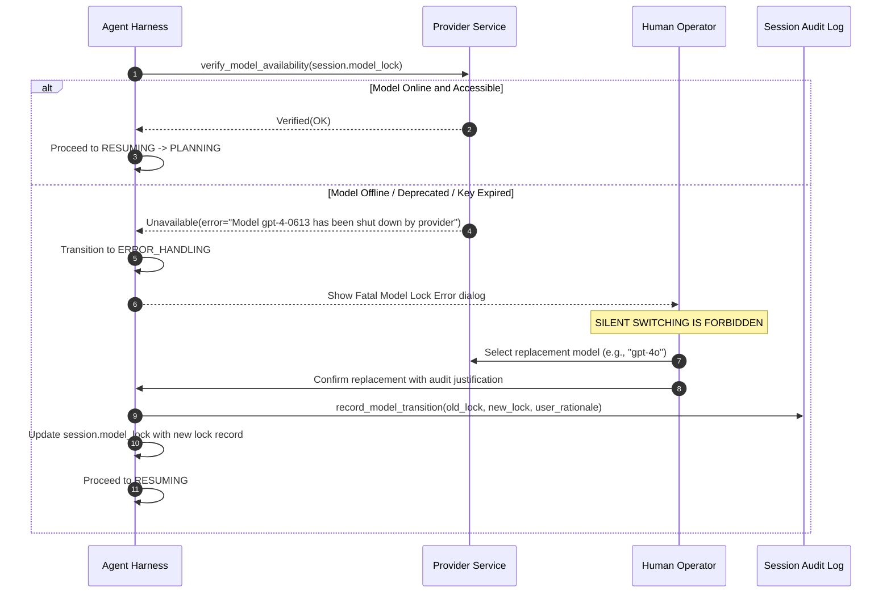
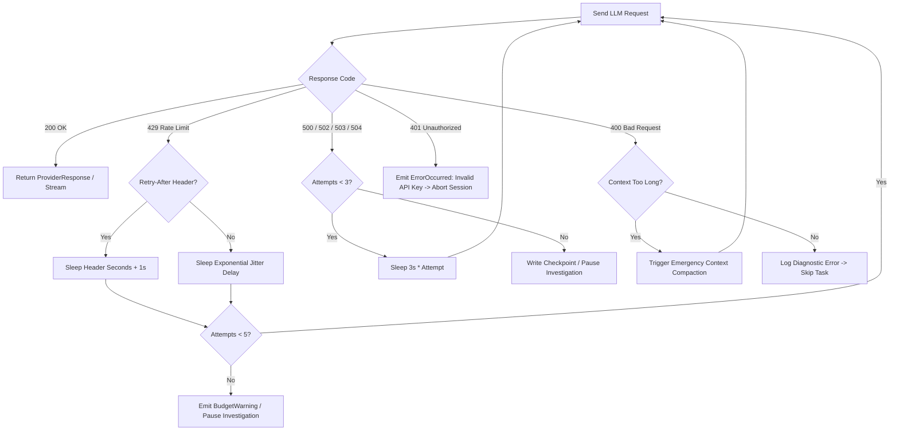

# 06 — LLM Providers, Model Discovery & Model Locking

> **Bletiner AI** — Autonomous Security Investigation Desktop Application  
> Document: `docs/06_LLM_PROVIDERS_AND_MODEL_DISCOVERY.md`  
> Author: AI Agent Systems Engineer (`@agent-eng`)  
> Reference: Earendil Works Pi Architecture (`pi-ai`)  
> Revision: 2.0 (Post-Audit Hardening)  
> Target Audience: Claude Code implementation agent, Principal Architect, QA Auditor  

---

## 1. Overview and Architecture

The LLM Provider Subsystem isolates Bletiner AI's agent harness from the heterogeneous APIs, authentication mechanisms, token limits, and capabilities of commercial and local model vendors.

### 1.1 Architectural Objectives

1. **Vendor Neutrality**: A unified Python `Protocol` abstraction (`pi-ai` inspired) ensures the core agent harness remains completely agnostic of the underlying model provider.
2. **First-Party and Local Model Support**: Full support for commercial cloud APIs (OpenAI, Anthropic, Gemini, DeepSeek, OpenRouter, Groq, Together AI, Mistral) and local air-gapped inference engines (Ollama, LM Studio, custom vLLM/OpenAI-compatible servers).
3. **Empirical Capability Verification**: Active querying of configured endpoints coupled with **empirical probing** (executing lightweight test function calls) to verify real-world capabilities (tool calling, streaming, vision, structured JSON) rather than blindly trusting provider metadata.
4. **Session Model Locking**: Immutable binding of an investigation to an exact provider, model, endpoint, and capability profile for reproducible security investigations.
5. **Zero-Plaintext Secrets Architecture**: Cryptographic storage of API keys and credentials in native OS secret stores (Windows Credential Manager / macOS Keychain / Linux Secret Service) with guaranteed redaction across logs, errors, and exported reports.
6. **Strict Trust Boundary**: Tool executions are strictly sandboxed inside Kali Linux Docker containers. In v1, external host-level MCP servers are deferred to prevent LLM execution escape.

---

## 2. Common Provider Adapter Interface (Python Protocol)

The adapter interface defines the contract that every provider implementation must satisfy. It standardizes message representations, tool schemas, streaming token chunks, tool calls, and error envelopes.

```python
from __future__ import annotations
from typing import (
    Protocol, Sequence, Optional, List, Dict, Any, AsyncIterator, Tuple, runtime_checkable
)
from dataclasses import dataclass, field
from datetime import datetime
from enum import Enum


class ProviderType(str, Enum):
    OPENAI = "openai"
    ANTHROPIC = "anthropic"
    GEMINI = "gemini"
    DEEPSEEK = "deepseek"
    OLLAMA = "ollama"
    LM_STUDIO = "lm_studio"
    OPENROUTER = "openrouter"
    GROQ = "groq"
    TOGETHER_AI = "together_ai"
    MISTRAL = "mistral"
    CUSTOM_OPENAI_COMPATIBLE = "custom_openai_compatible"


class FinishReason(str, Enum):
    STOP = "stop"
    TOOL_CALLS = "tool_calls"
    LENGTH = "length"
    CONTENT_FILTER = "content_filter"
    ERROR = "error"


@dataclass(frozen=True)
class NormalizedToolCall:
    """Standardized tool invocation payload from any model."""
    call_id: str
    tool_name: str
    arguments_json: str                 # Raw JSON string from model
    arguments: Dict[str, Any]           # Safely parsed JSON dictionary


@dataclass
class TokenUsage:
    """Token consumption metrics for cost accounting."""
    prompt_tokens: int = 0
    completion_tokens: int = 0
    total_tokens: int = 0
    estimated_cost_usd: Optional[float] = None


@dataclass
class ProviderChunk:
    """Streaming chunk emitted during generation."""
    delta_text: str = ""
    delta_tool_calls: List[NormalizedToolCall] = field(default_factory=list)
    finish_reason: Optional[FinishReason] = None
    usage: Optional[TokenUsage] = None


@dataclass
class ProviderResponse:
    """Non-streaming complete response from LLM."""
    content: str
    tool_calls: List[NormalizedToolCall] = field(default_factory=list)
    finish_reason: FinishReason = FinishReason.STOP
    usage: TokenUsage = field(default_factory=TokenUsage)
    model_identifier: str = ""
    raw_response_metadata: Dict[str, Any] = field(default_factory=dict)


@dataclass(frozen=True)
class ModelCapabilityProfile:
    """Verified operational capabilities for a specific model."""
    supports_tool_calling: bool
    supports_streaming: bool
    supports_vision: bool
    supports_structured_json: bool
    max_context_tokens: int
    max_output_tokens: int
    is_empirically_verified: bool
    verification_timestamp: Optional[datetime] = None


@runtime_checkable
class LLMProviderAdapter(Protocol):
    """Unified interface required for all model provider integrations."""

    @property
    def provider_id(self) -> ProviderType:
        """Returns the canonical provider type identifier."""
        ...

    async def initialize(self, config: "ProviderConfiguration") -> None:
        """Initializes client SDK, validates endpoint URL, tests credentials."""
        ...

    async def list_available_models(self) -> Sequence["DiscoveredModel"]:
        """Queries provider endpoint for list of deployed/available models."""
        ...

    async def generate_response(
        self,
        model_id: str,
        messages: Sequence["Message"],
        tools: Optional[Sequence["ToolDefinition"]] = None,
        temperature: float = 0.2,
        max_tokens: Optional[int] = None,
        timeout_seconds: float = 120.0
    ) -> ProviderResponse:
        """Executes non-streaming completion."""
        ...

    async def stream_response(
        self,
        model_id: str,
        messages: Sequence["Message"],
        tools: Optional[Sequence["ToolDefinition"]] = None,
        temperature: float = 0.2,
        max_tokens: Optional[int] = None,
        timeout_seconds: float = 120.0
    ) -> AsyncIterator[ProviderChunk]:
        """Streams completion tokens and tool-call deltas asynchronously."""
        ...

    async def probe_capabilities(
        self,
        model_id: str
    ) -> ModelCapabilityProfile:
        """Runs controlled empirical capability test suite against model."""
        ...

    async def calculate_cost(
        self,
        model_id: str,
        usage: TokenUsage
    ) -> Optional[float]:
        """Calculates estimated USD cost from token usage if pricing is known."""
        ...
```

---

## 3. Supported Providers & Integration Architecture

Bletiner AI adopts vendor-specific adapters when API semantics differ, refusing to force every provider through generic OpenAI compatibility shims that strip vendor capabilities.

### 3.1 Provider List and Transport Strategies

```
┌────────────────────────────────────────────────────────────────────────┐
│                        PROVIDER ADAPTER MATRIX                         │
│                                                                        │
│   Commercial Cloud Providers              Local Air-Gapped Providers   │
│   ┌───────────────────────────┐           ┌─────────────────────────┐  │
│   │ OpenAI (Official SDK)     │           │ Ollama (/api/tags native│  │
│   │ Anthropic (Messages API)  │           │ LM Studio (/v1/models)  │  │
│   │ Google Gemini (GenAI SDK) │           │ Local vLLM Endpoints    │  │
│   │ DeepSeek (Native API)     │           └─────────────────────────┘  │
│   │ Mistral (Mistral AI SDK)  │                                        │
│   └───────────────────────────┘           OpenAI-Compatible Aggregators│
│                                           ┌─────────────────────────┐  │
│                                           │ OpenRouter              │  │
│                                           │ Groq (Groq Cloud SDK)   │  │
│                                           │ Together AI             │  │
│                                           │ Custom Self-Hosted URL  │  │
│                                           └─────────────────────────┘  │
└────────────────────────────────────────────────────────────────────────┘
```

### 3.2 Provider Specifics & Incompatibilities

| Provider | Integration Transport | Tool-Calling Format | Streaming Mechanism | Pricing Data Available |
|---|---|---|---|---|
| **OpenAI** | Official `openai` Python SDK (v1.x) | Native OpenAI Functions / Tools JSON | SSE chunks via SDK async iterator | Yes (Configurable pricing table) |
| **Anthropic** | Official `anthropic` Python SDK | Native `tools` & `tool_use` blocks | SSE `content_block_delta` events | Yes (Configurable pricing table) |
| **Google Gemini** | `google-genai` / REST API | Native `function_declarations` | SSE / REST chunks | Yes (Configurable pricing table) |
| **DeepSeek** | HTTP client (OpenAI-compatible) | OpenAI-format Tool Calls | OpenAI-compatible SSE chunks | Yes (Public rate card) |
| **Ollama** | Direct REST client (`/api/chat`) | Ollama native tool schema (v0.3+) | JSON streaming lines | Local (Zero cost) |
| **LM Studio** | Direct REST client (`/v1/chat/completions`) | OpenAI-compatible `tools` (model dependent) | SSE chunks | Local (Zero cost) |
| **OpenRouter** | OpenAI client with OpenRouter base URL | OpenAI-format Tool Calls | SSE chunks | Yes (Returned in generation headers) |
| **Groq** | Official `groq` Python SDK | OpenAI-format Tool Calls | SSE chunks | Yes (Configurable pricing table) |
| **Together AI** | Together Python SDK / REST | OpenAI-format Tool Calls | SSE chunks | Yes (Configurable pricing table) |
| **Mistral** | Official `mistralai` Python SDK | Native Mistral `tools` | SSE chunks | Yes (Configurable pricing table) |
| **Custom Endpoint** | `httpx` async client | Configurable: OpenAI or Raw JSON | Configurable: SSE or Chunked | None (User defined) |

---

## 4. Model Discovery Scanner & Empirical Capability Probing

Marketing claims and static metadata cannot guarantee that a model reliably executes function calling or outputs valid JSON. Bletiner AI requires **empirical capability verification** before permitting a model to drive an autonomous investigation.

### 4.1 Discovery and Probing Workflow

```mermaid
sequenceDiagram
    autonumber
    participant UI as PySide6 Settings View
    participant User as Human Operator
    participant Scanner as Model Discovery Scanner
    participant Adapter as Provider Adapter
    participant Remote as LLM Provider API

    UI->>Scanner: scan_provider(provider_id)
    Scanner->>Adapter: list_available_models()
    Adapter->>Remote: GET /models endpoint
    Remote-->>Adapter: List of model IDs
    Adapter-->>Scanner: [DiscoveredModel, ...]
    Scanner-->>UI: Display model list in UI table

    User->>UI: Select model -> Click "Verify Capabilities"
    alt Cloud Provider with Potential Cost
        UI->>User: Show Cost Warning Dialog ("Test call will use ~150 tokens (<$0.01). Proceed?")
        User-->>UI: Confirm
    end

    UI->>Scanner: execute_capability_probe(provider_id, model_id)
    Scanner->>Adapter: probe_capabilities(model_id)
    
    rect rgb(30, 40, 60)
        Note over Adapter,Remote: Empirical Probe 1: Tool Calling
        Adapter->>Remote: Prompt with dummy tool 'lookup_ip(ip: str)'
        Remote-->>Adapter: Model response
        Adapter->>Adapter: Verify valid tool_call emitted with parsed args
    end

    rect rgb(30, 40, 60)
        Note over Adapter,Remote: Empirical Probe 2: Streaming
        Adapter->>Remote: Stream request ('Count 1 to 5')
        Remote-->>Adapter: Token deltas
        Adapter->>Adapter: Verify >= 3 distinct async chunks received
    end

    Adapter-->>Scanner: ModelCapabilityProfile(empirically_verified=True)
    Scanner-->>UI: Display green verified badge with supported features
```



### 4.2 Empirical Probe Test Suite Specification

| Probe Test | Synthetic Prompt | Injected Dummy Schema | Verification Success Criteria | Max Tokens |
|---|---|---|---|---|
| **`TOOL_CALLING_PROBE`** | *"Look up the IP address 192.0.2.1 using the lookup_ip tool."* | `lookup_ip(ip: string)` | Model emits structured `tool_calls` block containing `name="lookup_ip"` and valid JSON `{"ip": "192.0.2.1"}`. | 150 |
| **`STREAMING_PROBE`** | *"Count from 1 to 5."* | None | Transport yields at least 3 distinct streaming chunks via the async generator. | 50 |
| **`STRUCTURED_JSON_PROBE`** | *"Output status=ready and count=42 in JSON."* | JSON Schema: `{"status": str, "count": int}` | Output parses cleanly with `json.loads()` and contains exact typed keys. | 100 |
| **`VISION_PROBE`** | *"Identify the dominant colour."* (1x1 PNG attached) | None | Provider accepts image payload without returning 400 Bad Request. | 50 |

### 4.3 UI Cost Warning Dialog Guardrail

Before any probe is dispatched to a commercial cloud provider (OpenAI, Anthropic, Gemini, Groq, Together, Mistral, OpenRouter):
1. The UI displays an explicit modal dialog:
   ```
   [CAPABILITY PROBE CONFIRMATION]
   Provider: Anthropic
   Model: claude-3-5-sonnet-20241022
   Estimated tokens: ~350 tokens
   Estimated cost: < $0.01 USD

   This test sends 2-3 minimal test prompts to verify tool-calling and streaming.
   Do you authorize this verification call?
   [Cancel]  [Authorize Test]
   ```
2. Automated background probing without explicit operator authorization is **strictly forbidden**.

---

## 5. Model Locking Per Session

A fundamental tenet of forensic integrity in security investigations is **reproducibility**. An investigation cannot switch models mid-flight without invalidating the reasoning history and tool execution patterns.

### 5.1 Model Lock Specification

When an investigation is created, the selected model configuration is **locked** and serialized into SQLite `investigation_sessions.model_lock`.

```python
@dataclass(frozen=True)
class ModelLock:
    """Immutable model lock bound to an investigation for its entire lifecycle."""
    provider_id: ProviderType
    model_id: str
    endpoint_base_url: Optional[str]        # Custom endpoint if applicable
    capability_profile: ModelCapabilityProfile
    locked_at: datetime
    session_id: str
    selected_temperature: float = 0.2
    max_context_window: int = 128_000
    model_version_digest: Optional[str] = None # For local models: SHA-256 of Ollama model
```

### 5.2 Resume Semantics & Model Unavailability

When resuming a paused or stopped investigation, the harness executes a strict model-lock validation check:



**CRITICAL INVARIANT**: Under no circumstances does Bletiner AI silently or automatically fall back to an alternate model. If a model is unavailable, the investigation halts until the operator explicitly selects and confirms a replacement, writing an indelible audit entry.

---

## 6. Secrets Handling & Zero-Plaintext Security Architecture

API keys for commercial LLM providers represent critical security assets. Bletiner AI strictly enforces a **Zero-Plaintext Storage Policy**.

### 6.1 OS Keyring Integration

Credentials are never stored in SQLite databases, config files, JSON files, environment variable files (`.env`), or reports. They are stored exclusively via native OS keyring mechanisms:

| Operating System | Underlying Secret Storage Backend | Key Namespace |
|---|---|---|
| **Windows** | Windows Credential Manager via DPAPI | `BletinerAI:Provider:<provider_id>` |
| **macOS** | Apple Keychain Services | `BletinerAI:Provider:<provider_id>` |
| **Linux** | Secret Service API (Freedesktop / GNOME Keyring / KWallet) | `BletinerAI:Provider:<provider_id>` |

```python
class SecretStorageService(Protocol):
    """Manages secure credential persistence via native OS secure enclaves."""

    def store_api_key(self, provider_id: ProviderType, api_key: str) -> None:
        """Stores API key in OS credential manager. Never touches disk in plaintext."""
        ...

    def retrieve_api_key(self, provider_id: ProviderType) -> Optional[str]:
        """Retrieves API key on-demand for memory-only client instantiation."""
        ...

    def delete_api_key(self, provider_id: ProviderType) -> bool:
        """Purges API key from OS credential manager."""
        ...

    def has_api_key(self, provider_id: ProviderType) -> bool:
        """Checks presence of key without reading sensitive bytes into Python memory."""
        ...
```

### 6.2 Memory Protection and Log Redaction

1. **Memory-Only Ingestion**: API keys are read from the OS keyring only at client initialization and held exclusively in private memory buffers.
2. **Deterministic Redaction Filter**: An automated `LogRedactionFilter` wraps all application logging handlers, stdout/stderr streams, and Qt UI event buses. Any string matching recognized API key token formats (e.g., `sk-[a-zA-Z0-9]{32,}`, `ant-[a-zA-Z0-9]{32,}`, `AIzaSy[a-zA-Z0-9_-]{33}`) or matching active keys in memory is replaced with `[REDACTED_API_KEY]`.
3. **Report Sanitization**: Before writing Markdown or HTML reports, the report generator runs a mandatory regex pass ensuring zero leaked tokens or secrets appear in artifacts.

---

## 7. Provider Failure, Rate Limiting & Retry Policies

LLM providers experience frequent transient network disruptions, capacity constraints, and strict Requests-Per-Minute (RPM) / Tokens-Per-Minute (TPM) throttling.

### 7.1 Throttling and Backoff State Machine

```python
@dataclass
class RateLimitStatus:
    is_rate_limited: bool = False
    retry_after_seconds: Optional[float] = None
    rpm_remaining: Optional[int] = None
    tpm_remaining: Optional[int] = None
    reset_timestamp: Optional[datetime] = None


class RetryStrategy:
    """Calculates exponential backoff with full jitter to avoid thundering herd."""

    @staticmethod
    def calculate_delay(attempt: int, base_seconds: float = 2.0, max_seconds: float = 60.0) -> float:
        import random
        # Full jitter algorithm: sleep = rand(0, min(max_delay, base * 2 ^ attempt))
        ceiling = min(max_seconds, base_seconds * (2 ** attempt))
        return random.uniform(0.5, ceiling)
```

### 7.2 Provider Error Handling Protocol



---

## 8. Provider Capability Matrix (Honest Assessment)

The matrix below documents actual observed capabilities across target providers. Unknowns and model-dependent variables are marked honestly rather than assumed.

| Provider Identifier | Native Tool Calling | Streaming Tokens | Streaming Tool Calls | Vision Inputs | Structured JSON Enforcement | Local Air-Gapped | Context Window Range |
|---|---|---|---|---|---|---|---|
| **OpenAI** | **Yes** (Strict mode) | **Yes** | **Yes** | **Yes** (4o, 4-turbo) | **Yes** (`json_schema`) | No | 8K – 128K tokens |
| **Anthropic** | **Yes** (Messages API) | **Yes** | **Yes** | **Yes** (Claude 3/3.5) | **Yes** (Tool forced output) | No | 200K tokens |
| **Google Gemini** | **Yes** (Function call) | **Yes** | **Yes** | **Yes** (Native multimodal)| **Yes** (`response_schema`) | No | 32K – 2M tokens |
| **DeepSeek** | **Yes** (V2.5 / V3) | **Yes** | **Yes** | No (Varies) | **Yes** (`json_object`) | No | 64K – 128K tokens |
| **Ollama** | **Model Dependent** | **Yes** | **Model Dependent** | **Model Dependent** | **Yes** (`format="json"`) | **Yes** | Configurable (2K – 128K) |
| **LM Studio** | **Model Dependent** | **Yes** | **Model Dependent** | **Model Dependent** | **Yes** (Grammar based) | **Yes** | Configurable (2K – 128K) |
| **OpenRouter** | **Model Dependent** | **Yes** | **Model Dependent** | **Model Dependent** | **Model Dependent** | No | Up to 1M tokens |
| **Groq** | **Yes** (Select models) | **Yes** | **Yes** | **Yes** (Llama 3.2 Vision)| **Yes** (`json_object`) | No | 8K – 128K tokens |
| **Together AI** | **Yes** (Select models) | **Yes** | **Yes** | **Yes** (Select models) | **Yes** (JSON mode) | No | 8K – 128K tokens |
| **Mistral** | **Yes** (Large/Small) | **Yes** | **Yes** | **Yes** (Pixtral) | **Yes** (`json_object`) | No | 32K – 128K tokens |
| **Custom OpenAI** | **Endpoint Dependent**| **Endpoint Dependent** | **Endpoint Dependent** | **Endpoint Dependent** | **Endpoint Dependent** | Configurable | Endpoint Dependent |

*Note: For local engines (Ollama, LM Studio), tool calling requires models fine-tuned with function-calling capabilities (e.g., `llama3.1`, `qwen2.5`, `mistral-nemo`). Models lacking function calling tokens will fail the capability probe and cannot be used for autonomous agent execution.*

---

## 9. Implementation Architecture for Claude Code

When implementing the `llm_providers` module, Claude Code must adhere to this class layout:

```
src/bletiner/providers/
├── __init__.py                  # Exports LLMProviderAdapter, ModelLock, DiscoveredModel
├── protocols.py                 # Protocol definitions shown in Section 2
├── secret_manager.py            # OS Keyring implementation (keyring library)
├── scanner.py                   # Model discovery scanner and capability probes
├── probe.py                     # Empirical capability probe suite
├── lock.py                      # Session model lock manager and verification
├── adapters/
│   ├── base.py                  # Abstract base adapter handling common retry/redaction
│   ├── openai_adapter.py        # OpenAI, DeepSeek, Groq, Together, OpenRouter
│   ├── anthropic_adapter.py     # Anthropic Messages API
│   ├── gemini_adapter.py        # Google GenAI SDK
│   ├── ollama_adapter.py        # Ollama local REST client
│   └── lm_studio_adapter.py     # LM Studio local client
```

---

## 10. Cross-References

- **`docs/01_REQUIREMENTS.md`**: FR-046 through FR-055 (Provider management, model discovery, model locking).
- **`docs/03_AGENT_HARNESS.md`**: Agent harness integration with provider streaming and token budgeting.
- **`docs/05_DESKTOP_UI_UX.md`**: Model selection dropdown, discovery scan view, and capability probe confirmation dialog.
- **`docs/07_DATA_MODEL_AND_SESSION_LIFECYCLE.md`**: SQLite schema for `investigation_sessions.model_lock` and `discovered_models`.
- **`docs/09_SECURITY_THREAT_MODEL.md`**: Threat model for API key exposure, prompt injection via tool outputs, and LLM communication integrity.
- **`docs/10_TESTING_AND_ACCEPTANCE.md`**: Mocked provider contract testing suite and fake LLM test harness.
