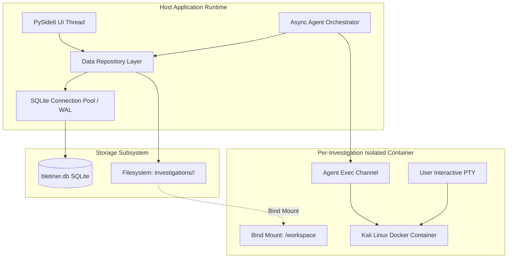
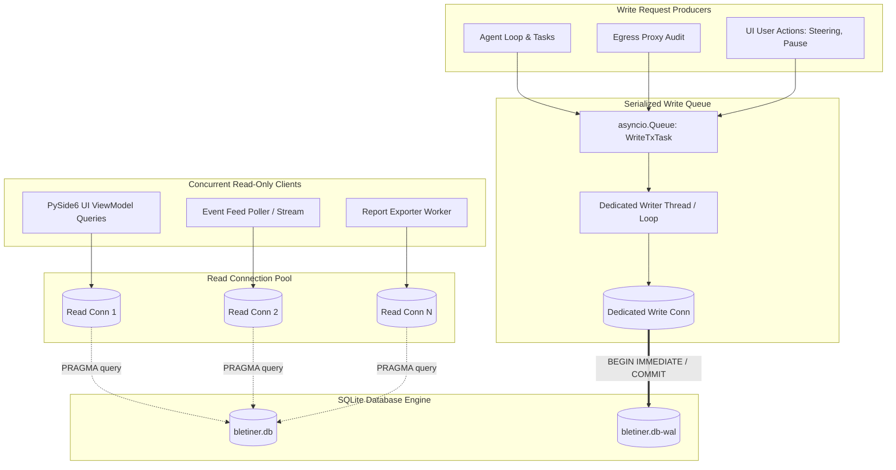
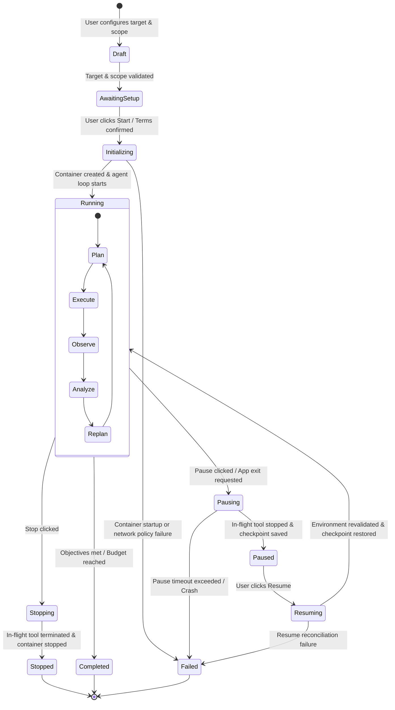
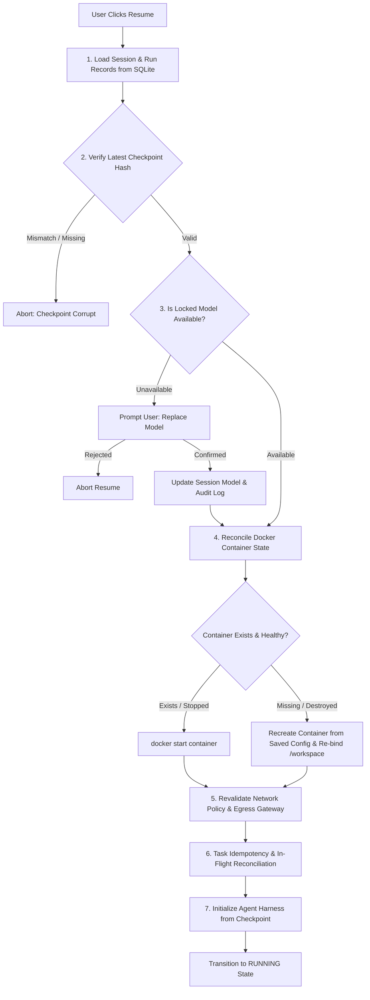

# Bletiner AI — Data Model and Session Lifecycle Specification

**Document Identifier:** `DOC-07-DATAMODEL-LIFECYCLE`  
**Version:** 2.0.0 (Revision 2 Architecture Update)  
**Status:** Approved Specification  
**Author:** Backend & Data Engineering Lead  
**Scope:** Data Architecture, Relational Schema, Filesystem Hierarchy, Session Lifecycle, Crash Consistency, and Recovery Protocols  

---

## 1. Executive Summary and Architecture Role

Bletiner AI is a professional, autonomous security-investigation desktop application built with Python, PySide6, Docker-isolated Kali Linux containers, and an LLM-driven agent harness.

The system's data architecture is founded upon three core design principles:
1. **Strict Separation of Durable vs. Ephemeral State:** Container processes, raw sockets, interactive terminal PTYs, and OS process memory (RAM, registers, open file descriptors) are treated as ephemeral and expendable. Under no circumstances does the system attempt to serialize or restore running Linux process memory. Conversely, investigation context, task queues, normalized tool executions, cryptographic evidence manifests, finding lifecycle trees, and user steering instructions are durable and guaranteed crash-consistent.
2. **Hybrid Storage Topology:** Structured metadata, state machines, relationship graphs, and time-series operational events reside in an ACID-compliant local **SQLite** database operating in Write-Ahead Logging (WAL) mode. Large raw outputs, packet captures, file artifacts, terminal logs, and final reports reside in a strictly structured **per-investigation filesystem workspace**. The relational database references filesystem artifacts via deterministic relative paths and cryptographic SHA-256 digests.
3. **Deterministic Crash Recovery & Resume:** The application survives abrupt host crashes, sudden power loss, Docker daemon restarts, and deliberate user interruptions. Upon resume, the system reconciles persisted state with physical Docker container state, validates the integrity of all artifacts, safely restores agent checkpoints, re-evaluates incomplete tasks using strict idempotency rules, and ensures no completed work is repeated or corrupted.



---

## 2. Complete Entity Definitions

The data model defines fourteen primary entities and four supporting auditing entities. All identifiers are Version 4 UUIDs formatted as standard 36-character hyphenated strings (`char(36)`), guaranteeing collision resistance across concurrent investigations.

### 2.1 Entity Catalog

| Entity Name | Primary Key | Parent Entity | Description & Role |
| :--- | :--- | :--- | :--- |
| **`TermsAcceptance`** | `acceptance_id` | *None* | Records explicit human user acceptance of legal terms and authorization covenants. Privacy-minimized: stores zero PII (NO IP address, NO MAC address, NO username). |
| **`ProviderModelConfig`**| `config_id` | *None* | Captures provider configuration, base URLs, model identifiers, capability flags, and token context limits. Strictly excludes raw API secrets (stored in OS keyring). |
| **`Investigation`** | `investigation_id`| *None* | The overarching project or target engagement record. Encapsulates target authorization, scope definitions, engagement mode, and high-level milestones. |
| **`Session`** | `session_id` | `Investigation` | An active or historical execution session within an investigation. Owns the runtime state machine, allocated container, checkpoint references, and filesystem directory. |
| **`Container`** | `container_id` | `Session` | Tracks the lifecycle, Docker container ID, network isolation mode, IP allocation, CPU/memory quotas, and health status of the Kali Linux container. |
| **`AgentRun`** | `run_id` | `Session` | An execution epoch of the agent loop. A session may experience multiple runs across pauses, resumes, steering interventions, or Basic-to-Deep depth upgrades. |
| **`Task`** | `task_id` | `AgentRun` | A discrete unit of investigative work planned by the agent (e.g., `port_scan`, `service_enum`, `cve_verify`). Tracks dependencies, idempotency, and status. |
| **`ToolExecution`** | `execution_id` | `Task` | A concrete command or script execution inside the container. Tracks exact shell command, exit code, stdout/stderr byte sizes, execution duration, and artifact links. |
| **`MessageRecord`** | `message_id` | `AgentRun` | Represents prompt context, LLM responses, tool invocation requests, and structured observations exchanged between the agent harness and the LLM provider. |
| **`Finding`** | `finding_id` | `Investigation`| A security issue, misconfiguration, or vulnerability discovered. Exists at the investigation level, tracking confidence, severity, and verification lifecycle. |
| **`EvidenceArtifact`** | `artifact_id` | `Session` | File-based artifacts (raw logs, PCAPs, dumps, screenshots) proving or supporting findings. Stores filesystem relative paths, MIME types, and SHA-256 hashes. |
| **`Report`** | `report_id` | `Investigation`| Generated Markdown and HTML deliverables summarizing findings, methodology, scope, and timeline. Stores version numbers, hashes, and render paths. |
| **`Checkpoint`** | `checkpoint_id` | `AgentRun` | Complete, serialized snapshots of agent memory, prompt context, tool states, and task queues enabling seamless crash recovery and rewind. |
| **`SteeringInstruction`**| `instruction_id`| `Session` | Human-in-the-loop directives injected by the user during live execution to redirect priorities, bypass non-productive avenues, or inject manual context. |
| **`ScopeTarget`** | `target_id` | `Investigation`| Normalized authorized targets (CIDR, Domain, IP, URL) with explicit boundary rules, ports, and subdomain expansion flags. |
| **`NetworkAuditLog`** | `log_id` | `Session` | Egress proxy connection records capturing timestamp, destination, port, protocol, policy decision (ALLOWED/BLOCKED), and rule triggers. |
| **`AuditLogEntry`** | `entry_id` | `Investigation`| Tamper-evident operational audit log capturing all system state changes, authorization upgrades, user commands, and configuration edits. |

### 2.2 Deep Entity Attribute Specifications

1. **`TermsAcceptance` (Privacy-Minimized)**:
   - Stores strictly `terms_version` (TEXT), `terms_hash` (TEXT SHA-256 of text), `accepted_at` (ISO-8601 UTC), and `acceptance_hash` (TEXT SHA-256).
   - Zero Personally Identifiable Information (PII): No IP address, MAC address, hostname, or user account name is collected or stored.
2. **`Investigation`**: Contains `title`, `description`, `primary_target`, `investigation_depth` (enum: `BASIC`, `DEEP`), `status` (enum: `DRAFT`, `ACTIVE`, `PAUSED`, `COMPLETED`, `TERMINATED`, `FAILED`), timestamps, and `terms_acceptance_id`.
3. **`Session`**: References `investigation_id` and `provider_config_id`. Contains `session_status`, `relative_path` (workspace directory), `total_tokens_used`, `total_cost_usd`, and session duration timestamps.
4. **`AgentRun`**: Represents an unbroken execution epoch. Contains `run_epoch` (integer incremented on each resume/upgrade), `run_depth`, `status`, `start_reason` (`INITIAL_START`, `USER_RESUME`, `STEERING_RESUME`, `DEPTH_UPGRADE`), `exit_reason`, and `active_checkpoint_id`.
5. **`Task`**: Represents the agent's dynamic plan. Contains `parent_task_id` (enabling dependency trees), `task_name`, `task_type` (`RECON`, `DISCOVERY`, `PROBE`, `VERIFY`, `ANALYZE`, `REPORT`), `target_asset`, `parameters_json`, `priority_score`, `status`, `is_idempotent`, and `retry_count`.
6. **`ToolExecution`**: Represents container command invocations. Contains `task_id`, `container_id`, `tool_name`, `command_line`, `working_directory`, `timeout_seconds`, `exit_code`, `status`, `stdout_artifact_id`, `stderr_artifact_id`, and `parsed_summary_json`.
7. **`MessageRecord`**: Persists prompt and conversation context for the Pi-inspired agent harness. Contains `run_id`, `sequence_number`, `role` (`system`, `user`, `assistant`, `tool`), `content_text`, `tool_calls_json`, `token_count`, `cost_usd`, and `is_evicted_from_ctx`.
8. **`Finding`**: Core investigative finding. Contains `stable_finding_key` (hash for deduplication across runs), `title`, `summary`, `category`, `affected_asset`, `affected_port`, `severity` (`INFO`, `LOW`, `MEDIUM`, `HIGH`, `CRITICAL`), `confidence` (`LOW`, `MEDIUM`, `HIGH`, `CONFIRMED`), `verification_status` (`DETECTED`, `NEEDS_TRIAGE`, `UNDER_INVESTIGATION`, `VERIFIED`, `FALSE_POSITIVE`, `INCONCLUSIVE`, `ACCEPTED_RISK`), `detection_method`, `impact_statement`, and `remediation_guidance`.
9. **`EvidenceArtifact`**: Immutable captured evidence. Contains `session_id`, `finding_id` (optional), `relative_path`, `file_name`, `file_type`, `mime_type`, `file_size_bytes`, `sha256_hash`, and capture timestamp.
10. **`Report`**: Final deliverables. Contains `investigation_id`, `session_id`, `report_version`, `report_type` (`INTERIM`, `FINAL`), `markdown_path`, `markdown_sha256`, `html_path`, `html_sha256`, and `findings_count_json`.
11. **`Container`**: Dedicated Kali Linux container metadata. Contains `session_id`, `docker_container_id`, `image_name`, `image_digest`, `container_name`, `ip_address`, `network_mode`, `status`, `cpu_limit`, and `memory_limit_mb`.
12. **`Checkpoint`**: Durable state snapshot. Contains `run_id`, `sequence_number`, `checkpoint_trigger` (`PERIODIC`, `PRE_TOOL`, `POST_TOOL`, `PRE_PAUSE`, `SHUTDOWN`), `relative_filepath`, `sha256_hash`, `context_tokens`, and `active_task_id`.
13. **`SteeringInstruction`**: Human steering directive. Contains `session_id`, `run_id`, `instruction_text`, `validation_status` (`PENDING`, `ACCEPTED`, `REJECTED_SCOPE`, `REJECTED_SAFETY`), `rejection_reason`, and `applied_status`.
14. **`ProviderModelConfig`**: Configured LLM endpoint. Contains `provider_name`, `model_identifier`, `display_name`, `base_url`, `keyring_service_key`, token window parameters, and capability flags.

---

## 3. SQLite Relational Schema Specification

The database file resides at `database/bletiner.db` relative to the application root. The schema enforces strict foreign key constraints, check constraints on state enumerations, deterministic index coverage for UI queries, and ISO-8601 UTC timestamps.

### 3.1 DDL: Complete Schema Definitions

```sql
-- ============================================================================
-- Bletiner AI Database Schema: Production Specification (Revision 2)
-- Dialect: SQLite 3.37+
-- Conventions: UUID primary keys, UTC ISO-8601 strings, Strict Foreign Keys
-- Privacy: Zero Personally Identifiable Information (PII) stored in database
-- ============================================================================

PRAGMA foreign_keys = ON;

-- ----------------------------------------------------------------------------
-- 1. Legal Terms & Acceptable Use Acceptance (Privacy-Minimized)
-- ----------------------------------------------------------------------------
CREATE TABLE terms_acceptance (
    acceptance_id       TEXT PRIMARY KEY NOT NULL CHECK(length(acceptance_id) = 36),
    terms_version       TEXT NOT NULL,
    terms_hash          TEXT NOT NULL CHECK(length(terms_hash) = 64),      -- SHA-256 of terms text
    accepted_at         TEXT NOT NULL,                                     -- ISO-8601 UTC timestamp
    acceptance_hash     TEXT NOT NULL CHECK(length(acceptance_hash) = 64)  -- SHA-256(terms_hash + accepted_at)
);

CREATE UNIQUE INDEX uq_terms_acceptance_version 
    ON terms_acceptance (terms_version);

-- ----------------------------------------------------------------------------
-- 2. LLM Provider & Model Configurations
-- ----------------------------------------------------------------------------
CREATE TABLE provider_model_config (
    config_id           TEXT PRIMARY KEY NOT NULL CHECK(length(config_id) = 36),
    provider_name       TEXT NOT NULL, -- e.g., 'anthropic', 'openai', 'ollama', 'gemini'
    model_identifier    TEXT NOT NULL, -- e.g., 'claude-3-5-sonnet-20241022'
    display_name        TEXT NOT NULL,
    base_url            TEXT,          -- NULL for official cloud endpoints, URL for local/custom
    keyring_service_key TEXT NOT NULL, -- Key used to retrieve secret from OS credential store
    context_window_size INTEGER NOT NULL CHECK(context_window_size > 0),
    max_output_tokens   INTEGER NOT NULL CHECK(max_output_tokens > 0),
    supports_tool_call  INTEGER NOT NULL CHECK(supports_tool_call IN (0, 1)),
    supports_vision     INTEGER NOT NULL CHECK(supports_vision IN (0, 1)),
    supports_streaming  INTEGER NOT NULL CHECK(supports_streaming IN (0, 1)),
    is_active           INTEGER NOT NULL DEFAULT 1 CHECK(is_active IN (0, 1)),
    created_at          TEXT NOT NULL,
    updated_at          TEXT NOT NULL
);

CREATE INDEX idx_provider_model_lookup 
    ON provider_model_config (provider_name, model_identifier, is_active);

-- ----------------------------------------------------------------------------
-- 3. Investigations (Engagement Root)
-- ----------------------------------------------------------------------------
CREATE TABLE investigations (
    investigation_id    TEXT PRIMARY KEY NOT NULL CHECK(length(investigation_id) = 36),
    title               TEXT NOT NULL,
    description         TEXT,
    primary_target      TEXT NOT NULL,
    investigation_depth TEXT NOT NULL CHECK(investigation_depth IN ('BASIC', 'DEEP')),
    status              TEXT NOT NULL CHECK(status IN ('DRAFT', 'ACTIVE', 'PAUSED', 'COMPLETED', 'TERMINATED', 'FAILED')),
    created_at          TEXT NOT NULL,
    updated_at          TEXT NOT NULL,
    completed_at        TEXT,
    terms_acceptance_id TEXT NOT NULL,
    FOREIGN KEY (terms_acceptance_id) REFERENCES terms_acceptance (acceptance_id) ON DELETE RESTRICT
);

CREATE INDEX idx_investigations_status ON investigations (status);
CREATE INDEX idx_investigations_created ON investigations (created_at DESC);

-- ----------------------------------------------------------------------------
-- 4. Scope Targets (Explicit Target Authorization)
-- ----------------------------------------------------------------------------
CREATE TABLE scope_targets (
    target_id           TEXT PRIMARY KEY NOT NULL CHECK(length(target_id) = 36),
    investigation_id    TEXT NOT NULL,
    target_type         TEXT NOT NULL CHECK(target_type IN ('DOMAIN', 'IPV4', 'IPV6', 'CIDR_V4', 'CIDR_V6', 'URL')),
    target_value        TEXT NOT NULL,
    allow_subdomains    INTEGER NOT NULL DEFAULT 0 CHECK(allow_subdomains IN (0, 1)),
    allowed_ports       TEXT, -- JSON Array of integers or port ranges, e.g., '[80, 443, 8000-8080]'
    is_excluded         INTEGER NOT NULL DEFAULT 0 CHECK(is_excluded IN (0, 1)),
    validation_status   TEXT NOT NULL CHECK(validation_status IN ('VALID', 'INVALID', 'BLOCKED')),
    created_at          TEXT NOT NULL,
    FOREIGN KEY (investigation_id) REFERENCES investigations (investigation_id) ON DELETE CASCADE
);

CREATE INDEX idx_scope_targets_inv ON scope_targets (investigation_id);

-- ----------------------------------------------------------------------------
-- 5. Sessions (Runtime Execution Contexts)
-- ----------------------------------------------------------------------------
CREATE TABLE sessions (
    session_id          TEXT PRIMARY KEY NOT NULL CHECK(length(session_id) = 36),
    investigation_id    TEXT NOT NULL,
    provider_config_id  TEXT NOT NULL,
    session_status      TEXT NOT NULL CHECK(session_status IN (
                            'DRAFT', 'AWAITING_SETUP', 'INITIALIZING', 'RUNNING',
                            'PAUSING', 'PAUSED', 'RESUMING', 'COMPLETED',
                            'STOPPING', 'STOPPED', 'FAILED'
                        )),
    relative_path       TEXT NOT NULL, -- e.g., 'investigations/8f1c4...'
    total_tokens_used   INTEGER NOT NULL DEFAULT 0,
    total_cost_usd      REAL NOT NULL DEFAULT 0.0,
    created_at          TEXT NOT NULL,
    updated_at          TEXT NOT NULL,
    ended_at            TEXT,
    FOREIGN KEY (investigation_id) REFERENCES investigations (investigation_id) ON DELETE CASCADE,
    FOREIGN KEY (provider_config_id) REFERENCES provider_model_config (config_id) ON DELETE RESTRICT
);

CREATE INDEX idx_sessions_investigation ON sessions (investigation_id);
CREATE INDEX idx_sessions_status ON sessions (session_status);

-- ----------------------------------------------------------------------------
-- 6. Containers (Kali Container Lifecycle & Allocation)
-- ----------------------------------------------------------------------------
CREATE TABLE containers (
    container_id        TEXT PRIMARY KEY NOT NULL CHECK(length(container_id) = 36),
    session_id          TEXT NOT NULL UNIQUE,
    docker_container_id TEXT UNIQUE,
    image_name          TEXT NOT NULL,
    image_digest        TEXT NOT NULL,
    container_name      TEXT NOT NULL UNIQUE,
    ip_address          TEXT,
    network_mode        TEXT NOT NULL DEFAULT 'isolated-bridge',
    status              TEXT NOT NULL CHECK(status IN ('ALLOCATED', 'CREATING', 'RUNNING', 'STOPPED', 'RESTARTING', 'DESTROYED', 'ORPHANED')),
    cpu_limit           REAL NOT NULL DEFAULT 2.0,
    memory_limit_mb     INTEGER NOT NULL DEFAULT 4096,
    created_at          TEXT NOT NULL,
    started_at          TEXT,
    stopped_at          TEXT,
    FOREIGN KEY (session_id) REFERENCES sessions (session_id) ON DELETE CASCADE
);

CREATE INDEX idx_containers_docker_id ON containers (docker_container_id);

-- ----------------------------------------------------------------------------
-- 7. Agent Runs (Discrete Autonomous Execution Epochs)
-- ----------------------------------------------------------------------------
CREATE TABLE agent_runs (
    run_id              TEXT PRIMARY KEY NOT NULL CHECK(length(run_id) = 36),
    session_id          TEXT NOT NULL,
    run_epoch           INTEGER NOT NULL DEFAULT 1,
    run_depth           TEXT NOT NULL CHECK(run_depth IN ('BASIC', 'DEEP')),
    status              TEXT NOT NULL CHECK(status IN ('INITIALIZING', 'RUNNING', 'PAUSING', 'PAUSED', 'COMPLETED', 'TERMINATED', 'FAILED')),
    start_reason        TEXT NOT NULL CHECK(start_reason IN ('INITIAL_START', 'USER_RESUME', 'STEERING_RESUME', 'DEPTH_UPGRADE')),
    exit_reason         TEXT,
    active_checkpoint_id TEXT,
    started_at          TEXT NOT NULL,
    ended_at            TEXT,
    FOREIGN KEY (session_id) REFERENCES sessions (session_id) ON DELETE CASCADE
);

CREATE INDEX idx_agent_runs_session ON agent_runs (session_id, run_epoch);

-- ----------------------------------------------------------------------------
-- 8. Checkpoints (Serialized Agent Memory & State Snapshots)
-- ----------------------------------------------------------------------------
CREATE TABLE checkpoints (
    checkpoint_id       TEXT PRIMARY KEY NOT NULL CHECK(length(checkpoint_id) = 36),
    run_id              TEXT NOT NULL,
    sequence_number     INTEGER NOT NULL,
    checkpoint_trigger  TEXT NOT NULL CHECK(checkpoint_trigger IN ('PERIODIC', 'PRE_TOOL', 'POST_TOOL', 'PRE_PAUSE', 'SHUTDOWN')),
    relative_filepath   TEXT NOT NULL, -- JSON snapshot relative path
    sha256_hash         TEXT NOT NULL,
    context_tokens      INTEGER NOT NULL,
    active_task_id      TEXT,
    created_at          TEXT NOT NULL,
    FOREIGN KEY (run_id) REFERENCES agent_runs (run_id) ON DELETE CASCADE
);

CREATE INDEX idx_checkpoints_run_seq ON checkpoints (run_id, sequence_number DESC);

-- ----------------------------------------------------------------------------
-- 9. Steering Instructions (Human-In-The-Loop Directives)
-- ----------------------------------------------------------------------------
CREATE TABLE steering_instructions (
    instruction_id      TEXT PRIMARY KEY NOT NULL CHECK(length(instruction_id) = 36),
    session_id          TEXT NOT NULL,
    run_id              TEXT NOT NULL,
    instruction_text    TEXT NOT NULL,
    validation_status   TEXT NOT NULL CHECK(validation_status IN ('PENDING', 'ACCEPTED', 'REJECTED_SCOPE', 'REJECTED_SAFETY')),
    rejection_reason    TEXT,
    applied_status      TEXT NOT NULL CHECK(applied_status IN ('QUEUED', 'INCORPORATED', 'DISCARDED')),
    created_at          TEXT NOT NULL,
    incorporated_at     TEXT,
    FOREIGN KEY (session_id) REFERENCES sessions (session_id) ON DELETE CASCADE,
    FOREIGN KEY (run_id) REFERENCES agent_runs (run_id) ON DELETE CASCADE
);

CREATE INDEX idx_steering_session ON steering_instructions (session_id, applied_status);

-- ----------------------------------------------------------------------------
-- 10. Tasks (Agent Task Graph & Queue)
-- ----------------------------------------------------------------------------
CREATE TABLE tasks (
    task_id             TEXT PRIMARY KEY NOT NULL CHECK(length(task_id) = 36),
    run_id              TEXT NOT NULL,
    parent_task_id      TEXT,
    task_name           TEXT NOT NULL,
    task_type           TEXT NOT NULL CHECK(task_type IN ('RECON', 'DISCOVERY', 'PROBE', 'VERIFY', 'ANALYZE', 'REPORT')),
    target_asset        TEXT NOT NULL,
    parameters_json     TEXT NOT NULL,
    priority_score      REAL NOT NULL DEFAULT 50.0,
    status              TEXT NOT NULL CHECK(status IN ('PENDING', 'SCHEDULED', 'RUNNING', 'COMPLETED', 'BLOCKED', 'FAILED', 'CANCELLED')),
    is_idempotent       INTEGER NOT NULL DEFAULT 1 CHECK(is_idempotent IN (0, 1)),
    retry_count         INTEGER NOT NULL DEFAULT 0,
    max_retries         INTEGER NOT NULL DEFAULT 2,
    failure_reason      TEXT,
    created_at          TEXT NOT NULL,
    started_at          TEXT,
    completed_at        TEXT,
    FOREIGN KEY (run_id) REFERENCES agent_runs (run_id) ON DELETE CASCADE,
    FOREIGN KEY (parent_task_id) REFERENCES tasks (task_id) ON DELETE SET NULL
);

CREATE INDEX idx_tasks_run_status ON tasks (run_id, status, priority_score DESC);

-- ----------------------------------------------------------------------------
-- 11. Tool Executions (Container Command Invocations)
-- ----------------------------------------------------------------------------
CREATE TABLE tool_executions (
    execution_id        TEXT PRIMARY KEY NOT NULL CHECK(length(execution_id) = 36),
    task_id             TEXT NOT NULL,
    container_id        TEXT NOT NULL,
    tool_name           TEXT NOT NULL, -- e.g., 'nmap', 'ffuf', 'nikto', 'sslyze'
    command_line        TEXT NOT NULL, -- Sanitized raw command executed
    working_directory   TEXT NOT NULL DEFAULT '/workspace',
    timeout_seconds     INTEGER NOT NULL DEFAULT 300,
    exit_code           INTEGER,
    status              TEXT NOT NULL CHECK(status IN ('QUEUED', 'RUNNING', 'SUCCESS', 'FAILED', 'TIMED_OUT', 'CANCELLED')),
    stdout_artifact_id  TEXT,
    stderr_artifact_id  TEXT,
    stdout_bytes        INTEGER DEFAULT 0,
    stderr_bytes        INTEGER DEFAULT 0,
    parsed_summary_json TEXT,
    started_at          TEXT NOT NULL,
    completed_at        TEXT,
    FOREIGN KEY (task_id) REFERENCES tasks (task_id) ON DELETE CASCADE,
    FOREIGN KEY (container_id) REFERENCES containers (container_id) ON DELETE RESTRICT
);

CREATE INDEX idx_tool_exec_task ON tool_executions (task_id);
CREATE INDEX idx_tool_exec_status ON tool_executions (status);

-- ----------------------------------------------------------------------------
-- 12. Message Records (Harness Context & Interaction Log)
-- ----------------------------------------------------------------------------
CREATE TABLE message_records (
    message_id          TEXT PRIMARY KEY NOT NULL CHECK(length(message_id) = 36),
    run_id              TEXT NOT NULL,
    sequence_number     INTEGER NOT NULL,
    role                TEXT NOT NULL CHECK(role IN ('system', 'user', 'assistant', 'tool')),
    content_text        TEXT,
    tool_calls_json     TEXT, -- Encoded function/tool invocation schemas
    tool_call_id        TEXT, -- For role='tool', ties back to LLM tool call ID
    token_count         INTEGER NOT NULL DEFAULT 0,
    cost_usd            REAL NOT NULL DEFAULT 0.0,
    is_evicted_from_ctx INTEGER NOT NULL DEFAULT 0 CHECK(is_evicted_from_ctx IN (0, 1)),
    created_at          TEXT NOT NULL,
    FOREIGN KEY (run_id) REFERENCES agent_runs (run_id) ON DELETE CASCADE
);

CREATE INDEX idx_message_run_seq ON message_records (run_id, sequence_number ASC);

-- ----------------------------------------------------------------------------
-- 13. Findings (Identified Vulnerabilities & Observations)
-- ----------------------------------------------------------------------------
CREATE TABLE findings (
    finding_id          TEXT PRIMARY KEY NOT NULL CHECK(length(finding_id) = 36),
    investigation_id    TEXT NOT NULL,
    session_id          TEXT NOT NULL,
    task_id             TEXT,
    stable_finding_key  TEXT NOT NULL, -- Deterministic deduplication hash: sha256(asset + category + port)
    title               TEXT NOT NULL,
    summary             TEXT NOT NULL,
    category            TEXT NOT NULL, -- e.g., 'INSECURE_TLS', 'EXPOSED_SERVICE', 'INJECTION'
    affected_asset      TEXT NOT NULL, -- Host, IP, or URL
    affected_port       INTEGER,
    severity            TEXT NOT NULL CHECK(severity IN ('INFO', 'LOW', 'MEDIUM', 'HIGH', 'CRITICAL')),
    confidence          TEXT NOT NULL CHECK(confidence IN ('LOW', 'MEDIUM', 'HIGH', 'CONFIRMED')),
    verification_status TEXT NOT NULL CHECK(verification_status IN (
                            'DETECTED', 'NEEDS_TRIAGE', 'UNDER_INVESTIGATION',
                            'VERIFIED', 'FALSE_POSITIVE', 'INCONCLUSIVE',
                            'ACCEPTED_RISK'
                        )),
    detection_method    TEXT NOT NULL,
    impact_statement    TEXT,
    remediation_guidance TEXT,
    is_included_in_report INTEGER NOT NULL DEFAULT 1 CHECK(is_included_in_report IN (0, 1)),
    first_detected_at   TEXT NOT NULL,
    last_verified_at    TEXT NOT NULL,
    FOREIGN KEY (investigation_id) REFERENCES investigations (investigation_id) ON DELETE CASCADE,
    FOREIGN KEY (session_id) REFERENCES sessions (session_id) ON DELETE CASCADE,
    FOREIGN KEY (task_id) REFERENCES tasks (task_id) ON DELETE SET NULL
);

CREATE UNIQUE INDEX uq_findings_dedup 
    ON findings (investigation_id, stable_finding_key);
CREATE INDEX idx_findings_inv_severity 
    ON findings (investigation_id, severity, verification_status);

-- ----------------------------------------------------------------------------
-- 14. Evidence Artifacts (Physical Filesystem References)
-- ----------------------------------------------------------------------------
CREATE TABLE evidence_artifacts (
    artifact_id         TEXT PRIMARY KEY NOT NULL CHECK(length(artifact_id) = 36),
    session_id          TEXT NOT NULL,
    finding_id          TEXT, -- NULL if general reconnaissance evidence
    relative_path       TEXT NOT NULL, -- e.g., 'evidence/nmap_scan_8080.xml'
    file_name           TEXT NOT NULL,
    file_type           TEXT NOT NULL CHECK(file_type IN ('RAW_OUTPUT', 'PCAP', 'SCREENSHOT', 'CONFIG_DUMP', 'CERTIFICATE', 'HTTP_TRACE')),
    mime_type           TEXT NOT NULL,
    file_size_bytes     INTEGER NOT NULL CHECK(file_size_bytes >= 0),
    sha256_hash         TEXT NOT NULL CHECK(length(sha256_hash) = 64),
    description         TEXT,
    captured_at         TEXT NOT NULL,
    FOREIGN KEY (session_id) REFERENCES sessions (session_id) ON DELETE CASCADE,
    FOREIGN KEY (finding_id) REFERENCES findings (finding_id) ON DELETE SET NULL
);

CREATE INDEX idx_artifacts_session ON evidence_artifacts (session_id);
CREATE INDEX idx_artifacts_finding ON evidence_artifacts (finding_id);
CREATE INDEX idx_artifacts_hash ON evidence_artifacts (sha256_hash);

-- ----------------------------------------------------------------------------
-- 15. Reports (Markdown & Standalone HTML Deliverables)
-- ----------------------------------------------------------------------------
CREATE TABLE reports (
    report_id           TEXT PRIMARY KEY NOT NULL CHECK(length(report_id) = 36),
    investigation_id    TEXT NOT NULL,
    session_id          TEXT NOT NULL,
    report_version      INTEGER NOT NULL DEFAULT 1,
    report_type         TEXT NOT NULL CHECK(report_type IN ('INTERIM', 'FINAL')),
    markdown_path       TEXT NOT NULL, -- Relative path to report.md
    markdown_sha256     TEXT NOT NULL,
    html_path           TEXT NOT NULL, -- Relative path to report.html
    html_sha256         TEXT NOT NULL,
    findings_count_json TEXT NOT NULL, -- JSON blob of counts: {"HIGH": 2, "MED": 5}
    generated_at        TEXT NOT NULL,
    FOREIGN KEY (investigation_id) REFERENCES investigations (investigation_id) ON DELETE CASCADE,
    FOREIGN KEY (session_id) REFERENCES sessions (session_id) ON DELETE CASCADE
);

CREATE INDEX idx_reports_investigation ON reports (investigation_id, report_version DESC);

-- ----------------------------------------------------------------------------
-- 16. Network Audit Logs (Egress Proxy Flow Records)
-- ----------------------------------------------------------------------------
CREATE TABLE network_audit_logs (
    log_id              TEXT PRIMARY KEY NOT NULL CHECK(length(log_id) = 36),
    session_id          TEXT NOT NULL,
    timestamp           TEXT NOT NULL,
    source_ip           TEXT NOT NULL,
    destination_host    TEXT NOT NULL,
    destination_ip      TEXT,
    destination_port    INTEGER NOT NULL,
    protocol            TEXT NOT NULL,
    decision            TEXT NOT NULL CHECK(decision IN ('ALLOWED', 'BLOCKED')),
    block_reason        TEXT,
    bytes_transferred   INTEGER NOT NULL DEFAULT 0,
    FOREIGN KEY (session_id) REFERENCES sessions (session_id) ON DELETE CASCADE
);

CREATE INDEX idx_net_audit_session ON network_audit_logs (session_id, decision);

-- ----------------------------------------------------------------------------
-- 17. System Audit Log Entries (Security & Mutation Ledger)
-- ----------------------------------------------------------------------------
CREATE TABLE audit_log_entries (
    entry_id            TEXT PRIMARY KEY NOT NULL CHECK(length(entry_id) = 36),
    investigation_id    TEXT NOT NULL,
    session_id          TEXT,
    event_timestamp     TEXT NOT NULL,
    actor               TEXT NOT NULL CHECK(actor IN ('AGENT', 'USER', 'SYSTEM')),
    event_type          TEXT NOT NULL,
    event_payload_json  TEXT NOT NULL,
    FOREIGN KEY (investigation_id) REFERENCES investigations (investigation_id) ON DELETE CASCADE
);

CREATE INDEX idx_audit_log_inv_time ON audit_log_entries (investigation_id, event_timestamp DESC);
```

---

## 4. SQLite Pragmas, Concurrency, and Connection Architecture

SQLite serves as the centralized persistence engine for Bletiner AI. In a desktop application where PySide6 runs the graphical user interface on the main thread, while asynchronous background workers (the agent harness, container monitors, and proxy loggers) run concurrently, standard default SQLite configurations will encounter `SQLITE_BUSY` or `database is locked` errors.

### 4.1 Required Database Pragmas

Every database connection established by Bletiner AI MUST execute the following initialization SQL block immediately upon connection acquisition:

```sql
-- Enforce write-ahead logging for non-blocking concurrent readers
PRAGMA journal_mode = WAL;

-- Sync data reliably while avoiding extreme multi-second fsync stalls on desktop OSes
PRAGMA synchronous = NORMAL;

-- Enforce foreign key constraints across all relationships
PRAGMA foreign_keys = ON;

-- Set a 5,000 millisecond busy wait timeout before throwing SQLITE_BUSY
PRAGMA busy_timeout = 5000;

-- Store temporary tables, indices, and views in memory
PRAGMA temp_store = MEMORY;

-- Enable auto-vacuum to prevent runaway fragmentation from tool log churn
PRAGMA auto_vacuum = INCREMENTAL;

-- Cache size: 64MB memory limit for query performance
PRAGMA cache_size = -64000;
```

### 4.2 Multi-Threaded Concurrency Pattern: Serialized Writer Architecture

SQLite's WAL mode permits **infinite concurrent readers**, but strictly **one single writer** at any given moment. To prevent write starvation, lock escalation races, and deadlocks between the PySide6 UI and the asyncio agent harness, Bletiner AI implements a **Dedicated Serialized Write Queue with a Read-Only Connection Pool**.



---

## 5. Filesystem Workspace and Artifact Model

Structured relational data is only half the storage picture. Security tools (Nmap, Nikto, ffuf, masscan) produce megabytes of verbose raw text, XML, JSON, and network packet captures. Inserting large raw blobs into SQLite degrades database cache performance and risks database corruption on abrupt process death.

Bletiner AI establishes an explicit, sandboxed directory tree per investigation session.

### 5.1 Investigation Workspace Hierarchy

```text
Bletiner/
├── database/
│   ├── bletiner.db                # Primary SQLite database
│   ├── bletiner.db-wal            # Write-Ahead Log
│   └── bletiner.db-shm            # Shared memory index
├── config/
│   ├── settings.json              # App-level UI & operational configs
│   └── network_policy.json        # Base firewall / proxy defaults
└── investigations/
    └── <session_id>/              # UUID folder per session
        ├── metadata.json          # Standalone JSON recovery manifest
        ├── workspace/             # Dedicated bind mount inside Kali container (/workspace)
        │   ├── scans/             # Tool-generated operational outputs
        │   ├── scripts/           # Agent-generated transient validation scripts
        │   └── wordlists/         # Target-specific wordlists or inputs
        ├── evidence/              # Immutable captured evidence artifacts
        │   ├── raw_logs/          # Tool stdout/stderr captures
        │   ├── pcaps/             # Filtered tcpdump captures
        │   ├── certs/             # Extracted TLS certificates
        │   └── responses/         # Raw HTTP request/response dumps
        ├── findings/              # JSON snapshots of confirmed findings
        │   ├── F-001.json
        │   └── F-002.json
        ├── logs/                  # System, container, and operational logs
        │   ├── agent.log          # Python agent harness debug log
        │   ├── container.log      # Docker container daemon stdout/stderr
        │   ├── terminal.log       # Interactive user PTY session transcript
        │   └── egress_proxy.log   # Detailed network proxy access log
        ├── checkpoints/           # Serialized agent memory & context snapshots
        │   ├── cp_000001.json.gz
        │   └── cp_000002.json.gz
        └── reports/               # Final deliverables
            ├── report.md          # Generated Markdown report
            ├── report.html        # Self-contained standalone HTML report
            └── assets/            # Embedded charts or SVG diagrams
```

---

## 6. Relationship Between SQLite Metadata and Filesystem Artifacts

1. **Deterministic Relative Paths:** SQLite never stores absolute filesystem paths. Absolute paths break if the user moves the `Bletiner/` root folder or runs Bletiner across different machines/drives. Paths are stored relative to the investigation session root (e.g., `evidence/raw_logs/nmap_443.txt`).
2. **Cryptographic SHA-256 Checksums:** All records in `evidence_artifacts`, `checkpoints`, and `reports` store the computed SHA-256 digest of the target file.
3. **Artifact Immutability:** Once written to `evidence/` or `checkpoints/`, files are marked read-only at the filesystem level (`chmod 0440` on Linux/macOS or read-only attribute on Windows). The agent harness NEVER modifies an existing artifact; it writes a new version with a new UUID.
4. **Dual Verification on Load:** When the UI or report generator requests an artifact, the repository layer reads the file, recalculates the SHA-256 hash, and compares it to the database record. If the hash mismatches, a `TamperedArtifactException` is raised and an audit log event is recorded.

---

## 7. Session State Machine and Lifecycle Transitions

The investigation session lifecycle is governed by a deterministic, finite state machine (FSM). The state machine protects against illegal operations, race conditions, and uncoordinated transitions.

### 7.1 Mermaid State Diagram



### 7.2 State Transition Matrix and Event Guards

| Source State | Event Trigger | Destination State | Guard Condition | Side Effects / Actions |
| :--- | :--- | :--- | :--- | :--- |
| **`Draft`** | `VALIDATE_TARGET` | **`AwaitingSetup`** | Target non-empty, RFC-compliant format, terms accepted. | Compute scope boundary, insert `scope_targets` into SQLite. |
| **`AwaitingSetup`**| `START_INVESTIGATION`| **`Initializing`** | Model provider reachable, Docker daemon active. | Create session folder, allocate Docker container, assign network. |
| **`Initializing`** | `INIT_SUCCESS` | **`Running`** | Container healthy, network proxy alive, probe passed. | Launch asyncio agent loop, insert `agent_runs` record. |
| **`Initializing`** | `INIT_FAILURE` | **`Failed`** | Docker error, port conflict, scope resolution failure. | Clean up orphaned container, persist failure reason to DB. |
| **`Running`** | `USER_PAUSE` | **`Pausing`** | None (user has absolute right to pause). | Signal agent loop to yield; trigger tool grace period. |
| **`Running`** | `APP_EXIT_REQUEST` | **`Pausing`** | None (intercept Qt `closeEvent`). | Mark exit reason as `SHUTDOWN_PAUSE`; begin pause sequence. |
| **`Running`** | `USER_STOP` | **`Stopping`** | None (user termination). | Signal immediate SIGKILL to agent processes; halt loop. |
| **`Running`** | `EXEC_COMPLETE` | **`Completed`** | All tasks done, budget exhausted, or goal achieved. | Finalize findings, compile `report.md`/`report.html`, stop container. |
| **`Running`** | `UNHANDLED_EXCEPTION`| **`Failed`** | Fatal runtime failure, Docker crash, unrecoverable error. | Capture crash diagnostic bundle, mark session failed. |
| **`Pausing`** | `CHECKPOINT_SAVED`| **`Paused`** | Running tools safely terminated, snapshot written. | Stop Docker container; update DB status to `PAUSED`. |
| **`Pausing`** | `PAUSE_TIMEOUT` | **`Paused`** | Grace period (10s) expired. Escalated to SIGKILL. | Force stop container, write emergency checkpoint to disk. |
| **`Paused`** | `USER_RESUME` | **`Resuming`** | Target model available, host resources adequate. | Recreate/start container, reattach proxy, load checkpoint. |
| **`Resuming`** | `RESUME_SUCCESS` | **`Running`** | Checkpoint hash verified, container reconnected. | Create new `agent_runs` epoch, re-evaluate pending tasks. |
| **`Resuming`** | `RESUME_FAILURE` | **`Failed`** | Checkpoint corrupt, Docker fail, or model unavailable. | Log error, prompt user for remediation or model switch. |
| **`Stopping`** | `STOP_COMPLETE` | **`Stopped`** | Container destroyed/stopped, final DB sync complete. | Finalize session record, calculate final token/dollar cost. |

---

## 8. Shutdown and Resume Recovery Protocol

### 8.1 Durable Task Checkpoints vs. Ephemeral Process Memory

A fundamental engineering principle of Bletiner AI is the absolute separation between durable investigation state and ephemeral operating system process state:

```
+-----------------------------------------------------------------------------------+
| DURABLE INVESTIGATION STATE (Serialized to SQLite & Filesystem Checkpoints)       |
| - Planned, Scheduled, Pending, and Completed Task Graph                           |
| - Normalized Message Context History (Prompts, Model Calls, Structured Responses) |
| - Finding Verification Trees (Discovered Assets, Severity, Confidence, Evidence)  |
| - Cryptographic Hashes of Stored Artifacts (PCAPs, XML Scans, Raw Tool Output)    |
| - User Steering Directives & Mode Configuration (Basic vs Deep)                   |
+-----------------------------------------------------------------------------------+
                                        vs.
+-----------------------------------------------------------------------------------+
| EPHEMERAL PROCESS MEMORY (Expendable, Never Serialized, Flushed on Exit)          |
| - Container Linux RAM, CPU Registers, Heap Allocations                            |
| - Active Operating System Process Identifiers (PIDs) inside Kali                  |
| - Raw TCP/UDP Sockets, Ephemeral Network Connections, Half-Open Handshakes        |
| - Active PTY Buffer & Interactive Bash Command Line State                         |
+-----------------------------------------------------------------------------------+
```

#### Idempotency Re-evaluation Protocol on Resume
When a session is resumed, Bletiner AI NEVER attempts to resume memory dumps or in-flight process execution. Instead, the task scheduler re-evaluates all incomplete tasks (`RUNNING` or `SCHEDULED` status at time of interruption) based on explicit idempotency classifications:
1. **Idempotent Tasks (Read-Only / Reconnaissance):**
   - Examples: `nmap_service_scan`, `nikto_header_check`, `sslyze_cipher_enum`, `dns_lookup`.
   - Behavior: Automatically reset to `PENDING` and re-scheduled. Completed output from previous runs is verified; if complete tool output already exists with a valid SHA-256 hash in `evidence_artifacts`, the execution is marked `COMPLETED` without re-running network traffic.
2. **Non-Idempotent Tasks (Stateful / Mutation / Active Probe):**
   - Examples: `http_form_post_probe`, `auth_rate_limit_probe`, `session_token_validation`.
   - Behavior: Marked `FAILED` with failure reason `INTERRUPTED_BY_SHUTDOWN`. A new verification task is synthesized to inspect the current state of the target before proceeding, preventing blind duplicate requests or accidental denial-of-service.

### 8.2 Coordinated Shutdown Sequence

```mermaid
sequenceDiagram
    autonumber
    participant UI as PySide6 UI / Event Loop
    participant SLM as SessionLifecycleManager
    participant Agent as Agent Harness Loop
    participant Tool as Tool Execution Engine
    participant Docker as Docker Subsystem
    participant DB as SQLite Write Pipeline

    UI->>SLM: Intercept closeEvent / Shutdown Signal
    SLM->>Agent: Signal Transition: Running -> Pausing
    Agent->>Agent: Halt Task Scheduler (No new tasks scheduled)
    
    rect rgb(30, 35, 45)
        Note over Agent,Tool: In-Flight Tool Handling with Grace Period
        Agent->>Tool: Request Cooperative Cancellation (SIGINT)
        alt Tool finishes within 5s grace period
            Tool-->>Agent: Tool Exited (Exit Code recorded)
        else Grace period expires
            Agent->>Tool: Escalate to Hard Cancellation (SIGTERM -> SIGKILL)
            Tool-->>Agent: Process Terminated
        end
    end

    Agent->>SLM: State Captured (Memory, Message History, Tasks)
    SLM->>DB: Write Atomic Checkpoint (cp_XXXXXX.json.gz)
    SLM->>Docker: Stop Docker Container (Graceful 5s timeout)
    Docker-->>SLM: Container Stopped
    SLM->>DB: Update Session Status: PAUSED (Reason: APP_SHUTDOWN)
    SLM->>DB: PRAGMA wal_checkpoint(TRUNCATE)
    SLM-->>UI: Safe to Terminate UI Process
```



### 8.3 Resume and Reconciliation Protocol



---

## 9. Crash Consistency and Atomic Operations

To ensure total system resilience against abrupt power failure or OS termination:

### 9.1 Atomic File Writing Pattern

Filesystem artifacts (reports, checkpoints, manifests) MUST NEVER be written directly to their target paths. Direct writes risk leaving truncated, corrupted 0-byte files if a crash occurs mid-write.

All file operations in Bletiner AI MUST use the **Atomic Write-Flush-Rename Pattern**:

```python
import os
import tempfile
import pathlib

def write_atomic_file(target_path: pathlib.Path, content_bytes: bytes) -> None:
    """
    Atomically writes bytes to target_path using an OS-level atomic rename.
    Guarantees that target_path either exists in a fully written state or
    remains untouched.
    """
    target_path = pathlib.Path(target_path)
    parent_dir = target_path.parent
    parent_dir.mkdir(parents=True, exist_ok=True)
    
    # 1. Write to a temporary file in the EXACT same filesystem directory
    # (Same directory guarantees rename() is an atomic POSIX / NTFS metadata update)
    with tempfile.NamedTemporaryFile(
        dir=parent_dir,
        prefix=f".tmp_{target_path.stem}_",
        suffix=".tmp",
        delete=False
    ) as tmp_file:
        tmp_name = tmp_file.name
        tmp_file.write(content_bytes)
        tmp_file.flush()
        # 2. Force physical flush from OS page cache to disk controller
        os.fsync(tmp_file.fileno())

    # 3. Perform atomic replace over target path
    # On Windows, os.replace() is atomic and overwrites existing destination
    os.replace(tmp_name, target_path)
```

### 9.2 Two-Phase Dual-Write Consistency Protocol

When capturing evidence or saving checkpoints, the system must write both to the filesystem and to SQLite. To guarantee consistency:
1. **Step 1 (Filesystem First):** Write the artifact to disk atomically using `write_atomic_file()`. Calculate its SHA-256 hash.
2. **Step 2 (Database Record):** Within the dedicated SQLite write thread, execute `BEGIN IMMEDIATE;`, insert the `evidence_artifacts` or `checkpoints` record referencing the relative path and hash, and `COMMIT;`.
3. **Recovery on Inconsistency:** If the system crashes between Step 1 and Step 2, the file exists on disk but has no database record. Upon next startup, the `StorageReconciliationWorker` scans `evidence/` and `checkpoints/`. Any unindexed file is evaluated: if valid, it is indexed into SQLite; if partial or temporary (`.tmp_*`), it is safely deleted.

---

## 10. Data Migration and Versioning Strategy

As Bletiner AI evolves across releases, the SQLite database schema and filesystem structures will require migrations.

### 10.1 Schema Version Tracking

The SQLite database tracks schema versions using the built-in `PRAGMA user_version`:

```sql
-- Query current schema version
PRAGMA user_version;

-- Set schema version to 2 (Revision 2 Architecture Release)
PRAGMA user_version = 2;
```

### 10.2 Migration Framework Specification

1. **Transactional Migrations:** Every migration step is encapsulated in an explicit SQL migration script (`migrations/v001_to_v002.sql`). Migrations run inside an atomic `BEGIN EXCLUSIVE TRANSACTION;` block. If any DDL statement fails, the entire transaction rolls back cleanly, leaving `user_version` untouched.
2. **Pre-Migration Automatic Backup:** Before executing any migration, Bletiner AI creates an immediate cold backup of `bletiner.db`:
   ```python
   backup_file = f"database/bletiner_backup_v{current_version}_{int(time.time())}.db"
   ```
3. **Migration Runner Protocol:**
   - On application startup, compare `PRAGMA user_version` against `CURRENT_APP_SCHEMA_VERSION`.
   - If `db_version == app_version`: Continue normal startup.
   - If `db_version < app_version`: Apply pending migrations in sequential order (`v1 -> v2`), updating `PRAGMA user_version` after each successful commit.
   - If `db_version > app_version`: The database was created by a newer version of Bletiner AI. The application halts with an explicit error: `"Database schema version {db_version} is newer than application version {app_version}. Please upgrade Bletiner AI."`

---

## 11. Security and Sanitization Rules

To preserve confidentiality, integrity, and regulatory compliance:
1. **No Plaintext Secrets in SQLite:** Under NO circumstances shall API keys, bearer tokens, or HTTP Basic Auth credentials be stored in `bletiner.db`. All secrets are delegated to the OS credential manager (Windows Credential Manager via `keyring`).
2. **Zero PII in Legal Terms Acceptance:** No IP addresses, MAC addresses, hostnames, or usernames are stored in the database. Terms acceptance records are strictly cryptographic (`terms_hash` and `acceptance_hash`).
3. **Path Traversal Defense:** All relative paths resolved against `investigations/<session_id>/` are validated using strict boundary checks:
   ```python
   resolved = (base_dir / relative_path).resolve()
   if not resolved.is_relative_to(base_dir.resolve()):
       raise SecurityViolationException(f"Path traversal detected: {relative_path}")
   ```
4. **Redaction in Logs & Events:** All stdout/stderr streams and prompt messages pass through an in-memory redaction pipeline before insertion into `message_records` or `tool_executions`. Regular expressions mask standard API keys, AWS tokens, private keys, and target authentication passwords.

---

## 12. Verification and Acceptance Criteria

| Requirement ID | Verification Test | Expected Result | Pass/Fail Gate |
| :--- | :--- | :--- | :--- |
| **`VER-DATA-001`** | Initialize database from empty file and execute DDL. | All 17 tables, 14 indexes, and constraints create without error. | Mandatory |
| **`VER-DATA-002`** | Privacy Audit: inspect `terms_acceptance` table schema and data. | Zero PII columns (No IP, MAC, or username); strictly version & hashes. | Mandatory |
| **`VER-DATA-003`** | Rapid concurrent write benchmark (100 parallel tasks). | Zero `SQLITE_BUSY` errors; all writes processed via write queue. | Mandatory |
| **`VER-DATA-004`** | Kill application process (`SIGKILL`) during active tool execution. | Session marks `PAUSED`/`INTERRUPTED` on restart; tasks re-evaluated for idempotency. | Mandatory |
| **`VER-DATA-005`** | Corrupt checkpoint file manually and attempt resume. | System detects SHA-256 mismatch; alerts user with explicit error. | Mandatory |
| **`VER-DATA-006`** | Relocate `Bletiner/` root folder to another drive/path. | All artifacts load correctly due to relative path referencing. | Mandatory |
| **`VER-DATA-007`** | Execute migration rollback test on invalid DDL. | Database rolls back to original `user_version`; backup remains valid. | Mandatory |
