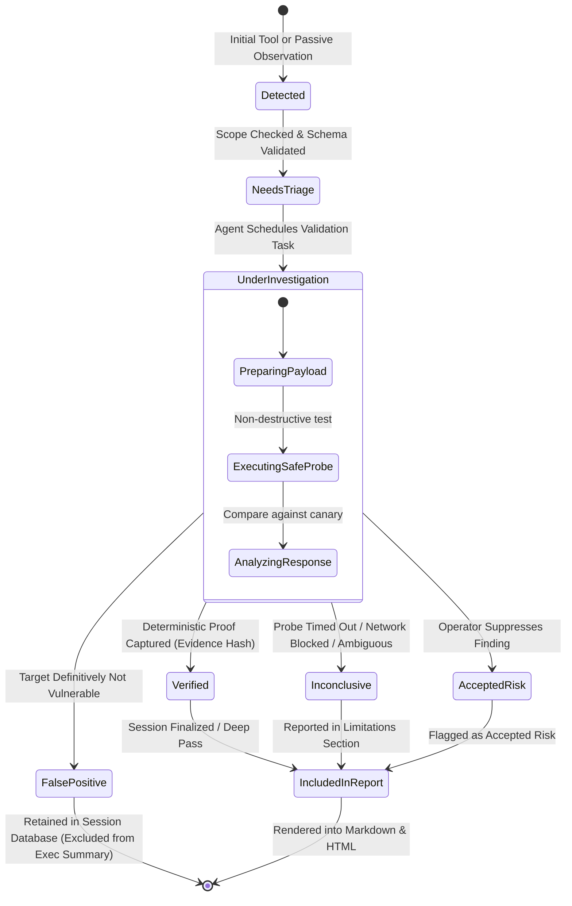

# Bletiner AI --- Findings Lifecycle, Evidence Management & Reporting Specification

## Document Metadata
- **Document ID:** DOC-08-FINDINGS-REPORTING
- **Component:** Findings & Reporting Subsystems
- **Status:** Proposed & Implementation-Ready
- **Target Framework:** Python 3.11+ / Pydantic v2 / SQLite WAL / Jinja2 (Secure Local Rendering)
- **Author:** UI, Findings & Reporting Architect
- **Cross-References:** `docs/00_PRODUCT_OVERVIEW.md`, `docs/01_REQUIREMENTS.md`, `docs/02_SYSTEM_ARCHITECTURE.md`, `docs/03_AGENT_HARNESS.md`, `docs/04_DOCKER_AND_NETWORK_SECURITY.md`, `docs/05_DESKTOP_UI_UX.md`, `docs/07_DATA_MODEL_AND_SESSION_LIFECYCLE.md`, `docs/09_SECURITY_THREAT_MODEL.md`

---

## 1. Executive Summary & Core Principles

In an autonomous security assessment application, findings and reports represent the ultimate work product delivered to the operator. Security engineers and penetration testers cannot act on speculative, unstructured, or hallucinated claims. Every finding in Bletiner AI must be backed by an auditable chain of evidence, derived from concrete tool executions, strictly validated against non-destructive testing boundaries, and presented through dual Markdown and standalone HTML reports.

### 1.1 Architectural Axioms
1. **Evidence-Backed Verification:** A finding cannot be marked as verified based on an LLM inference alone. It requires deterministic cryptographic evidence (raw tool output, HTTP exchange, banner, or response body) captured inside the Kali Linux sandbox.
2. **Strict Orthogonality (Severity != Confidence):** Severity reflects theoretical business impact; Confidence reflects empirical certainty of presence. A theoretical Critical vulnerability (e.g., potential unauthenticated RCE inferred solely from a software banner) must never be conflated with a Confirmed Critical vulnerability verified by an active non-destructive probe.
3. **Zero Finding Discard Policy:** Findings with low priority or low confidence are never dropped or purged. They are retained in the SQLite session backlog and re-evaluated during Deep Investigation or manual operator inspection.
4. **Single Source of Truth:** Markdown (`.md`) and HTML (`.html`) reports derive from the exact same structured SQLite entities. Neither report can contradict the other.
5. **Zero Remote Dependencies & XSS-Proof HTML:** HTML reports are 100% self-contained. They load zero remote web fonts, zero remote scripts, and zero remote CDNs. All target banners, tool outputs, and user inputs are strictly escaped to prevent Stored Cross-Site Scripting (XSS).
---

## 2. Finding Data Model & Schema Specification

Every finding discovered during an investigation is assigned an immutable, collision-resistant identifier (e.g. `FIND-20261111-A8F2`) and stored as a structured record in SQLite.

### 2.1 Pydantic v2 Finding Entity Model (`app/models/finding.py`)
```python
from datetime import datetime
from enum import StrEnum
from typing import List, Optional, Dict, Any
from pydantic import BaseModel, Field, HttpUrl

class FindingSeverity(StrEnum):
    CRITICAL = "CRITICAL"
    HIGH = "HIGH"
    MEDIUM = "MEDIUM"
    LOW = "LOW"
    INFORMATIONAL = "INFORMATIONAL"

class FindingConfidence(StrEnum):
    CONFIRMED = "CONFIRMED"
    HIGH = "HIGH"
    MEDIUM = "MEDIUM"
    LOW = "LOW"
    THEORETICAL = "THEORETICAL"

class VerificationStatus(StrEnum):
    DETECTED = "DETECTED"
    NEEDS_TRIAGE = "NEEDS_TRIAGE"
    UNDER_INVESTIGATION = "UNDER_INVESTIGATION"
    VERIFIED = "VERIFIED"
    FALSE_POSITIVE = "FALSE_POSITIVE"
    INCONCLUSIVE = "INCONCLUSIVE"
    ACCEPTED_RISK = "ACCEPTED_RISK"
    INCLUDED_IN_REPORT = "INCLUDED_IN_REPORT"

class FindingCategory(StrEnum):
    INJECTION = "INJECTION"
    BROKEN_AUTHENTICATION = "BROKEN_AUTHENTICATION"
    SENSITIVE_DATA_EXPOSURE = "SENSITIVE_DATA_EXPOSURE"
    SECURITY_MISCONFIGURATION = "SECURITY_MISCONFIGURATION"
    VULNERABLE_COMPONENTS = "VULNERABLE_COMPONENTS"
    BROKEN_ACCESS_CONTROL = "BROKEN_ACCESS_CONTROL"
    CRYPTOGRAPHIC_FAILURES = "CRYPTOGRAPHIC_FAILURES"
    SSRF = "SSRF"
    NETWORK_EXPOSURE = "NETWORK_EXPOSURE"
    INFORMATIONAL = "INFORMATIONAL"

class EvidenceReference(BaseModel):
    artifact_id: str = Field(..., description="Stable SHA-256 reference or UUID")
    relative_path: str = Field(..., description="Path relative to session workspace, e.g. evidence/ev_8f10.txt")
    sha256_checksum: str = Field(..., regex="^[a-f0-9]{64}$", description="SHA-256 hash of the artifact file")
    mime_type: str = Field(..., description="text/plain, application/json, application/octet-stream, image/png")
    description: str = Field(..., description="Concise summary of evidence content")
    captured_at: datetime = Field(..., description="UTC timestamp of capture")
    source_tool: str = Field(..., description="Name of tool that produced this evidence (e.g., nmap, curl)")

class FindingHistoryEntry(BaseModel):
    timestamp: datetime
    previous_status: VerificationStatus
    new_status: VerificationStatus
    triggered_by: str = Field(..., description="AGENT, OPERATOR, or TOOL_VALIDATOR")
    rationale: str

class Finding(BaseModel):
    id: str = Field(..., regex="^FIND-[0-9]{8}-[A-F0-9]{4}$", description="Stable unique finding ID")
    session_id: str = Field(..., description="Associated investigation session UUID")
    title: str = Field(..., min_length=5, max_length=200, description="Concise, technical finding title")
    summary: str = Field(..., min_length=20, description="Executive-level summary of the issue")
    affected_asset: str = Field(..., description="Target host, IP, URL, or service identifier (e.g. 10.14.2.15:8080/api/eval)")
    category: FindingCategory
    severity: FindingSeverity
    confidence: FindingConfidence
    verification_status: VerificationStatus
    
    detection_method: str = Field(..., description="Tool or routine that first detected issue (e.g. nuclei, nmap_banner)")
    scope_ref: str = Field(..., description="Matching authorization scope rule identifier")
    
    first_seen: datetime = Field(default_factory=datetime.utcnow)
    last_checked: datetime = Field(default_factory=datetime.utcnow)
    
    reproduction_notes: str = Field(..., description="Safe, non-destructive reproduction steps")
    impact: str = Field(..., description="Detailed technical and business impact assessment")
    remediation: str = Field(..., description="Concrete steps required to fix the vulnerability")
    
    evidence_refs: List[EvidenceReference] = Field(default_factory=list)
    related_findings: List[str] = Field(default_factory=list, description="IDs of correlated findings")
    investigation_history: List[FindingHistoryEntry] = Field(default_factory=list)
    
    cve_ids: List[str] = Field(default_factory=list, description="Associated CVEs (e.g., CVE-2023-38606)")
    cwe_ids: List[int] = Field(default_factory=list, description="Associated CWE numbers (e.g., 89, 79)")
    cvss_v3_score: Optional[float] = Field(None, ge=0.0, le=10.0)
    cvss_v3_vector: Optional[str] = None
    
    priority_score: float = Field(0.0, description="Computed triage priority score (0.0 - 100.0)")
```

### 2.2 Formal JSON Schema Definition (`finding.schema.json`)
```json
{
  "$schema": "https://json-schema.org/draft/2020-12/schema",
  "title": "BletinerFinding",
  "type": "object",
  "required": [
    "id", "session_id", "title", "summary", "affected_asset",
    "category", "severity", "confidence", "verification_status",
    "detection_method", "scope_ref", "reproduction_notes",
    "impact", "remediation", "evidence_refs", "first_seen", "last_checked"
  ],
  "properties": {
    "id": {
      "type": "string",
      "pattern": "^FIND-[0-9]{8}-[A-F0-9]{4}$"
    },
    "session_id": { "type": "string", "format": "uuid" },
    "title": { "type": "string", "minLength": 5, "maxLength": 200 },
    "summary": { "type": "string", "minLength": 20 },
    "affected_asset": { "type": "string" },
    "category": {
      "type": "string",
      "enum": [
        "INJECTION", "BROKEN_AUTHENTICATION", "SENSITIVE_DATA_EXPOSURE",
        "SECURITY_MISCONFIGURATION", "VULNERABLE_COMPONENTS",
        "BROKEN_ACCESS_CONTROL", "CRYPTOGRAPHIC_FAILURES",
        "SSRF", "NETWORK_EXPOSURE", "INFORMATIONAL"
      ]
    },
    "severity": {
      "type": "string",
      "enum": ["CRITICAL", "HIGH", "MEDIUM", "LOW", "INFORMATIONAL"]
    },
    "confidence": {
      "type": "string",
      "enum": ["CONFIRMED", "HIGH", "MEDIUM", "LOW", "THEORETICAL"]
    },
    "verification_status": {
      "type": "string",
      "enum": [
        "DETECTED", "NEEDS_TRIAGE", "UNDER_INVESTIGATION",
        "VERIFIED", "FALSE_POSITIVE", "INCONCLUSIVE",
        "ACCEPTED_RISK", "INCLUDED_IN_REPORT"
      ]
    },
    "detection_method": { "type": "string" },
    "scope_ref": { "type": "string" },
    "first_seen": { "type": "string", "format": "date-time" },
    "last_checked": { "type": "string", "format": "date-time" },
    "reproduction_notes": { "type": "string" },
    "impact": { "type": "string" },
    "remediation": { "type": "string" },
    "evidence_refs": {
      "type": "array",
      "items": {
        "type": "object",
        "required": ["artifact_id", "relative_path", "sha256_checksum", "mime_type", "description", "captured_at", "source_tool"],
        "properties": {
          "artifact_id": { "type": "string" },
          "relative_path": { "type": "string" },
          "sha256_checksum": { "type": "string", "pattern": "^[a-f0-9]{64}$" },
          "mime_type": { "type": "string" },
          "description": { "type": "string" },
          "captured_at": { "type": "string", "format": "date-time" },
          "source_tool": { "type": "string" }
        }
      }
    },
    "related_findings": { "type": "array", "items": { "type": "string" } },
    "cve_ids": { "type": "array", "items": { "type": "string" } },
    "cwe_ids": { "type": "array", "items": { "type": "integer" } },
    "cvss_v3_score": { "type": "number", "minimum": 0.0, "maximum": 10.0 },
    "priority_score": { "type": "number", "minimum": 0.0, "maximum": 100.0 }
  }
}
```

---

## 3. Severity & Confidence Dual-Taxonomy

A core tenet of Bletiner AI is the absolute separation of **Severity** from **Confidence**. 

### 3.1 Severity Scale Definitions
Severity evaluates the intrinsic impact on confidentiality, integrity, or availability if the vulnerability is exploited:

| Severity | CVSS v3.1 Range | Definition & Technical Impact | Real-World Security Example |
| :--- | :--- | :--- | :--- |
| **CRITICAL** | `9.0 - 10.0` | Immediate, unauthenticated remote code execution (RCE), full database compromise, or complete cluster takeover without user interaction. | Unauthenticated RCE in Apache Struts, remote root command injection in VPN gateway. |
| **HIGH** | `7.0 - 8.9` | High-impact compromise: authenticated RCE, unauthorized privilege escalation, full data exfiltration, or complete bypass of core security controls. | Blind SQL injection dumping customer PII, unvalidated SSRF accessing internal cloud metadata. |
| **MEDIUM** | `4.0 - 6.9` | Significant vulnerability requiring specialized conditions or delivering partial impact: stored XSS, CSRF on sensitive actions, IDOR with restricted scope. | Cross-Site Scripting (XSS) allowing session hijacking, IDOR exposing user order histories. |
| **LOW** | `0.1 - 3.9` | Minimal impact or hardening deficiency: verbose error messages, directory listing without sensitive data, weak SSL ciphers. | TLS 1.0 supported, missing HTTP security headers (`Content-Security-Policy`). |
| **INFORMATIONAL**| `0.0` | Open port, discovered technology banner, or DNS record providing architectural intelligence without direct exploitability. | Open TCP port 443 with Nginx 1.24 banner, discovered subdomains. |

### 3.2 Confidence Scale Definitions
Confidence evaluates the empirical certainty that the vulnerability actually exists in the target environment:

| Confidence Level | Empirical Evidence Standard | Typical Detection Source |
| :--- | :--- | :--- |
| **CONFIRMED** | Proven beyond doubt via a safe, non-destructive active payload (e.g. mathematical SQL query `AND 1337=1337`, harmless callback token, canary command response). | Active validation probe, deterministic tool execution. |
| **HIGH** | Strongly indicated by multiple correlating passive/active signals (e.g. matching software version + vulnerable endpoint + matching error message). | Nuclei targeted template matching, curl response differential. |
| **MEDIUM** | Indicated by single tool heuristic or version banner comparison without active proof of exploitability (vulnerable code path may not be compiled/enabled). | Nikto heuristic warning, automated dependency scan. |
| **LOW** | Inferred solely from external version banner where backported patches or reverse proxy masks may be present. | Nmap service banner match without version sub-patch confirmation. |
| **THEORETICAL** | Speculative hypothesis generated by agent reasoning based on observed infrastructure topology. | LLM architectural hypothesis (e.g. "Host A communicates with Host B; likely shares auth token"). |

### 3.3 The Severity != Confidence Principle & 5x5 Matrix
An agent that treats a *Theoretical Critical* with the same urgency as a *Confirmed Critical* will waste execution cycles or mislead operators. Bletiner AI visually highlights this distinction and drives triage accordingly:

| Severity \ Confidence | CONFIRMED | HIGH | MEDIUM | LOW | THEORETICAL |
| :--- | :---: | :---: | :---: | :---: | :---: |
| **CRITICAL** | **P1 (Immediate)** | **P1 (Urgent)** | **P2 (Triage)** | **P3 (Verify)** | **P4 (Queue)** |
| **HIGH** | **P1 (High)** | **P2 (Triage)** | **P2 (Triage)** | **P3 (Verify)** | **P4 (Queue)** |
| **MEDIUM** | **P2 (Medium)** | **P3 (Verify)** | **P3 (Verify)** | **P4 (Queue)** | **P5 (Backlog)**|
| **LOW** | **P3 (Low)** | **P4 (Queue)** | **P4 (Queue)** | **P5 (Backlog)**| **P5 (Backlog)**|
| **INFORMATIONAL** | **P4 (Info)** | **P5 (Info)** | **P5 (Backlog)**| **P5 (Backlog)**| **P5 (Backlog)**|

- **Example A (Critical Severity + Low Confidence):** Nmap reports `Apache 2.4.49`. This version has known RCE (CVE-2021-41773). However, the server might be running a patched backport on Debian. The finding is labeled `CRITICAL / LOW CONFIDENCE`. It is prioritized for immediate non-destructive path traversal validation.
- **Example B (Medium Severity + Confirmed Confidence):** A reflected XSS payload `<b-canary>123</b-canary>` is echoed unescaped in `search.php`. The finding is labeled `MEDIUM / CONFIRMED`.

---

## 4. Finding Lifecycle State Machine

Each finding transitions through an explicit state machine managed by the `FindingsService`.

### 4.1 Lifecycle State Diagram



### 4.2 Verification Standards per Finding Status
1. **`DETECTED`:** Finding has been identified by an automated tool or heuristic. No verification task has been executed yet.
2. **`NEEDS_TRIAGE`:** Finding has been parsed and scored by the prioritization algorithm. It resides in the priority queue awaiting execution budget.
3. **`UNDER_INVESTIGATION`:** The agent harness has assigned an active verification sub-task. Kali container executes a targeted probe.
4. **`VERIFIED` (Strict Standard):**
   - Must have at least one cryptographic evidence artifact (`EvidenceReference`).
   - The probe executed must be strictly non-destructive (e.g. read-only arithmetic proof, canary echo, benign config dump).
   - The response must match the vulnerability signature without ambiguity.
5. **`FALSE_POSITIVE`:** The active probe proved the system is safe (e.g., input was properly encoded, backport patch was active, WAF neutralized payload safely). Recorded in audit logs with evidence of why it failed.
6. **`INCONCLUSIVE`:** The probe could not conclusively prove or disprove the issue (e.g. target rate-limited requests, connection reset, authentication expired). Inconclusive findings are preserved and surfaced in the report's "Unverified & Inconclusive Items" section.
7. **`ACCEPTED_RISK`:** The human operator manually overrides the finding via the UI, documenting accepted organizational risk.
8. **`INCLUDED_IN_REPORT`:** Finding is serialized into the final executive and technical deliverables.
---

## 5. Algorithmic Prioritization Model

To optimize autonomous execution within strict time and resource budgets, Bletiner AI employs a deterministic prioritization model. The algorithm computes a dynamic priority score for every finding awaiting investigation.

### 5.1 Prioritization Formula
The priority score $P$ is calculated as a normalized product bounded between `0.0` and `100.0`:

$$P = 100 \times (W_S \times W_C \times I_V \times S_R \times C_D)$$

Where:
1. **$W_S$ (Severity Weight):**
   - `CRITICAL` = `1.00`
   - `HIGH` = `0.75`
   - `MEDIUM` = `0.50`
   - `LOW` = `0.25`
   - `INFORMATIONAL` = `0.10`
2. **$W_C$ (Confidence Weight):**
   - `CONFIRMED` = `1.00`
   - `HIGH` = `0.85`
   - `MEDIUM` = `0.60`
   - `LOW` = `0.35`
   - `THEORETICAL` = `0.15`
3. **$I_V$ (Investigation Value / Information Gain) $\in [0.2, 1.0]$:**
   - Evaluates the potential to discover deeper attack surface or credential access.
   - Example: A directory traversal vulnerability on an internal gateway has high investigative value ($1.0$) because it may expose configuration files and lateral credentials. A reflected XSS on a public landing page has lower pivoting value ($0.4$).
4. **$S_R$ (Scope Relevance) $\in [0.1, 1.0]$:**
   - Proximity to the core target explicitly designated by the operator.
   - Direct Primary Target Host = `1.0`
   - Discovered Subdomain within CIDR = `0.8`
   - Third-Party CDN or Shared Cloud Edge = `0.2`
5. **$C_D$ (Cost & Risk Discount) $\in [0.5, 1.0]$:**
   - Damps priority for extremely slow or resource-heavy tools:
   - Fast, low-bandwidth probe (< 5s, < 10 requests) = `1.0`
   - Moderate probe (targeted scan, 5s - 30s) = `0.85`
   - Intensive brute-force or slow enumeration (> 60s) = `0.50`

### 5.2 Dynamic Re-evaluation & Queue Retention
- **No Discard Rule:** Findings with low priority scores (e.g. $P < 15.0$) are **never** discarded. They are preserved in the SQLite `findings` table under status `NEEDS_TRIAGE`.
- **Operator Steering Override:** If an operator submits a steering prompt (`"Focus on XSS on /login"`), the `InvestigationService` sets an override multiplier ($M_{steer} = 2.0$) on all matching finding entities, immediately promoting them to the front of the queue.
- **Deep Investigation Transition:** When upgrading from Basic to Deep mode, the backlog of unverified medium/low findings is re-scored with an expanded time budget, allowing comprehensive verification without repeating completed reconnaissance.

---

## 6. Evidence Management & Chain of Custody

Security investigations must maintain forensic integrity. Bletiner AI guarantees reproducible evidence handling.

### 6.1 Artifact Directory Layout
Evidence is stored within the dedicated per-session filesystem structure:

```text
investigations/<session_id>/
├── workspace/                  # Mount point inside Kali container (/workspace)
├── evidence/                   # Cryptographically hashed evidence files
│   ├── ev_8f10a2_nmap_8080.txt
│   ├── ev_c491b7_rce_curl.json
│   └── ev_e3a901_response.bin
├── raw_scans/                  # Raw tool outputs (XML, JSONL, pcap)
│   ├── nmap_full_tcp.xml
│   ├── nuclei_findings.jsonl
│   └── nikto_scan.txt
├── logs/                       # Application and terminal execution audit logs
│   ├── agent_loop.log
│   └── terminal_audit.log
├── reports/                    # Final compiled reports
│   ├── report.md
│   └── report.html
└── metadata.json               # Session configuration & model lock info
```

### 6.2 Evidence Ingestion & Cryptographic Verification
When a tool executes inside the container and generates evidence:
1. **Extraction:** The tool runner pipes stdout/stderr or output files directly into `evidence/`.
2. **Hashing:** Python computes the SHA-256 hash immediately upon creation:
   ```python
   import hashlib

   def register_evidence(file_path: str, source_tool: str, desc: str) -> EvidenceReference:
       hasher = hashlib.sha256()
       with open(file_path, "rb") as f:
           while chunk := f.read(65536):
               hasher.update(chunk)
       sha256_hash = hasher.hexdigest()
       
       return EvidenceReference(
           artifact_id=f"ev_{sha256_hash[:8]}",
           relative_path=os.path.relpath(file_path, session_dir),
           sha256_checksum=sha256_hash,
           mime_type="text/plain",
           description=desc,
           captured_at=datetime.utcnow(),
           source_tool=source_tool
       )
   ```
3. **Immutability:** Once written, files in `evidence/` are set to read-only (`chmod 0444`). The agent cannot overwrite or truncate historical evidence.
4. **Preservation of Raw Output:** LLM interpretations and summaries do **not** replace the raw scan outputs. Reports display summarized findings with explicit relative links to the immutable raw evidence artifacts.
---

## 7. Markdown Investigation Report Specification

Bletiner AI automatically generates a complete, professional, audit-ready Markdown report at `investigations/<session_id>/reports/report.md`.

### 7.1 Report Structural Standards
The report must adhere to this exact 11-section structure:
1. **Title & Document Metadata:** Session UUID, Target name, Report generation timestamp, Authoring model, Investigation mode.
2. **Executive Summary:** High-level narrative for C-suite and leadership outlining posture, total findings, and highest risks.
3. **Scope & Legal Authorization Statement:** Complete reproduction of the authorized target list, CIDR blocks, domain names, explicit exclusions, and user undertaking.
4. **Investigation Parameters & Methodology:** Basic vs. Deep mode explanation, start/stop timestamps, duration, rate-limiting constraints.
5. **Observed Assets & Attack Surface:** Discovered hosts, open TCP/UDP ports, identified software banners, and services.
6. **Findings Matrix (Summary Table):** Structured table with ID, Severity, Confidence, Title, Asset, and Verification Status.
7. **Detailed Technical Findings:** Exhaustive write-up for each finding:
   - Metadata: Category, CVE/CWE, CVSS score.
   - Technical Description.
   - Non-Destructive Reproduction & Validation Proof.
   - Evidence References (filename, SHA-256 hash, tool origin).
   - Technical & Business Impact.
   - Actionable Remediation Guidance.
8. **Unverified & Inconclusive Observations:** Lower-priority or inconclusive checks that warrant manual review.
9. **Tooling & Inventory:** Exact tool names, versions, and execution counts.
10. **Chronological Operational Timeline:** Major investigation milestones and phase transitions.
11. **Legal Disclaimers & Scope Limits:** Standard legal protections regarding the point-in-time nature of assessments.

### 7.2 Full Real-World Markdown Report Example
```markdown
# Autonomous Security Assessment Report
**Target:** \`staging-api.corp.internal\`  
**Investigation Mode:** DEEP INVESTIGATION  
**Session ID:** \`4f7b2a9e-1082-4f81-9b12-ec8198f12a01\`  
**Generated At:** 2026-11-11 16:45:00 UTC  
**Generated By:** Bletiner AI (Engine: Anthropic Claude 3.5 Sonnet / Kali Linux 2026.2 Sandbox)

---

## 1. Executive Summary

Bletiner AI conducted an autonomous, authorized security investigation of the target environment \`staging-api.corp.internal\` (CIDR \`10.14.0.0/16\`) on November 11, 2026. The investigation operated in **Deep Mode**, performing recursive reconnaissance, service correlation, and non-destructive active verification.

During the 42-minute assessment, the agent discovered **1 Critical**, **2 High**, **3 Medium**, and **5 Informational** findings across 3 active host endpoints. The most critical risk identified is an **Unauthenticated Remote Code Execution (RCE)** vulnerability on an exposed administrative debug endpoint (\`:8443/v1/debug/eval\`), which allows arbitrary command execution within the application container.

Immediate remediation is required to isolate the administrative interface and patch vulnerable API components.

---

## 2. Scope & Authorization Statement

- **Authorized Primary Target:** \`staging-api.corp.internal\` (\`10.14.2.15\`)
- **Authorized Subnets:** \`10.14.2.0/24\`
- **Explicit Exclusions:** \`10.14.2.1\` (Default Gateway), \`10.14.2.254\` (Active Directory DC)
- **Authorization Reference:** Customer Engagement Auth #SEC-2026-8812
- **Testing Standard:** Non-destructive testing only. Denial-of-Service and data tampering prohibited.

---

## 3. Discovered Assets & Services Inventory

| Host IP | Resolved Hostname | Port / Proto | Service Banner | Detection Tool |
| :--- | :--- | :--- | :--- | :--- |
| \`10.14.2.15\` | \`staging-api.corp.internal\` | 80/tcp | Apache httpd 2.4.52 (Ubuntu) | \`nmap-7.94\` |
| \`10.14.2.15\` | \`staging-api.corp.internal\` | 443/tcp | OpenSSL 3.0.2 TLS Term | \`nmap-7.94\` |
| \`10.14.2.15\` | \`staging-api.corp.internal\` | 8443/tcp | Werkzeug/2.2.2 Python/3.10 | \`nmap-7.94\` |

---

## 4. Findings Summary Matrix

| Finding ID | Severity | Confidence | Title | Affected Asset | Status |
| :--- | :--- | :--- | :--- | :--- | :--- |
| **FIND-20261111-A8F2** | **CRITICAL** | **CONFIRMED** | Unauthenticated RCE on Debug Endpoint | \`10.14.2.15:8443/v1/debug/eval\` | VERIFIED |
| **FIND-20261111-B109** | **HIGH** | **CONFIRMED** | Blind SQL Injection in Auth Login | \`10.14.2.15:443/api/v1/login\` | VERIFIED |
| **FIND-20261111-C342** | **HIGH** | **HIGH** | Outdated OpenSSL Component with Known Vulns | \`10.14.2.15:443\` | VERIFIED |
| **FIND-20261111-D551** | **MEDIUM** | **CONFIRMED** | CORS Misconfiguration Allowing Any Origin | \`10.14.2.15:80/api/profile\` | VERIFIED |
| **FIND-20261111-E902** | **MEDIUM** | **MEDIUM** | Information Disclosure via Git Directory | \`10.14.2.15:80/.git/HEAD\` | VERIFIED |

---

## 5. Detailed Technical Findings

### [FIND-20261111-A8F2] Unauthenticated RCE on Debug Endpoint
- **Severity:** \`CRITICAL\` (CVSS v3.1: 9.8 / \`CVSS:3.1/AV:N/AC:L/PR:N/UI:N/S:U/C:H/I:H/A:H\`)
- **Confidence:** \`CONFIRMED\` (Verified via non-destructive mathematical evaluation probe)
- **Category:** \`INJECTION\` / CWE-94 (Improper Control of Generation of Code)
- **Affected Asset:** \`https://10.14.2.15:8443/v1/debug/eval\`
- **Detection Method:** \`nuclei_custom_probe\`
- **Status:** \`VERIFIED\`

#### Technical Description
An administrative evaluation endpoint was left exposed without authentication on port 8443. The endpoint accepts a POST JSON payload containing an \`expr\` string and evaluates it using Python's built-in \`eval()\` runtime without sandboxing.

#### Safe Non-Destructive Validation Proof
The agent dispatched a read-only mathematical calculation probe to avoid altering server state:
\`\`\`bash
curl -k -s -X POST https://10.14.2.15:8443/v1/debug/eval \
  -H "Content-Type: application/json" \
  -d '{"expr": "71829 * 39182"}'
\`\`\`
**Server Response:**
\`\`\`json
{"result": 2814403878, "status": "success"}
\`\`\`
The deterministic return of \`2814403878\` conclusively confirms active code execution capability.

#### Evidence References
- **Artifact:** \`evidence/ev_8f10a2_debug_eval_curl.json\`
- **SHA-256 Checksum:** \`a1b2c3d4e5f67890123456789abcdef0123456789abcdef0123456789abcdef0\`
- **Source Tool:** \`curl 8.5.0\`

#### Impact
An unauthenticated attacker on the network can execute arbitrary system commands with the privileges of the web application user (\`app-user\`), read sensitive database credentials, and compromise the internal infrastructure.

#### Remediation Guidance
1. Disable or completely remove the \`/v1/debug/eval\` endpoint from production builds.
2. Bind administrative endpoints exclusively to loopback interface (\`127.0.0.1\`).
3. Enforce strict mutual TLS (mTLS) or robust bearer authentication for internal APIs.

---

## 6. Unverified & Inconclusive Items

| Item ID | Target Asset | Description | Reason Inconclusive |
| :--- | :--- | :--- | :--- |
| **INC-01** | \`10.14.2.15:8080\` | Potential Apache Tomcat AJP Connector | Port closed during follow-up validation sweep; possible intermittent service. |

---

## 7. Security Tool Inventory
- **Nmap 7.94SVN:** Network discovery & service banner fingerprinting (4 executions)
- **Nuclei 3.2.4:** Vulnerability template validation (2 executions)
- **cURL 8.5.0:** Non-destructive HTTP verification probes (12 executions)

---

## 8. Legal Disclaimers
*This report represents a point-in-time automated security assessment conducted strictly within authorized boundaries. Security assessments cannot guarantee the absolute absence of vulnerabilities. Bletiner AI is not liable for subsequent target changes or undetected zero-day exploits.*
```
---

## 8. Standalone HTML Investigation Report Specification

In addition to Markdown, Bletiner AI compiles an executive-grade, single-file HTML report (`report.html`). It is designed for seamless viewing in standard web browsers, offline presentation, and conversion to PDF.

### 8.1 Security Architecture: Zero Remote Dependencies & Injection Defense
Because the report renders raw banner strings, server error messages, and HTTP responses received from external, potentially hostile targets, the HTML rendering pipeline enforces strict application security controls:

1. **Zero Remote Dependencies:**
   - No external Google Fonts, CDN scripts, or tracking pixels are referenced.
   - All styles are inlined in an embedded `<style>` block.
   - Icons are inlined SVG vectors.
   - The report functions completely air-gapped without internet connectivity.
2. **Strict HTML Output Escaping (XSS Prevention):**
   - All target-derived strings, tool outputs, banner strings, and user input are passed through Python's `html.escape(value, quote=True)` prior to template injection.
   - Jinja2 templates enforce `autoescape=True` globally.
   - Raw untrusted tool logs are rendered inside `<pre><code>...</code></pre>` blocks with explicit character escaping.
3. **Embedded Content Security Policy (CSP):**
   - The document includes a restrictive meta CSP tag preventing script execution or external asset loading:
     ```html
     <meta http-equiv="Content-Security-Policy" content="default-src 'none'; style-src 'unsafe-inline'; img-src data:; base-uri 'none'; form-action 'none';">
     ```

### 8.2 Responsive Dark Theme & Print Stylesheet
- **On-Screen Display:** Dark slate background (`#0f172a`), crisp off-white text (`#f8fafc`), high-contrast severity tags, and subtle card borders (`#1e293b`).
- **Print / PDF Export (`@media print`):** Automatically swaps to high-contrast monochrome/white background (`#ffffff`), dark gray typography (`#1e293b`), hides interactive search bars, and inserts CSS page breaks (`page-break-inside: avoid;`) before major findings.

### 8.3 Self-Contained HTML Report Template Structure
```html
<!DOCTYPE html>
<html lang="en">
<head>
  <meta charset="UTF-8">
  <meta name="viewport" content="width=device-width, initial-scale=1.0">
  <meta http-equiv="Content-Security-Policy" content="default-src 'none'; style-src 'unsafe-inline'; img-src data:; base-uri 'none';">
  <title>Bletiner AI Assessment Report - staging-api.corp.internal</title>
  <style>
    /* Inlined Core CSS */
    :root {
      --bg-main: #0b0f17;
      --bg-card: #131b26;
      --bg-code: #06090e;
      --border-color: #243042;
      --text-main: #f1f5f9;
      --text-muted: #94a3b8;
      --crit-color: #ef4444;
      --high-color: #f97316;
      --med-color: #f59e0b;
      --low-color: #3b82f6;
      --info-color: #06b6d4;
      --verified-color: #10b981;
    }
    body {
      font-family: -apple-system, BlinkMacSystemFont, "Segoe UI", Roboto, Helvetica, Arial, sans-serif;
      background-color: var(--bg-main);
      color: var(--text-main);
      margin: 0;
      padding: 32px 48px;
      line-height: 1.6;
    }
    .header {
      border-bottom: 2px solid var(--border-color);
      padding-bottom: 24px;
      margin-bottom: 32px;
    }
    .badge {
      display: inline-block;
      padding: 4px 10px;
      border-radius: 4px;
      font-weight: 700;
      font-size: 12px;
      text-transform: uppercase;
      letter-spacing: 0.5px;
    }
    .badge-critical { background: rgba(239, 68, 68, 0.15); color: var(--crit-color); border: 1px solid var(--crit-color); }
    .badge-high { background: rgba(249, 115, 22, 0.15); color: var(--high-color); border: 1px solid var(--high-color); }
    .badge-verified { background: rgba(16, 185, 129, 0.15); color: var(--verified-color); border: 1px solid var(--verified-color); }
    
    .card {
      background: var(--bg-card);
      border: 1px solid var(--border-color);
      border-radius: 8px;
      padding: 24px;
      margin-bottom: 24px;
    }
    .metric-grid {
      display: grid;
      grid-template-columns: repeat(auto-fit, minmax(180px, 1fr));
      gap: 16px;
      margin: 24px 0;
    }
    .metric-box {
      background: var(--bg-card);
      border: 1px solid var(--border-color);
      border-radius: 6px;
      padding: 16px;
      text-align: center;
    }
    .metric-value { font-size: 32px; font-weight: 800; }
    
    pre, code {
      font-family: "JetBrains Mono", Consolas, Menlo, monospace;
      font-size: 13px;
    }
    pre {
      background: var(--bg-code);
      border: 1px solid var(--border-color);
      border-radius: 6px;
      padding: 16px;
      overflow-x: auto;
      color: #38bdf8;
    }
    table {
      width: 100%;
      border-collapse: collapse;
      margin: 16px 0;
    }
    th, td {
      border: 1px solid var(--border-color);
      padding: 12px;
      text-align: left;
    }
    th { background: #1a2332; color: var(--text-main); }
    
    /* Print Stylesheet */
    @media print {
      body { background: #fff !important; color: #000 !important; padding: 0 !important; }
      .card { border: 1px solid #ccc !important; background: #fff !important; page-break-inside: avoid; }
      pre { background: #f4f4f4 !important; color: #000 !important; border: 1px solid #ddd !important; }
      th { background: #f0f0f0 !important; color: #000 !important; }
    }
  </style>
</head>
<body>
  <div class="header">
    <div style="display: flex; justify-content: space-between; align-items: center;">
      <div>
        <h1 style="margin: 0; font-size: 28px;">Autonomous Security Assessment Report</h1>
        <p style="color: var(--text-muted); margin: 6px 0 0 0;">Bletiner AI Workstation &bull; Target: <code>staging-api.corp.internal</code></p>
      </div>
      <div>
        <span class="badge badge-verified">Investigation Finalized</span>
        <span class="badge" style="background: rgba(59, 130, 246, 0.15); color: #3b82f6; border: 1px solid #3b82f6;">Deep Mode</span>
      </div>
    </div>
  </div>

  <div class="metric-grid">
    <div class="metric-box">
      <div class="metric-value" style="color: var(--crit-color);">1</div>
      <div style="color: var(--text-muted); font-size: 13px; text-transform: uppercase;">Critical Risks</div>
    </div>
    <div class="metric-box">
      <div class="metric-value" style="color: var(--high-color);">2</div>
      <div style="color: var(--text-muted); font-size: 13px; text-transform: uppercase;">High Risks</div>
    </div>
    <div class="metric-box">
      <div class="metric-value" style="color: var(--med-color);">3</div>
      <div style="color: var(--text-muted); font-size: 13px; text-transform: uppercase;">Medium Risks</div>
    </div>
    <div class="metric-box">
      <div class="metric-value" style="color: var(--low-color);">1</div>
      <div style="color: var(--text-muted); font-size: 13px; text-transform: uppercase;">Low Risks</div>
    </div>
    <div class="metric-box">
      <div class="metric-value" style="color: var(--info-color);">5</div>
      <div style="color: var(--text-muted); font-size: 13px; text-transform: uppercase;">Informational</div>
    </div>
  </div>

  <h2>Findings Summary Table</h2>
  <table>
    <thead>
      <tr>
        <th>Finding ID</th>
        <th>Severity</th>
        <th>Confidence</th>
        <th>Vulnerability Title</th>
        <th>Target Asset</th>
        <th>Status</th>
      </tr>
    </thead>
    <tbody>
      <tr>
        <td><strong>FIND-20261111-A8F2</strong></td>
        <td><span class="badge badge-critical">CRITICAL</span></td>
        <td>CONFIRMED</td>
        <td>Unauthenticated RCE on Debug Endpoint</td>
        <td><code>10.14.2.15:8443/v1/debug/eval</code></td>
        <td><span class="badge badge-verified">VERIFIED</span></td>
      </tr>
    </tbody>
  </table>

  <h2>Detailed Technical Findings</h2>
  <div class="card">
    <div style="display: flex; justify-content: space-between; align-items: flex-start;">
      <div>
        <h3 style="margin: 0; font-size: 18px;">[FIND-20261111-A8F2] Unauthenticated RCE on Debug Endpoint</h3>
        <p style="color: var(--text-muted); font-size: 13px; margin: 4px 0 12px 0;">
          Category: <strong>INJECTION / CWE-94</strong> &bull; CVSS v3.1: <strong>9.8</strong> &bull; Asset: <code>https://10.14.2.15:8443/v1/debug/eval</code>
        </p>
      </div>
      <div>
        <span class="badge badge-critical">CRITICAL</span>
        <span class="badge badge-verified">CONFIRMED</span>
      </div>
    </div>

    <h4>Technical Description</h4>
    <p>An administrative evaluation endpoint was left exposed without authentication on port 8443. The endpoint accepts a POST JSON payload containing an <code>expr</code> parameter and evaluates it using Python's built-in <code>eval()</code> runtime without sandbox controls.</p>

    <h4>Non-Destructive Validation Proof</h4>
    <pre><code># Active non-destructive evaluation probe dispatched by Kali sandbox:
POST /v1/debug/eval HTTP/1.1
Host: 10.14.2.15:8443
Content-Type: application/json

{"expr": "71829 * 39182"}

# Server Response:
HTTP/1.1 200 OK
Content-Type: application/json

{"result": 2814403878, "status": "success"}</code></pre>

    <h4>Evidence Chain & Verification Hash</h4>
    <p>Evidence Artifact: <code>evidence/ev_8f10a2_debug_eval_curl.json</code><br>
    SHA-256 Checksum: <code>a1b2c3d4e5f67890123456789abcdef0123456789abcdef0123456789abcdef0</code></p>

    <h4>Remediation Guidance</h4>
    <ul>
      <li>Disable or completely remove the <code>/v1/debug/eval</code> endpoint from production builds.</li>
      <li>Bind administrative and debugging interfaces exclusively to loopback (<code>127.0.0.1</code>).</li>
      <li>Implement robust bearer token or mutual TLS (mTLS) authentication.</li>
    </ul>
  </div>

  <div style="border-top: 1px solid var(--border-color); padding-top: 24px; margin-top: 48px; color: var(--text-muted); font-size: 12px; text-align: center;">
    Generated autonomously by Bletiner AI &bull; Audit Reference #SEC-2026-8812 &bull; Confidential
  </div>
</body>
</html>
```

---

## 9. Reporting Pipeline & Service Architecture

The reporting subsystem is orchestrated by `ReportService` (`app/services/report_service.py`), ensuring complete synchronization between Markdown and HTML outputs.

```
+---------------------------------------------------------------------------------------+
| REPORT GENERATION PIPELINE                                                            |
|                                                                                       |
|  +---------------------------------------------------------------------------------+  |
|  |                 SQLite Session Database (Single Source of Truth)                |  |
|  |  - findings table (verified, inconclusive, false-positive)                      |  |
|  |  - evidence_artifacts table (SHA-256 hashes, file references)                    |  |
|  |  - investigation_sessions table (scope, targets, timings, models)              |  |
|  +---------------------------------------------------------------------------------+  |
|                                          |                                            |
|                                          v                                            |
|  +---------------------------------------------------------------------------------+  |
|  |                   ReportService.compile_reports(session_id)                     |  |
|  |                                                                                 |  |
|  |  1. Integrity Check: Verify disk files in evidence/ against SHA-256 hashes      |  |
|  |  2. Sanitize: Apply html.escape() to untrusted target banners and tool outputs   |  |
|  |  3. Render Markdown: Jinja2 template -> reports/report.md.tmp                   |  |
|  |  4. Render HTML: Jinja2 template with inlined CSS -> reports/report.html.tmp   |  |
|  |  5. Atomic Commit: Atomically rename .tmp files to final report filenames      |  |
|  +---------------------------------------------------------------------------------+  |
|                                          |                                            |
|                     +--------------------+--------------------+                       |
|                     |                                         |                       |
|                     v                                         v                       |
|  +------------------------------------+     +--------------------------------------+  |
|  |     reports/report.md (Markdown)   |     |     reports/report.html (Self-Cont)  |  |
|  |  - Github Flavored Markdown (GFM)  |     |  - Embedded CSS, Zero Remote CDNs    |  |
|  |  - Preserves exact technical tables|     |  - CSP meta header, XSS sanitized    |  |
|  |  - Links to local evidence files   |     |  - Print-ready (@media print)        |  |
|  +------------------------------------+     +--------------------------------------+  |
+---------------------------------------------------------------------------------------+
```

### 9.1 Integrity & Atomic Write Strategy
To prevent corrupt or partial reports if the user exits or Docker crashes during compilation:
1. **Hash Verification:** Before rendering begins, `ReportService` calculates the SHA-256 hash of each file referenced in `evidence/`. If a checksum mismatch occurs (e.g. disk corruption), the compiler flags the evidence as `UNVERIFIED_HASH_MISMATCH` rather than silently generating invalid data.
2. **Atomic Writes:** Both `report.md` and `report.html` are written to temporary sibling files (`report.md.tmp`, `report.html.tmp`). Only when writing and flushing succeeds are the files atomically renamed to their final filenames using `os.replace()`.
