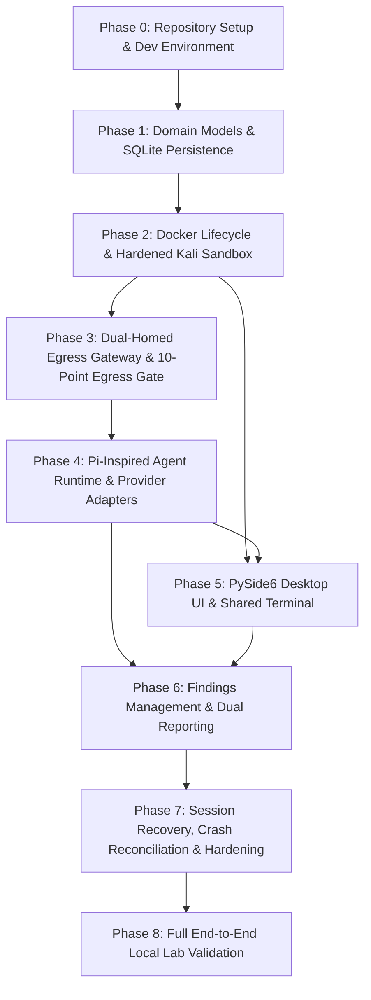

# Bletiner AI — Phased Implementation Roadmap

**Document Identifier:** `DOC-11-ROADMAP`  
**Version:** 3.0.0 (Revision 3 Egress Enforcement & Runtime Security Validation)  
**Status:** Approved Specification  
**Author:** Backend & Data Engineering Lead  
**Scope:** Phased Engineering Plan, Deliverables, Verifiable Exit Criteria, Phase Gates, Dependencies, and Critical Path  

---

## 1. Executive Summary and Implementation Philosophy

Bletiner AI is a desktop application engineered for autonomous, authorized security investigations. Because it interfaces an autonomous LLM agent with real-world network reconnaissance tools executing inside Kali Linux containers, implementation must follow a strictly phased, defense-in-depth engineering roadmap.

### 1.1 Canonical Phase Reordering Principle (Revision 3 Architecture)
In accordance with ADR-010, ADR-012, and SEC-024:
> **"A security architecture is not secure because documentation says FAIL-CLOSED. It is secure only after we have demonstrated that it fails closed under adversarial tests."**

The Docker execution sandbox and dual-homed network egress gateway MUST be constructed, hardened, and verified via the **10-Point Egress Validation Gate & Infrastructure Proof-of-Concept (`scripts/verify_gateway_poc.py`) BEFORE building or launching the autonomous Agent Loop**.

An autonomous agent must NEVER be connected to live network capabilities without hardware- and kernel-enforced scope boundaries proven in practice. Development proceeds strictly from the ground up: repository scaffolding and persistence first, then the hardened container sandbox, followed by the egress isolation gateway, before introducing the Pi-inspired agent harness.

### 1.2 Canonical Roadmap Overview (9 Phases)

| Phase | Phase Name | Focus Area | Relative Duration | Pre-requisites |
| :--- | :--- | :--- | :--- | :--- |
| **Phase 0** | Repository Setup & Dev Env | Python 3.11+ venv, project layout, CI/CD linters, formatting | Sprint 1 (Weeks 1–2) | None |
| **Phase 1** | Domain Models & Persistence | SQLite WAL schema, Keyring integration, Pydantic domain models | Sprints 1–2 (Weeks 2–4) | Phase 0 |
| **Phase 2** | Docker & Hardened Sandbox | Kali container lifecycle, non-root user, dropped capabilities | Sprints 2–3 (Weeks 4–6) | Phase 1 |
| **Phase 3** | Dual-Homed Egress Gateway | Network isolation, egress proxy, SNI validation, 10-Point Gate | Sprints 3–4 (Weeks 6–8) | Phase 2 |
| **Phase 4** | Agent Runtime & Providers | Pi-inspired loop, `pi-ai` adapters, 4-tier tool risk, rate limits | Sprints 4–5 (Weeks 8–10) | Phase 1, Phase 3 |
| **Phase 5** | Desktop UI & Shared Terminal | PySide6 three-card layout, xterm.js PTY bridge, event feed | Sprints 5–6 (Weeks 10–12)| Phase 2, Phase 4 |
| **Phase 6** | Findings & Dual Reporting | 7-stage verification FSM, scoring, Markdown & HTML reports | Sprints 6–7 (Weeks 12–14)| Phase 4, Phase 5 |
| **Phase 7** | Recovery & Crash Reconciliation | Atomic checkpoints, 5-phase shutdown, idempotency engine | Sprints 7–8 (Weeks 14–16)| Phase 1, Phase 6 |
| **Phase 8** | Full E2E Local Lab Validation | Isolated local targets (Juice Shop / DVWA), failure injection | Sprints 8–9 (Weeks 16–18)| All Prior Phases |

---

## 2. Phase Specifications: Phases 0 to 2

### Phase 0: Repository Setup and Development Environment
* **Objective:** Establish the production repository scaffold, configure the Python 3.11+ environment, lock development dependencies, enforce strict type checking, and configure pre-commit hooks for code quality.
* **Dependencies:** None. Grounding phase.
* **Key Deliverables:**
  1. Complete project directory layout per `docs/12_PROJECT_STRUCTURE.md` including `src/bletiner/` and `src/bletiner/infra/gateway/`.
  2. `pyproject.toml` configuration with strict Ruff linter, Black formatter, and Mypy static type checker settings.
  3. Pre-commit hooks enforcing zero syntax errors, zero untyped defs (`disallow_untyped_defs = true`), and security scans with `bandit`.
  4. Base test infrastructure (`pytest`, `pytest-asyncio`, `pytest-mock`, `pytest-qt`).
* **Exit Criteria (Verifiable):**
  - [ ] `mypy --strict src/ tests/` executes with 0 errors on clean checkout.
  - [ ] `ruff check .` and `black --check .` pass with 100% compliance.
  - [ ] Automated CI pipeline runs test runner and verifies Python 3.11+ compatibility.
* **What Must Be Proven Before Proceeding:** Clean developer workstation bootstrap with consistent toolchain across Windows and Linux environments.

---

### Phase 1: Domain Models and SQLite Persistence
* **Objective:** Implement the relational persistence layer in SQLite operating in WAL mode, the Dedicated Serialized Write Queue worker, thread-safe read pools, domain Pydantic models, and OS Keyring integration.
* **Dependencies:** Phase 0.
* **Key Deliverables:**
  1. Complete SQLite schema DDL (`database/bletiner.db`) with 17 tables, 14 indexes, check constraints, and `PRAGMA user_version = 2`.
  2. Privacy-minimized `terms_acceptance` table storing zero PII (NO IP, NO MAC, NO username; strictly `terms_version`, `terms_hash`, `accepted_at`, and `acceptance_hash`).
  3. Dedicated Serialized SQLite Write Queue Worker (`storage/db_pool.py`) with read-only connection pooling.
  4. Repository classes with full CRUD support: `InvestigationRepository`, `SessionRepository`, `ProviderConfigRepository`, `TermsAcceptanceRepository`, `FindingRepository`.
  5. OS Keyring integration (`services/secrets_service.py`) for zero-plaintext secret storage (Windows Credential Manager / Secret Service).
* **Exit Criteria (Verifiable):**
  - [ ] 100% pass on SQLite DDL execution: table creation, constraints, foreign keys, and cascading deletes verified via `pytest tests/test_db_schema.py`.
  - [ ] Concurrent write stress test: 200 concurrent write operations submitted to `db_pool` complete with zero `SQLITE_BUSY` errors.
  - [ ] Privacy verification: automated test confirms `terms_acceptance` schema contains zero PII columns.
  - [ ] Keyring round-trip test: API keys stored, retrieved, and deleted with zero plaintext persistence to disk or log files.
* **What Must Be Proven Before Proceeding:** The database layer can safely persist, query, and rollback transactions under multi-threaded concurrency without deadlock or write starvation.

---

### Phase 2: Docker Lifecycle and Hardened Kali Sandbox
* **Objective:** Implement the per-investigation Kali Linux container lifecycle management, unprivileged execution policies, capability dropping, resource quotas, and local PTY bridge connecting to the container for terminal emulation.
* **Dependencies:** Phase 1 (Data models, repository layer).
* **Key Deliverables:**
  1. Version-pinned, reproducible Kali Linux Dockerfile (`kali-rolling-bletiner:v1.0`).
  2. `ContainerManager` service wrapping Docker SDK: container creation with non-root user (`bletiner`, UID 1000), read-only root FS, `/workspace` bind mount, memory (4GB), and CPU (2.0 cores) quotas.
  3. Container security hardening: `cap_drop=['ALL']`, `cap_add=['NET_RAW', 'NET_BIND_SERVICE']`, strictly NO `CAP_NET_ADMIN`, NO privileged flags, and NO `docker.sock` mount. Enforce Linux Ambient Capabilities under `no_new_privs: true` so `bletiner` can run raw socket tools (e.g. `nmap -sS`) without root privilege escalation.
  4. Headless Docker Exec channel for agent command execution (`services/docker_exec_service.py`) with structured `argv: list[str]` parameter passing (avoiding `/bin/sh -c` shell interpolation).
  5. Local PTY bridge server (`services/terminal_bridge.py`) exposing bidirectional WebSocket stream between container bash shell and desktop host.
* **Exit Criteria (Verifiable):**
  - [ ] Automated test creates Kali container, executes test command via Docker Exec, captures exit code 0, and stops container in under 3.5 seconds.
  - [ ] Security test confirms container user is unprivileged (UID 1000), `/` is read-only, `/workspace` is writable, and `docker.sock` is NOT mounted.
  - [ ] Capability verification: container strictly drops all capabilities except `NET_RAW` and `NET_BIND_SERVICE`; attempts to modify routing tables (`ip route`) fail with Permission Denied.
  - [ ] Ambient capability verification: non-root `bletiner` user successfully performs an Nmap SYN scan (`nmap -sS`) without `sudo` and with `no_new_privs: true`.
  - [ ] PTY bridge test streams raw ANSI sequences (colors, cursor movements, resize events) with latency under 15ms.
* **What Must Be Proven Before Proceeding:** Container creation, command execution, and destruction are completely isolated, non-root, and cannot escape into host resources.

---

## 3. Phase Specifications: Phases 3 to 5

### Phase 3: Dual-Homed Egress Gateway and Network Scope Enforcement
* **Objective:** Establish the dual-homed egress gateway container and network boundary enforcing authorized investigation scopes BEFORE any autonomous agent execution begins. Intercept and filter container network traffic using the gateway proxy, blocking unauthorized destinations, private RFC1918 networks, cloud metadata endpoints, loopback escapes, and multi-tenant CDN domain spoofing via SNI inspection.
* **Dependencies:** Phase 2 (Docker container network).
* **Key Deliverables:**
  1. Dual-Homed Gateway Container specification (`src/bletiner/infra/gateway/`): connects to isolated internal container network on one side, and host egress on the other.
  2. `ScopeValidator` service: Strict parsing and normalization of authorized domains, IPv4/IPv6, CIDRs, and URLs.
  3. Safe DNS resolver with DNS-rebinding protection and pre-execution destination IP validation.
  4. SNI & Host Header Egress Validator (ADR-012): Inspects TLS Client Hello SNI and HTTP Host headers to prevent unauthorized domain access on shared multi-tenant CDN/cloud IP infrastructures.
  5. Kernel-level egress firewall rules in gateway container blocking RFC1918 subnets (`10.0.0.0/8`, `172.16.0.0/12`, `192.168.0.0/16`), loopback (`127.0.0.0/8`), link-local (`169.254.0.0/16`), and AWS/GCP/Azure metadata endpoints (`169.254.169.254`).
  6. Real-time network audit logging (`network_audit_logs` in SQLite) capturing all allowed and blocked flows.
  7. **Standalone Verification Script (`scripts/verify_gateway_poc.py`)**: Automated verification harness implementing all 10 egress failure checks.

#### Mandatory Exit Gate: The 10-Point Egress Validation Gate
Claude Code MUST build and pass `scripts/verify_gateway_poc.py` (all 10 checks passing on Windows Docker Desktop WSL2) BEFORE starting Phase 4 (Agent Runtime):

| Test ID | Test Scenario | Expected Result & Verification Gate |
| :--- | :--- | :--- |
| **`EGRESS-01`** | `test_access_authorized_domain` | HTTP GET to authorized domain -> `200 OK`, `DECISION: ALLOWED` logged. |
| **`EGRESS-02`** | `test_access_unauthorized_domain_same_cdn` | Request to unauthorized domain sharing CDN IP -> SNI drop / HTTP 403. |
| **`EGRESS-03`** | `test_direct_tcp_bypassing_proxy` | Raw socket TCP connection to unauthorized IP -> dropped by gateway forward filter. |
| **`EGRESS-04`** | `test_direct_udp_connection` | UDP packet to unauthorized IP -> dropped by gateway filter. |
| **`EGRESS-05`** | `test_direct_dns_query_to_external_resolver` | Direct DNS query to `8.8.8.8` -> intercepted to gateway DNS filter or dropped. |
| **`EGRESS-06`** | `test_access_localhost_host_gateway` | Connection to Docker bridge gateway or `127.0.0.1` -> strictly blocked. |
| **`EGRESS-07`** | `test_access_cloud_metadata_ip` | Connection to `169.254.169.254` (cloud metadata) -> strictly dropped. |
| **`EGRESS-08`** | `test_gateway_stopped_fail_closed` | Gateway container stopped -> zero external packets escape (assert 100% packet loss). |
| **`EGRESS-09`** | `test_out_of_scope_redirect_blocked` | HTTP 301/302 to external domain -> blocked at client hook and gateway SNI layer. |
| **`EGRESS-10`** | `test_ipv6_bypass_attempt` | Outbound IPv6 socket -> dropped / network unreachable. |

* **Exit Criteria (Verifiable):**
  - [ ] `python scripts/verify_gateway_poc.py` executes all 10 checks with 100% pass rate on Windows Docker Desktop WSL2.
  - [ ] Gateway container crash test: when gateway is forcefully killed, Kali container has ZERO external connectivity (true fail-closed topology).
  - [ ] Network audit log test: all 10 test attempts generate matching `network_audit_logs` entries in SQLite.
* **What Must Be Proven Before Proceeding:** No process executed inside the Kali container can reach unauthorized internet destinations or private internal infrastructure under any circumstance.

---

### Phase 4: Pi-Inspired Agent Runtime and Provider Adapters
* **Objective:** Implement the Pi-inspired agent harness loop (`Plan -> Execute -> Observe -> Analyze -> Replan`), unified model provider abstraction (`pi-ai` adapter pattern), tool registry, and step-by-step state machine. Enforce that all security tools execute strictly inside the container in v1 (deferring host-level MCP execution per ADR-011).
* **Dependencies:** Phase 1 (Data models), Phase 3 (10-Point Egress Gateway verified).
* **Key Deliverables:**
  1. Unified `ProviderAdapter` Protocol (`pi-ai` pattern) and concrete adapters for Anthropic, OpenAI, Ollama, LM Studio, Groq, OpenRouter, and Gemini.
  2. Strict separation between internal unified `AgentMessage` types and external provider `Message[]` schemas (translation occurs strictly at the LLM boundary).
  3. Compact System Prompt (<1,000 tokens) focusing on tool calling and operational discipline (safety rules enforced in Python code and gateway, NEVER prompt alone).
  4. **4-Tier Tool Risk Classification & Autonomous Scheduling Boundary**:
     - *Tier 1 (Safe Read-Only)*: Autonomous execution permitted in Basic & Deep modes.
     - *Tier 2 (Active Reconnaissance)*: Autonomous execution permitted in Basic & Deep modes.
     - *Tier 3 (Intrusive Validation)*: Non-destructive verification (e.g. rate-limited `nuclei`, `ffuf`) permitted ONLY in Deep mode.
     - *Tier 4 (High-Risk/Exploitative)*: Mass scanning (`>1000pps`), `sqlmap --os-shell`, Metasploit, brute-forcing — strictly blocked by harness; agent CANNOT schedule Tier 4.
  5. Built-in rate and budget limits per tool call (max requests/sec, max total requests, execution timeout).
  6. **Two-Tier Redirect Validation (Client Hook - Layer A)**: Tool execution wrapper disables automatic HTTP redirects (`follow_redirects=False`), inspects HTTP 301/302 `Location` headers against `ScopeValidator`, and raises `REDIRECT_OUT_OF_SCOPE` if target leaves scope.
  7. Minimalist, Hardened Containerized Tool Registry (`services/tool_registry.py`) executing strictly inside Kali container via Docker Exec API passing structured `argv: list[str]`.
  8. `AgentLoop` state machine implementing step-by-step reasoning cycle, token budget tracking, and loop prevention (detecting repetitive identical tool calls).
  9. Typed streaming event bus (`services/event_bus.py`) emitting operational lifecycle events (NOT conversational prose).
* **Exit Criteria (Verifiable):**
  - [ ] Deterministic mock agent run executes a complete 4-step investigation plan against mock tools, verifying all state transitions.
  - [ ] Provider adapter contract tests pass with 100% fidelity across mocked Anthropic, OpenAI, and Ollama response streams.
  - [ ] Tool execution security check: confirms 100% of tool invocations execute inside Kali container via `argv: list[str]`; zero host-level execution occurs.
  - [ ] Tier 4 blocking test: attempting to schedule an exploitative tool call is rejected by harness policy engine with `POLICY_VIOLATION_TIER4`.
  - [ ] Redirect hook test: HTTP 301 to out-of-scope domain is aborted client-side before network request is made.
  - [ ] Loop detector successfully identifies and terminates 3 consecutive identical tool invocations with a `LOOP_DETECTED` warning event.
* **What Must Be Proven Before Proceeding:** The agent harness can plan and execute container commands autonomously, cleanly recover from tool errors, and operate within strict token budgets without hallucinating command outputs.

---

### Phase 5: PySide6 Desktop UI and Shared Interactive Terminal
* **Objective:** Assemble the PySide6 desktop interface featuring the three-card layout: Left Card (Investigation status, target, activity feed, findings summary), Center Card (shared interactive Kali terminal, connection badge, split controls), Right Card (Sessions & Files drawer), and Bottom Steering Card (compact instruction input, pause/stop actions). Connect UI with background asyncio event loops via `qasync`.
* **Dependencies:** Phase 2 (PTY terminal bridge), Phase 4 (Agent event streaming).
* **Key Deliverables:**
  1. Main Window bootstrap (`ui/main_window.py`) establishing the sleek dark aesthetic (`#12141a`, `#1a1d24`, `#222630`), Top Bar branding with status pill badge, and window controls.
  2. Three-Card Workspace composition (`ui/workspace.py`):
     - Left Card (`INVESTIGATION`): target link, chronological activity feed, colored finding badges (`Potential` in yellow, `Confirmed` in coral).
     - Center Card (`>_ KALI LINUX TERMINAL`): terminal icon, green "Connected" badge, embedded xterm.js terminal, split controls.
     - Right Card (`SESSIONS & FILES`): collapsible tree view showing `report.md`, `report.html`, `evidence/`, `logs/`, and prior sessions.
  3. Bottom Steering Card (`ui/widgets/steering_card.py`): "Agent running" status badge, compact instruction input, Pause and Stop action controls.
  4. Qt WebEngine + `xterm.js` embedded terminal component connecting to local PTY bridge via secure WebSocket.
  5. First-use Terms and Conditions modal dialog, persisting cryptographic acceptance without PII to `terms_acceptance`.
* **Exit Criteria (Verifiable):**
  - [ ] UI maintains 60 FPS rendering and zero main-thread freezing during high-throughput event streaming (100 events/second).
  - [ ] User can execute manual bash commands in the embedded terminal while the agent executes background tools without terminal garbling.
  - [ ] Pause button immediately transitions session state to `PAUSING` and displays visual pause indicator within 500ms.
  - [ ] Steering instruction submitted via input bar is validated against scope and queued in `steering_instructions` table.
* **What Must Be Proven Before Proceeding:** The PySide6 UI is completely decoupled from long-running background tasks, responsive at all times, and provides seamless interactive terminal access.

---

## 4. Phase Specifications: Phases 6 to 8

### Phase 6: Findings Management and Dual Reporting (Markdown + HTML)
* **Objective:** Implement the structured findings repository, automated finding deduplication, multi-factor prioritization engine, 7-stage verification lifecycle, and the dual report generation engine (Markdown + self-contained HTML).
* **Dependencies:** Phase 4 (Agent runtime), Phase 5 (UI event feed).
* **Key Deliverables:**
  1. `FindingService` managing finding models, deduplication hashing (`stable_finding_key = sha256(asset + category + port)`), and SQLite persistence.
  2. Verification Lifecycle State Machine: Transitions across `DETECTED -> NEEDS_TRIAGE -> UNDER_INVESTIGATION -> VERIFIED -> FALSE_POSITIVE / INCONCLUSIVE / ACCEPTED_RISK`.
  3. Multi-Factor Prioritization Engine: Calculates priority score using normalized factors:
     $$\text{Priority} = \frac{\text{Severity} \times \text{Confidence} \times \text{Investigation Value} \times \text{Scope Relevance}}{\text{Estimated Cost}}$$
  4. Findings backlog queue in SQLite: guarantees low-priority findings are preserved and never discarded.
  5. Basic-to-Deep re-verification engine: analyzes completed Basic findings and generates targeted deep verification tasks.
  6. `ReportService` compiling findings into Markdown (`report.md`) and self-contained HTML (`report.html`) using Jinja2 with embedded local CSS and strict HTML sanitization/escaping against report XSS.
* **Exit Criteria (Verifiable):**
  - [ ] Finding deduplication test: submitting two identical vulnerabilities across different scan passes updates the existing finding rather than duplicating it.
  - [ ] Verification lifecycle test: finding cannot transition directly from `DETECTED` to `VERIFIED` without passing through `UNDER_INVESTIGATION` with attached evidence.
  - [ ] Prioritization test: high-severity/high-confidence finding on authorized root domain ranks above low-confidence finding on edge service.
  - [ ] Report parity test: automated validator verifies that Markdown report and HTML report contain identical finding counts, severities, and text.
  - [ ] XSS injection test: tool output containing `` and `` payloads is safely escaped in HTML report output.
* **What Must Be Proven Before Proceeding:** The system correctly distinguishes potential anomalies from verified vulnerabilities, ranks work by real investigative value, and generates consistent, evidence-backed reports.

---

### Phase 7: Session Recovery, Crash Reconciliation, and Security Hardening
* **Objective:** Implement full session persistence, atomic checkpointing, crash consistency, coordinated shutdown sequences, reconciliation protocols upon resume, and model availability validation.
* **Dependencies:** Phase 1 (Data models), Phase 2 (Docker lifecycle), Phase 4 (Agent state tree), Phase 6 (Findings).
* **Key Deliverables:**
  1. `CheckpointService`: Serializes complete agent memory, message history, task queues, and observations into atomic `checkpoints/cp_<seq>.json.gz` files (explicitly excluding raw process memory).
  2. Coordinated Five-Phase Shutdown Handler: Intercepts Qt `closeEvent`, halts new tasks, gracefully terminates in-flight tools (SIGINT -> SIGTERM -> SIGKILL), stops Docker container, and marks session `PAUSED`.
  3. `RecoveryReconciliationService`: Executed upon application launch. Reconciles database state with Docker container state, validates checkpoint SHA-256 hashes, and re-attaches network policies.
  4. Task Idempotency Engine: Re-queues interrupted idempotent tasks (e.g., port scans) while marking non-idempotent tasks `FAILED` to prevent blind repetition.
  5. Model Locking & Migration Dialog: Enforces locked model per session; prompts user with explicit replacement dialog if locked model is unavailable on resume.
  6. Lightweight Capability Probing: Verifies provider capabilities empirically before starting new investigations.
* **Exit Criteria (Verifiable):**
  - [ ] Abrupt process kill test: `SIGKILL` sent to Bletiner AI during tool execution; upon relaunch, session appears in Resumable list with status `PAUSED`/`INTERRUPTED`.
  - [ ] Resume test: Resuming from checkpoint re-establishes container, verifies SHA-256 hash, and continues agent loop from exact interrupted step without re-executing completed tasks.
  - [ ] Checkpoint tampering test: manually modifying 1 byte in checkpoint file is caught by SHA-256 verification and blocks corrupted resume.
  - [ ] Model deprecation test: simulating an unavailable model triggers explicit replacement dialog and logs migration to `audit_log_entries`.
* **What Must Be Proven Before Proceeding:** The system guarantees zero state corruption and seamless resume capability regardless of when or how the application is terminated.

---

### Phase 8: Full End-to-End Local Lab Validation
* **Objective:** Execute full end-to-end integration testing against deliberately vulnerable local lab targets (OWASP Juice Shop / DVWA), perform failure injection stress tests, conduct security audits, and package the desktop application for distribution.
* **Dependencies:** All Prior Phases (Phases 0 through 7).
* **Key Deliverables:**
  1. Local Vulnerable Lab Harness (`tests/lab/`): Docker Compose environment running isolated vulnerable targets (OWASP Juice Shop, DVWA, vulnerable mock HTTP service) on private test subnet.
  2. End-to-End Automated Test Suite: Complete autonomous investigation run against lab target from target entry to HTML report generation.
  3. Failure Injection Test Harness: Simulates sudden Docker crashes, network disconnects, provider 429 rate limits, and disk exhaustion.
  4. Security Hardening Audit: Verifies zero plaintext secrets in DB, zero PII in terms acceptance, validates path traversal protections, inspects report sanitization, and confirms container non-root status.
  5. Production Packaging Pipeline: Desktop executable packaging (PyInstaller / PySide6 deploy) for Windows (`.exe` installer) and Linux (`.AppImage` / `.tar.gz`).
* **Exit Criteria (Verifiable):**
  - [ ] End-to-End Lab Test: Bletiner AI autonomously discovers, verifies, and reports at least 3 vulnerabilities in OWASP Juice Shop lab container without human intervention.
  - [ ] Zero False Escapes: 100% of egress gateway and scope enforcement tests pass; zero unauthorized network packets leave the container.
  - [ ] Failure Resilience: 10 consecutive failure injection runs recover cleanly without database corruption or orphan containers.
  - [ ] Packaging Verification: Packaged desktop application installs and launches from terminal on clean Windows test machine without external Python dependencies.
* **What Must Be Proven Before Proceeding:** Bletiner AI is reliable, secure, autonomous, crash-resilient, and ready for deployment to security professionals.

---

## 5. Master Phase Matrix & Quality Verification Gates

| Phase | Phase Name | Primary Gate Deliverable | Mandatory Verification Test | Failure Consequence |
| :--- | :--- | :--- | :--- | :--- |
| **Phase 0** | Repo Setup & Dev Env | Pyproject, Ruff, Mypy, pre-commit | `mypy --strict` & lint suite | Broken dev baseline; Halts Phase 1 |
| **Phase 1** | Domain Models & DB | SQLite schema, WAL write pool, Keyring | 200 concurrent write stress test | DB corruption / Concurrency deadlock; Halts Phase 2 |
| **Phase 2** | Docker Sandbox | Kali Docker runner & PTY bridge | Unprivileged exec & ambient cap test | Container breakout risk; Halts Phase 3 |
| **Phase 3** | Dual-Homed Gateway | Egress proxy, SNI validation, PoC | **10-Point Egress Validation Gate (`verify_gateway_poc.py`)** | Scope violation / unauthorized scanning; **Strictly Halts Phase 4** |
| **Phase 4** | Agent Runtime | Pi-inspired loop & 4-tier risk | Mock autonomous plan & loop detection | Hallucinated command loops; Halts Phase 5 |
| **Phase 5** | Desktop UI | Three-card PySide6 UI & terminal | 60 FPS responsive terminal stress test | Unresponsive UI thread; Halts Phase 6 |
| **Phase 6** | Findings & Reporting | 7-stage verification & reports | Report parity & XSS sanitization test | Security vulnerability in report; Halts Phase 7 |
| **Phase 7** | Recovery & Hardening | Checkpointing & reconciliation | SIGKILL during active tool execution | Loss of investigation work on crash; Halts Phase 8 |
| **Phase 8** | E2E Lab Validation | Lab test harness & installer | Autonomous Juice Shop investigation | Application fails production release criteria |

---

## 6. Critical Path Analysis and Resource Allocation

### 6.1 Critical Path Identification
The critical path for Bletiner AI is strictly sequential along the execution, sandbox, and security boundaries:

$$\text{Phase 0 (Scaffold)} \longrightarrow \text{Phase 1 (Data)} \longrightarrow \text{Phase 2 (Docker)} \longrightarrow \text{Phase 3 (Gateway 10-Point Gate)} \longrightarrow \text{Phase 4 (Agent Loop)} \longrightarrow \text{Phase 6 (Findings)} \longrightarrow \text{Phase 7 (Recovery)} \longrightarrow \text{Phase 8 (E2E)}$$

Validating the dual-homed egress gateway (Phase 3) via `scripts/verify_gateway_poc.py` BEFORE constructing the agent runtime (Phase 4) guarantees that no prompt-injection or hallucinated tool call can escape onto private networks during development and testing.

---

## 7. Requirements to Roadmap Traceability Matrix

The table below maps core requirements from `docs/01_REQUIREMENTS.md` directly to their implementing phase and verification test:

| Requirement ID | Requirement Summary | Target Phase | Verification Method & Test Suite |
| :--- | :--- | :--- | :--- |
| **`FR-001`** | Target validation & scope parsing (CIDR, Domain, IP, URL) | Phase 3 | `pytest tests/test_scope_validator.py` |
| **`FR-002`** | Dedicated Kali container creation & workspace bind mount | Phase 2 | `pytest tests/test_container_lifecycle.py` |
| **`FR-003`** | Autonomous Plan -> Execute -> Observe -> Analyze loop | Phase 4 | `pytest tests/test_agent_loop.py` |
| **`FR-004`** | Basic vs. Deep investigation modes | Phase 4, 6 | `pytest tests/test_investigation_depth.py` |
| **`FR-005`** | Interactive shared terminal with PTY bridge | Phase 2, 5 | `pytest tests/test_terminal_bridge.py` |
| **`FR-006`** | Human steering instruction injection without wiping context | Phase 4, 5 | `pytest tests/test_steering.py` |
| **`FR-007`** | Pause, resume, and stop controls with grace periods | Phase 5, 7 | `pytest tests/test_session_lifecycle.py` |
| **`FR-008`** | Finding prioritization by severity, confidence, and value | Phase 6 | `pytest tests/test_prioritization.py` |
| **`FR-009`** | Dual Markdown and standalone HTML report generation | Phase 6 | `pytest tests/test_reporting.py` |
| **`FR-010`** | Model provider configuration and local model discovery | Phase 1, 4, 7| `pytest tests/test_model_scanner.py` |
| **`SEC-001`** | First-use Terms and Conditions legal acceptance (zero PII) | Phase 1, 5 | `pytest tests/test_terms_acceptance.py` |
| **`SEC-002`** | Strict RFC1918, metadata, loopback, and SNI egress blocking | Phase 3 | `pytest tests/test_egress_proxy.py` |
| **`SEC-003`** | Non-root container user, dropped caps, no `docker.sock` mount | Phase 2 | `pytest tests/test_container_hardening.py` |
| **`SEC-004`** | Zero plaintext API keys in database or log files | Phase 1 | `pytest tests/test_secrets_keyring.py` |
| **`SEC-005`** | Report XSS prevention via strict string escaping | Phase 6 | `pytest tests/test_report_sanitization.py` |
| **`SEC-021`** | Linux Ambient Capabilities under `no_new_privs` for raw socket tools | Phase 2 | `pytest tests/test_ambient_capabilities.py` |
| **`SEC-022`** | Two-Tier Redirect Validation (Client Hook + Gateway SNI) | Phase 3, 4 | `pytest tests/test_redirect_boundary.py` |
| **`SEC-023`** | 4-Tier Tool Risk Classification & Autonomous Scheduling Boundary | Phase 4 | `pytest tests/test_tool_risk_tiers.py` |
| **`SEC-024`** | 10-Point Egress Validation Gate & Infrastructure PoC Verification | Phase 3 | `python scripts/verify_gateway_poc.py` |
| **`NFR-001`** | PySide6 UI thread non-blocking 60 FPS responsiveness | Phase 5 | `pytest tests/test_ui_responsiveness.py` |
| **`NFR-002`** | SQLite WAL mode concurrent write resilience | Phase 1 | `pytest tests/test_db_concurrency.py` |
| **`NFR-003`** | Crash recovery and state restoration from checkpoints | Phase 7 | `pytest tests/test_crash_recovery.py` |
| **`NFR-004`** | Standalone desktop application packaging | Phase 8 | `tests/packaging/verify_binary.bat` |
