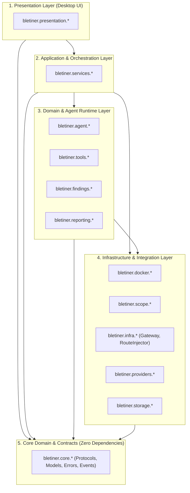
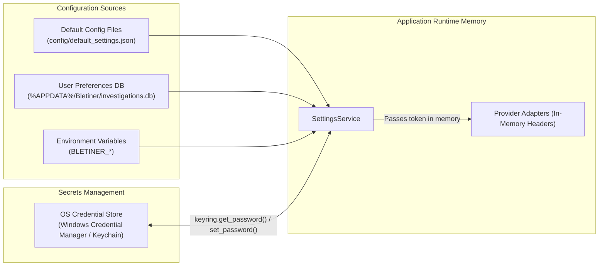

# 12 — Project Structure & Repository Organization

> **Status:** Proposed — architectural specification for implementation.  
> **Version:** 3.1.0 (Revision 3.1: Technical Routing & ECH Stripping Corrections Applied)  
> **Target Audience:** Claude Code / Engineering Team  
> **Last Updated:** 2026-11-11  

---

## Table of Contents

1. [Architectural Alignment & Overview](#1-architectural-alignment--overview)
2. [Complete Directory Tree](#2-complete-directory-tree)
3. [Package & Module Responsibilities](#3-package--module-responsibilities)
   - [3.1 Presentation Layer (`bletiner/presentation/`)](#31-presentation-layer-bletinerpresentation)
   - [3.2 Application & Service Layer (`bletiner/services/`)](#32-application--service-layer-bletinerservices)
   - [3.3 Agent Harness Layer (`bletiner/agent/` — Pi-Inspired)](#33-agent-harness-layer-bletineragent--pi-inspired)
   - [3.4 Tool Subsystem (`bletiner/tools/` — 4-Tier Risk Classification)](#34-tool-subsystem-bletinertools--4-tier-risk-classification)
   - [3.5 Docker & Sandbox Subsystem (`bletiner/docker/`)](#35-docker--sandbox-subsystem-bletinerdocker)
   - [3.6 Scope & Egress Enforcement (`bletiner/scope/`)](#36-scope--egress-enforcement-bletinerscope)
   - [3.7 Infrastructure Gateway Subsystem (`bletiner/infra/gateway/`)](#37-infrastructure-gateway-subsystem-bletinerinfragateway)
   - [3.8 LLM Provider Subsystem (`bletiner/providers/` — pi-ai)](#38-llm-provider-subsystem-bletinerproviders--pi-ai)
   - [3.9 Findings & Prioritization Subsystem (`bletiner/findings/`)](#39-findings--prioritization-subsystem-bletinerfindings)
   - [3.10 Reporting Subsystem (`bletiner/reporting/`)](#310-reporting-subsystem-bletinerreporting)
   - [3.11 Persistence & Storage Subsystem (`bletiner/storage/`)](#311-persistence--storage-subsystem-bletinerstorage)
   - [3.12 Core Domain, Protocols & Utilities (`bletiner/core/`)](#312-core-domain-protocols--utilities-bletinercore)
4. [Dependency Direction & Architectural Layering](#4-dependency-direction--architectural-layering)
5. [Import Boundaries & Automated Enforcement](#5-import-boundaries--automated-enforcement)
6. [Configuration & Secrets Layout](#6-configuration--secrets-layout)
7. [Test Suite Architecture & Lab Layout](#7-test-suite-architecture--lab-layout)
8. [Code Style, Typing & Naming Conventions](#8-code-style-typing--naming-conventions)

---

## 1. Architectural Alignment & Overview

This document specifies the concrete repository and file layout for **Bletiner AI**. The structure directly reflects the component architecture, trust boundaries, dual-homed network isolation, route injection helpers, and protocol contracts defined in [02_SYSTEM_ARCHITECTURE.md](file:///C:/Users/Husain/Documents/Bletiner%20AI%20Desktop/docs/02_SYSTEM_ARCHITECTURE.md).

### Design Philosophy
- **Clean Architecture:** Strict separation between Presentation (PySide6), Application Services, Domain/Harness logic, Infrastructure Gateway, and Storage.
- **Protocol-First Interfaces:** Every subsystem boundary interacts through abstract `typing.Protocol` interfaces defined in `bletiner/core/protocols/`.
- **Pi-Harness Adaptation:** Integrates the **Earendil Works Pi harness** architecture (`pi-ai` provider abstraction, `pi-agent` state machine, state tree branching, compact system prompt).
- **Dual-Homed Fail-Closed Gateway:** Infrastructure gateway package (`bletiner/infra/gateway/`) manages the dual-homed network topology, transparent SNI proxy, scoped DNS interception with ECH stripping, and domain allowlisting.
- **Ambient Capabilities Execution:** Dedicated wrapper (`bletiner/tools/ambient_exec.py`) executing non-root raw socket commands (`capsh --ambient`) under `no_new_privs: true`.
- **Enforced Import Boundaries:** Explicit layer rules enforced via `import-linter` in CI to prevent architectural erosion or circular dependencies.

---

## 2. Complete Directory Tree

The complete repository structure for Bletiner AI is detailed below:

```text
bletiner-ai/
├── .github/
│   └── workflows/
│       ├── ci.yml                  # Linting, type checks, unit & integration tests
│       └── release.yml             # PyInstaller desktop builds (Windows, macOS, Linux)
├── docker/
│   ├── kali/
│   │   ├── Dockerfile              # Hardened Kali image (cap_drop=ALL, non-root, no CAP_NET_ADMIN)
│   │   ├── entrypoint.sh           # Container initialization & drop-privileges script
│   │   └── requirements.txt        # Pinned security tool versions
│   ├── gateway/
│   │   ├── Dockerfile              # Lightweight dual-homed Alpine gateway image
│   │   ├── entrypoint.sh           # Gateway startup, routing & sysctl net.ipv4.ip_forward=1
│   │   ├── iptables_setup.sh       # Transparent redirect chains (PREROUTING, FORWARD, MASQUERADE)
│   │   ├── transparent_proxy.py    # Transparent SNI & Host header proxy (Port 8080)
│   │   └── dns_filter.py           # Scoped DNS interceptor daemon with ECH stripping (Port 5353)
│   └── lab/
│       ├── Dockerfile.vulnerable   # Deliberately vulnerable local lab target
│       └── mock_target_app.py      # Lightweight HTTP lab service for CI testing
├── docs/                           # Architecture and engineering documentation suite
│   ├── 00_PRODUCT_OVERVIEW.md
│   ├── 01_REQUIREMENTS.md
│   ├── 02_SYSTEM_ARCHITECTURE.md
│   ├── 03_AGENT_HARNESS.md
│   ├── 04_DOCKER_AND_NETWORK_SECURITY.md
│   ├── 05_DESKTOP_UI_UX.md
│   ├── 06_LLM_PROVIDERS_AND_MODEL_DISCOVERY.md
│   ├── 07_DATA_MODEL_AND_SESSION_LIFECYCLE.md
│   ├── 08_FINDINGS_AND_REPORTING.md
│   ├── 09_SECURITY_THREAT_MODEL.md
│   ├── 10_TESTING_AND_ACCEPTANCE.md
│   ├── 11_IMPLEMENTATION_ROADMAP.md
│   ├── 12_PROJECT_STRUCTURE.md
│   ├── 13_OPEN_DECISIONS_AND_ASSUMPTIONS.md
│   ├── 14_CLAUDE_CODE_IMPLEMENTATION_BRIEF.md
│   └── 15_DOCUMENTATION_AUDIT.md
├── src/
│   └── bletiner/
│       ├── __init__.py             # Package version & metadata
│       ├── __main__.py             # Entrypoint: python -m bletiner
│       ├── app/                    # Desktop application lifecycle & bootstrap
│       │   ├── __init__.py
│       │   ├── bootstrap.py        # qasync event loop initialization & dependency injection
│       │   ├── lifecycle.py        # Application startup, shutdown escalation & cleanup
│       │   └── logging_config.py   # Structured logging setup (console + file)
│       ├── core/                   # Shared domain types, protocols, errors, and utilities
│       │   ├── __init__.py
│       │   ├── constants.py        # Global constants, version strings, resource limits
│       │   ├── errors.py           # Domain exception hierarchy (BletinerError, ScopeError, etc.)
│       │   ├── events.py           # Typed agent event hierarchy (AgentEvent, FindingEvent, etc.)
│       │   ├── models.py           # Immutable dataclasses & domain entities
│       │   └── protocols/          # Python Protocol definitions (subsystem contracts)
│       │       ├── __init__.py
│       │       ├── agent.py        # AgentHarnessProtocol, ContextManagerProtocol, StateTreeProtocol
│       │       ├── docker.py       # DockerManagerProtocol, TerminalBridgeProtocol, RouteInjectorProtocol
│       │       ├── findings.py     # FindingStoreProtocol, PrioritizerProtocol
│       │       ├── gateway.py      # GatewayManagerProtocol, SNIProxyProtocol, DNSFilterProtocol
│       │       ├── presentation.py # ViewModel protocols
│       │       ├── providers.py    # ProviderAdapterProtocol, ModelScannerProtocol
│       │       ├── reporting.py    # ReportServiceProtocol
│       │       ├── scope.py        # ScopeServiceProtocol, EgressControllerProtocol
│       │       ├── services.py     # InvestigationServiceProtocol, SessionServiceProtocol
│       │       ├── storage.py      # DatabaseRepositoryProtocol, CheckpointManagerProtocol
│       │       └── tools.py        # ToolDefinitionProtocol, ToolExecutorProtocol
│       ├── presentation/           # Desktop Presentation Layer (PySide6 UI)
│       │   ├── __init__.py
│       │   ├── main_window.py      # QMainWindow composing the three-card workspace
│       │   ├── viewmodels/         # Observable ViewModel state adapters
│       │   │   ├── __init__.py
│       │   │   ├── activity_vm.py  # Reactive stream adapter for left activity feed
│       │   │   ├── findings_vm.py  # Findings summary & table view model
│       │   │   ├── investigation_vm.py # Active investigation state & steering
│       │   │   └── session_vm.py   # Resumable sessions & history view model
│       │   ├── views/              # Panel widgets & composite views
│       │   │   ├── __init__.py
│       │   │   ├── activity_panel.py # Left card: event feed, phases, status badges
│       │   │   ├── center_panel.py   # Center card: terminal, steering bar, controls
│       │   │   ├── right_panel.py    # Right card: session browser, artifacts, reports
│       │   │   └── widgets/        # Reusable custom UI components
│       │   │       ├── __init__.py
│       │   │       ├── badge.py        # Severity & confidence status badges
│       │   │       ├── event_card.py   # Collapsible structured event item widget
│       │   │       ├── filter_bar.py   # Search & filter inputs
│       │   │       └── steering_bar.py # Compact steering input with action triggers
│       │   ├── dialogs/            # Modal & modeless configuration screens
│       │   │   ├── __init__.py
│       │   │   ├── new_investigation.py # Target input, scope definition, depth selection
│       │   │   ├── provider_config.py   # Provider setup, API keys, discovery scanner
│       │   │   ├── terms_approval.py    # Privacy-preserving first-run terms approval
│       │   │   └── confirmation.py      # Destructive action confirmations
│       │   ├── terminal/           # Qt WebEngineView + xterm.js integration
│       │   │   ├── __init__.py
│       │   │   ├── terminal_widget.py   # QWebEngineView wrapper with Qt WebChannel
│       │   │   └── web/                 # Local web assets for terminal emulator
│       │   │       ├── index.html       # Sandboxed HTML loading xterm.js
│       │   │       ├── xterm.js         # Pinned xterm.js bundle
│       │   │       ├── xterm.css        # Dark-themed terminal styling
│       │   │       └── xterm-addon-fit.js # Pinned FitAddon for terminal auto-resize
│       │   └── styles/             # Dark security-operations theme & assets
│       │       ├── __init__.py
│       │       ├── dark_theme.qss  # Comprehensive Qt Style Sheet (QSS)
│       │       └── icons/          # SVG icons (terminal, shield, alert, play, pause, stop)
│       ├── services/               # Application & Service Layer (Orchestration)
│       │   ├── __init__.py
│       │   ├── investigation_service.py # High-level investigation workflow coordinator
│       │   ├── session_service.py       # Session lifecycle state machine & recovery
│       │   ├── container_lifecycle_service.py # Sandbox & gateway provisioning and stop
│       │   ├── agent_orchestration_service.py # Harness lifecycle & event bridge
│       │   ├── provider_management_service.py # Provider catalog & model locking
│       │   ├── findings_service.py      # Findings triage & deduplication
│       │   ├── report_service.py        # Report generation dispatch & artifact linking
│       │   ├── settings_service.py      # App settings & OS Keyring secret manager
│       │   └── scope_service.py         # Target parsing, validation & egress rules
│       ├── agent/                  # Pi-Inspired Autonomous Agent Harness
│       │   ├── __init__.py
│       │   ├── loop.py             # Plan → Execute → Observe → Analyze → Re-plan state machine
│       │   ├── context.py          # Message history (AgentMessage), token counting & context pruning
│       │   ├── state_tree.py       # Branching conversation & checkpoint state tree
│       │   ├── event_stream.py     # Asynchronous structured telemetry publisher
│       │   ├── steering.py         # Human instruction queue & safe checkpoint injector
│       │   ├── budget.py           # Token, iteration, and time budget enforcer
│       │   └── state_machine.py    # Explicit agent state transitions & invariants
│       ├── tools/                  # Controlled Tool Registry & Sandboxed Execution
│       │   ├── __init__.py
│       │   ├── registry.py         # Tool catalog, registration & schema export
│       │   ├── executor.py         # Execution runner, timeout enforcement, nonces
│       │   ├── parser.py           # Raw output normalizer & observation extractor
│       │   ├── risk_tier.py        # 4-Tier Risk Classification validator & policy gate
│       │   ├── ambient_exec.py     # Ambient capability runner (capsh --ambient under no_new_privs)
│       │   └── definitions/        # Declarative tool implementations
│       │       ├── __init__.py
│       │       ├── base.py         # BaseTool class with JSON schema generator
│       │       ├── core_exec.py    # docker_exec, docker_read_file, docker_write_file, docker_edit_file
│       │       ├── nmap.py         # Port scanning & service detection
│       │       ├── ffuf.py         # Web endpoint & directory reconnaissance
│       │       ├── nikto.py        # Web server security misconfiguration scanner
│       │       ├── whois.py        # Domain registration & ASN discovery
│       │       └── dns_recon.py    # DNS record enumeration & subdomains
│       ├── docker/                 # Docker Engine Subsystem
│       │   ├── __init__.py
│       │   ├── manager.py          # aiodocker client wrapper (containers, volumes, nets)
│       │   ├── exec_session.py     # Headless agent execution session runner (structured argv)
│       │   ├── terminal_bridge.py  # WebSocket / PTY multiplexer for xterm.js
│       │   └── health.py           # Container healthchecks & resource usage monitors
│       ├── scope/                  # Scope & Network Enforcement Subsystem
│       │   ├── __init__.py
│       │   ├── parser.py           # Domain, IPv4, IPv6, CIDR, and URL parsing
│       │   ├── validator.py        # Destination authorization & private IP filter
│       │   ├── dns_resolver.py     # Secure DNS resolution & rebinding protection
│       │   └── redirect_hook.py    # Layer A: Client-side HTTP 301/302 redirect inspection
│       ├── infra/                  # Infrastructure Services & Network Gateways
│       │   ├── __init__.py
│       │   └── gateway/            # Dual-homed egress gateway management
│       │       ├── __init__.py
│       │       ├── gateway_manager.py    # Provisions bletiner-internal-<id> and bletiner-gateway-<id>
│       │       ├── route_injector.py     # Injects gateway route via netns helper (alpine)
│       │       ├── transparent_proxy.py  # Transparent SNI and HTTP Host header filtering logic
│       │       ├── dns_filter.py         # Scoped DNS interceptor daemon with ECH stripping (Port 5353)
│       │       ├── iptables_manager.py   # Gateway routing & iptables setup (FORWARD/REDIRECT)
│       │       ├── two_tier_redirect.py  # Gateway-level Layer B handshake guard
│       │       └── templates/            # Configuration templates for gateway daemons
│       ├── providers/              # LLM Provider Subsystem (pi-ai Abstraction)
│       │   ├── __init__.py
│       │   ├── registry.py         # Provider adapter factory & active session binding
│       │   ├── scanner.py          # Dynamic model discovery scanner
│       │   ├── prober.py           # Empirical capability probe runner (tools, JSON, streaming)
│       │   └── adapters/           # Vendor-specific adapters
│       │       ├── __init__.py
│       │       ├── base.py         # Abstract BaseProviderAdapter (pi-ai protocol)
│       │       ├── openai.py       # OpenAI API & OpenAI-compatible endpoints
│       │       ├── anthropic.py    # Anthropic Messages API (Claude)
│       │       ├── gemini.py       # Google Gemini API
│       │       ├── ollama.py       # Local Ollama instance REST adapter
│       │       ├── lmstudio.py     # Local LM Studio REST adapter
│       │       └── openrouter.py   # OpenRouter multi-provider adapter
│       ├── findings/               # Findings Management Subsystem
│       │   ├── __init__.py
│       │   ├── store.py            # In-memory & SQLite backed findings repository
│       │   ├── prioritizer.py      # Composite scoring engine (severity, confidence, value, cost)
│       │   └── deduplicator.py     # Finding fingerprinting & duplicate suppression
│       ├── reporting/              # Report Generation Subsystem
│       │   ├── __init__.py
│       │   ├── markdown_gen.py     # Structured Markdown report compiler
│       │   ├── html_gen.py         # Standalone HTML report compiler with CSS inlining
│       │   ├── sanitizer.py        # Untrusted string sanitizer (HTML escaping, script stripping)
│       │   └── templates/          # Jinja2 report templates
│       │       ├── report.md.j2    # Markdown report template
│       │       ├── report.html.j2  # Polished dark-themed HTML report template
│       │       └── styles.css      # Embedded CSS for standalone HTML reports
│       └── storage/                # Persistence & Checkpointing Subsystem
│           ├── __init__.py
│           ├── database.py         # aiosqlite wrapper, migrations, connection pool
│           ├── migrations/         # Versioned SQL migration files
│           │   ├── 001_initial.sql
│           │   └── 002_findings_indexes.sql
│           ├── repositories/       # Specific entity repositories
│           │   ├── __init__.py
│           │   ├── investigation_repo.py
│           │   ├── session_repo.py
│           │   ├── finding_repo.py
│           │   └── audit_repo.py
│           ├── artifact_store.py   # Filesystem folder layout & file operations
│           └── checkpoint_manager.py # Atomic JSON dumps (`os.replace`) & restore
├── tests/                          # Automated Test Suite
│   ├── conftest.py                 # Universal PyTest fixtures (qasync loop, mock docker, mock keyring)
│   ├── unit/                       # Subsystem isolated unit tests
│   │   ├── test_scope_parser.py
│   │   ├── test_scope_validator.py
│   │   ├── test_context_manager.py
│   │   ├── test_agent_loop.py
│   │   ├── test_tool_registry.py
│   │   ├── test_tool_risk_tiers.py
│   │   ├── test_ambient_capabilities.py
│   │   ├── test_gateway_rules.py
│   │   ├── test_route_injection.py
│   │   ├── test_dns_ech_stripping.py
│   │   ├── test_two_tier_redirect.py
│   │   ├── test_prioritization.py
│   │   ├── test_report_sanitizer.py
│   │   └── test_checkpoint_atomic.py
│   ├── integration/                # Cross-subsystem integration tests
│   │   ├── test_database_migrations.py
│   │   ├── test_provider_adapters_mock.py
│   │   ├── test_docker_manager.py
│   │   ├── test_transparent_sni_proxy.py
│   │   ├── test_cdn_vs_dedicated_ip_forwarding.py
│   │   ├── test_gateway_fail_closed.py
│   │   ├── test_terminal_bridge.py
│   │   └── test_session_recovery.py
│   ├── e2e/                        # End-to-end investigation flows
│   │   ├── test_basic_investigation_flow.py
│   │   ├── test_steering_injection_flow.py
│   │   ├── test_shutdown_and_resume_flow.py
│   │   └── test_basic_to_deep_upgrade_flow.py
│   └── fixtures/                   # Static test payloads & outputs
│       ├── nmap_sample_output.txt
│       ├── ffuf_sample_output.json
│       └── mock_llm_responses.json
├── pyproject.toml                  # PEP 518/621 project metadata, dependencies, tools
├── setup.cfg                       # Flake8, mypy, and tool configurations
├── .importlinter                   # Architectural layer import boundary rules
└── README.md                       # Developer setup, build, and contribution guide
```


## 3. Package & Module Responsibilities

### 3.1 Presentation Layer (`bletiner/presentation/`)

The presentation layer is responsible for the PySide6 desktop GUI. It renders the dark security-operations workspace, captures user steering and command input, and binds to application services via ViewModels. It never accesses the filesystem, Docker daemon, or network directly.

| Module | Responsibility | Key Classes / Exports |
|---|---|---|
| `main_window.py` | Top-level `QMainWindow`. Composes the three-card workspace (Investigation, Kali Linux Terminal, Sessions & Files) with top bar branding and bottom steering card. | `MainWindow` |
| `viewmodels/investigation_vm.py` | Manages the active investigation state, target details, depth, steering triggers, and pause/resume buttons. | `InvestigationViewModel` |
| `viewmodels/activity_vm.py` | Receives `AgentEvent` streams over Qt signals, maintains the event history model, and filters events by type/severity. | `ActivityViewModel`, `EventTreeModel` |
| `viewmodels/findings_vm.py` | Manages detected and confirmed findings, severity counts, and findings table models. | `FindingsViewModel`, `FindingsTableModel` |
| `viewmodels/session_vm.py` | Lists resumable and completed sessions, manages session deletion, and handles report opening. | `SessionViewModel` |
| `views/activity_panel.py` | Left panel widget displaying phase progression, active tool status, and the structured activity feed. | `ActivityPanelWidget` |
| `views/center_panel.py` | Center panel widget containing the embedded xterm.js terminal, target scope banner, and steering input bar. | `CenterPanelWidget` |
| `views/right_panel.py` | Right panel widget displaying session history, evidence files, and generated HTML/Markdown reports. | `RightPanelWidget` |
| `terminal/terminal_widget.py` | `QWebEngineView` embedding a sandboxed `xterm.js` terminal. Communicates with Python via Qt WebChannel. | `TerminalWidget` |
| `dialogs/terms_approval.py` | Privacy-preserving terms modal requiring explicit acknowledgment of authorized testing (zero operator IP/user PII stored). | `TermsApprovalDialog` |
| `dialogs/provider_config.py` | Provider and model settings modal. Features the dynamic model discovery scanner and capability test triggers. | `ProviderConfigDialog` |
| `dialogs/new_investigation.py` | Modal for creating an investigation. Captures target, scope rules, investigation depth (Basic/Deep), and locked model. | `NewInvestigationDialog` |

### 3.2 Application & Service Layer (`bletiner/services/`)

The application layer orchestrates domain logic, coordinates workflows across subsystems, and enforces high-level business rules.

| Module | Responsibility | Key Classes / Exports |
|---|---|---|
| `investigation_service.py` | Top-level coordinator for starting, pausing, resuming, stopping, and upgrading investigations. | `InvestigationService` |
| `session_service.py` | Manages session lifecycle state transitions (`INITIALIZING` → `RUNNING` → `PAUSED` → `COMPLETED`) and recovery. | `SessionService` |
| `container_lifecycle_service.py` | Interacts with Docker to provision, healthcheck, stop, and clean up per-investigation Kali sandboxes and gateways. | `ContainerLifecycleService` |
| `agent_orchestration_service.py` | Bridges the agent harness with the UI; handles event pub/sub and queues human steering directives. | `AgentOrchestrationService` |
| `provider_management_service.py` | Manages configured LLM providers, model locking, discovery scanning, and capability verification. | `ProviderManagementService` |
| `findings_service.py` | Ingests, deduplicates, and manages the lifecycle of findings (triage, verification, reporting). | `FindingsService` |
| `report_service.py` | Coordinates compilation of Markdown and HTML reports from structured SQLite records. | `ReportService` |
| `settings_service.py` | Manages persistent user preferences in SQLite and secrets in the platform OS Keyring. | `SettingsService` |
| `scope_service.py` | Normalizes target strings, verifies destination IPs against allowed scope, and configures gateway firewall. | `ScopeService` |

### 3.3 Agent Harness Layer (`bletiner/agent/` — Pi-Inspired)

Inspired directly by the **Earendil Works Pi harness (`@earendil-works/pi-coding-agent`)**, this subsystem implements a single-agent autonomous loop operating as a step-by-step state machine with branching state trees.

| Module | Responsibility | Key Classes / Exports |
|---|---|---|
| `loop.py` | Core execution engine implementing the state machine: `Prompt → Plan → Tool Selection → Container Exec → Observation → Analysis → Replanning`. | `AgentLoop` |
| `context.py` | Manages message history (`AgentMessage` / `AppMessage`), calculates token counts, and applies rolling window pruning. | `ContextManager` |
| `state_tree.py` | Branching conversation and state tree supporting checkpoints, rewinds, and forks instead of flat chat logs. | `StateTree`, `StateNode` |
| `event_stream.py` | Asynchronous pub/sub event bus streaming typed JSON operational events to the UI and session recorder. | `EventStream` |
| `steering.py` | Thread-safe queue for human steering instructions. Injects steering directives into the context at the next safe checkpoint. | `SteeringController` |
| `budget.py` | Enforces execution limits: maximum LLM tokens, maximum tool invocations, and overall investigation timeouts. | `BudgetEnforcer` |
| `state_machine.py` | Formal state definition and legal transition validator for the agent loop lifecycle. | `AgentStateMachine`, `AgentState` |

### 3.4 Tool Subsystem (`bletiner/tools/` — 4-Tier Risk Classification)

Manages the registration, validation, execution, and parsing of security tools. Tools execute strictly inside the container sandbox.

| Module | Responsibility | Key Classes / Exports |
|---|---|---|
| `registry.py` | In-memory catalog of available tools. Converts declarative definitions into provider-native function schemas. | `ToolRegistry` |
| `risk_tier.py` | Enforces the 4-Tier Risk Policy: Tier 1 (Safe/Passive), Tier 2 (Active Recon), Tier 3 (Intrusive Deep Only), Tier 4 (High-Risk/Blocked). | `ToolRiskTier`, `RiskPolicyGate` |
| `ambient_exec.py` | Executes non-root commands with ambient capabilities (`capsh --ambient=cap_net_raw,cap_net_bind_service`) under `no_new_privs: true`. | `AmbientExecRunner` |
| `executor.py` | Dispatches structured argument lists (`cmd: list[str]`) directly to Docker Exec without shell string concatenation. | `ToolExecutor` |
| `parser.py` | Parses raw tool stdout/stderr into structured observations and preliminary finding candidates. | `ToolResultParser` |
| `definitions/base.py` | Abstract base class defining the tool protocol, input/output schemas, and risk classifications. | `BaseTool` |
| `definitions/core_exec.py` | Core tools executing strictly inside Kali: `docker_exec`, `docker_read_file`, `docker_write_file`, `docker_edit_file`. | `DockerExecTool`, `DockerReadFileTool` |
| `definitions/nmap.py` | Service discovery and port scanner definition (`nmap -sV -T4`). Falls back to `nmap -sT` if ambient capabilities are unavailable. | `NmapTool` |
| `definitions/ffuf.py` | Web fuzzing and directory discovery definition (rate-limited max 20 req/s in Tier 3). | `FfufTool` |
| `definitions/nikto.py` | Web server misconfiguration scanner definition. | `NiktoTool` |
| `definitions/whois.py` | Passive domain registration and network allocation query tool. | `WhoisTool` |
| `definitions/dns_recon.py` | DNS record enumerator and zone transfer checker. | `DnsReconTool` |

### 3.5 Docker & Sandbox Subsystem (`bletiner/docker/`)

Encapsulates all container operations using `aiodocker` for non-blocking execution.

| Module | Responsibility | Key Classes / Exports |
|---|---|---|
| `manager.py` | Manages Docker containers, bridge networks, and workspace volume mounts. | `DockerManager` |
| `exec_session.py` | Dispatches headless, non-interactive command executions for the agent (`stdin=False`, `tty=False`). | `ExecSessionManager` |
| `terminal_bridge.py` | Manages interactive PTY sessions (`stdin=True`, `tty=True`) over a local WebSocket bridge to `xterm.js`. | `TerminalBridge` |
| `health.py` | Monitors container memory, CPU utilization, PID limits, and process liveness. | `ContainerHealthMonitor` |

### 3.6 Scope & Egress Enforcement (`bletiner/scope/`)

Provides application-level target validation, parsing, and secure DNS resolution.

| Module | Responsibility | Key Classes / Exports |
|---|---|---|
| `parser.py` | Normalizes and parses domain names, IPv4/IPv6 addresses, CIDR blocks, and Web URLs. | `ScopeParser`, `TargetDefinition` |
| `validator.py` | Checks destinations against approved scope. Drops RFC1918 private IPs, loopback, link-local, and cloud metadata. | `ScopeValidator` |
| `dns_resolver.py` | Performs asynchronous DNS resolution with pinning and validation to prevent DNS rebinding attacks. | `DNSResolver` |
| `redirect_hook.py` | Layer A: Intercepts HTTP 301/302 `Location` headers client-side and validates against scope before redirection. | `ClientRedirectHook` |

### 3.7 Infrastructure Gateway Subsystem (`bletiner/infra/gateway/`)

Manages the dual-homed bridge network architecture, transparent proxying, scoped DNS interception, and host netns route injection.

| Module | Responsibility | Key Classes / Exports |
|---|---|---|
| `gateway_manager.py` | Provisions the dual-homed `bletiner-gateway-<id>` container and `bletiner-internal-<id>` (`internal: true`) network. | `GatewayManager` |
| `route_injector.py` | Executes transient helper container (`alpine`) attached to Kali netns to set default route (`172.30.0.254`). | `RouteInjector` |
| `transparent_proxy.py` | Transparent forward proxy intercepting ports 80/443; validates TLS SNI and HTTP Host headers. | `TransparentSNIProxy` |
| `dns_filter.py` | Scoped DNS resolver intercepting port 53; strips HTTPS/SVCB type 65 records to counter TLS ECH bypass. | `ScopedDNSFilter` |
| `iptables_manager.py` | Configures `PREROUTING` redirect chains, fail-closed `FORWARD` rules (dedicated IP vs CDN drop), and `POSTROUTING` masquerade. | `IPTablesManager` |
| `two_tier_redirect.py` | Layer B: Gateway-level TLS SNI handshake gate dropping handshakes to redirected out-of-scope domains. | `GatewayRedirectGate` |

### 3.8 LLM Provider Subsystem (`bletiner/providers/` — pi-ai)

Implements the **`pi-ai` provider abstraction**, strictly separating internal unified `AgentMessage` types from external vendor-specific schemas.

| Module | Responsibility | Key Classes / Exports |
|---|---|---|
| `registry.py` | Factory and registry binding provider IDs to concrete adapter instances. | `ProviderRegistry` |
| `scanner.py` | Probes configured endpoints to discover available models and reported parameters. | `ModelDiscoveryScanner` |
| `prober.py` | Runs empirical capability probes (test JSON function call, streaming) before autonomous runs. | `CapabilityProber` |
| `adapters/base.py` | Abstract protocol and base class defining the provider contract. | `BaseProviderAdapter` |
| `adapters/openai.py` | Adapter for OpenAI API (GPT-4o, o-series) and OpenAI-compatible endpoints. | `OpenAIAdapter` |
| `adapters/anthropic.py` | Adapter for Anthropic Messages API (Claude 3.5 Sonnet). | `AnthropicAdapter` |
| `adapters/gemini.py` | Adapter for Google Gemini API (Gemini 1.5 Pro/Flash, 2.0). | `GeminiAdapter` |
| `adapters/ollama.py` | Adapter for local Ollama instances (`http://127.0.0.1:11434`). | `OllamaAdapter` |
| `adapters/lmstudio.py` | Adapter for local LM Studio instances (`http://127.0.0.1:1234/v1`). | `LMStudioAdapter` |
| `adapters/openrouter.py` | Adapter for OpenRouter gateway. | `OpenRouterAdapter` |

### 3.9 Findings & Prioritization Subsystem (`bletiner/findings/`)

Manages the lifecycle of security observations, calculates priority rankings, and eliminates duplicate alerts.

| Module | Responsibility | Key Classes / Exports |
|---|---|---|
| `store.py` | Storage manager providing query, filter, and persistence operations for findings. | `FindingStore` |
| `prioritizer.py` | Multi-factor prioritization engine: composite score balancing severity, confidence, information value, and cost. | `PrioritizationEngine` |
| `deduplicator.py` | Computes semantic fingerprints to merge duplicate findings discovered across multiple tools. | `FindingDeduplicator` |

### 3.10 Reporting Subsystem (`bletiner/reporting/`)

Compiles evidence-backed investigation reports in Markdown and standalone HTML.

| Module | Responsibility | Key Classes / Exports |
|---|---|---|
| `markdown_gen.py` | Compiles structured investigation findings into a GitHub-flavored Markdown report. | `MarkdownReportGenerator` |
| `html_gen.py` | Compiles a standalone HTML report with embedded CSS, SVG charts, and zero external script dependencies. | `HTMLReportGenerator` |
| `sanitizer.py` | Sanitizes untrusted tool outputs, server headers, and user strings to prevent HTML/XSS injection. | `ReportSanitizer` |

### 3.11 Persistence & Storage Subsystem (`bletiner/storage/`)

Provides durable relational metadata storage, atomic checkpoint serialization, and raw artifact management.

| Module | Responsibility | Key Classes / Exports |
|---|---|---|
| `database.py` | Manages the SQLite database connection using `aiosqlite` in WAL mode with connection pooling. | `DatabaseConnection` |
| `repositories/*.py` | Repository implementations encapsulating SQL queries for investigations, sessions, findings, and audits. | `InvestigationRepository`, `FindingRepository` |
| `artifact_store.py` | Manages per-investigation directories on the host filesystem (`workspace/`, `evidence/`, `reports/`). | `ArtifactStore` |
| `checkpoint_manager.py` | Writes atomic checkpoint JSON dumps using `tempfile` and `os.replace` to prevent state corruption. | `CheckpointManager` |

### 3.12 Core Domain, Protocols & Utilities (`bletiner/core/`)

Shared domain contracts, constants, and data definitions. Contains zero dependencies on outer layers.

| Module | Responsibility | Key Classes / Exports |
|---|---|---|
| `models.py` | Core immutable domain dataclasses: `Investigation`, `Finding`, `ScopeDefinition`, `ToolResult`. | Domain Entities |
| `protocols/*.py` | Abstract `typing.Protocol` definitions specifying the public contracts of all subsystems. | System Protocols |
| `events.py` | Strongly typed event definitions: `PlanEvent`, `ToolStartEvent`, `FindingDetectedEvent`, etc. | `AgentEvent` hierarchy |
| `errors.py` | Domain exception hierarchy: `BletinerError`, `ScopeViolationError`, `ContainerError`, `ProviderError`. | Exception Classes |
| `constants.py` | Application-wide constants: default resource limits, timeout intervals, version strings. | Constants |

---

## 4. Dependency Direction & Architectural Layering

The codebase enforces a strict downward dependency hierarchy inspired by Clean Architecture principles. Outer layers depend on inner layers; inner layers never depend on outer layers.



### Dependency Invariants
1. **Presentation Isolation:** `bletiner.presentation` may import `bletiner.services` and `bletiner.core`. It must **never** import `bletiner.docker`, `bletiner.infra`, `bletiner.storage`, or `bletiner.providers` directly.
2. **Core Domain Independence:** `bletiner.core` is completely self-contained. It contains pure Python models, protocols, and exceptions, importing only standard library modules (`typing`, `dataclasses`, `enum`, `abc`). It never imports any application layer.
3. **Services as Orchestrators:** `bletiner.services` acts as the mediation boundary. ViewModels interact strictly with Services, which in turn coordinate Agent, Tools, Docker, Infra Gateway, and Storage.
4. **No Cyclic Dependencies:** No circular module imports are allowed across or within packages. All cross-subsystem contracts are defined as abstract Protocols in `bletiner.core.protocols`.

---

## 5. Import Boundaries & Automated Enforcement

To maintain long-term architectural integrity as Claude Code and human contributors build the codebase, import rules are verified on every commit using `import-linter`.

### `.importlinter` Configuration

The following configuration file is located at the root of the repository:

```ini
[importlinter]
root_package = bletiner

# 1. Enforce strict layered architecture
[importlinter:contract:layers]
name = Bletiner Architectural Layers
type = layers
layers =
    bletiner.presentation
    bletiner.services
    bletiner.agent | bletiner.tools | bletiner.findings | bletiner.reporting
    bletiner.docker | bletiner.scope | bletiner.infra | bletiner.providers | bletiner.storage
    bletiner.core

# 2. Prevent presentation from bypassing the service layer
[importlinter:contract:forbidden-presentation-bypasses]
name = Presentation Cannot Bypass Services
type = forbidden
source_modules =
    bletiner.presentation
forbidden_modules =
    bletiner.docker
    bletiner.infra
    bletiner.storage
    bletiner.providers
    bletiner.tools.executor

# 3. Core cannot depend on any outer module
[importlinter:contract:core-independence]
name = Core Subsystem Independence
type = forbidden
source_modules =
    bletiner.core
forbidden_modules =
    bletiner.presentation
    bletiner.services
    bletiner.agent
    bletiner.tools
    bletiner.docker
    bletiner.scope
    bletiner.infra
    bletiner.providers
    bletiner.findings
    bletiner.reporting
    bletiner.storage

# 4. Agent loop cannot depend directly on concrete PySide6 UI
[importlinter:contract:agent-headless]
name = Agent Loop Must Remain Headless
type = forbidden
source_modules =
    bletiner.agent
forbidden_modules =
    bletiner.presentation
    PySide6
```

---

## 6. Configuration & Secrets Layout

Bletiner AI follows the principle of least privilege and zero plaintext secrets on disk.



### 1. File-Based Configuration
- Default, non-sensitive application settings (default timeouts, UI theme, resource limits) are stored in `config/default_settings.json`.
- At runtime, persistent user preferences (e.g., last selected provider, window dimensions, custom CIDR defaults) are stored in the `app_settings` table of `investigations.db`.

### 2. Secrets Management
- **Zero Plaintext Storage:** LLM provider API keys, tokens, or credentials are **never** written to SQLite, configuration files, environment files, or logs.
- **OS Keyring Integration:** The `SettingsService` interfaces with the standard Python `keyring` library to read and store secrets directly in:
  - Windows: *Windows Credential Manager*
  - macOS: *Keychain Services*
  - Linux: *Secret Service API (FreeDesktop) / GNOME Keyring / KWallet*
- **Service Name Convention:** Secrets are registered under the service identifier `bletiner-ai/<provider_id>` (e.g., `bletiner-ai/openai`, `bletiner-ai/anthropic`).

### 3. Environment Variables
Environment variables can override default settings for headless or developer testing (all prefixed with `BLETINER_`):
- `BLETINER_DATA_DIR`: Custom path for database and investigation directories.
- `BLETINER_LOG_LEVEL`: Override logging level (`DEBUG`, `INFO`, `WARNING`, `ERROR`).
- `BLETINER_MOCK_PROVIDERS`: If set to `1`, binds mock LLM adapters for offline CI tests.
- `BLETINER_DOCKER_HOST`: Custom Docker socket/pipe URL for remote testing engines.

---

## 7. Test Suite Architecture & Lab Layout

Testing is structured to provide high confidence across all architectural layers while ensuring that no tests ever run against unauthorized public internet targets.

```text
tests/
├── conftest.py                     # Universal PyTest fixtures (qasync loop, mock docker, mock keyring)
├── unit/                           # Isolated, deterministic tests (0 external dependencies)
│   ├── test_scope_parser.py        # Target parsing, CIDR resolution, URL handling
│   ├── test_scope_validator.py     # RFC1918 filtering, cloud metadata blocking
│   ├── test_context_manager.py     # Rolling window token management & pruning
│   ├── test_agent_loop.py          # State machine transitions using FakeModelAdapter
│   ├── test_tool_registry.py       # Declarative schema compilation & parameter checks
│   ├── test_tool_risk_tiers.py     # 4-Tier risk policy gates & scheduling bounds
│   ├── test_ambient_capabilities.py # capsh ambient capability inheritance under no_new_privs
│   ├── test_gateway_rules.py       # Dual-homed routing & SNI rule generation
│   ├── test_route_injection.py     # Host netns route helper container test
│   ├── test_dns_ech_stripping.py   # Assert HTTPS/SVCB type 65 records are stripped
│   ├── test_two_tier_redirect.py   # Client-side hook & gateway SNI gate test
│   ├── test_prioritization.py      # Composite scoring math & rank order
│   ├── test_report_sanitizer.py    # HTML escaping, XSS neutralization
│   └── test_checkpoint_atomic.py   # Atomic file dump & rollback simulation
├── integration/                    # Subsystem integration tests (using mocks or local dockerd)
│   ├── test_database_migrations.py # Schema version upgrades via aiosqlite in memory
│   ├── test_provider_adapters.py   # Provider contract tests with mocked HTTPS endpoints
│   ├── test_docker_manager.py      # Container creation & healthcheck verification
│   ├── test_transparent_sni_proxy.py # Transparent SNI proxying on port 8080
│   ├── test_cdn_vs_dedicated_ip_forwarding.py # Assert FORWARD DROP on CDN domain IP
│   ├── test_gateway_fail_closed.py # Assert zero packets exit when gateway stops
│   ├── test_terminal_bridge.py     # WebSocket to PTY bridge echo test
│   └── test_session_recovery.py    # Checkpoint restoration & container reconciliation
├── e2e/                            # Full workflow end-to-end scenarios
│   ├── test_basic_investigation_flow.py # Basic scan workflow against mock lab target
│   ├── test_steering_injection_flow.py  # Mid-flight user steering test
│   ├── test_shutdown_and_resume_flow.py # Graceful exit and clean resume verification
│   └── test_basic_to_deep_upgrade_flow.py # Continuation from Basic to Deep mode
├── fixtures/                       # Deterministic test payloads
│   ├── nmap_sample_output.txt      # Real output capture from nmap scan
│   ├── ffuf_sample_output.json     # Real output capture from ffuf
│   └── mock_llm_responses.json     # Pre-recorded tool call completions
└── lab/                            # Isolated, deliberately vulnerable test targets
    ├── Dockerfile.vulnerable       # Standalone test target container
    └── mock_target_app.py          # Minimalist HTTP server with simulated misconfigurations
```

### Lab Target Testing Protocol
1. **Local Isolation:** All E2E tests target a local Docker container (`bletiner-lab-target`) running on an isolated Docker network (`172.28.0.0/16`).
2. **Zero Internet Traffic:** CI configurations enforce network isolation (`--network=none` or strictly mocked HTTP calls) so no stray packets escape the host.

---

## 8. Code Style, Typing & Naming Conventions

### 8.1 Python Language Standards
- **Python Version:** Python 3.11+ strictly required.
- **Type Annotations:** 100% strict type hints (`mypy --strict`). All functions, methods, and classes must have explicit parameter and return type signatures.
- **Data Models:** Use immutable dataclasses (`@dataclass(frozen=True)`) or Pydantic v2 models for domain data transfer objects (DTOs).

### 8.2 Naming Conventions

| Entity | Convention | Example |
|---|---|---|
| **Packages & Modules** | `snake_case` | `container_lifecycle_service.py`, `scope/` |
| **Classes & Protocols** | `PascalCase` | `InvestigationService`, `AgentHarnessProtocol` |
| **Functions & Methods** | `snake_case` | `create_investigation()`, `parse_scope()` |
| **Constants** | `UPPER_SNAKE_CASE` | `DEFAULT_TIMEOUT_SECONDS`, `MAX_CONTEXT_TOKENS` |
| **Qt Signals** | `*_changed`, `*_requested` | `investigation_changed`, `pause_requested` |
| **Qt Slot Handlers** | `on_*` | `on_event_received()`, `on_pause_clicked()` |
| **Agent Event Types** | `snake_case` string | `"tool_start"`, `"finding_detected"` |
| **Database Tables** | `snake_case` (plural) | `investigations`, `sessions`, `findings` |
| **Database Primary Keys** | `id` / `<entity>_id` | `investigation_id`, `finding_id` |

### 8.3 Error Handling & Logging Rules
1. **Explicit Error Types:** Never raise generic `Exception` or `RuntimeError`. Derive all domain errors from `BletinerError` in `bletiner.core.errors`.
2. **Structured Logging:** Use Python's standard `logging` with structured formatting (`%(asctime)s [%(levelname)s] [%(name)s] %(message)s`). Include contextual identifiers: `investigation_id`, `session_id`, `tool_name`.
3. **No Credential Logging:** Secrets, API keys, Authorization headers, and raw session tokens must be redacted by logging formatters before outputting to stdout or log files.

---

*End of Document 12 — Project Structure & Repository Organization.*
