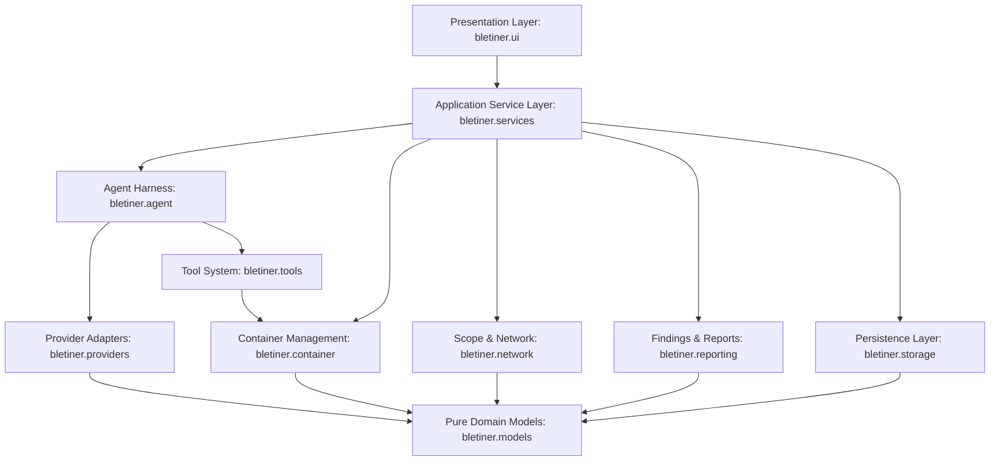

# Bletiner AI — Claude Code Implementation Brief

**Document ID:** `DOC-14`  
**Version:** 3.1.0 (Revision 3.1 — Technical Correction & Empirical Validation Baseline)  
**Status:** Approved Master Implementation Specification  
**Target Agent:** Claude Code (Autonomous Implementation Assistant)  
**Authors:** Lead Systems Architect & Claude Code Technical Author  
**Audience:** Claude Code, Core Maintainers, Engineering Leads  

---

> [!CAUTION]
> ### MANDATORY INVIOLABLE IMPLEMENTATION RULES (REVISION 3.1 AUDIT)
> Claude Code must strictly enforce the following non-negotiable implementation rules. Any deviation will immediately fail automated CI/CD security gates:
> 1. **MANDATORY ROUTE INJECTION RULE (ADR-016):** Do not assume assigning a static IP to the gateway changes Kali's route table. Because `internal: true` bridge networks provision zero default routes, Claude Code MUST implement host-side container netns route injection (`docker run --rm --network=container:bletiner-kali-<id> --cap-add=NET_ADMIN alpine ip route replace default via <gateway_ip>`). Never grant `CAP_NET_ADMIN` to Kali itself.
> 2. **MANDATORY CDN ROUTING ISOLATION RULE (ADR-018):** Never add iptables raw FORWARD rules for CDN IPs when scanning domain targets. Domain targets route strictly through the gateway SNI/Host proxy. Raw packet forwarding is enabled ONLY for explicitly authorized dedicated IP/CIDR scopes.
> 3. **MANDATORY AMBIENT CAPABILITY RULE:** Use Linux ambient capabilities (`setpriv --ambient-caps=+net_raw,+net_bind_service`) for non-root user `bletiner` (UID 1000). Inspect process status via `grep Cap /proc/$$/status` in the test suite; assert `CapAmb` contains raw socket bits under `no_new_privs: true`, while `CAP_NET_ADMIN` is strictly `0`.
> 4. **MANDATORY ECH MITIGATION RULE (ADR-017):** Configure gateway internal DNS resolver to strip type 65 `HTTPS` / `SVCB` records, preventing TLS Encrypted Client Hello (ECH) from blinding the gateway SNI inspector.
> 5. **MANDATORY GATE 3 VERIFICATION POC:** In Phase 3, Claude Code MUST construct and pass `scripts/verify_gateway_poc.py` (all 10 egress failure scenarios passing on Docker Desktop WSL2/Linux). **Claude Code MUST NOT begin Phase 4 (Agent Runtime) until all 10 tests pass.**
> 6. **STRUCTURED COMMAND ARRAYS ONLY:** Never use raw string shell concatenation (e.g., `bash -c "cmd " + arg`). All container commands must be structured argument arrays (`argv: list[str]`) passed directly to Docker Exec / Linux `execve` primitives.
> 7. **TOOL SAFETY TIERS & AUTONOMOUS SCHEDULING BOUNDARY:** The autonomous agent loop must strictly reject any Tier 4 tool (masscan, sqlmap exploitation, hydra, metasploit). Enforce global scan rate limits.
> 8. **EMPIRICAL TEST REPORTING RULE:** Every test must record Test ID, exact command, expected result, actual result, verdict (PASS / FAIL / NOT RUN), and raw logs. Distinguish Documentation consistency, Implementation correctness, and Empirically verified security properties (marked PENDING LAB EXECUTION until live Docker execution).

---

## 1. Executive Technical Summary: What to Build

**Bletiner AI** is a professional desktop security operations workspace for autonomous, authorized security investigations. It is **not** a chat assistant; it is an autonomous investigative agent system that executes inside a controlled sandbox and streams concise, structured operational events to an operator.

### 1.1 Core System Capabilities
1. **Desktop Presentation Layer (PySide6 / Qt6):** A professional, dark-themed, 3-card security operations interface (inspired by modern developer terminal aesthetics):
   * **Left Card (`INVESTIGATION`):** Target link, chronological structured activity feed (events, tool executions, state transitions), and prioritized findings badges (`Potential`, `Confirmed`).
   * **Center Card (`>_ KALI LINUX TERMINAL`):** Main execution workspace featuring a shared interactive Kali terminal (embedded `xterm.js` via `QWebEngineView`), container connection badge, and shared `/workspace` banner.
   * **Right Card (`SESSIONS & FILES`):** Collapsible file drawer showing investigation artifacts (`report.md`, `report.html`, `evidence/`, `logs/`) and historical session browser.
   * **Bottom Control Card:** Agent status badge, compact steering instruction bar, and Pause/Stop controls.
2. **Autonomous Agent Harness (Pi-Inspired Architecture):**
   * Based directly on the **Earendil Works Pi-harness** architecture (`pi-ai` unified provider abstraction + `pi-agent` state machine).
   * Executes the cyclic autonomous loop:  
     $$\text{Plan} \longrightarrow \text{Execute} \longrightarrow \text{Observe} \longrightarrow \text{Analyze} \longrightarrow \text{Re-plan}$$
   * Maintains a durable branching **Session State Tree** supporting checkpoints, rewinds, and seamless resumption.
   * Supports dynamic mid-turn human **steering** without erasing prior context or evidentiary findings.
3. **Execution Sandbox (Docker Kali Linux):**
   * Strict 1:1:1 mapping: **One Investigation = One Dedicated Kali Container = One Filesystem Workspace**.
   * Shared between agent (Docker Exec non-interactive pipes) and human operator (Docker PTY interactive session).
   * Hardened container boundary: unprivileged (`privileged=False`), user `bletiner` (UID 1000) with ambient capabilities, read-only rootfs, zero Docker socket mounts, ephemeral `/tmp` (tmpfs), and isolated `/workspace` volume.
4. **Network Isolation & Scope Enforcement (Dual-Homed Fail-Closed Gateway):**
   * Default restricted networking enforced via a dedicated dual-homed Egress Gateway container:
     * Kali connects ONLY to `bletiner-internal-<id>` (`internal: true`, zero direct internet route).
     * Gateway container bridges internal network to external Docker network with TLS SNI and HTTP Host header inspection.
     * Default gateway routing + kernel IP forwarding captures raw sockets and non-proxy tools, enforcing destination IP allowlists at packet layer.
     * DNS type 65 record stripping neutralizes TLS ECH.
     * Fail-closed: if the gateway stops, Kali has zero network egress.
   * Hard blocking of RFC 1918 private subnets (unless local lab mode), loopback (`127.0.0.0/8`), link-local (`169.254.0.0/16`), and cloud metadata APIs.
5. **Persistence & Evidentiary Reporting:**
   * SQLite with Write-Ahead Logging (WAL) for transactional metadata, sessions, tasks, and findings.
   * Per-session filesystem directory structure storing raw tool stdout/stderr, screenshots, network logs, and reports.
   * Dual report export: clean Markdown (`report.md`) and a self-contained, air-gapped HTML report (`report.html`) rendered with Jinja2 and protected by Content Security Policy.

---

## 2. Architectural Boundaries & Forbidden Cross-Imports

To maintain strict modularity, testability, and security, Claude Code must enforce a clean, unidirectional layered architecture. The codebase is divided into explicit packages with rigid import boundaries.



### 2.1 Package Responsibilities
* `bletiner.models`: Pure domain value objects, Pydantic schemas, and immutable data contracts. Zero external infrastructure dependencies.
* `bletiner.storage`: SQLite database manager, SQL schemas, migrations, and filesystem artifact persistence. Implements repository protocols.
* `bletiner.container`: Docker SDK orchestration, Kali container lifecycle, ambient capability launcher, netns route injector, Exec API runners, and PTY terminal stream bridges.
* `bletiner.network`: Target normalization, CIDR/DNS validators, DNS rebinding protections, DNS HTTPS type 65 record filter, and dual-homed egress gateway sidecar orchestrator.
* `bletiner.providers`: Pluggable LLM adapters (`pi-ai` architecture) normalizing OpenAI, Anthropic, Gemini, DeepSeek, Ollama, LM Studio, etc.
* `bletiner.tools`: Security tool definitions, 4-tier risk classification, input/output schemas, and containerized tool executors using structured `argv: list[str]`.
* `bletiner.agent`: Pi-inspired autonomous agent loop, state machine, branching session state tree, event streaming bus, and context window compaction.
* `bletiner.services`: High-level workflow orchestrators (InvestigationService, SessionService, FindingService) coordinating domain subsystems.
* `bletiner.reporting`: Markdown builder and Jinja2 air-gapped HTML report generator.
* `bletiner.ui`: PySide6 desktop views, controllers, view models, `qasync` event loop integration, and xterm.js terminal view.

### 2.2 Forbidden Cross-Imports Matrix

Claude Code must strictly avoid any import violating the matrix below. Any violation will fail automated architectural linting.

| Source Package | Allowed Imports | FORBIDDEN Imports |
|---|---|---|
| `bletiner.models` | Python stdlib, Pydantic | `bletiner.ui`, `bletiner.storage`, `bletiner.container`, `bletiner.agent`, `docker`, `PySide6` |
| `bletiner.storage` | `bletiner.models`, SQLite, stdlib | `bletiner.ui`, `bletiner.agent`, `bletiner.container`, `PySide6` |
| `bletiner.providers` | `bletiner.models`, HTTP clients, official SDKs | `bletiner.ui`, `bletiner.storage`, `bletiner.container`, `PySide6` |
| `bletiner.container` | `bletiner.models`, `docker`, stdlib | `bletiner.ui`, `bletiner.agent`, `bletiner.providers`, `PySide6` |
| `bletiner.agent` | `bletiner.models`, `bletiner.providers` (via Protocol), `bletiner.tools` | `bletiner.ui`, `bletiner.storage` (direct DB), `PySide6` |
| `bletiner.ui` | `bletiner.models`, `bletiner.services`, `PySide6`, `qasync` | Direct calls to `bletiner.storage` (raw SQL), `docker`, direct `bletiner.container` |

### 2.3 Dependency Inversion Principles
1. **Service Interfaces:** All domain boundaries must depend on Python `typing.Protocol` classes defined in `bletiner.models.protocols`.
2. **UI Isolation:** The UI communicates with background systems exclusively by awaiting methods on `ApplicationServices` or subscribing to typed event streams emitted by the agent event bus.
3. **No Direct Thread Spawning:** Thread management is governed strictly through `qasync` and `asyncio.to_thread()`. No ad-hoc `threading.Thread` or raw `QThread` instances without architectural approval.

---

## 3. Required Phased Implementation Order (Revision 3.1 Reordered Sequence)

Claude Code must strictly execute the implementation in the revised canonical sequence detailed below. Notice that **Phase 2 (Docker Sandbox) and Phase 3 (Egress Gateway) must pass fail-closed tests BEFORE implementing Phase 4 (Agent Runtime).**

```mermaid
flowchart LR
    P0["Phase 0: Setup"] --> P1["Phase 1: Domain & Storage"]
    P1 --> P2["Phase 2: Docker Sandbox"]
    P2 --> P3["Phase 3: Egress Gateway (10-Point PoC)"]
    P3 --> P4["Phase 4: Agent Runtime (Pi-Harness)"]
    P4 --> P5["Phase 5: PySide6 Desktop UI"]
    P5 --> P6["Phase 6: Findings & Reports"]
    P6 --> P7["Phase 7: Crash Recovery & Hardening"]
    P7 --> P8["Phase 8: E2E Local Lab Validation"]
```



### Phase 0: Project Setup, Tooling & Scaffolding
* **Objectives:** Establish the workspace structure, dependency management, strict static analysis, and testing foundation.
* **Deliverables:**
  * `pyproject.toml` configuring Python 3.11+, Poetry/uv, dependencies (`pyside6`, `docker`, `pydantic>=2.0`, `qasync`, `keyring`, `jinja2`, `aiosqlite`, `pytest`, `pytest-asyncio`, `pytest-qt`, `ruff`, `mypy`).
  * Package directories under `bletiner/` and test suites under `tests/`.
  * Pre-commit hooks for Ruff formatting, linting, and Mypy strict type checking.
  * Entry-point CLI script `bletiner/__main__.py` resolving `--help` and basic version info.
* **Phase Gate 0:** `poetry run ruff check .`, `poetry run mypy bletiner`, and `poetry run pytest` all return exit code 0 on clean baseline.

### Phase 1: Pure Domain Entities & Persistence Engine
* **Objectives:** Build the data model, transactional SQLite database layer with WAL mode, and repository protocols.
* **Deliverables:**
  * `bletiner/models/`: Core Pydantic v2 schemas: `Investigation`, `Session`, `Task`, `ToolCall`, `Observation`, `Finding`, `Evidence`, `Event`, `ScopeSpec`.
  * `bletiner/storage/database.py`: Async SQLite connection manager with WAL mode (`PRAGMA journal_mode=WAL`), foreign keys, and migration runner.
  * `bletiner/storage/repositories/`: Typed repositories (`InvestigationRepository`, `SessionRepository`, `FindingRepository`).
  * `bletiner/storage/artifacts.py`: Filesystem workspace manager creating standardized session trees (`investigations/<id>/workspace`, `evidence`, `reports`, `checkpoints`).
* **Unit Tests:** `tests/unit/test_storage.py`, `tests/unit/test_models.py` (validating schema validation, database transactions, foreign key integrity, and directory creation).
* **Phase Gate 1:** Database schema creates cleanly, all repository CRUD operations succeed in memory and on disk, foreign key violations raise typed exceptions, WAL mode confirmed.

### Phase 2: Docker Lifecycle & Hardened Kali Sandbox
* **Objectives:** Implement Docker lifecycle orchestration, ambient capability inheritance, structured Exec session streaming, and PTY terminal bridge.
* **Deliverables:**
  * `bletiner/container/manager.py`: `DockerContainerManager` creating dedicated Kali containers labeled `app=bletiner, session_id=<id>`.
  * Container security configuration: user `bletiner` (UID 1000), `cap_drop=['ALL']`, `read_only=True`, `tmpfs={'/tmp': 'size=512m'}`, `no_new_privs: true`, `privileged=False`, zero Docker socket mounts.
  * Ambient capabilities: Launcher executes commands via `setpriv --reuid=1000 --regid=1000 --init-groups --inh-caps=+net_raw,+net_bind_service --ambient-caps=+net_raw,+net_bind_service`, preserving raw socket capabilities under `no_new_privs: true`.
  * Volume mounting: Isolated host `/workspace` directory mounted to `/workspace` in container.
  * `bletiner/container/exec_runner.py`: Async non-interactive command execution using **structured `argv: list[str]` arrays** (no shell string concatenation) with timeout and SIGTERM/SIGKILL escalation.
  * `bletiner/container/pty_bridge.py`: Interactive PTY bridge connecting WebSocket/TTY streams to container for operator terminal.
* **Unit Tests:** `tests/unit/test_container_manager.py` using mocked Docker API client, validating security flags and Exec stream decoding.
* **Phase Gate 2:** Automated test proves container creation sets all required hardening flags, confirms zero `CAP_NET_ADMIN`, inspects `/proc/$$/status` asserting `CapAmb` contains raw socket bits under `no_new_privs`, mounts only `/workspace`, rejects privileged mode, and executes structured `argv` commands safely.

### Phase 3: Dual-Homed Egress Gateway & Network Scope Enforcement (MOVED UP)
* **Objectives:** Build the fail-closed dual-homed bridge network topology, host-side netns route injection (ADR-016), DNS type 65 record stripping (ADR-017), strict CDN domain vs IP forwarding separation (ADR-018), and the 10-point PoC gate.
* **Deliverables:**
  * `bletiner/network/topology.py`: Creates `bletiner-internal-<id>` (`internal: true`) and orchestrates `bletiner-gateway-<id>` attached to both internal network and external bridge.
  * `bletiner/network/router.py`: Injects default route via host-side ephemeral netns setup container (`docker run --rm --network=container:bletiner-kali-<id> --cap-add=NET_ADMIN alpine ip route replace default via <gateway_ip>`).
  * `bletiner/network/gateway.py`: Proxy engine performing TLS SNI inspection and HTTP `Host` header validation against authorized domains. Blocks unauthorized co-tenants on shared CDN IPs.
  * `bletiner/network/dns.py`: Internal DNS resolver intercepting port 53 and stripping type 65 `HTTPS` / `SVCB` records, neutralizing TLS ECH bypass.
  * `bletiner/network/routing.py`: Configures kernel IP forwarding and packet-level `iptables` FORWARD rules dropping raw TCP/UDP to non-whitelisted IPs. For domain targets, raw forwarding is strictly disabled.
  * `bletiner/network/redirects.py`: Two-tier redirect validation (Layer A tool wrapper pre-request hook + Layer B gateway SNI drop).
  * `scripts/verify_gateway_poc.py`: Automated 10-point standalone verification script.
* **Unit Tests:** `tests/unit/test_gateway.py`, `tests/unit/test_scope.py` testing fail-closed network drops when gateway container terminates, netns route injection, SNI blocking, and redirect rejection.
* **Phase Gate 3 (MANDATORY POC GATE):** Run `python scripts/verify_gateway_poc.py` on Docker Desktop. All 10 egress failure scenarios must PASS with 0 failures before Claude Code begins Phase 4.

### Phase 4: Pi-Inspired Agent Runtime & Provider Adapters
* **Objectives:** Adapt Earendil Works Pi-harness (`pi-ai` and `pi-agent`) into a modular Python autonomous agent engine enforcing the 4-tier tool safety boundary.
* **Deliverables:**
  * `bletiner/providers/`: Unified `ProviderAdapter` Protocol and implementations (OpenAI, Anthropic, Gemini, DeepSeek, Ollama, LM Studio, OpenAI-compatible). Translates internal `AgentMessage` to vendor schemas.
  * `bletiner/providers/scanner.py`: Model discovery scanner with mandatory empirical capability probing (test function call, streaming) and UI cost warnings before paid calls.
  * `bletiner/agent/loop.py`: `AgentLoop` state machine implementing `Plan -> Execute -> Observe -> Analyze -> Re-plan`.
  * `bletiner/agent/state_tree.py`: Branching session state tree for durable checkpoints and step-by-step auditability.
  * `bletiner/agent/steering.py`: Mid-turn queue accepting operator steering instructions without resetting evidence state.
  * `bletiner/tools/registry.py`: Controlled tool registry enforcing **4-tier risk classification**. Plan generator rejects proposals containing Tier 4 tools (masscan, sqlmap, hydra).
* **Unit Tests:** `tests/unit/test_agent_loop.py` verifying state machine transitions, steering injection, and rejection of Tier 4 tools.
* **Phase Gate 4:** Agent loop plans, executes tools, records findings, rejects Tier 4 tools with `PolicyViolationError`, and restores from checkpoint.

### Phase 5: Desktop Presentation Layer (PySide6) & Shared Terminal
* **Objectives:** Build the sleek, dark-themed, 3-card PySide6 user interface powered by `qasync` and an embedded `xterm.js` terminal.
* **Deliverables:**
  * `bletiner/ui/app.py`: PySide6 application bootstrap with `qasync` event loop integration on main GUI thread.
  * `bletiner/ui/main_window.py`: Three-card layout (Left: Investigation card with target & activity feed; Center: Kali Linux terminal card; Right: Sessions & files drawer; Bottom: steering bar with Pause/Stop).
  * `bletiner/ui/terminal.py`: `QWebEngineView` embedding air-gapped `xterm.js`, connected via loopback WebSocket bridge with cryptographically random token authentication.
  * `bletiner/ui/feed.py`: Virtualized list displaying structured operational events (no raw conversational chat).
  * `bletiner/ui/modals/`: First-run Terms and Conditions acceptance dialog and Scope Expansion confirmation modal. Zero user PII stored.
* **UI Tests:** `tests/ui/test_main_window.py` with `pytest-qt` verifying view rendering, button signal propagation, and non-blocking event loops.
* **Phase Gate 5:** PySide6 desktop app launches smoothly, connects to xterm.js terminal, displays streaming operational events, and maintains 60 FPS without freezing the GUI.

### Phase 6: Findings Management & Dual-Format Reporting
* **Objectives:** Implement the findings evaluation lifecycle, prioritization algorithm, and dual-format report generators.
* **Deliverables:**
  * `bletiner/reporting/lifecycle.py`: State progression manager (`Detected -> Needs Triage -> Under Investigation -> Verified / False Positive / Inconclusive -> Reported`).
  * `bletiner/reporting/prioritization.py`: Multi-factor prioritization combining Severity, Confidence, and expected information gain.
  * `bletiner/reporting/markdown_builder.py`: Generates standardized, professional `report.md`.
  * `bletiner/reporting/html_generator.py`: Jinja2 generator with strict autoescaping (`autoescape=True`), inlined styles/SVGs, air-gapped assets, and embedded Content Security Policy.
  * `bletiner/reporting/sanitizer.py`: Automatic redaction of target JWTs, passwords, and sensitive credentials in public report views.
* **Unit Tests:** `tests/unit/test_reporting.py` testing report generation against comprehensive finding fixtures and XSS injection fuzzing strings.
* **Phase Gate 6:** Generated Markdown and HTML reports are data-consistent, HTML report renders in offline browser without network requests, and all XSS attack vectors are neutralized.

### Phase 7: Session Recovery, Crash Reconciliation & Security Hardening
* **Objectives:** Build startup reconciliation routines, crash recovery from state trees, and complete secrets management.
* **Deliverables:**
  * `bletiner/services/recovery.py`: Scans Docker daemon on startup for containers labeled `app=bletiner`, reconciles orphan containers with SQLite session statuses.
  * Idempotency engine: Evaluates incomplete tasks on resumption (differentiating safe read-only checks from state-altering commands).
  * `bletiner/services/secrets.py`: Native `keyring` manager integration with encrypted AES-256 fallback store. Redacts secrets from memory and logs.
* **Unit Tests:** `tests/unit/test_recovery.py` simulating sudden SIGKILL termination and verifying clean state restoration.
* **Phase Gate 7:** Application recovers seamlessly from simulated crashes without re-executing completed scans; orphan containers are swept; zero secrets leak into logs.

### Phase 8: Full End-to-End Local Lab Validation
* **Objectives:** Execute automated E2E tests in a controlled local lab against deliberately vulnerable containers.
* **Deliverables:**
  * `tests/integration/test_local_lab.py`: Automated E2E test running Basic and Deep investigations against local Docker targets (OWASP Juice Shop / DVWA). **ZERO public network traffic.**
  * Failure injection suite verifying resilience against simulated gateway crashes, Docker timeouts, and provider 429 rate limits.
  * Automated security audit verifying zero host/container escape vectors.
* **Phase Gate 8:** Complete test suite passes with 85%+ code coverage. The application autonomously discovers, validates, and reports vulnerabilities on a local lab container without human intervention.

---

## 4. Coding Standards & Implementation Patterns

Claude Code must adhere to strict, production-grade Python engineering conventions throughout all codebase files.

### 4.1 Language & Typing Standards
* **Python Target:** Python 3.11+. Use modern language features (`match/case`, `ExceptionGroup`, `TaskGroup`).
* **Type Annotations:** Strict static typing everywhere.
  * Every file must begin with `from __future__ import annotations`.
  * Every function and method must declare fully annotated parameter types and return types (`def execute(self, cmd: list[str]) -> ToolResult:`).
  * `Any` is strictly prohibited unless wrapping third-party untyped C-extensions, and must be accompanied by a `# type: ignore` comment with justification.
  * Pass Mypy under strict mode (`disallow_untyped_defs = true`, `strict_optional = true`, `warn_redundant_casts = true`).
* **Protocols over Inheritance:** Define interfaces as `@runtime_checkable` `typing.Protocol` classes. Avoid deep inheritance trees; prefer composition and protocol compliance.
* **Domain Models:** Use Pydantic v2 `BaseModel` with `model_config = ConfigDict(frozen=True, extra="forbid")` for immutable domain entities and data transfer objects.
* **Structured Commands Only:** All container tool executions must accept `cmd: list[str]`. The use of `shell=True` or raw shell string concatenation (`bash -c "..."`) is an immediate blocking lint failure.

### 4.2 Async & Concurrency Guidelines
* **Native Async Everywhere:** Use `async`/`await` across all I/O boundaries (database queries, network requests, Docker streaming, WebSocket messages).
* **Qt Event Loop Non-Blocking Rule:** NEVER execute blocking calls (such as `time.sleep()`, synchronous `subprocess.run()`, synchronous file downloads, or CPU-heavy encryption) on the main Qt thread.
* **Dispatching Blocking Work:** Offload inevitable blocking operations using `await asyncio.to_thread(func, *args)`.
* **Graceful Cancellation:** All long-running async loops and tasks must periodically inspect `asyncio.current_task().cancelling()` or accept an explicit `CancellationToken`. Catch `asyncio.CancelledError` cleanly and ensure cleanup logic runs in `finally:` blocks.

### 4.3 Error Handling Hierarchy

All custom exceptions must inherit from a unified base class `BletinerError`:

```text
BletinerError (base exception)
├── ConfigurationError
├── StorageError
│   ├── MigrationError
│   └── RecordNotFoundError
├── ScopeViolationError
│   ├── OutOfScopeTargetError
│   ├── PrivateNetworkBlockedError
│   ├── SharedCDNTenantBlockedError
│   └── DNSRebindingDetectedError
├── ContainerError
│   ├── DockerDaemonUnavailableError
│   ├── ContainerCreationError
│   ├── ContainerTimeoutError
│   └── ContainerOOMError
├── GatewayError
│   ├── GatewayCrashError
│   ├── SNIInspectionFailureError
│   ├── NetnsRouteInjectionError
│   └── PoCVerificationFailedError
├── ProviderError
│   ├── AuthenticationError
│   ├── RateLimitExceededError
│   ├── ContextLengthExceededError
│   └── ModelUnavailableError
├── AgentHarnessError
│   ├── LoopBudgetExceededError
│   ├── CheckpointCorruptedError
│   └── SteeringValidationError
└── PolicyViolationError
    ├── DestructiveActionBlockedError
    └── Tier4ToolBlockedError
```

---

## 5. Testing Expectations & Quality Strategy

Quality is enforced via a comprehensive test suite that Claude Code must construct alongside every module.

### 5.1 Test Reporting Requirements (Rev 3.1)
Every automated test executed by Claude Code must report structured results containing:
1. **Test ID** (e.g. `TC-INT-GATEWAY-001`)
2. **Exact Command or Procedure**
3. **Expected Result**
4. **Actual Result**
5. **Verdict:** `PASS`, `FAIL`, or `NOT RUN`
6. **Relevant Logs or Evidence**

Never mark a test as `PASS` based solely on documentation or unexecuted test code. Distinguish between documentation consistency, implementation correctness, and live empirically verified security properties (marked `PENDING LAB EXECUTION` until live Docker execution).

### 5.2 Test Organization & Deterministic Mocking
* Framework: `pytest` with `pytest-asyncio`, `pytest-mock`, `pytest-qt`, and `pytest-cov`.
* Mock Docker client using `unittest.mock.MagicMock` for fast unit tests.
* Use deterministic fake provider adapters returning scripted `AgentMessage` responses.
* **ZERO Public Network Testing:** Unit and integration tests must NEVER perform HTTP requests against public servers or external domains. All external I/O is mocked. E2E tests target local lab Docker containers only.

---

## 6. Mandatory Security Rules

1. **ZERO Hardcoded Secrets:** Never hardcode API keys, tokens, or default passwords. All secrets are retrieved via the `keyring` service or environment variables. All logging formatters must redact strings matching API key patterns (`sk-...`, `Bearer ...`).
2. **Untrusted Data Boundary:** All container tool outputs (stdout, stderr, exit codes), network responses, HTTP headers, and file contents MUST be treated as untrusted data.
3. **Fail-Closed Network Enforcement:** Scope validation occurs at the dual-homed egress gateway layer. For domain targets, direct packet forwarding to CDN IPs is strictly disabled.
4. **Non-Destructive Enforcement:** Automated tools are restricted to reconnaissance, fingerprinting, and non-destructive proof-of-concept verification. Tier 4 tools are barred from autonomous scheduling.
5. **XSS & Injection Immunity:** Jinja2 templates enforce `autoescape=True`. Content Security Policy (`default-src 'none'`) embedded in HTML report header.

---

## 7. What NOT to Implement Prematurely

* ❌ **NO Multi-Agent Swarms:** Single intelligent agent runtime only for v1.
* ❌ **NO Tier 4 Tool Execution:** Never allow the autonomous loop to schedule or execute Tier 4 intrusive tools (masscan, sqlmap exploit, hydra).
* ❌ **NO Custom Host Kernel Drivers:** Use standard Docker bridge networks and container-level proxies.
* ❌ **NO Host-Level MCP Servers:** Do not execute MCP server binaries on the host system. Tools execute inside Kali.
* ❌ **NO Cloud Telemetry or SaaS Sync:** Bletiner AI is a fully local, privacy-first desktop application.
* ❌ **NO Generic Plugin Marketplace:** Use a static, version-controlled tool registry.
* ❌ **NO Exposed Raw Chain-of-Thought:** Expose only structured operational events (`Event` objects).

---

## 8. Progress Reporting & Milestones

Claude Code should report its progress after completing each phase using clear, structured milestone summaries following Conventional Commits (`feat(gateway): implement host netns route injection`, `test(security): add 10-point egress failure scenario verification script`).

---

## 9. Required Phase Gates (Revision 3.1 Reordered)

| Phase | Verifiable Exit Criteria | Verification Command |
|---|---|---|
| **Gate 0** | Baseline repo scaffolds cleanly, Ruff and Mypy strict pass with 0 errors. | `poetry run ruff check . && poetry run mypy bletiner` |
| **Gate 1** | SQLite database creates tables in WAL mode, repository tests achieve 90%+ coverage. | `poetry run pytest tests/unit/test_storage.py` |
| **Gate 2** | Kali container created with zero `CAP_NET_ADMIN`, user `bletiner` has ambient caps, read-only root, structured `argv` exec. | `poetry run pytest tests/unit/test_container_manager.py` |
| **Gate 3** | **MANDATORY POC GATE:** `verify_gateway_poc.py` passes all 10 egress failure scenarios on Docker Desktop with 0 failures. | `poetry run python scripts/verify_gateway_poc.py && poetry run pytest tests/unit/test_gateway.py` |
| **Gate 4** | Pi-harness agent loop plans, executes tools, records findings, blocks Tier 4 tools, and restores from checkpoint. | `poetry run pytest tests/unit/test_agent_loop.py` |
| **Gate 5** | PySide6 desktop UI launches, connects to xterm.js terminal, and displays streaming events at 60 FPS. | `poetry run pytest tests/ui/test_main_window.py` |
| **Gate 6** | Dual Markdown and HTML reports generated; HTML report passes automated XSS fuzzing suite. | `poetry run pytest tests/unit/test_reporting.py` |
| **Gate 7** | Startup reconciliation sweeps orphan containers; state tree restores interrupted tasks idempotently. | `poetry run pytest tests/unit/test_recovery.py` |
| **Gate 8** | Full E2E investigation run autonomously against local test container completes with verified report. | `poetry run pytest tests/integration/test_local_lab.py` |

---

## 10. When Claude Code MUST Stop and Ask the User

Claude Code must **NOT guess** when encountering any of the following conditions. Stop execution immediately and request user clarification:

1. **Gate 3 PoC Verification Failure:** Any of the 10 automated egress failure tests fail on the host workstation. Stop immediately and diagnose network bridge configuration before proceeding to Phase 4.
2. **Target Scope Ambiguity:** The user supplies a target specification that could be interpreted as multiple distinct scopes (e.g., wildcard subdomains spanning third-party SaaS CDNs).
3. **Docker Environment Failure:** The local workstation does not have a running Docker daemon or the user account lacks permissions to communicate with the Docker socket.
4. **Architectural Deviation:** Implementing a requirement appears to require introducing an unapproved external dependency or violating the Forbidden Cross-Imports Matrix.
5. **Model Lock Unavailable on Resume:** An existing session is resumed but the configured model is no longer available from the provider.
6. **Security Policy Conflict:** An explicit steering instruction from the operator requests an action that violates the non-destructive policy or authorized scope boundary.
