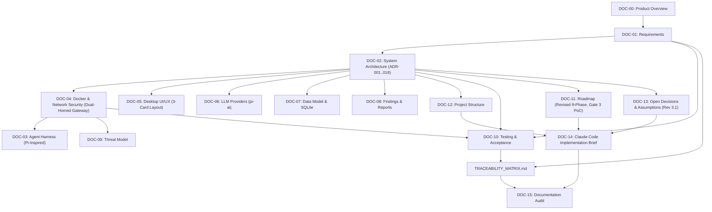

# Bletiner AI — Technical Documentation Suite & Architecture Index

**Master Suite Version:** 3.1.0 (Revision 3.1 — Technical Correction & Empirical Validation Baseline)  
**Status:** Approved Master Engineering Baseline  
**Target Systems:** Windows 10/11 (Docker Desktop WSL2), macOS 13+, Modern Linux  
**Implementation Language:** Python 3.11+ | **GUI:** PySide6 | **Sandbox:** Docker (Kali Linux)  

---

## 1. Documentation Suite Overview

Welcome to the official engineering documentation and technical specification package for **Bletiner AI** — an autonomous, evidence-driven security investigation desktop application. 

This repository contains an exhaustive, production-ready specification designed to guide human software engineers and autonomous AI coding agents (**Claude Code**) through the phased construction of the application. 

**Revision 3.1 Technical Corrections:** Following an empirical architecture review, this suite incorporates deep technical corrections and formal Architecture Decision Records (ADRs):
* **Host-Side Netns Route Injection (ADR-016):** Docker bridge networks with `internal: true` provision zero default gateways. To avoid granting `CAP_NET_ADMIN` to Kali, the host injects the default route via an ephemeral setup container attached to Kali's network namespace (`--network=container:...`), keeping Kali permanently unprivileged.
* **DNS HTTPS Record Stripping for ECH Mitigation (ADR-017):** Gateway DNS resolver intercepts port 53 and strips type 65 `HTTPS` / `SVCB` records, preventing TLS Encrypted Client Hello (ECH) from hiding the SNI and forcing transparent TLS 1.3 fallback.
* **Strict Separation of Domain SNI Proxying vs Dedicated IP Forwarding (ADR-018):** For multi-tenant CDN targets, zero raw IP forwarding rules are added; domain targets route strictly through the SNI proxy. Raw packet forwarding is enabled only for explicitly authorized dedicated IP/CIDR scopes.
* **Ambient Capabilities Verification:** Non-root user `bletiner` inherits raw socket privileges under `no_new_privs: true` via ambient capabilities (`CapAmb`), verified via `/proc/$$/status`.
* **Empirical Test Verification Standard:** Strict reporting rules requiring Test ID, exact command, expected/actual results, verdict, and raw logs, distinguishing documentation consistency from live lab execution.

### 1.1 Complete Documentation Suite Index

| Doc ID | File Name | Title & Primary Scope | Primary Audience |
|---|---|---|---|
| **DOC-00** | [00_PRODUCT_OVERVIEW.md](file:///c:/Users/Husain/Documents/Bletiner%20AI%20Desktop/docs/00_PRODUCT_OVERVIEW.md) | Product vision, target personas, core Plan-Execute-Observe loop, principles, and system glossary. | All Personas |
| **DOC-01** | [01_REQUIREMENTS.md](file:///c:/Users/Husain/Documents/Bletiner%20AI%20Desktop/docs/01_REQUIREMENTS.md) | 138 structured requirements: FR-001..088, NFR-001..026, SEC-001..027, 12 user stories, and acceptance criteria. | Developers, QA, PM |
| **DOC-02** | [02_SYSTEM_ARCHITECTURE.md](file:///c:/Users/Husain/Documents/Bletiner%20AI%20Desktop/docs/02_SYSTEM_ARCHITECTURE.md) | System context, dual-homed container topology, trust boundaries, `qasync` concurrency, and ADRs (ADR-001..ADR-018). | Architects, Developers |
| **DOC-03** | [03_AGENT_HARNESS.md](file:///c:/Users/Husain/Documents/Bletiner%20AI%20Desktop/docs/03_AGENT_HARNESS.md) | Earendil Works Pi-harness adaptation, state machine, branching session tree, event streaming, and steering queues. | Agent Engineers, Devs |
| **DOC-04** | [04_DOCKER_AND_NETWORK_SECURITY.md](file:///c:/Users/Husain/Documents/Bletiner%20AI%20Desktop/docs/04_DOCKER_AND_NETWORK_SECURITY.md) | Dual-homed bridge network, netns route injection, ambient caps, SNI/CDN egress filtering, and ECH mitigation. | Security, Devops |
| **DOC-05** | [05_DESKTOP_UI_UX.md](file:///c:/Users/Husain/Documents/Bletiner%20AI%20Desktop/docs/05_DESKTOP_UI_UX.md) | PySide6 3-card operations workspace, xterm.js terminal bridge via QtWebEngine, dark theme, and visual mockups. | Frontend/UI Engineers |
| **DOC-06** | [06_LLM_PROVIDERS_AND_MODEL_DISCOVERY.md](file:///c:/Users/Husain/Documents/Bletiner%20AI%20Desktop/docs/06_LLM_PROVIDERS_AND_MODEL_DISCOVERY.md) | `pi-ai` provider abstraction (OpenAI, Anthropic, Gemini, DeepSeek, Ollama, LM Studio), model scanner, and model locking. | AI Engineers, Devs |
| **DOC-07** | [07_DATA_MODEL_AND_SESSION_LIFECYCLE.md](file:///c:/Users/Husain/Documents/Bletiner%20AI%20Desktop/docs/07_DATA_MODEL_AND_SESSION_LIFECYCLE.md) | SQLite WAL database schema, Pydantic domain models, filesystem session trees, checkpoints, and crash recovery. | Backend Engineers |
| **DOC-08** | [08_FINDINGS_AND_REPORTING.md](file:///c:/Users/Husain/Documents/Bletiner%20AI%20Desktop/docs/08_FINDINGS_AND_REPORTING.md) | 8-stage finding lifecycle, severity/confidence scoring, Markdown and Jinja2 air-gapped HTML report specifications. | Security, Reporters |
| **DOC-09** | [09_SECURITY_THREAT_MODEL.md](file:///c:/Users/Husain/Documents/Bletiner%20AI%20Desktop/docs/09_SECURITY_THREAT_MODEL.md) | Threat model, trust boundaries, prompt injection mitigation, host/container escape defenses, and residual risk matrix. | Security Auditors |
| **DOC-10** | [10_TESTING_AND_ACCEPTANCE.md](file:///c:/Users/Husain/Documents/Bletiner%20AI%20Desktop/docs/10_TESTING_AND_ACCEPTANCE.md) | Testing pyramid, mocked Docker/LLM suites, 10-point fail-closed gateway PoC, local lab targets, and empirical verdict rules. | QA Engineers, Devs |
| **DOC-11** | [11_IMPLEMENTATION_ROADMAP.md](file:///c:/Users/Husain/Documents/Bletiner%20AI%20Desktop/docs/11_IMPLEMENTATION_ROADMAP.md) | Revised 9-phase roadmap (Phases 0 through 8), establishing the 10-point PoC as the mandatory Phase 3 exit gate. | Tech Leads, PM |
| **DOC-12** | [12_PROJECT_STRUCTURE.md](file:///c:/Users/Husain/Documents/Bletiner%20AI%20Desktop/docs/12_PROJECT_STRUCTURE.md) | Complete directory tree, module responsibilities, strict import boundaries, and coding conventions. | Developers, Architects |
| **DOC-13** | [13_OPEN_DECISIONS_AND_ASSUMPTIONS.md](file:///c:/Users/Husain/Documents/Bletiner%20AI%20Desktop/docs/13_OPEN_DECISIONS_AND_ASSUMPTIONS.md) | Confirmed decisions, Revision 3.1 audit resolutions, conservative assumptions, open questions, and risk registers. | Architects, Leads |
| **DOC-14** | [14_CLAUDE_CODE_IMPLEMENTATION_BRIEF.md](file:///c:/Users/Husain/Documents/Bletiner%20AI%20Desktop/docs/14_CLAUDE_CODE_IMPLEMENTATION_BRIEF.md) | Direct operational manual for Claude Code: 8 critical inviolable rules, reordered phase gates, and Gate 3 PoC. | Claude Code, Devs |
| **DOC-15** | [15_DOCUMENTATION_AUDIT.md](file:///c:/Users/Husain/Documents/Bletiner%20AI%20Desktop/docs/15_DOCUMENTATION_AUDIT.md) | Documentation quality audit verifying completeness, consistency, traceability, and architectural integrity. | QA Leads, Auditors |
| **MATRIX** | [TRACEABILITY_MATRIX.md](file:///c:/Users/Husain/Documents/Bletiner%20AI%20Desktop/docs/TRACEABILITY_MATRIX.md) | Bidirectional traceability mapping all 138 requirements (FR/NFR/SEC) -> Architecture -> Phase -> Test -> Verification. | QA, Compliance |

---

## 2. Recommended Reading Orders by Persona

Depending on your role and operational responsibility, follow the targeted reading sequences below to gain immediate clarity without cognitive overload.

### 2.1 For Implementing Engineers & Claude Code
*Goal: Understand exact implementation steps, coding rules, phase gates, and module boundaries.*
1. **[DOC-14: Claude Code Implementation Brief](file:///c:/Users/Husain/Documents/Bletiner%20AI%20Desktop/docs/14_CLAUDE_CODE_IMPLEMENTATION_BRIEF.md)** *(Start here — read 8 Critical Inviolable Rules and Gate 3 PoC first)*
2. **[DOC-12: Project Structure](file:///c:/Users/Husain/Documents/Bletiner%20AI%20Desktop/docs/12_PROJECT_STRUCTURE.md)** *(Scaffolding, directory tree, import rules)*
3. **[DOC-02: System Architecture](file:///c:/Users/Husain/Documents/Bletiner%20AI%20Desktop/docs/02_SYSTEM_ARCHITECTURE.md)** *(Subsystem contracts and `qasync` concurrency)*
4. **[DOC-04: Docker & Network Security](file:///c:/Users/Husain/Documents/Bletiner%20AI%20Desktop/docs/04_DOCKER_AND_NETWORK_SECURITY.md)** *(Netns route injection, ambient caps, ECH mitigation)*
5. **[DOC-03: Agent Harness](file:///c:/Users/Husain/Documents/Bletiner%20AI%20Desktop/docs/03_AGENT_HARNESS.md)** *(Pi-harness loop, 4-tier tool safety, state tree)*
6. **[DOC-07: Data Model & Session Lifecycle](file:///c:/Users/Husain/Documents/Bletiner%20AI%20Desktop/docs/07_DATA_MODEL_AND_SESSION_LIFECYCLE.md)** *(SQLite schema and Pydantic models)*
7. **[DOC-11: Implementation Roadmap](file:///c:/Users/Husain/Documents/Bletiner%20AI%20Desktop/docs/11_IMPLEMENTATION_ROADMAP.md)** *(Phase gates, Gate 3 PoC requirement)*

### 2.2 For Systems Architects & Tech Leads
*Goal: Review architectural integrity, trade-offs, concurrency models, and decision rationale.*
1. **[DOC-00: Product Overview](file:///c:/Users/Husain/Documents/Bletiner%20AI%20Desktop/docs/00_PRODUCT_OVERVIEW.md)** *(Vision, principles, boundaries)*
2. **[DOC-02: System Architecture](file:///c:/Users/Husain/Documents/Bletiner%20AI%20Desktop/docs/02_SYSTEM_ARCHITECTURE.md)** *(System context, deployment, ADRs)*
3. **[DOC-13: Open Decisions & Assumptions](file:///c:/Users/Husain/Documents/Bletiner%20AI%20Desktop/docs/13_OPEN_DECISIONS_AND_ASSUMPTIONS.md)** *(Revision 3.1 audit resolutions, trade-offs, risks)*
4. **[DOC-04: Docker & Network Security](file:///c:/Users/Husain/Documents/Bletiner%20AI%20Desktop/docs/04_DOCKER_AND_NETWORK_SECURITY.md)** *(Dual-homed gateway topology and netns routing)*
5. **[DOC-03: Agent Harness](file:///c:/Users/Husain/Documents/Bletiner%20AI%20Desktop/docs/03_AGENT_HARNESS.md)** *(Pi-harness loop state machine)*
6. **[DOC-15: Documentation Audit](file:///c:/Users/Husain/Documents/Bletiner%20AI%20Desktop/docs/15_DOCUMENTATION_AUDIT.md)** *(Cross-specification validation)*

### 2.3 For Security Auditors & Penetration Testers
*Goal: Audit threat models, prompt injection resistance, network egress controls, and non-destructive policies.*
1. **[DOC-09: Security Threat Model](file:///c:/Users/Husain/Documents/Bletiner%20AI%20Desktop/docs/09_SECURITY_THREAT_MODEL.md)** *(Assets, threat actors, attack surfaces, mitigations)*
2. **[DOC-04: Docker & Network Security](file:///c:/Users/Husain/Documents/Bletiner%20AI%20Desktop/docs/04_DOCKER_AND_NETWORK_SECURITY.md)** *(Dual-homed gateway, zero `CAP_NET_ADMIN`, ambient caps, proxy rules)*
3. **[DOC-08: Findings & Reporting](file:///c:/Users/Husain/Documents/Bletiner%20AI%20Desktop/docs/08_FINDINGS_AND_REPORTING.md)** *(XSS defenses, evidence hashing, sanitization)*
4. **[DOC-01: Requirements](file:///c:/Users/Husain/Documents/Bletiner%20AI%20Desktop/docs/01_REQUIREMENTS.md)** *(SEC-001 through SEC-027)*
5. **[DOC-10: Testing & Acceptance](file:///c:/Users/Husain/Documents/Bletiner%20AI%20Desktop/docs/10_TESTING_AND_ACCEPTANCE.md)** *(10-Point Egress PoC and empirical verification standards)*

### 2.4 For Product Managers & Stakeholders
*Goal: Understand capabilities, user workflows, investigation depth, and delivery roadmap.*
1. **[DOC-00: Product Overview](file:///c:/Users/Husain/Documents/Bletiner%20AI%20Desktop/docs/00_PRODUCT_OVERVIEW.md)** *(Vision, user personas, glossary)*
2. **[DOC-01: Requirements](file:///c:/Users/Husain/Documents/Bletiner%20AI%20Desktop/docs/01_REQUIREMENTS.md)** *(User stories, acceptance criteria)*
3. **[DOC-05: Desktop UI/UX](file:///c:/Users/Husain/Documents/Bletiner%20AI%20Desktop/docs/05_DESKTOP_UI_UX.md)** *(3-card layout and terminal experience)*
4. **[DOC-11: Implementation Roadmap](file:///c:/Users/Husain/Documents/Bletiner%20AI%20Desktop/docs/11_IMPLEMENTATION_ROADMAP.md)** *(Phases, milestones, deliverables)*

---

## 3. Document Dependency Graph

The documentation suite is strictly modular and interconnected. The Mermaid diagram below illustrates the structural dependencies across the specifications:



---

## 4. Key Architectural Constraints & Core Principles (Revision 3.1)

All contributors and implementing agents must uphold the following core principles. These are non-negotiable architectural invariants:

### 1. One Agent, Modular Internals (Pi-Harness Adaptation)
* **Single Intelligent Agent:** Bletiner AI utilizes a single autonomous agent runtime for v1 (master prompt Section 2.5). Multi-agent swarms (AutoGen, CrewAI) are prohibited to prevent non-deterministic token cascades and uncontrolled execution branches.
* **Pi-Harness Core:** The agent engine adapts the **Earendil Works Pi-harness** architecture (`pi-ai` provider normalization and `pi-agent` cyclic state machine).
* **Modular Services:** Internally, responsibilities are cleanly divided into specialized services: Planning, Reconnaissance, Analysis, Verification, Prioritization, and Reporting.

### 2. Dedicated Sandbox & Non-Root Ambient Capabilities
* **Strict 1:1:1 Isolation:** Every investigation runs inside its own dedicated Kali Linux Docker container with an independent filesystem volume (`investigations/<id>/workspace`).
* **Hardened Sandbox Boundary:**
  * Unprivileged user `bletiner` (UID 1000) under `no_new_privs: true`.
  * Preserves raw socket execution (`CAP_NET_RAW`, `CAP_NET_BIND_SERVICE`) via Linux ambient capabilities (`setpriv --ambient-caps`), verified via `grep Cap /proc/$$/status`.
  * **ZERO `CAP_NET_ADMIN` in Kali:** Kali is untrusted to firewall itself. No internal `iptables` or `nftables` commands run inside Kali.
  * Root filesystem mounted strictly read-only (`read_only=True`).
  * Temporary scratch spaces mounted via memory-backed `tmpfs`.
  * Absolute prohibition on mounting the Docker socket (`/var/run/docker.sock`).

### 3. Dual-Homed Fail-Closed Gateway & Host-Side Netns Route Injection
* **Dual-Homed Network Topology:**
  * Kali connects exclusively to `bletiner-internal-<id>` (`internal: true`, zero default route provisioned by Docker).
  * Host injects default route pointing to `bletiner-gateway` via an ephemeral setup container attached to Kali's netns (ADR-016), keeping Kali permanently unprivileged.
  * Outbound traffic routes strictly through `bletiner-gateway-<id>`, which bridges the internal network to the external network.
  * **Fail-Closed Assurance:** If the gateway container terminates, the internal network retains zero external connectivity.
* **Strict CDN Domain vs IP Forwarding Separation (ADR-018):** For domain targets, direct packet forwarding to CDN IPs is prohibited; domain targets route strictly through the SNI proxy.
* **DNS HTTPS/SVCB Record Stripping (ADR-017):** Gateway DNS resolver intercepts port 53 and strips type 65 records, preventing TLS Encrypted Client Hello (ECH) from hiding the SNI.
* **Two-Tier Redirect Validation:** Overcomes CONNECT proxy encrypted header blindness by combining Layer A client-side pre-request validation (`allow_redirects=False`) with Layer B gateway TLS SNI drops.
* **Scope Escape Protections:** Hard-blocking of loopback, RFC 1918 private subnets (unless local lab mode), link-local (`169.254.0.0/16`), cloud metadata APIs, and anti-DNS rebinding enforcement.

### 4. 4-Tier Tool Safety Classification & Structured Commands
* **Tool Risk Classification:** Tools partitioned into Tier 1 (Passive), Tier 2 (Safe Active), Tier 3 (Bounded Verification), and Tier 4 (Intrusive/Destructive).
* **INVIOLABLE SAFETY BOUNDARY:** **Tier 4 tools (masscan, sqlmap exploit, hydra) are strictly BLOCKED from autonomous agent scheduling.** They may only be invoked manually by the human operator.
* **Command Injection Immunity:** All tool executions inside Kali via Docker Exec must use structured argument arrays (`argv: list[str]`). Raw string shell concatenation (`bash -c "cmd " + arg`) is strictly forbidden.

### 5. Shared Workspace & Dual Execution
* **Dual Execution Channels:** The autonomous agent and the human operator share the *same* dedicated container:
  * Agent executes via non-interactive Docker Exec API pipes.
  * Human operator interacts via an embedded, interactive `xterm.js` PTY terminal.
* **Non-Destructive Pause:** When the operator pauses the agent, user interactive processes inside the terminal are never terminated.

### 6. Model Locking & Pluggable Provider Abstraction
* **Vendor Decoupling:** Provider adapters (`pi-ai`) normalize diverse APIs (OpenAI, Anthropic, Gemini, DeepSeek, Ollama, LM Studio, etc.) to internal `AgentMessage` types.
* **Session Model Lock:** Once an investigation begins, model parameters are locked to guarantee investigation reproducibility.
* **Zero Plaintext Secrets:** API keys are never stored in SQLite, log files, or reports. They are stored in OS-native Credential Managers (`keyring`).

### 7. Non-Destructive Default Security Policy
* **Safe Investigation:** By default, all tools operate strictly in non-destructive discovery and verification modes.
* **Prohibited Actions:** No automated exploitation, brute-force denial-of-service, remote file deletion/modification, or lateral movement payloads. Intrusive operations require explicit, separate user authorization.

### 8. Air-Gapped HTML Reporting & XSS Immunity
* **Self-Contained Artifacts:** HTML reports inline all CSS styles and SVG graphics. Zero calls to external CDNs.
* **Strict Sanitization:** Jinja2 templates enforce `autoescape=True`. Content Security Policy (`default-src 'none'`) prevents script injection from hostile target banner payloads.

---

## 5. Quickstart Guide for Engineers

To begin working with the Bletiner AI documentation and implementation repository:

```bash
# 1. Inspect the implementation brief and critical inviolable rules
cat docs/14_CLAUDE_CODE_IMPLEMENTATION_BRIEF.md

# 2. Review the project directory structure
cat docs/12_PROJECT_STRUCTURE.md

# 3. Check the open decisions and risks register
cat docs/13_OPEN_DECISIONS_AND_ASSUMPTIONS.md

# 4. Review the revised implementation roadmap and the Gate 3 PoC requirement
cat docs/11_IMPLEMENTATION_ROADMAP.md
```

---

## 6. Document Sign-Off & Authority Statement

This Documentation Index and Master Architecture Suite has been reviewed, cross-verified, and approved by the Lead Systems Architect under **Revision 3.1 (Technical Correction & Empirical Validation Baseline)**. It represents the unified source of truth for the Bletiner AI desktop application. All implementation work carried out by Claude Code must align with these specifications.
